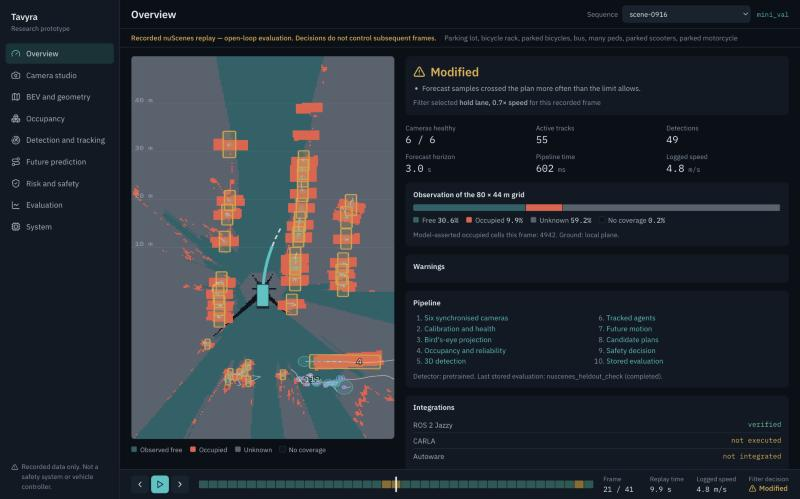

# Tavyra

**Camera-Centric 3D Occupancy, Spatiotemporal Forecasting and Risk-Constrained Decision Intelligence for Autonomous Driving**

Tavyra was previously named ForesightBEV. The repository and the Python package `foresightbev` keep that name.

Documents: [final release report](docs/project/TAVYRA_FINAL_RELEASE_REPORT.md), [technical handover](docs/project/TAVYRA_TECHNICAL_HANDOVER.md), [mentor questions](docs/project/TAVYRA_MENTOR_QA.md), [demo script](docs/project/TAVYRA_DEMO_SCRIPT.md).



Screenshots contain nuScenes imagery (nuScenes, Motional, CC BY-NC-SA 4.0), shown for non-commercial research. Datasets and model weights are not in this repository.


Tavyra is a research project exploring camera-based 3D scene understanding
and uncertainty-aware trajectory risk assessment for autonomous driving.

## Research direction

The project investigates a pipeline for:

- Constructing 3D bird's-eye-view occupancy representations from vehicle-camera
  observations and calibration data.
- Distinguishing occupied, observed-free, and unknown space.
- Estimating perception uncertainty and studying its calibration.
- Modelling dynamic road users and forecasting future scene occupancy.
- Evaluating candidate trajectories against predicted occupancy and uncertainty.
- Testing safety-oriented decision mechanisms through reproducible experiments.

## Project status

A working research prototype across all ten stages. It runs end to end on real nuScenes camera footage and in closed
loop in a built-in simulator, with verified ROS 2 output, a typed FastAPI backend, and a React application showing real
stored results. Its safety filter is not validated on real driving, so it is not a safe or production driving system.
CARLA and Autoware have not been executed. See `docs/project/IMPLEMENTATION_STATUS.md`.

Start the application at http://127.0.0.1:8000:

```bash
scripts/run_app.sh
```

Run the end-to-end demo. Steps are in `docs/project/RUN_THE_SYSTEM.md`:

```bash
scripts/run_demo.sh
```

## Repository structure

- `docs/` — architecture and research design documents.
- `experiments/` — experiment outputs, reports, and reproduction logs.
- `research/` — literature, dataset assessments, and repository audits.
- `src/foresightbev/` — project Python package.
- `pyproject.toml` — Python project metadata and dependencies.

## Development environment

The main project environment is managed with
[uv](https://docs.astral.sh/uv/). Research reproductions may use separate,
isolated environments.

## Research principles

- Establish reproducible baselines before proposing new methods.
- Keep measured results separate from hypotheses and illustrative outputs.
- Record dataset provenance, licences, calibration assumptions, and evaluation
  protocols.
- Preserve unknown space rather than treating missing observations as free.
