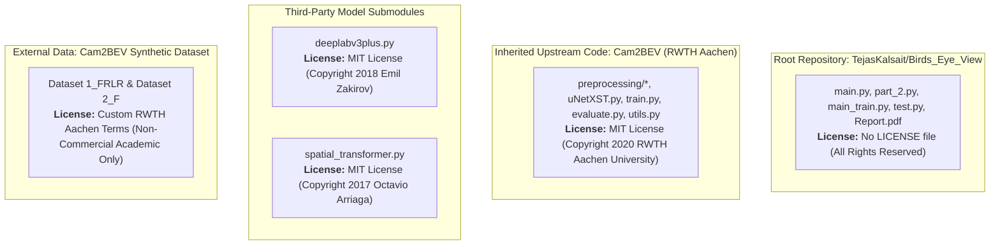

# Audit Review Addendum: Birds_Eye_View

**Project:** ForesightBEV Research Project
**Target Repository:** `Birds_Eye_View` (Tejas Kalsait et al.)
**Target Commit:** `e66817791ea897cadbf3a9093409e24ce8bc9dbc` (HEAD -> main)
**Parent Document:** [`research/repository_audits/birds_eye_view/REA_REPORT.md`](REA_REPORT.md)
**Document Purpose:** Formal technical review amendments, re-evaluations, mathematical refinements, and updated baseline recommendations.
**Investigation Mode:** Read-Only Static Codebase Audit (No source modifications, no script execution).

---

## 1. Re-Evaluation of Defect DEF-08 (Tensor Rank & Conv2d Dimension Semantics)

### 1.1 Context and Original Classification
In [`REA_REPORT.md`](REA_REPORT.md) Section 12.1, defect **DEF-08** was classified as a *Tensor Shape Bug* under the assertion that passing an unbatched 3D tensor of shape $(1, 321, 201)$ to a PyTorch `Conv2d` layer caused a dimension crash or functioned solely due to an implementation anomaly.

### 1.2 PyTorch Conv2d Input Rank Specification
Per the official PyTorch documentation (introduced in PyTorch 1.10 and formalized in PyTorch 2.x), `torch.nn.Conv2d` officially supports **two** distinct input rank formats:
1. **Batched 4D Tensor:** Shape $(N, C_{in}, H_{in}, W_{in})$
2. **Unbatched 3D Tensor:** Shape $(C_{in}, H_{in}, W_{in})$

When provided with a 3D tensor $(C_{in}, H, W)$, `nn.Conv2d` treats the sample as an unbatched single input, applies convolutions across $C_{in}$, and emits an unbatched 3D output $(C_{out}, H_{out}, W_{out})$.

### 1.3 Detailed Trace of `model/main.py` and `model/part_2.py`
Examining the actual implementation in [`model/main.py:187-238`](https://github.com/TejasKalsait/Birds_Eye_View/blob/e66817791ea897cadbf3a9093409e24ce8bc9dbc/model/main.py#L187-L238):

```python
197: temp_img = cv.imread(image_name, cv.IMREAD_GRAYSCALE)
198: temp_img = cv.resize(temp_img, (201, 321), interpolation = cv.INTER_LINEAR)
199: p2_train_data.append(temp_img)
200: p2_labels.append(1)
201:
202: part_2_inputs = torch.tensor(np.array(p2_train_data), dtype = torch.float)
203: p2_labels = torch.tensor(np.array(p2_labels), dtype = torch.long)
204:
205: part_2_dataset = TensorDataset(part_2_inputs, p2_labels)
206:
207: test_loader = DataLoader(part_2_dataset, batch_size = 1, shuffle = False)
...
234: for x, y in progress_bar(test_loader):
235:     count += 1
236:     inp_img, _ = x, y
237:     outputs = model(inp_img)
```

1. **Array Instantiation:**
   `temp_img` has shape $(H=321, W=201)$.
   `np.array(p2_train_data)` stacks $N$ images, producing a NumPy array of shape $(N, 321, 201)$.
   `part_2_inputs` is instantiated with shape $(N, 321, 201)$.
2. **Dataset & DataLoader Extraction:**
   `part_2_dataset[i]` returns an individual 2D tensor $(321, 201)$.
   `test_loader` has `batch_size = 1`. When collated by PyTorch's default collator, the batch dimension is prepended, yielding `x` of shape $(1, 321, 201)$.
3. **Forward Pass Execution:**
   Inside `CNN.forward(self, x)` ([`model/main.py:164-177`](https://github.com/TejasKalsait/Birds_Eye_View/blob/e66817791ea897cadbf3a9093409e24ce8bc9dbc/model/main.py#L164-L177)):
   ```python
   166: x = nn.functional.relu(self.conv1(x))
   ```
   `self.conv1` is defined as `nn.Conv2d(1, 32, kernel_size=3, padding=0)` ([`model/main.py:157`](https://github.com/TejasKalsait/Birds_Eye_View/blob/e66817791ea897cadbf3a9093409e24ce8bc9dbc/model/main.py#L157)).
   Because `x` has shape $(1, 321, 201)$ (a 3D tensor), PyTorch evaluates it under the **unbatched 3D signature**:
   $$C_{in} = 1, \quad H_{in} = 321, \quad W_{in} = 201$$
   Since $C_{in} = 1$ matches `conv1.in_channels = 1`, the operation completes without a shape mismatch, producing an unbatched output $(32, 159, 99)$.
   Subsequent layers proceed symmetrically:
   - `conv2` + pool $\to (64, 78, 48)$
   - `conv3` + pool $\to (128, 38, 23)$
   - Line 172: `x = x.view(-1, 111872)` produces a 2D tensor $(1, 111872)$.
   - `fc1`, `fc2`, `fc3` output a tensor of shape $(1, 3)$.

### 1.4 True Vulnerability: Batch Size Brittleness (Rank Conflation)
While this execution succeeds when `batch_size = 1`, the data pipeline exhibits severe structural fragility due to **rank conflation** (omitting the channel dimension $C=1$):
- If `batch_size` is increased to any value $B > 1$ (e.g. `batch_size = 4`), `DataLoader` collates samples into a 3D tensor of shape $(4, 321, 201)$.
- PyTorch interprets this 3D tensor as unbatched with $C_{in} = 4$.
- `self.conv1(x)` immediately raises a runtime exception:
  `RuntimeError: Given groups=1, weight of size [32, 1, 3, 3], expected input[4, 321, 201] to have 1 channels, but got 4 channels instead`.

### 1.5 Amended Classification
**DEF-08 is downgraded from a "Fatal Runtime Bug" to "Architectural Fragility: Missing Channel Dimension (Improper Tensor Rank Specification)".**
The code executes successfully under its hardcoded `batch_size = 1` constraint because PyTorch natively permits unbatched 3D inputs where $C_{in}=1$. However, the absence of an explicit channel dimension (`unsqueeze(1)` or `(N, 1, H, W)`) violates PyTorch batch-processing standards and prevents scaling batch size during training or vectorized evaluation.

---

## 2. Refinement of DEF-06 (Framework Co-Location vs. True Compatibility Hazards)

### 2.1 Re-Assessment of Framework Co-Location
In [`REA_REPORT.md`](REA_REPORT.md) Section 11.1 and DEF-06, it was asserted that co-locating TensorFlow and PyTorch in a single process creates *"unresolvable GPU context and memory conflicts."*

This claim must be refined. In contemporary deep learning pipelines (e.g., model converters, Hugging Face validation harnesses, and cross-framework distillation loops), TensorFlow and PyTorch frequently execute within the same Python process. Co-location is **not** inherently impossible.

### 2.2 Genuine Operational & Engineering Hazards in `Birds_Eye_View`
The true risks associated with [`model/main.py:10,129`](https://github.com/TejasKalsait/Birds_Eye_View/blob/e66817791ea897cadbf3a9093409e24ce8bc9dbc/model/main.py#L10) stem from specific unmanaged resource allocation and pinned package constraints:

1. **Greedy CUDA VRAM Allocation:**
   - By default, TensorFlow attempts to allocate nearly the entire available GPU VRAM upon initialization unless `tf.config.experimental.set_memory_growth(gpu, True)` or a virtual memory limit is configured.
   - In [`model/main.py`](https://github.com/TejasKalsait/Birds_Eye_View/blob/e66817791ea897cadbf3a9093409e24ce8bc9dbc/model/main.py), no memory growth limits are set.
   - When TensorFlow completes its uNetXST predictions at line 119 and execution advances to PyTorch at line 129, PyTorch attempts to initialize its own CUDA caching allocator. Because TensorFlow has already locked the GPU's memory address space, PyTorch frequently fails with an unhandled CUDA Out-Of-Memory (OOM) error on consumer GPUs with $\le 8\text{ GB}$ VRAM.
2. **CUDA & C++ Runtime Library Incompatibilities:**
   - Pinned `tensorflow==2.5.0` ([`requirements.txt:8`](https://github.com/TejasKalsait/Birds_Eye_View/blob/e66817791ea897cadbf3a9093409e24ce8bc9dbc/requirements.txt#L8)) requires CUDA 11.2 and cuDNN 8.1.
   - Pinned `pytorch` ([`requirements.txt:10`](https://github.com/TejasKalsait/Birds_Eye_View/blob/e66817791ea897cadbf3a9093409e24ce8bc9dbc/requirements.txt#L10)) is unpinned, meaning modern `pip install` resolves to PyTorch 2.x compiled against CUDA 11.8 or 12.x.
   - Dynamic linking of disparate CUDA runtime libraries (`libcudart`, `libcublas`) into a single address space can trigger symbol collisions or driver segfaults.
3. **Python Environment Obsoletion:**
   - `tensorflow==2.5.0` was deprecated in 2021 and lacks official wheels for Python $\ge 3.10$ or macOS ARM64 (Apple Silicon).
   - Attempting to construct a unified Python virtual environment containing both `tensorflow==2.5.0` and modern `torch` introduces insoluble dependency resolver conflicts (e.g. `numpy`, `protobuf`, `typing-extensions`).

### 2.3 Amended Classification
**DEF-06 is refined to: "Operational Memory Contention and Dependency Conflict (Unmanaged VRAM & Dual-Framework Packaging)".**
The defect is not that TensorFlow and PyTorch cannot coexist in Python, but that [`model/main.py`](https://github.com/TejasKalsait/Birds_Eye_View/blob/e66817791ea897cadbf3a9093409e24ce8bc9dbc/model/main.py) fails to configure TensorFlow memory growth, couples unpinned PyTorch with deprecated TensorFlow 2.5, and chains two disparate frameworks sequentially in a single script without process isolation or explicit device memory management.

---

## 3. Geometric Formulation of Off-Plane Homography Projection Error

### 3.1 Correction of "Infinite Distortion" Language
Section 9.1 of [`REA_REPORT.md`](REA_REPORT.md) stated that *"all 3D objects are distorted radially towards infinity."* This phrasing is mathematically imprecise. Objects extending above the ground plane do not project to infinity unless the optical ray is parallel to the ground surface. Instead, off-plane points undergo a **finite, calculable geometric displacement** governed by camera elevation and object height.

### 3.2 Exact Mathematical Derivation of Off-Plane Displacement

Consider a calibrated vehicle camera with center of projection $C = (X_c, Y_c, Z_c)^T$ in the vehicle body coordinate frame (where $Z_w$ is the upward vertical axis).

The reference road plane is defined as:
$$\Pi_0: Z_w = 0$$

Let an elevated 3D point (e.g. the roof of a vehicle, pedestrian head, or curb edge) be situated at:
$$P = \begin{bmatrix} X_w \\ Y_w \\ h \end{bmatrix}, \quad h > 0$$

```text
Geometric Diagram of Off-Plane Projection Error:

                       Camera Center C (Xc, Yc, Zc)
                                  ●
                                 /│
                                / │
                               /  │
                              /   │
                             /    │
                            /     │
          Elevated Point P ●      │
          (Xw, Yw, h)     /│      │
                         / │      │
                        /  │      │
                       /   │      │
  ────────────────────/────┴──────┴──────────────────────> Ground Plane Z = 0
             P_proj  ●     P_base C_nadir
           (Xproj, Yproj)  (Xw, Yw) (Xc, Yc)
                     |<───>|
                     Displacement Delta
```

1. **Optical Ray Equation:**
   The parametric optical ray originating at camera center $C$ and passing through elevated point $P$ is:
   $$\mathbf{r}(\lambda) = C + \lambda (P - C) = \begin{bmatrix} X_c + \lambda(X_w - X_c) \\ Y_c + \lambda(Y_w - Y_c) \\ Z_c + \lambda(h - Z_c) \end{bmatrix}, \quad \lambda \ge 0$$
2. **Ground Plane Intersection:**
   Inverse Perspective Mapping evaluates the intersection of this optical ray with the ground plane $\Pi_0$ ($Z = 0$):
   $$Z_c + \lambda(h - Z_c) = 0 \implies \lambda = \frac{Z_c}{Z_c - h}$$
   *(Note: This intersection exists in front of the camera provided the point lies below camera altitude, $h < Z_c$.)*
3. **Projected Ground Plane Coordinates:**
   Substituting $\lambda$ yields the apparent BEV location $P_{proj} = (X_{proj}, Y_{proj}, 0)^T$:
   $$X_{proj} = X_c + \left(\frac{Z_c}{Z_c - h}\right)(X_w - X_c)$$
   $$Y_{proj} = Y_c + \left(\frac{Z_c}{Z_c - h}\right)(Y_w - Y_c)$$
4. **Displacement Vector ($\Delta$):**
   The geometric projection error $\Delta = P_{proj} - P_{base}$ relative to the ground nadir of the object $P_{base} = (X_w, Y_w, 0)^T$ is:
   $$\Delta = \begin{bmatrix} X_{proj} - X_w \\ Y_{proj} - Y_w \end{bmatrix} = \left(\frac{Z_c}{Z_c - h} - 1\right) \begin{bmatrix} X_w - X_c \\ Y_w - Y_c \end{bmatrix}$$
   $$\Delta = \left(\frac{h}{Z_c - h}\right) \begin{bmatrix} X_w - X_c \\ Y_w - Y_c \end{bmatrix}$$

### 3.3 Physical Implications for Vehicle Cameras
In dataset `1_FRLR`, the front camera height is $Z_c = 1.4\text{ m}$ ([`preprocessing/camera_configs/1_FRLR/front.yaml:15`](https://github.com/TejasKalsait/Birds_Eye_View/blob/e66817791ea897cadbf3a9093409e24ce8bc9dbc/preprocessing/camera_configs/1_FRLR/front.yaml#L15)):
- **Ground points ($h = 0$):** $\Delta = 0$. Road markings and flat lane boundaries project with zero error.
- **Low obstacles ($h = 0.2\text{ m}$, e.g. a curb):**
  $\frac{h}{Z_c - h} = \frac{0.2}{1.4 - 0.2} = \frac{0.2}{1.2} \approx 0.167$. The curb top is displaced radially outward from the camera by $\approx 16.7\%$ of its ground distance.
- **Standard vehicles ($h = 1.2\text{ m}$):**
  $\frac{h}{Z_c - h} = \frac{1.2}{1.4 - 1.2} = 6.0$. The roof of a vehicle at ground distance $10\text{ m}$ is projected $60\text{ m}$ behind its true base, generating severe radial elongation.
- **Asymptote ($h \to Z_c$):** Displacement approaches infinity only when obstacle height approaches camera mount elevation ($h \to 1.4\text{ m}$), where the optical ray becomes near-parallel to the ground plane.
- **Points above camera height ($h > Z_c$):** $\lambda < 0$; the ray through the upper boundary never intersects the ground in front of the vehicle, projecting behind the camera plane and requiring geometric clipping ([`preprocessing/ipm/ipm.py:161-164`](https://github.com/TejasKalsait/Birds_Eye_View/blob/e66817791ea897cadbf3a9093409e24ce8bc9dbc/preprocessing/ipm/ipm.py#L161-L164)).

---

## 4. Decoupling Classifier Predictions from Arrow Visualization Mismatch

### 4.1 Diagnostic Separation: Network Logits vs. OpenCV Drawing
Section 8.4 and DEF-03 in [`REA_REPORT.md`](REA_REPORT.md) noted that the arrow overlay logic in [`model/main.py:251-260`](https://github.com/TejasKalsait/Birds_Eye_View/blob/e66817791ea897cadbf3a9093409e24ce8bc9dbc/model/main.py#L251-L260) completely inverted directional indicators.

It is critical to distinguish between two independent layers:
1. **The Latent Classifier Representation (Network Logits & Argmax):** The discrete integer class prediction produced by the PyTorch CNN model.
2. **The Post-Processing Rendering Layer (`cv2.arrowedLine`):** The graphical primitive used to depict that prediction on an output canvas.

### 4.2 Evidence of Isolated Visualization Failure
Tracing [`model/main.py:240-262`](https://github.com/TejasKalsait/Birds_Eye_View/blob/e66817791ea897cadbf3a9093409e24ce8bc9dbc/model/main.py#L240-L262):
```python
240: outputs = model(inp_img)
242: which_direction = torch.argmax(outputs)
244: which_direction = which_direction.detach().numpy()
247: print("Direction is", Fore.RED, which_direction, Fore.RESET)
251: if which_direction == 0:
253:     arrow_image = cv2.arrowedLine(inp_img.detach().numpy().reshape(321, 201, 1), (160, 100), (160, 50), (255, 0, 0), 3)
255: elif which_direction == 1:
257:     arrow_image = cv2.arrowedLine(inp_img.detach().numpy().reshape(321, 201, 1), (160, 100), (190, 100), (255, 0, 0), 3)
259: else:
261:     arrow_image = cv2.arrowedLine(inp_img.detach().numpy().reshape(321, 201, 1), (160, 100), (160, 150), (255, 0, 0), 3)
```

- In [`model/part_2.py:89-93`](https://github.com/TejasKalsait/Birds_Eye_View/blob/e66817791ea897cadbf3a9093409e24ce8bc9dbc/model/part_2.py#L89-L93), the training dataset targets were ingested directly as integer strings (`curr_label = root.find('object/name').text`).
- Per [Report.pdf](https://github.com/TejasKalsait/Birds_Eye_View/blob/e66817791ea897cadbf3a9093409e24ce8bc9dbc/Report.pdf) Section 4.3.1:
  - Label `0` = Left
  - Label `1` = Straight
  - Label `2` = Right
- During evaluation, `outputs = model(inp_img)` computes logits across the 3 classes. `torch.argmax(outputs)` reliably extracts the model's highest-probability index ($0, 1,$ or $2$).
- At line 247, `print("Direction is", which_direction)` prints the exact integer class predicted by the network.

The flaw occurs **strictly within lines 251–261**:
The author mapped OpenCV pixel coordinates $(x, y) = (\text{column}, \text{row})$ erroneously:
- `which_direction == 0` draws from $(160, 100) \to (160, 50)$ ($\Delta x = 0, \Delta y = -50$, upward vector $\implies$ Straight).
- `which_direction == 1` draws from $(160, 100) \to (190, 100)$ ($\Delta x = +30, \Delta y = 0$, rightward vector $\implies$ Right).
- `which_direction == 2` draws from $(160, 100) \to (160, 150)$ ($\Delta x = 0, \Delta y = +50$, downward vector $\implies$ Reverse).

### 4.3 Conclusion
The classifier's mathematical weights, internal representations, and printed terminal outputs (`Direction is 0`) are **not corrupted by the drawing code**. The bug is strictly a **presentation-layer coordinate mapping error** between the integer decision and the rendered graphical arrow.

---

## 5. Comprehensive Intellectual Property & Data Licensing Audit

To establish strict legal provenance for the ForesightBEV project, the software components and datasets must be decomposed into their distinct legal regimes:



### 5.1 Exact Component Licensing Breakdown

| Subsystem | Exact Location | Copyright Holder | License Type | Terms & Commercial Restrictions |
|---|---|---|---|---|
| **Root Repository Extensions** | Root directory, `model/main.py`, `model/part_2.py`, `model/main_train.py`, `model/test.py` | Tejas Kalsait et al. (University at Buffalo) | **No License (All Rights Reserved)** | No express grant of copyright. Under GitHub Terms of Service, code can be viewed/forked, but commercial reuse or derivative distribution requires explicit permission. |
| **Cam2BEV Base Implementation** | `preprocessing/ipm/*`, `preprocessing/occlusion/*`, `preprocessing/homography_converter/*`, `model/architecture/uNetXST.py`, `model/train.py`, `model/evaluate.py`, `model/utils.py` | Institute for Automotive Engineering (ika), RWTH Aachen University | **MIT License** ([`preprocessing/ipm/ipm.py:3-24`](https://github.com/TejasKalsait/Birds_Eye_View/blob/e66817791ea897cadbf3a9093409e24ce8bc9dbc/preprocessing/ipm/ipm.py#L3-L24)) | Permissive open-source license. Allows commercial use, modification, and sublicensing provided original copyright and permission notice are preserved. |
| **DeepLabv3+ Layer** | `model/architecture/third_party/deeplabv3plus.py` | Emil Zakirov (`keras-deeplab-v3-plus`) | **MIT License** ([`model/architecture/third_party/deeplabv3plus.py:1-6`](https://github.com/TejasKalsait/Birds_Eye_View/blob/e66817791ea897cadbf3a9093409e24ce8bc9dbc/model/architecture/third_party/deeplabv3plus.py#L1-L6)) | Permissive open-source license. |
| **Spatial Transformer Layer** | `model/architecture/third_party/spatial_transformer.py` | Octavio Arriaga (`STN.keras`) | **MIT License** ([`model/architecture/third_party/spatial_transformer.py:1-6`](https://github.com/TejasKalsait/Birds_Eye_View/blob/e66817791ea897cadbf3a9093409e24ce8bc9dbc/model/architecture/third_party/spatial_transformer.py#L1-L6)) | Permissive open-source license. |
| **Cam2BEV Synthetic Dataset** | External download via RWTH Aachen GitLab (`data/download.sh`) | RWTH Aachen University (ika) | **Custom Non-Commercial Research Terms** | **Strictly Non-Commercial.** Free for academic research, teaching, and scientific publications. Mandatory citation of ITSC 2020 paper. **Cannot be used to train commercial robotics products.** |

### 5.2 Legal Guidance for ForesightBEV
- **Code Reuse:** Core mathematical utilities from `Cam2BEV` (`ipm.py`) can be cleanly adapted under MIT License terms with proper RWTH Aachen attribution.
- **Dataset Prohibition:** The Cam2BEV dataset **must not** be utilized for training production or commercial ForesightBEV models. ForesightBEV must utilize commercially permissible datasets (e.g. nuScenes under CC BY-NC-SA for research vs. commercial permissive datasets, or in-house synthetic CARLA/Isaac Sim datasets created under clean commercial licenses).

---

## 6. Corrected Architectural Baseline for Single-Camera RGB-D Robotics

### 6.1 Re-Assessment of LSS and BEVFormer
In [`REA_REPORT.md`](REA_REPORT.md) Section 10, Lift-Splat-Shoot (LSS) and BEVFormer were proposed as immediate replacements for `uNetXST`.

This recommendation is refined:
- **LSS (Philion & Baker, ECCV 2020)** and **BEVFormer (Li et al., ECCV 2022)** were developed to solve the **ill-posed depth estimation problem** in multi-camera RGB-only autonomous driving (e.g., nuScenes surround rigs). LSS trains a neural network to infer a categorical depth distribution along optical rays to lift 2D image features into 3D space.
- In **RGB-D mobile robotics**, the robot is equipped with a sensor that **physically measures metric depth** (e.g., active stereo, structured light, or time-of-flight depth cameras such as Intel RealSense D435i/D455 or Orbbec Femto).
- Employing an unconstrained neural depth predictor (like LSS) on a robot that already possesses calibrated hardware depth introduces unnecessary inference latency, model hallucination, and metric scale uncertainty.
- Therefore, LSS and BEVFormer represent **secondary multi-camera research alternatives**, not the direct architectural replacement for an RGB-D robotics platform.

---

## 7. Recommended Geometry Baseline: Explicit Metric-Depth Back-Projection

### 7.1 Mathematical Specification of the Baseline
For ForesightBEV's primary RGB-D sensor pipeline, the foundational geometry module must be **analytical metric-depth back-projection followed by point-cloud voxel rasterization**.

```text
ForesightBEV Recommended Geometric Baseline Pipeline:

RGB Image (H, W, 3) ──┐
                      ├──> Pixel Alignment ──> Unproject to Camera Frame ──> Extrinsic Transform ──> Voxel Rasterization ──> 2D BEV Costmap
Depth Map (H, W)    ──┘      (u, v, d)              (Xc, Yc, Zc)                (Xb, Yb, Zb)          (Nx, Ny Voxel Grid)       (Metric Grid)
```

1. **Analytical Back-Projection (Pinhole De-Projection):**
   Given calibrated camera intrinsic parameters $f_x, f_y, p_x, p_y$ and measured depth $d = D(u, v) \in [\epsilon, d_{max}]$ at pixel $(u, v)$:
   $$X_c = \frac{u - p_x}{f_x} \cdot d$$
   $$Y_c = \frac{v - p_y}{f_y} \cdot d$$
   $$Z_c = d$$
2. **Extrinsic Transformation to Robot Base Frame:**
   Given the calibrated extrinsic transform $T_{base\_cam} = \begin{bmatrix} R & t \\ \mathbf{0}^T & 1 \end{bmatrix}$ (incorporating dynamic pitch/roll compensation from IMU odometry):
   $$\begin{bmatrix} X_{base} \\ Y_{base} \\ Z_{base} \end{bmatrix} = R \begin{bmatrix} X_c \\ Y_c \\ Z_c \end{bmatrix} + t$$
3. **Point-Cloud Voxel Rasterization (BEV Grid Generation):**
   Discretize the robot-centric horizontal space into a metric grid with spatial resolution $\Delta x = \Delta y = 0.05\text{ m}$ (5 cm/cell):
   $$i = \left\lfloor \frac{X_{base} - X_{min}}{\Delta x} \right\rfloor, \quad j = \left\lfloor \frac{Y_{base} - Y_{min}}{\Delta y} \right\rfloor$$
   Assign points to height bands:
   - Ground plane / drivable: $Z_{base} \in [z_{ground} - \delta, z_{ground} + \delta]$
   - Obstacle / non-traversable: $Z_{base} \in [z_{obstacle\_min}, z_{obstacle\_max}]$
   - Overhanging / traversable clearance: $Z_{base} > z_{obstacle\_max}$

### 7.2 Advantages of the Analytical Baseline
1. **Zero Hallucination:** Metric depth is physically anchored; obstacle boundaries correspond directly to measured physical surfaces.
2. **Terrain Invariance:** Ramps, curbs, sloped floors, and pitch/roll variations are handled through true 3D coordinates ($Z_{base}$), completely resolving the planar homography smearing that crippled `uNetXST`.
3. **High Efficiency:** The unprojection operation can be implemented as a vectorized NumPy/PyTorch tensor calculation or an edge GPU shader running at 60+ Hz on NVIDIA Jetson hardware.
4. **Benchmarking Foundation:** Provides an unambiguous, deterministic baseline against which any subsequent learned occupancy forecasting networks must be evaluated.

---

## 8. Occlusion Ray-Casting Strategy: Profiling Before Acceleration

### 8.1 Re-Assessment of CUDA Ray-Casting
[`REA_REPORT.md`](REA_REPORT.md) recommended immediately re-implementing [`preprocessing/occlusion/occlusion.py`](https://github.com/TejasKalsait/Birds_Eye_View/blob/e66817791ea897cadbf3a9093409e24ce8bc9dbc/preprocessing/occlusion/occlusion.py) in C++/CUDA.

This recommendation is deferred in accordance with sound engineering practice:
- The existing implementation in [`preprocessing/occlusion/occlusion.py:110-148`](https://github.com/TejasKalsait/Birds_Eye_View/blob/e66817791ea897cadbf3a9093409e24ce8bc9dbc/preprocessing/occlusion/occlusion.py#L110-L148) utilizes an iterative Python `for` loop over `skimage.draw.line` pixels and `cv2.floodFill` calls. While slow, it is used **strictly as an offline dataset preparation tool**, not as an online inference component.
- Premature optimization into custom C++/CUDA kernels introduces maintenance overhead, build system complexity, and platform portability barriers.

### 8.2 Two-Stage Implementation Roadmap for Occlusion Handling
1. **Stage A: Vectorized Python Reference Implementation:**
   - Develop a clean, vectorized Python reference module using NumPy or PyTorch grid operations.
   - Profile throughput across representative dataset batches (measuring milliseconds per frame and CPU core utilization).
   - Evaluate whether vectorized NumPy or PyTorch grid-sampling satisfies offline generation requirements.
2. **Stage B: Targeted Acceleration (Only If Profiled as Bottleneck):**
   - If offline generation or online costmap ray-tracing constitutes an empirical bottleneck ($> 15\text{ ms/frame}$ for online or $> 10\text{ hours}$ for offline dataset processing), profile the specific hot paths.
   - Accelerate identified bottlenecks using Numba JIT compiling or CuPy before undertaking full native C++/CUDA kernel development.

---

## 9. Updated Component Reuse Decision Table

This table supersedes Section 10 of [`REA_REPORT.md`](REA_REPORT.md):

| Component / Subsystem | Upstream Source Location | Decision | Detailed Rationale & ForesightBEV Replacement |
|---|---|---|---|
| **Camera Extrinsic & Intrinsic Math** | [`preprocessing/ipm/ipm.py:36-73`](https://github.com/TejasKalsait/Birds_Eye_View/blob/e66817791ea897cadbf3a9093409e24ce8bc9dbc/preprocessing/ipm/ipm.py#L36-L73) | **ADAPT / REFERENCE** | Pinhole projection math and axis permutation matrix $R_s$ are mathematically correct and standard. Re-implement cleanly in a PyTorch/NumPy robotics geometry module. |
| **Occlusion Line-of-Sight Formulation** | [`preprocessing/occlusion/occlusion.py:110-148`](https://github.com/TejasKalsait/Birds_Eye_View/blob/e66817791ea897cadbf3a9093409e24ce8bc9dbc/preprocessing/occlusion/occlusion.py#L110-L148) | **ADAPT (PYTHON FIRST)** | Adopt the physical concept of ray-casting behind blocking obstacles to supervise unobserved spatial volumes. Build a clean Python reference; profile before developing accelerated kernels. |
| **Planar Homography Generator** | [`preprocessing/ipm/ipm.py:141-147`](https://github.com/TejasKalsait/Birds_Eye_View/blob/e66817791ea897cadbf3a9093409e24ce8bc9dbc/preprocessing/ipm/ipm.py#L141-L147) | **DISCARD** | Planar IPM ($Z_w = 0$) causes severe elevation distortion on elevated obstacles. Unsuitable for 3D robotics navigation. |
| **Spatial Transformer Homography Converter** | [`preprocessing/homography_converter/*`](https://github.com/TejasKalsait/Birds_Eye_View/blob/e66817791ea897cadbf3a9093409e24ce8bc9dbc/preprocessing/homography_converter/homography_converter.py) | **DISCARD** | Tied to legacy Keras STN coordinate normalizations and planar warping. |
| **uNetXST Segmentation Network** | [`model/architecture/uNetXST.py`](https://github.com/TejasKalsait/Birds_Eye_View/blob/e66817791ea897cadbf3a9093409e24ce8bc9dbc/model/architecture/uNetXST.py) | **DISCARD** | Legacy TensorFlow 2.5 architecture utilizing fixed 2D planar homographies. Replaced by metric depth back-projection and PyTorch-native BEV perception. |
| **DeepLabv3+ Backbones** | [`model/architecture/deeplab_*.py`](https://github.com/TejasKalsait/Birds_Eye_View/blob/e66817791ea897cadbf3a9093409e24ce8bc9dbc/model/architecture/deeplab_mobilenet.py) | **DISCARD** | Single-input 2D segmentation models requiring pre-warped/stitched inputs; incapable of true multi-modal 3D spatial reasoning. |
| **Stage 2 CNN Classifier** | [`model/main.py:151-177`](https://github.com/TejasKalsait/Birds_Eye_View/blob/e66817791ea897cadbf3a9093409e24ce8bc9dbc/model/main.py#L151-L177), [`model/part_2.py`](https://github.com/TejasKalsait/Birds_Eye_View/blob/e66817791ea897cadbf3a9093409e24ce8bc9dbc/model/part_2.py) | **DISCARD** | Ad-hoc discrete 3-way classifier with missing weights, batch-size brittleness, and inverted visualization logic. Robotics navigation requires continuous 2D/3D costmaps and trajectory planners (e.g. Nav2). |
| **Training & Evaluation Pipelines** | [`model/train.py`](https://github.com/TejasKalsait/Birds_Eye_View/blob/e66817791ea897cadbf3a9093409e24ce8bc9dbc/model/train.py), [`model/evaluate.py`](https://github.com/TejasKalsait/Birds_Eye_View/blob/e66817791ea897cadbf3a9093409e24ce8bc9dbc/model/evaluate.py) | **REBUILD** | Replace with modern PyTorch Lightning or PyTorch native pipelines supporting multi-modal inputs, mixed precision, and standard robotics validation metrics. |
| **Colab Wrapper Scripts** | [`model/main_train.py`](https://github.com/TejasKalsait/Birds_Eye_View/blob/e66817791ea897cadbf3a9093409e24ce8bc9dbc/model/main_train.py), [`model/test.py`](https://github.com/TejasKalsait/Birds_Eye_View/blob/e66817791ea897cadbf3a9093409e24ce8bc9dbc/model/test.py) | **DISCARD** | Incomplete notebook exports containing fatal Python syntax errors. |

---

## 10. Open Technical Questions for ForesightBEV

1. **RGB-D vs. Multi-Camera Trade-Off:**
   Given that ForesightBEV targets mobile robotics, under what operational scenarios (e.g. outdoor direct sunlight blinding infrared structured-light sensors vs. indoor navigation) does an analytical metric back-projection pipeline require learned depth completion or multi-view learned fusion?
2. **Dynamic Pitch/Roll Compensation:**
   In autonomous ground robotics, chassis acceleration, braking, and surface irregularities induce dynamic pitch and roll oscillations. How should IMU high-frequency odometry be coupled with camera extrinsic matrices to maintain stabilized metric BEV grids in real time?
3. **Temporal Occupancy State Representation:**
   The audited repository processes each timestep in isolation ($T=1$). For dynamic obstacle forecasting and collision avoidance, should ForesightBEV accumulate point clouds across time using a rolling ego-motion buffer, or maintain a recurrent hidden state (e.g., ConvGRU / Spatial-Temporal Transformer) over the BEV grid?
4. **Voxel Grid Elevation Granularity:**
   For navigation planning (Nav2), is a 2D multi-layer height map (ground traversability, positive obstacles, negative obstacles/drops) sufficient, or does 3D robot manipulation and arm avoidance require a fully 3D discretized occupancy voxel grid ($X \times Y \times Z$)?
5. **Occlusion Supervision in 3D:**
   How can the 2D line-of-sight occlusion ray-casting concept from `occlusion.py` be extended to 3D frustum ray-casting to explicitly distinguish between "free/observed space", "occupied space", and "unobserved/occluded space" in the robot's local metric costmap?
