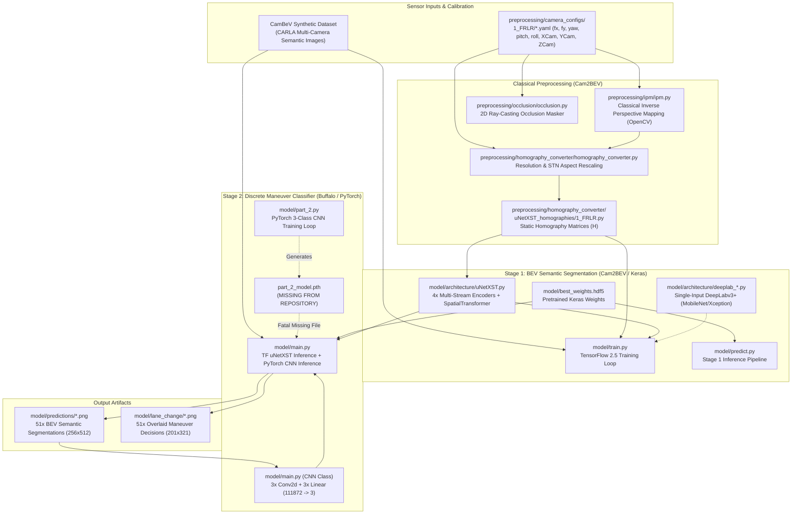
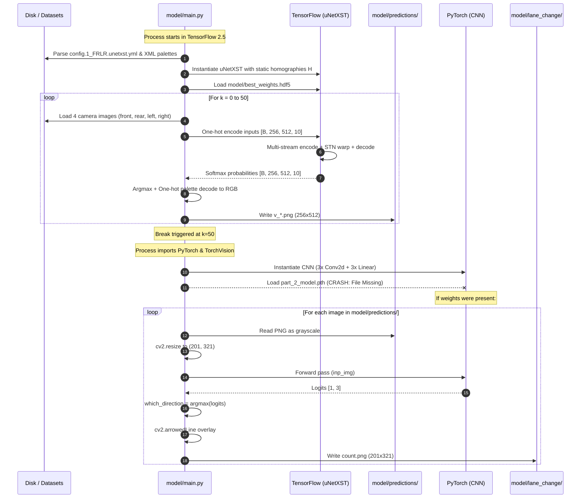

# Reverse Engineering Audit Report: Birds_Eye_View

**Project:** ForesightBEV Research Audit
**Target Repository:** `Birds_Eye_View`
**Repository URL:** [https://github.com/TejasKalsait/Birds_Eye_View](https://github.com/TejasKalsait/Birds_Eye_View)
**Target Commit Audited:** `e66817791ea897cadbf3a9093409e24ce8bc9dbc` (HEAD -> main)
**Authors / Contributors:** Tejas Pankaj Kalsait, Athindra Bandi, Samarth Gangwal, Lakshmi Ramaswamy Vishwanath (University at Buffalo)
**Upstream Provenance:** Derivative work based directly on `Cam2BEV` by Lennart Reiher, Bastian Lampe, and Lutz Eckstein (Institute for Automotive Engineering - ika, RWTH Aachen University, ITSC 2020)
**Audit Date:** November 2026
**Auditor Mode:** Read-Only Static Reverse-Engineering & Source Code Verification

---

## Table of Contents

1. [Executive Summary & Core Audit Findings](#1-executive-summary--core-audit-findings)
2. [Repository Architecture & Source Lineage](#2-repository-architecture--source-lineage)
   - [2.1 Lineage & Provenance Decomposition](#21-lineage--provenance-decomposition)
   - [2.2 Repository Directory Topology](#22-repository-directory-topology)
   - [2.3 Repository Architecture Diagram](#23-repository-architecture-diagram)
3. [Execution Flow & Pipeline Tracing](#3-execution-flow--pipeline-tracing)
   - [3.1 Offline Preprocessing Pipeline](#31-offline-preprocessing-pipeline)
   - [3.2 Stage 1 Training & Inference Pipeline (BEV Generation)](#32-stage-1-training--inference-pipeline-bev-generation)
   - [3.3 Stage 2 Training & Inference Pipeline ("Blind Spot" / Lane Change)](#33-stage-2-training--inference-pipeline-blind-spot--lane-change)
   - [3.4 End-to-End Execution & Data-Flow Diagram](#34-end-to-end-execution--data-flow-diagram)
4. [File-by-File Module Audit & Technical Inspection](#4-file-by-file-module-audit--technical-inspection)
   - [4.1 Preprocessing Modules](#41-preprocessing-modules)
   - [4.2 Model Architecture Modules](#42-model-architecture-modules)
   - [4.3 Model Runtime, Training, & Inference Scripts](#43-model-runtime-training--inference-scripts)
   - [4.4 Configuration & Conversion Assets](#44-configuration--conversion-assets)
5. [Mathematical Derivation of the BEV Transformation](#5-mathematical-derivation-of-the-bev-transformation)
   - [5.1 Camera Projection Geometry & World Coordinates](#51-camera-projection-geometry--world-coordinates)
   - [5.2 Planar Road-to-Camera Mapping Matrix](#52-planar-road-to-camera-mapping-matrix)
   - [5.3 Analytical Inverse Perspective Mapping (IPM) Homography](#53-analytical-inverse-perspective-mapping-ipm-homography)
   - [5.4 SpatialTransformer Grid Transformation & Aspect-Ratio Adjustment](#54-spatialtransformer-grid-transformation--aspect-ratio-adjustment)
   - [5.5 Verification: Constant vs. Learned Homography](#55-verification-constant-vs-learned-homography)
6. [Model Architecture & Training Audit](#6-model-architecture--training-audit)
   - [6.1 Stage 1: uNetXST Architecture](#61-stage-1-unetxst-architecture)
   - [6.2 Stage 1 Alternative: DeepLabv3+ (MobileNetV2 & Xception)](#62-stage-1-alternative-deeplabv3-mobilenetv2--xception)
   - [6.3 Stage 2: Lane Changing CNN Architecture](#63-stage-2-lane-changing-cnn-architecture)
   - [6.4 Loss Functions, Optimization, & Training Dynamics](#64-loss-functions-optimization--training-dynamics)
7. [Data Pipeline & Dataset Specification](#7-data-pipeline--dataset-specification)
   - [7.1 CamBeV / Cam2BEV Synthetic Dataset Usage](#71-cambev--cam2bev-synthetic-dataset-usage)
   - [7.2 Ground-Truth Occlusion Masking via 2D Ray Casting](#72-ground-truth-occlusion-masking-via-2d-ray-casting)
   - [7.3 One-Hot Semantic Palette Transformation](#73-one-hot-semantic-palette-transformation)
   - [7.4 Absence of Data Augmentation](#74-absence-of-data-augmentation)
   - [7.5 Stage 2 Annotation Pipeline](#75-stage-2-annotation-pipeline)
8. [Inference, Postprocessing, & Blind-Spot Reality Check](#8-inference-postprocessing--blind-spot-reality-check)
   - [8.1 BEV Segmentation Decoding](#81-bev-segmentation-decoding)
   - [8.2 Lane-Change Decision & Arrow Overlay](#82-lane-change-decision--arrow-overlay)
   - [8.3 The "Blind Spot" Misnomer & Algorithmic Reality](#83-the-blind-spot-misnomer--algorithmic-reality)
   - [8.4 Critical Visualization Bug in Directional Mapping](#84-critical-visualization-bug-in-directional-mapping)
9. [Technical Limitations & RGB-D Robotics Gap](#9-technical-limitations--rgb-d-robotics-gap)
   - [9.1 2D Planar Homography Collapse vs. Metric 3D Occupancy](#91-2d-planar-homography-collapse-vs-metric-3d-occupancy)
   - [9.2 Missing Capabilities for ForesightBEV](#92-missing-capabilities-for-foresightbev)
10. [Reusability Assessment & Decision Table](#10-reusability-assessment--decision-table)
11. [Dependencies, Licensing, & Compatibility Audit](#11-dependencies-licensing--compatibility-audit)
    - [11.1 Package Dependencies & Environment Conflict](#111-package-dependencies--environment-conflict)
    - [11.2 Intellectual Property & Licensing Breakdown](#112-intellectual-property--licensing-breakdown)
12. [Defect Catalog & Open Questions](#12-defect-catalog--open-questions)

---

## 1. Executive Summary & Core Audit Findings

A rigorous source-code reverse-engineering audit was performed on the repository `Birds_Eye_View` authored by Tejas Kalsait et al. (University at Buffalo). The repository is presented in its documentation as an autonomous driving perception and blind-spot avoidance system that generates Bird's Eye View (BEV) representations from multiple vehicle-mounted cameras using deep learning.

### Primary Audit Conclusions

1. **Academic Lineage and Upstream Provenance:**
   The codebase is fundamentally a fork/copy of the official open-source release of **`Cam2BEV`** (ITSC 2020) authored by Lennart Reiher, Bastian Lampe, and Lutz Eckstein from the Institute for Automotive Engineering (ika) at RWTH Aachen University. Upstream files retain original 2020 MIT License headers from RWTH Aachen. The authors of `Birds_Eye_View` packaged this repository as part of a graduate course project report ([Report.pdf](https://github.com/TejasKalsait/Birds_Eye_View/blob/e66817791ea897cadbf3a9093409e24ce8bc9dbc/Report.pdf)).

2. **Refutation of the "Learned Homography Matrix" Claim:**
   The project [README.md:27](https://github.com/TejasKalsait/Birds_Eye_View/blob/e66817791ea897cadbf3a9093409e24ce8bc9dbc/README.md#L27) explicitly states:
   > *"The model learns the spacial features and transforms the image into a different plane by learning a Homography Matrix."*
   **Source code inspection disproves this claim.** In [model/architecture/uNetXST.py:73](https://github.com/TejasKalsait/Birds_Eye_View/blob/e66817791ea897cadbf3a9093409e24ce8bc9dbc/model/architecture/uNetXST.py#L73), the Spatial Transformer layers are initialized with fixed homographies computed analytically via classical Inverse Perspective Mapping (IPM) geometry ([preprocessing/homography_converter/uNetXST_homographies/1_FRLR.py:28-33](https://github.com/TejasKalsait/Birds_Eye_View/blob/e66817791ea897cadbf3a9093409e24ce8bc9dbc/preprocessing/homography_converter/uNetXST_homographies/1_FRLR.py#L28-L33)) and set to **`theta_const=True`**. The network does not learn or optimize homography parameters during training; line 72 explicitly notes: `# Problem w/ trainable theta: regularization necessary, huge loss, always went to loss=nan`.

3. **Reality of the "Blind Spot Functionality":**
   The project [README.md:51-53](https://github.com/TejasKalsait/Birds_Eye_View/blob/e66817791ea897cadbf3a9093409e24ce8bc9dbc/README.md#L51-L53) describes an added "blind spot functionality using the generated Bird's Eye View output." Source code inspection of [model/main.py:150-264](https://github.com/TejasKalsait/Birds_Eye_View/blob/e66817791ea897cadbf3a9093409e24ce8bc9dbc/model/main.py#L150-L264) and [model/part_2.py:27-180](https://github.com/TejasKalsait/Birds_Eye_View/blob/e66817791ea897cadbf3a9093409e24ce8bc9dbc/model/part_2.py#L27-L180) reveals that this is **not** a geometric sensor visibility or occlusion analysis tool. It is a rudimentary 3-class PyTorch convolutional classifier that maps a downsampled $321 \times 201$ grayscale BEV segmentation image to a discrete steering recommendation (`0`: Left, `1`: Straight, `2`: Right).

4. **Critical Execution Defects & Missing Artifacts:**
   - **Missing Weights File:** [model/main.py:226](https://github.com/TejasKalsait/Birds_Eye_View/blob/e66817791ea897cadbf3a9093409e24ce8bc9dbc/model/main.py#L226) requires `part_2_model.pth` in the working directory to load the Stage 2 classifier. This file was omitted from the git repository; executing `main.py` crashes with a fatal `FileNotFoundError`.
   - **Syntax Errors in Wrapper Scripts:** Both [model/main_train.py:11](https://github.com/TejasKalsait/Birds_Eye_View/blob/e66817791ea897cadbf3a9093409e24ce8bc9dbc/model/main_train.py#L11) and [model/test.py:11](https://github.com/TejasKalsait/Birds_Eye_View/blob/e66817791ea897cadbf3a9093409e24ce8bc9dbc/model/test.py#L11) contain unassigned python syntax errors (`requirements_path = #Enter the path...`), rendering them unrunnable.
   - **Severe Framework Collision:** The repository requires both TensorFlow 2.5.0 (for Stage 1) and PyTorch (for Stage 2) within the single execution script [model/main.py](https://github.com/TejasKalsait/Birds_Eye_View/blob/e66817791ea897cadbf3a9093409e24ce8bc9dbc/model/main.py#L10-L130).
   - **Coordinate Vector Bug:** In [model/main.py:251-260](https://github.com/TejasKalsait/Birds_Eye_View/blob/e66817791ea897cadbf3a9093409e24ce8bc9dbc/model/main.py#L251-L260), the rendered arrow coordinates for predicted directions directly contradict the label definitions documented in [Report.pdf](https://github.com/TejasKalsait/Birds_Eye_View/blob/e66817791ea897cadbf3a9093409e24ce8bc9dbc/Report.pdf). Class 0 (defined as Left) draws a vertical forward arrow; Class 1 (defined as Straight) draws a horizontal right arrow; Class 2 (defined as Right) draws a vertical reverse arrow.

5. **Viability for ForesightBEV (RGB-D Robotics):**
   The architecture is restricted to flat ground-plane homographies ($Z_w = 0$). It lacks depth perception, metric 3D voxel reasoning, temporal frame fusion, ego-motion compensation, and non-flat ground handling. Consequently, no neural or runtime components can be used directly for ForesightBEV; only the analytical calibration equations in [preprocessing/ipm/ipm.py](https://github.com/TejasKalsait/Birds_Eye_View/blob/e66817791ea897cadbf3a9093409e24ce8bc9dbc/preprocessing/ipm/ipm.py) and the offline ray-casting formulation in [preprocessing/occlusion/occlusion.py](https://github.com/TejasKalsait/Birds_Eye_View/blob/e66817791ea897cadbf3a9093409e24ce8bc9dbc/preprocessing/occlusion/occlusion.py) provide reusable reference formulations.

---

## 2. Repository Architecture & Source Lineage

### 2.1 Lineage & Provenance Decomposition

The repository represents an ad-hoc hybrid composed of two distinct eras and author groups:

| Component Set | Source Authorship | Original License | Framework | Key Files |
|---|---|---|---|---|
| **Cam2BEV Baseline** | RWTH Aachen University (ika) / Lennart Reiher et al. (2020) | MIT License | TensorFlow 2.x / Keras | `preprocessing/*`, `model/architecture/*`, `model/train.py`, `model/evaluate.py`, `model/predict.py`, `model/utils.py`, `model/config.*.yml`, `model/one_hot_conversion/*` |
| **Deeplabv3+ Backbone** | Emil Zakirov (`keras-deeplab-v3-plus`) | MIT License | Keras | `model/architecture/third_party/deeplabv3plus.py` |
| **Spatial Transformer** | Octavio Arriaga (`STN.keras`) | MIT License | Keras | `model/architecture/third_party/spatial_transformer.py` |
| **Stage 2 Lane Change Classifier & Integration** | Tejas Kalsait, Athindra Bandi, Samarth Gangwal, Lakshmi Ramaswamy Vishwanath (2023) | Unlicensed / None Stated | PyTorch | `model/main.py`, `model/part_2.py`, `model/main_train.py`, `model/test.py`, `model/lane_change/*`, `Report.pdf` |

### 2.2 Repository Directory Topology

```text
Birds_Eye_View/
├── README.md                                  # Upstream project overview and setup documentation
├── Report.pdf                                 # Academic project report (University at Buffalo, 7 pages)
├── requirements.txt                           # Pinned pip dependency manifest
├── images/                                    # Markdown visual assets
│   ├── bird_eye_sample.png                    # 964x604 qualitative BEV demonstration
│   ├── model_part1.png                        # uNetXST architecture diagram
│   ├── model_part2.png                        # Stage 2 CNN classifier diagram
│   └── result_graph.png                       # Training loss curves from Report.pdf
├── preprocessing/                             # Sensor calibration and dataset preprocessing tools
│   ├── camera_configs/                        # Extrinsic & intrinsic camera YAML definitions
│   │   ├── 1_FRLR/                            # 4-camera surround rig (front, rear, left, right, drone)
│   │   └── 2_F/                               # 1-camera front rig (front, drone)
│   ├── homography_converter/                  # IPM-to-STN grid homography converter
│   │   ├── homography_converter.py            # Resolution & aspect-ratio matrix re-scaling tool
│   │   ├── README.md                          # Converter usage instructions
│   │   └── uNetXST_homographies/              # Pre-calculated constant homography matrices
│   │       ├── 1_FRLR.py                      # 4x 3x3 matrices for uNetXST on 1_FRLR setup
│   │       └── 2_F.py                         # 1x 3x3 matrix for uNetXST on 2_F setup
│   ├── ipm/                                   # Classical Inverse Perspective Mapping generator
│   │   ├── ipm.py                             # Computes IPM and stitches homography maps using OpenCV
│   │   ├── README.md                          # Usage documentation for IPM preprocessing
│   │   └── assets/example.png                 # Stitched IPM demonstration image
│   └── occlusion/                             # Ground-truth line-of-sight occlusion filter
│       ├── occlusion.py                       # 2D Bresenham ray-casting over drone segmentation
│       ├── README.md                          # Documentation of occlusion generation
│       └── assets/                            # Visual examples (original vs occluded)
└── model/                                     # Neural network architectures, configs, and runtime scripts
    ├── architecture/                          # Model definitions
    │   ├── uNetXST.py                         # Multi-stream U-Net with in-network Spatial Transformers
    │   ├── deeplab_mobilenet.py               # DeepLabv3+ with MobileNetV2 backbone (single input)
    │   ├── deeplab_xception.py                # DeepLabv3+ with Xception backbone (single input)
    │   └── third_party/                       # External Keras layers
    │       ├── deeplabv3plus.py               # DeepLabv3+ Keras implementation
    │       └── spatial_transformer.py         # Keras BilinearInterpolation STN layer
    ├── config.1_FRLR.unetxst.yml              # Config: 4 cameras -> uNetXST
    ├── config.1_FRLR.deeplab-mobilenet.yml     # Config: Stitched IPM -> DeepLab MobileNet
    ├── config.1_FRLR.deeplab-xception.yml      # Config: Stitched IPM -> DeepLab Xception
    ├── config.2_F.unetxst.yml                 # Config: 1 front camera -> uNetXST
    ├── config.2_F.deeplab-mobilenet.yml       # Config: Stitched IPM -> DeepLab MobileNet
    ├── config.2_F.deeplab-xception.yml        # Config: Stitched IPM -> DeepLab Xception
    ├── one_hot_conversion/                    # XML color-to-semantic-class lookup palettes
    │   ├── convert_3.xml                      # 3 semantic classes
    │   ├── convert_3+occl.xml                 # 3 semantic classes + occluded class (4 total)
    │   ├── convert_9.xml                      # 9 semantic classes
    │   ├── convert_9+occl.xml                 # 9 semantic classes + occluded class (10 total)
    │   ├── convert_10.xml                     # 10 raw Cityscapes-style classes (inputs)
    │   └── convert_30.xml                     # 30 detailed classes
    ├── best_weights.hdf5                      # 37 MB checkpoint of trained uNetXST weights
    ├── utils.py                               # Image I/O, palette conversion, custom loss & metrics
    ├── train.py                               # TensorFlow/Keras training loop for Stage 1
    ├── evaluate.py                            # Evaluation script: mIoU, confusion matrices
    ├── predict.py                             # Clean Stage 1 BEV inference script (outputs PNGs)
    ├── main.py                                # Integrated inference: Stage 1 TF -> Stage 2 PyTorch
    ├── part_2.py                              # Standalone training script for Stage 2 CNN classifier
    ├── main_train.py                          # Broken Colab export wrapper for train.py
    ├── test.py                                # Broken Colab export wrapper for evaluate.py
    ├── predictions/                           # 51 sample output PNGs from Stage 1 (256x512)
    └── lane_change/                           # 51 sample output PNGs with directional arrows (201x321)
```

### 2.3 Repository Architecture Diagram



---

## 3. Execution Flow & Pipeline Tracing

### 3.1 Offline Preprocessing Pipeline

The repository provides three offline command-line utilities in `preprocessing/`:

1. **`preprocessing/ipm/ipm.py`:**
   - **Invocation:** `./ipm.py --drone ../camera_configs/1_FRLR/drone.yaml ../camera_configs/1_FRLR/front.yaml front [rear, left, right...] --output <out_dir>` ([preprocessing/ipm/README.md:39](https://github.com/TejasKalsait/Birds_Eye_View/blob/e66817791ea897cadbf3a9093409e24ce8bc9dbc/preprocessing/ipm/README.md#L39)).
   - **Mechanism:** Parses extrinsic and intrinsic parameters from YAML configurations, constructs camera projection matrices $P$, maps the ground plane $Z_w=0$ to drone pixel coordinates via matrix $M$, computes homographies $H = (PM)^{-1}$, performs `cv2.warpPerspective`, applies geometric FOV masks ([preprocessing/ipm/ipm.py:157-164](https://github.com/TejasKalsait/Birds_Eye_View/blob/e66817791ea897cadbf3a9093409e24ce8bc9dbc/preprocessing/ipm/ipm.py#L157-L164)), and stitches the 4 camera images into a single mosaic.
   - **Primary Use:** Generates training inputs for single-input architectures (`deeplab_mobilenet.py` and `deeplab_xception.py`).

2. **`preprocessing/homography_converter/homography_converter.py`:**
   - **Mechanism:** Converts the OpenCV homography produced by `ipm.py` (which targets image resolutions such as $604 \times 964$) to the $256 \times 512$ network input resolution, while adjusting for aspect-ratio padding and STN's normalized coordinate grid $[-1, 1]^2$.
   - **Output:** Statically written into [preprocessing/homography_converter/uNetXST_homographies/1_FRLR.py](https://github.com/TejasKalsait/Birds_Eye_View/blob/e66817791ea897cadbf3a9093409e24ce8bc9dbc/preprocessing/homography_converter/uNetXST_homographies/1_FRLR.py).

3. **`preprocessing/occlusion/occlusion.py`:**
   - **Invocation:** `./occlusion.py --batch images/ drone.yaml front.yaml [cam...] --output <out_dir>` ([preprocessing/occlusion/README.md:27](https://github.com/TejasKalsait/Birds_Eye_View/blob/e66817791ea897cadbf3a9093409e24ce8bc9dbc/preprocessing/occlusion/README.md#L27)).
   - **Mechanism:** Computes ray casting across the top-down semantic ground-truth image from each vehicle camera origin. Pixels shadowed behind blocking classes (`building`, `wall`, `car`, `truck`, `bus`, etc.) are converted to the semantic class `occluded` (`RGB: [150, 150, 150]`).

### 3.2 Stage 1 Training & Inference Pipeline (BEV Generation)

1. **Training (`model/train.py`):**
   - Triggered via CLI: `python train.py -c config.1_FRLR.unetxst.yml` ([model/train.py:40-61](https://github.com/TejasKalsait/Birds_Eye_View/blob/e66817791ea897cadbf3a9093409e24ce8bc9dbc/model/train.py#L40-L61)).
   - Builds input pipelines using `tf.data.Dataset` ([model/train.py:125-139](https://github.com/TejasKalsait/Birds_Eye_View/blob/e66817791ea897cadbf3a9093409e24ce8bc9dbc/model/train.py#L125-L139)).
   - Reads 4 camera images per sample (`front`, `rear`, `left`, `right`), resizes to $256 \times 512$ using nearest-neighbor interpolation, and one-hot encodes RGB values into 10 binary channels using [model/one_hot_conversion/convert_10.xml](https://github.com/TejasKalsait/Birds_Eye_View/blob/e66817791ea897cadbf3a9093409e24ce8bc9dbc/model/one_hot_conversion/convert_10.xml).
   - Optimizes the uNetXST model using the Adam optimizer with `weighted_categorical_crossentropy` ([model/train.py:150-156](https://github.com/TejasKalsait/Birds_Eye_View/blob/e66817791ea897cadbf3a9093409e24ce8bc9dbc/model/train.py#L150-L156)).
   - Periodically exports checkpoints and tracks best validation mIoU (`best_weights.hdf5`).

2. **Inference (`model/predict.py`):**
   - Loads trained weights from [model/best_weights.hdf5](https://github.com/TejasKalsait/Birds_Eye_View/blob/e66817791ea897cadbf3a9093409e24ce8bc9dbc/model/best_weights.hdf5).
   - Feeds batches through `model.predict(inputs)` ([model/predict.py:107](https://github.com/TejasKalsait/Birds_Eye_View/blob/e66817791ea897cadbf3a9093409e24ce8bc9dbc/model/predict.py#L107)), executes `argmax(2)` across the channel dimension, decodes indices to RGB colors using `convert_9+occl.xml`, and writes PNG images to `model/predictions/`.

### 3.3 Stage 2 Training & Inference Pipeline ("Blind Spot" / Lane Change)

1. **Training (`model/part_2.py`):**
   - Reads Pascal VOC XML annotation files from `../data/content/Cam2BEV/data/Annotations/` ([model/part_2.py:71-93](https://github.com/TejasKalsait/Birds_Eye_View/blob/e66817791ea897cadbf3a9093409e24ce8bc9dbc/model/part_2.py#L71-L93)).
   - Reads corresponding BEV PNG images from `../data/content/Cam2BEV/data/1_FRLR/val/bev+occlusion/real_data/`, loads them as grayscale via OpenCV, and resizes them to $(W=201, H=321)$ ([model/part_2.py:95-96](https://github.com/TejasKalsait/Birds_Eye_View/blob/e66817791ea897cadbf3a9093409e24ce8bc9dbc/model/part_2.py#L95-L96)).
   - Encapsulates tensors into PyTorch `TensorDataset` and trains a 3-layer CNN classifier for 5 epochs using `nn.CrossEntropyLoss` and `optim.Adam(lr=0.001)` ([model/part_2.py:112-155](https://github.com/TejasKalsait/Birds_Eye_View/blob/e66817791ea897cadbf3a9093409e24ce8bc9dbc/model/part_2.py#L112-L155)).
   - Saves model weights to `../models/part_2_model.pth` ([model/part_2.py:175](https://github.com/TejasKalsait/Birds_Eye_View/blob/e66817791ea897cadbf3a9093409e24ce8bc9dbc/model/part_2.py#L175)).

2. **Integrated Inference (`model/main.py`):**
   - Lines 1–119 execute Stage 1 uNetXST inference for up to 51 samples ($k=0 \dots 50$, hardcoded break at line 117), writing output images to `predictions/`.
   - Lines 128–264 transition abruptly into PyTorch: loads the images from `predictions/`, resizes to $(201, 321)$, attempts to load `part_2_model.pth` ([model/main.py:226](https://github.com/TejasKalsait/Birds_Eye_View/blob/e66817791ea897cadbf3a9093409e24ce8bc9dbc/model/main.py#L226)), runs forward inference, determines the discrete direction (`torch.argmax(outputs)`), and renders directional arrows onto the images in `model/lane_change/`.

### 3.4 End-to-End Execution & Data-Flow Diagram



---

## 4. File-by-File Module Audit & Technical Inspection

### 4.1 Preprocessing Modules

#### [`preprocessing/ipm/ipm.py`](https://github.com/TejasKalsait/Birds_Eye_View/blob/e66817791ea897cadbf3a9093409e24ce8bc9dbc/preprocessing/ipm/ipm.py)
- **Role:** Classical Inverse Perspective Mapping generator.
- **License / Authorship:** MIT License, Copyright 2020 Institute for Automotive Engineering of RWTH Aachen University ([lines 3–24](https://github.com/TejasKalsait/Birds_Eye_View/blob/e66817791ea897cadbf3a9093409e24ce8bc9dbc/preprocessing/ipm/ipm.py#L3-L24)).
- **Key Logic:**
  - `Camera` class ([lines 36–73](https://github.com/TejasKalsait/Birds_Eye_View/blob/e66817791ea897cadbf3a9093409e24ce8bc9dbc/preprocessing/ipm/ipm.py#L36-L73)): Implements intrinsic matrix $K$, coordinate transform rotation matrix $R$, translation vector $t$, and projection matrix $P = K [R \mid t]$.
  - Axis transformation: Line 55 applies $R_s = \begin{bmatrix} 0 & -1 & 0 \\ 0 & 0 & -1 \\ 1 & 0 & 0 \end{bmatrix}$ to convert from vehicle body coordinates ($X$ forward, $Y$ left, $Z$ up) to the camera optical frame ($X$ right, $Y$ down, $Z$ forward).
  - Ground plane mapping: Lines 141–146 define the $4 \times 3$ mapping matrix $M$ and invert the product $P \cdot M$ via `np.linalg.inv(cam.P.dot(M))` to obtain the planar homography matrix $H$.
  - Image warping & masking: Lines 178–193 apply `cv2.warpPerspective` and compute angular masks to blank out image pixels located behind the camera plane ($|\theta - \text{yaw}| \in (90^\circ, 270^\circ)$).

#### [`preprocessing/homography_converter/homography_converter.py`](https://github.com/TejasKalsait/Birds_Eye_View/blob/e66817791ea897cadbf3a9093409e24ce8bc9dbc/preprocessing/homography_converter/homography_converter.py)
- **Role:** Converts OpenCV homography matrices to work with SpatialTransformer layers under downscaled resolutions and altered aspect ratios.
- **License / Authorship:** MIT License, Copyright 2020 RWTH Aachen University ([lines 3–24](https://github.com/TejasKalsait/Birds_Eye_View/blob/e66817791ea897cadbf3a9093409e24ce8bc9dbc/preprocessing/homography_converter/homography_converter.py#L3-L24)).
- **Key Logic:**
  - Lines 68–94: Introduces input padding transform $T_i$, input scaling $K_i$, output cropping $T_o$, and output scaling $K_o$, calculating the adjusted OpenCV homography:
    $$H_{cv\_adj} = K_o \cdot T_o \cdot H_{cv} \cdot K_i \cdot T_i$$
  - Lines 100–119: Converts the pixel-space homography to normalized STN grid coordinates $[-1, 1]^2$ using normalization matrices $S_i$ and $S_o$:
    $$H_{stn} = (S_o \cdot H_{cv\_adj} \cdot S_i)^{-1}$$

#### [`preprocessing/homography_converter/uNetXST_homographies/1_FRLR.py`](https://github.com/TejasKalsait/Birds_Eye_View/blob/e66817791ea897cadbf3a9093409e24ce8bc9dbc/preprocessing/homography_converter/uNetXST_homographies/1_FRLR.py) & [`2_F.py`](https://github.com/TejasKalsait/Birds_Eye_View/blob/e66817791ea897cadbf3a9093409e24ce8bc9dbc/preprocessing/homography_converter/uNetXST_homographies/2_F.py)
- **Role:** Hardcoded lists of $3 \times 3$ NumPy float matrices passed directly into the SpatialTransformer layers of `uNetXST`.
- **License:** MIT License, Copyright 2020 RWTH Aachen University.
- **Content:** Exact floating-point matrices for Front, Rear, Left, and Right cameras.

#### [`preprocessing/occlusion/occlusion.py`](https://github.com/TejasKalsait/Birds_Eye_View/blob/e66817791ea897cadbf3a9093409e24ce8bc9dbc/preprocessing/occlusion/occlusion.py)
- **Role:** Synthesizes line-of-sight occlusion masks for ground-truth top-down drone images.
- **License / Authorship:** MIT License, Copyright 2020 RWTH Aachen University ([lines 3–24](https://github.com/TejasKalsait/Birds_Eye_View/blob/e66817791ea897cadbf3a9093409e24ce8bc9dbc/preprocessing/occlusion/occlusion.py#L3-L24)).
- **Key Logic:**
  - Lines 37–72 define `BLOCKING_LABELS` (`building`, `wall`, `car`, `truck`, `bus`, `trailer`, `train`, etc.) and their RGB color representations.
  - `castRay()` ([lines 110–148](https://github.com/TejasKalsait/Birds_Eye_View/blob/e66817791ea897cadbf3a9093409e24ce8bc9dbc/preprocessing/occlusion/occlusion.py#L110-L148)): Uses `skimage.draw.line` to trace rays from each camera origin outward to image boundaries. When hitting a blocking class, the object is transferred in its entirety via `floodFill` ([lines 102–108](https://github.com/TejasKalsait/Birds_Eye_View/blob/e66817791ea897cadbf3a9093409e24ce8bc9dbc/preprocessing/occlusion/occlusion.py#L102-L108)), and subsequent pixels along that ray remain masked as `occluded` (`RGB: [150, 150, 150]`).

---

### 4.2 Model Architecture Modules

#### [`model/architecture/uNetXST.py`](https://github.com/TejasKalsait/Birds_Eye_View/blob/e66817791ea897cadbf3a9093409e24ce8bc9dbc/model/architecture/uNetXST.py)
- **Role:** Multi-camera deep neural network for BEV semantic segmentation.
- **License / Authorship:** MIT License, Copyright 2020 RWTH Aachen University ([lines 3–24](https://github.com/TejasKalsait/Birds_Eye_View/blob/e66817791ea897cadbf3a9093409e24ce8bc9dbc/model/architecture/uNetXST.py#L3-L24)).
- **Key Logic:**
  - `encoder()` ([lines 37–57](https://github.com/TejasKalsait/Birds_Eye_View/blob/e66817791ea897cadbf3a9093409e24ce8bc9dbc/model/architecture/uNetXST.py#L37-L57)): Constructs separate convolutional encoder branches for each camera stream. Successive blocks double filter counts ($16 \to 32 \to 64 \to 128 \to 256$), applying two `Conv2D(3x3) + BatchNorm + ReLU` steps, followed by `MaxPooling2D(2x2)` and `Dropout(0.1)`.
  - `joiner()` ([lines 60–104](https://github.com/TejasKalsait/Birds_Eye_View/blob/e66817791ea897cadbf3a9093409e24ce8bc9dbc/model/architecture/uNetXST.py#L60-L104)): Fuses feature maps across all encoder streams at each depth level $d \in \{0, \dots, 4\}$.
    - Line 73: `SpatialTransformer(shape, shape, theta_init=thetas[i], theta_const=True)(list_of_encoder_layers[i][d])`. Feature maps are warped into the top-down frame using the fixed homography matrix.
    - Line 75: Warped feature maps from all cameras are concatenated along the channel axis.
    - Lines 76–80: Two $3 \times 3$ convolutions fuse the combined channels.
  - `decoder()` ([lines 107–127](https://github.com/TejasKalsait/Birds_Eye_View/blob/e66817791ea897cadbf3a9093409e24ce8bc9dbc/model/architecture/uNetXST.py#L107-L127)): Uses `Conv2DTranspose(strides=(2,2))` to symmetrically upsample feature maps, concatenates skip connections from the `joiner` outputs, and applies two `Conv2D(3x3) + BatchNorm + ReLU` layers.
  - Output head: Line 155–156 applies a final `Conv2D(filters=n_output_channels)` with `Activation("softmax")`.

#### [`model/architecture/third_party/spatial_transformer.py`](https://github.com/TejasKalsait/Birds_Eye_View/blob/e66817791ea897cadbf3a9093409e24ce8bc9dbc/model/architecture/third_party/spatial_transformer.py)
- **Role:** Keras implementation of the Spatial Transformer Network layer.
- **License / Authorship:** MIT License, Copyright 2017 Octavio Arriaga ([lines 1–6](https://github.com/TejasKalsait/Birds_Eye_View/blob/e66817791ea897cadbf3a9093409e24ce8bc9dbc/model/architecture/third_party/spatial_transformer.py#L1-L6)).
- **Key Logic:**
  - `BilinearInterpolation` layer ([lines 40–174](https://github.com/TejasKalsait/Birds_Eye_View/blob/e66817791ea897cadbf3a9093409e24ce8bc9dbc/model/architecture/third_party/spatial_transformer.py#L40-L174)): Generates a regular sampling grid in $[-1, 1]^2$ normalized coordinates via `_make_regular_grids()`, applies matrix multiplication with the $3 \times 3$ projective matrix, performs perspective division by the third homogeneous coordinate $w$, and samples input features via differentiable bilinear interpolation.
  - `_spatial_transformer()` ([lines 210–240](https://github.com/TejasKalsait/Birds_Eye_View/blob/e66817791ea897cadbf3a9093409e24ce8bc9dbc/model/architecture/third_party/spatial_transformer.py#L210-L240)): When `theta_const=True`, bypasses the localization network and tiles the static input matrix `theta_init` across the batch ([line 234](https://github.com/TejasKalsait/Birds_Eye_View/blob/e66817791ea897cadbf3a9093409e24ce8bc9dbc/model/architecture/third_party/spatial_transformer.py#L234)).

#### [`model/architecture/deeplab_mobilenet.py`](https://github.com/TejasKalsait/Birds_Eye_View/blob/e66817791ea897cadbf3a9093409e24ce8bc9dbc/model/architecture/deeplab_mobilenet.py) & [`deeplab_xception.py`](https://github.com/TejasKalsait/Birds_Eye_View/blob/e66817791ea897cadbf3a9093409e24ce8bc9dbc/model/architecture/deeplab_xception.py)
- **Role:** Alternative segmentation backbones wrapping `third_party/deeplabv3plus.py`.
- **License / Authorship:** MIT License, Copyright 2020 RWTH Aachen University.
- **Structural Limitation:** Both models accept only a single input tensor `tf.keras.layers.Input(input_shape)` ([line 38](https://github.com/TejasKalsait/Birds_Eye_View/blob/e66817791ea897cadbf3a9093409e24ce8bc9dbc/model/architecture/deeplab_mobilenet.py#L38)). They **cannot** accept raw multi-camera inputs; they require offline pre-warping and pre-stitching via `ipm.py`.

---

### 4.3 Model Runtime, Training, & Inference Scripts

#### [`model/main.py`](https://github.com/TejasKalsait/Birds_Eye_View/blob/e66817791ea897cadbf3a9093409e24ce8bc9dbc/model/main.py)
- **Role:** Primary inference script referenced in `README.md`.
- **Authorship:** Tejas Kalsait et al. (University at Buffalo).
- **Key Logic & Critical Flaws:**
  - Lines 1–116 replicate `model/predict.py`. Runs inference using the TensorFlow uNetXST model on up to 51 test samples (`k == 50: break` at line 117), writing output images to `predictions/`.
  - Lines 128–149 import PyTorch, torchvision, and colorama.
  - Lines 151–177 define a PyTorch `CNN` class for Stage 2.
  - Lines 185–207 read images back from `predictions/`, resize to $(201, 321)$, and wrap them into a PyTorch `TensorDataset`.
  - **Fatal Defect:** Line 226 attempts `model.load_state_dict(torch.load("part_2_model.pth"))`. Because `part_2_model.pth` is missing from the repository, execution crashes.
  - **Visualization Defect:** Lines 251–262 overlay directional arrows with swapped/inverted spatial coordinates.

#### [`model/part_2.py`](https://github.com/TejasKalsait/Birds_Eye_View/blob/e66817791ea897cadbf3a9093409e24ce8bc9dbc/model/part_2.py)
- **Role:** Standalone training script for the Stage 2 CNN classifier.
- **Authorship:** Tejas Kalsait et al. (University at Buffalo).
- **Key Logic:**
  - Reads Pascal VOC XML files from hardcoded path `../data/content/Cam2BEV/data/Annotations/` ([line 71](https://github.com/TejasKalsait/Birds_Eye_View/blob/e66817791ea897cadbf3a9093409e24ce8bc9dbc/model/part_2.py#L71)).
  - Loads corresponding images from `../data/content/Cam2BEV/data/1_FRLR/val/bev+occlusion/real_data/` ([line 72](https://github.com/TejasKalsait/Birds_Eye_View/blob/e66817791ea897cadbf3a9093409e24ce8bc9dbc/model/part_2.py#L72)).
  - Flattens feature maps to 111,872 dimensions into a 3-layer MLP ($111,872 \to 1024 \to 512 \to 3$) ([lines 36–38](https://github.com/TejasKalsait/Birds_Eye_View/blob/e66817791ea897cadbf3a9093409e24ce8bc9dbc/model/part_2.py#L36-L38)).
  - Saves weights to `../models/part_2_model.pth` ([line 175](https://github.com/TejasKalsait/Birds_Eye_View/blob/e66817791ea897cadbf3a9093409e24ce8bc9dbc/model/part_2.py#L175)) (explaining why `model/main.py`, which looks in `./`, failed to locate it).

#### [`model/train.py`](https://github.com/TejasKalsait/Birds_Eye_View/blob/e66817791ea897cadbf3a9093409e24ce8bc9dbc/model/train.py)
- **Role:** Training engine for Stage 1 BEV segmentation.
- **License / Authorship:** MIT License, Copyright 2020 RWTH Aachen University ([lines 3–24](https://github.com/TejasKalsait/Birds_Eye_View/blob/e66817791ea897cadbf3a9093409e24ce8bc9dbc/model/train.py#L3-L24)).
- **Key Logic:** Sets up tf.data pipelines with one-hot encoding on the fly, applies `weighted_categorical_crossentropy` ([lines 151–154](https://github.com/TejasKalsait/Birds_Eye_View/blob/e66817791ea897cadbf3a9093409e24ce8bc9dbc/model/train.py#L151-L154)), evaluates Mean IoU via `MeanIoUWithOneHotLabels`, and manages TensorBoard, model checkpoints, and early stopping.

#### [`model/predict.py`](https://github.com/TejasKalsait/Birds_Eye_View/blob/e66817791ea897cadbf3a9093409e24ce8bc9dbc/model/predict.py) & [`evaluate.py`](https://github.com/TejasKalsait/Birds_Eye_View/blob/e66817791ea897cadbf3a9093409e24ce8bc9dbc/model/evaluate.py)
- **Role:** Pure Stage 1 inference and validation evaluation scripts from upstream Cam2BEV (MIT License, RWTH Aachen).
- `evaluate.py` calculates confusion matrices, class-wise IoU, and precision/recall plots.

#### [`model/main_train.py`](https://github.com/TejasKalsait/Birds_Eye_View/blob/e66817791ea897cadbf3a9093409e24ce8bc9dbc/model/main_train.py) & [`test.py`](https://github.com/TejasKalsait/Birds_Eye_View/blob/e66817791ea897cadbf3a9093409e24ce8bc9dbc/model/test.py)
- **Role:** Exported Colab wrapper scripts.
- **Status:** Broken. Line 11 in both files contains `requirements_path = #Enter the path...`, throwing a fatal Python `SyntaxError: invalid syntax` upon compilation.

#### [`model/utils.py`](https://github.com/TejasKalsait/Birds_Eye_View/blob/e66817791ea897cadbf3a9093409e24ce8bc9dbc/model/utils.py)
- **Role:** Core utility library for image loading, resizing with aspect-ratio preservation, one-hot palette encoding/decoding, XML parsing, and weighted cross-entropy loss calculation.
- **License / Authorship:** MIT License, Copyright 2020 RWTH Aachen University ([lines 1–23](https://github.com/TejasKalsait/Birds_Eye_View/blob/e66817791ea897cadbf3a9093409e24ce8bc9dbc/model/utils.py#L1-L23)).

---

### 4.4 Configuration & Conversion Assets

- **YAML Configs (`model/config.*.yml`):**
  Specify hyperparameters, dataset directory paths, image dimensions ($256 \times 512$), batch size (5), learning rate ($10^{-4}$), loss class weights, and one-hot palette paths.
- **XML Conversion Palettes (`model/one_hot_conversion/convert_*.xml`):**
  `<IKALabelDefinition>` files mapping input and label RGB values from the CARLA simulator to discrete one-hot integer class indices. For `convert_10.xml` and `convert_9+occl.xml`, labels correspond to Cityscapes-style semantic classes.
- **Model Checkpoint (`model/best_weights.hdf5`):**
  A 37 MB HDF5 file containing Keras model weights. String inspection confirms layers `conv2d_8` through `conv2d_51`, `batch_normalization_*`, and `conv2d_transpose`, verifying that this checkpoint represents a fully trained `uNetXST` model.

---

## 5. Mathematical Derivation of the BEV Transformation

### 5.1 Camera Projection Geometry & World Coordinates

The repository models vehicle cameras using the standard pinhole camera projection formulation.

Let homogeneous world coordinates be denoted by:
$$x_w = \begin{bmatrix} X_w \\ Y_w \\ Z_w \\ 1 \end{bmatrix} \in \mathbb{R}^4$$

The vehicle world coordinate system adheres to the standard SAE/ISO vehicle convention:
- $+X_w$: Forward along vehicle longitudinal centerline.
- $+Y_w$: Left along vehicle lateral axis.
- $+Z_w$: Upward along vertical axis.

The camera optical frame follows standard computer vision conventions:
- $+x_c$: Right.
- $+y_c$: Downward.
- $+z_c$: Optical axis (forward pointing).

To reconcile these coordinate frames, [preprocessing/ipm/ipm.py:55](https://github.com/TejasKalsait/Birds_Eye_View/blob/e66817791ea897cadbf3a9093409e24ce8bc9dbc/preprocessing/ipm/ipm.py#L55) defines the axis-switching permutation matrix $R_s$:
$$R_s = \begin{bmatrix} 0 & -1 & 0 \\ 0 & 0 & -1 \\ 1 & 0 & 0 \end{bmatrix}$$

Euler rotation angles (yaw $\psi$, pitch $\theta$, roll $\phi$) are converted into rotation matrices:
$$R_z(-\psi) = \begin{bmatrix} \cos(-\psi) & -\sin(-\psi) & 0 \\ \sin(-\psi) & \cos(-\psi) & 0 \\ 0 & 0 & 1 \end{bmatrix}, \quad R_y(-\theta) = \begin{bmatrix} \cos(-\theta) & 0 & \sin(-\theta) \\ 0 & 1 & 0 \\ -\sin(-\theta) & 0 & \cos(-\theta) \end{bmatrix}, \quad R_x(-\phi) = \begin{bmatrix} 1 & 0 & 0 \\ 0 & \cos(-\phi) & -\sin(-\phi) \\ 0 & \sin(-\phi) & \cos(-\phi) \end{bmatrix}$$

The complete camera rotation matrix $R \in \mathbb{R}^{3 \times 3}$ is:
$$R = R_s \cdot R_z(-\psi) \cdot R_y(-\theta) \cdot R_x(-\phi)$$

The camera position in vehicle coordinates is $X_{cam} = [X_c, Y_c, Z_c]^T$. The extrinsic translation vector $t \in \mathbb{R}^{3 \times 1}$ is:
$$t = -R \cdot X_{cam}$$

Given camera intrinsic calibration matrix $K$:
$$K = \begin{bmatrix} f_x & 0 & p_x \\ 0 & f_y & p_y \\ 0 & 0 & 1 \end{bmatrix}$$

The full $3 \times 4$ camera projection matrix $P$ maps world points to homogeneous image coordinates:
$$P = K [R \mid t] \in \mathbb{R}^{3 \times 4}, \quad \lambda \begin{bmatrix} u \\ v \\ 1 \end{bmatrix} = P \begin{bmatrix} X_w \\ Y_w \\ Z_w \\ 1 \end{bmatrix}$$

---

### 5.2 Planar Road-to-Camera Mapping Matrix

The fundamental assumption of Inverse Perspective Mapping is that the environment can be approximated as a flat road plane where:
$$Z_w = 0$$

Let the target BEV image coordinate be $(u_{bev}, v_{bev})$, where $u_{bev} \in [0, W_{bev}-1]$ and $v_{bev} \in [0, H_{bev}-1]$.

Let resolution scale factors be $r_x, r_y$ (pixels per meter), and image center shifts be $(s_x, s_y)$ ([preprocessing/ipm/ipm.py:128-140](https://github.com/TejasKalsait/Birds_Eye_View/blob/e66817791ea897cadbf3a9093409e24ce8bc9dbc/preprocessing/ipm/ipm.py#L128-L140)):
$$X_w = \frac{u_{bev} - s_x}{r_x}, \quad Y_w = -\frac{v_{bev} - s_y}{r_y}, \quad Z_w = 0$$

Expressed in homogeneous matrix form, the mapping $M \in \mathbb{R}^{4 \times 3}$ from BEV pixel space to the flat 3D road plane is:
$$M = \begin{bmatrix} \frac{1}{r_x} & 0 & -\frac{s_x}{r_x} \\ 0 & -\frac{1}{r_y} & \frac{s_y}{r_y} \\ 0 & 0 & 0 \\ 0 & 0 & 1 \end{bmatrix}$$

Notice row 3 of $M$ is identically zero, enforcing $Z_w = 0$.

---

### 5.3 Analytical Inverse Perspective Mapping (IPM) Homography

Multiplying the camera projection matrix $P$ by the planar embedding matrix $M$ yields a $3 \times 3$ mapping from the 2D BEV plane to the camera image plane:
$$H_{bev \to cam} = P \cdot M \in \mathbb{R}^{3 \times 3}$$

For any point on the ground plane in the BEV image, its corresponding projection in the vehicle camera image is:
$$\lambda \begin{bmatrix} u_{cam} \\ v_{cam} \\ 1 \end{bmatrix} = H_{bev \to cam} \begin{bmatrix} u_{bev} \\ v_{bev} \\ 1 \end{bmatrix}$$

The Inverse Perspective Mapping (IPM) homography $H_{IPM}$ that transforms pixels from the camera image to the BEV image is the direct matrix inverse:
$$H_{IPM} = (P \cdot M)^{-1} = H_{cam \to bev} \in \mathbb{R}^{3 \times 3}$$

In [preprocessing/ipm/ipm.py:146](https://github.com/TejasKalsait/Birds_Eye_View/blob/e66817791ea897cadbf3a9093409e24ce8bc9dbc/preprocessing/ipm/ipm.py#L146), this exact equation is computed via:
```python
IPMs.append(np.linalg.inv(cam.P.dot(M)))
```

---

### 5.4 SpatialTransformer Grid Transformation & Aspect-Ratio Adjustment

The classical homography $H_{IPM}$ operates on native camera pixel coordinates (e.g. $604 \times 964$). The neural network `uNetXST` operates on downsampled feature maps ($256 \times 512$) and utilizes Spatial Transformer units which sample coordinates over a normalized grid $[-1, 1] \times [-1, 1]$.

In [preprocessing/homography_converter/homography_converter.py](https://github.com/TejasKalsait/Birds_Eye_View/blob/e66817791ea897cadbf3a9093409e24ce8bc9dbc/preprocessing/homography_converter/homography_converter.py), additional coordinate transforms are introduced:

1. **Resolution & Aspect-Ratio Normalization:**
   - Input translation $T_i$ (padding) and scaling $K_i$:
     $$T_i = \begin{bmatrix} 1 & 0 & p_{x,in} \\ 0 & 1 & p_{y,in} \\ 0 & 0 & 1 \end{bmatrix}, \quad K_i = \begin{bmatrix} f_{x,in} & 0 & 0 \\ 0 & f_{y,in} & 0 \\ 0 & 0 & 1 \end{bmatrix}$$
   - Output cropping $T_o$ and scaling $K_o$:
     $$T_o = \begin{bmatrix} 1 & 0 & p_{x,out} \\ 0 & 1 & p_{y,out} \\ 0 & 0 & 1 \end{bmatrix}, \quad K_o = \begin{bmatrix} f_{x,out} & 0 & 0 \\ 0 & f_{y,out} & 0 \\ 0 & 0 & 1 \end{bmatrix}$$
   - Adjusted pixel-space homography:
     $$H_{cv\_adj} = K_o \cdot T_o \cdot H_{IPM} \cdot K_i \cdot T_i$$

2. **Normalized STN Grid Mapping:**
   Let $S_i$ map from the normalized grid $[-1, 1]^2$ to pixel coordinates:
   $$S_i = \begin{bmatrix} \frac{W_{in}}{2} & 0 & \frac{W_{in}}{2} \\ 0 & \frac{H_{in}}{2} & \frac{H_{in}}{2} \\ 0 & 0 & 1 \end{bmatrix}$$
   Let $S_o$ map from pixel coordinates to the normalized grid $[-1, 1]^2$:
   $$S_o = \begin{bmatrix} \frac{2}{W_{out}} & 0 & -1 \\ 0 & \frac{2}{H_{out}} & -1 \\ 0 & 0 & 1 \end{bmatrix}$$

3. **Final STN Homography:**
   Because the Spatial Transformer interpolates feature values by backward grid sampling, the matrix required by `BilinearInterpolation` is:
   $$H_{stn} = (S_o \cdot H_{cv\_adj} \cdot S_i)^{-1}$$
   Computed in [preprocessing/homography_converter/homography_converter.py:119](https://github.com/TejasKalsait/Birds_Eye_View/blob/e66817791ea897cadbf3a9093409e24ce8bc9dbc/preprocessing/homography_converter/homography_converter.py#L119):
   ```python
   stnHr = np.linalg.inv(So.dot(cvHr.dot(Si)))
   ```

Because normalized coordinates $[-1, 1]$ are resolution-invariant, the exact same matrix $H_{stn}$ applies at every feature map scale within `uNetXST` ($256 \times 512$, $128 \times 256$, $64 \times 128$, $32 \times 64$, $16 \times 32$).

---

### 5.5 Verification: Constant vs. Learned Homography

A central claim in the target project's [README.md:27](https://github.com/TejasKalsait/Birds_Eye_View/blob/e66817791ea897cadbf3a9093409e24ce8bc9dbc/README.md#L27) is that:
> *"The model learns the spacial features and transforms the image into a different plane by learning a Homography Matrix."*

**Source code verification disproves this claim:**
In [model/architecture/uNetXST.py:73](https://github.com/TejasKalsait/Birds_Eye_View/blob/e66817791ea897cadbf3a9093409e24ce8bc9dbc/model/architecture/uNetXST.py#L73):
```python
t = SpatialTransformer(shape, shape, theta_init=thetas[i], theta_const=True)(list_of_encoder_layers[i][d])
```
And in [model/architecture/third_party/spatial_transformer.py:233-234](https://github.com/TejasKalsait/Birds_Eye_View/blob/e66817791ea897cadbf3a9093409e24ce8bc9dbc/model/architecture/third_party/spatial_transformer.py#L233-L234):
```python
else:
    theta = tf.tile(theta_init, tf.shape(input)[0:1])
```

The parameter `theta_const=True` explicitly disables gradient propagation into `theta`, forcing it to remain static. The comment at [model/architecture/uNetXST.py:72](https://github.com/TejasKalsait/Birds_Eye_View/blob/e66817791ea897cadbf3a9093409e24ce8bc9dbc/model/architecture/uNetXST.py#L72) reveals why:
```python
# Problem w/ trainable theta: regularization necessary, huge loss, always went to loss=nan
```
Thus, the homography matrix is **purely analytical and static**, derived from IPM calibration. The network learns convolutional feature representations before and after the transformation, but does **not** learn the transformation matrix itself.

---

## 6. Model Architecture & Training Audit

### 6.1 Stage 1: uNetXST Architecture

`uNetXST` is an encoder-decoder architecture that integrates geometric warping into intermediate latent feature representations.

```text
uNetXST Structural Flow (4 Camera Streams: F, R, L, R):

Camera Inputs [4 x (B, 256, 512, 10)]
  │
  ├── Multi-Stream Encoders (udepth = 5):
  │     Level 0: (B, 256, 512,  16) ──> SpatialTransformer(H_i, const) ──> Concat(4x) ──> Conv(16) ──┐
  │     Level 1: (B, 128, 256,  32) ──> SpatialTransformer(H_i, const) ──> Concat(4x) ──> Conv(32) ──┼── (Skip Connections)
  │     Level 2: (B,  64, 128,  64) ──> SpatialTransformer(H_i, const) ──> Concat(4x) ──> Conv(64) ──┼──┘
  │     Level 3: (B,  32,  64, 128) ──> SpatialTransformer(H_i, const) ──> Concat(4x) ──> Conv(128) ─┼──┘
  │     Level 4: (B,  16,  32, 256) ──> SpatialTransformer(H_i, const) ──> Concat(4x) ──> Conv(256) ─┘ (Bottleneck)
  │
  └── Decoder (Conv2DTranspose + Skip Concatenation):
        Level 4 ──> UpConv(128) + Skip(Level 3) ──> Conv(128)
        Level 3 ──> UpConv(64)  + Skip(Level 2) ──> Conv(64)
        Level 2 ──> UpConv(32)  + Skip(Level 1) ──> Conv(32)
        Level 1 ──> UpConv(16)  + Skip(Level 0) ──> Conv(16)
        Level 0 ──> Conv2D(10, 3x3) + Softmax ──> Output: (B, 256, 512, 10)
```

- **Encoder parameters:** Default initial filter count `filters1 = 16`, doubling at each depth level up to 256. Each level consists of two $3 \times 3$ convolutions with Batch Normalization and ReLU, followed by $2 \times 2$ max-pooling and 10% dropout ([model/architecture/uNetXST.py:47-56](https://github.com/TejasKalsait/Birds_Eye_View/blob/e66817791ea897cadbf3a9093409e24ce8bc9dbc/model/architecture/uNetXST.py#L47-L56)).
- **Joiner:** Applies the static homography matrix $H_i$ to each camera branch via bilinear sampling, concatenates the warped feature maps, and applies two $3 \times 3$ convolutions with Batch Normalization.
- **Decoder:** Symmetric transposed convolutions ($2 \times 2$ stride) concatenated with corresponding skip connections from the joiner.
- **Output:** $256 \times 512 \times 10$ softmax distribution over 10 semantic classes.

---

### 6.2 Stage 1 Alternative: DeepLabv3+ (MobileNetV2 & Xception)

In addition to `uNetXST`, the repository includes wrappers for `DeepLabv3+` with MobileNetV2 ([model/architecture/deeplab_mobilenet.py](https://github.com/TejasKalsait/Birds_Eye_View/blob/e66817791ea897cadbf3a9093409e24ce8bc9dbc/model/architecture/deeplab_mobilenet.py)) and Xception ([model/architecture/deeplab_xception.py](https://github.com/TejasKalsait/Birds_Eye_View/blob/e66817791ea897cadbf3a9093409e24ce8bc9dbc/model/architecture/deeplab_xception.py)).

- **Core Mechanism:** Leverages Atrous Spatial Pyramid Pooling (ASPP) to capture multi-scale context.
- **Severe Limitation:** DeepLabv3+ is strictly a single-image 2D segmentation model. As configured in [model/config.1_FRLR.deeplab-mobilenet.yml:1](https://github.com/TejasKalsait/Birds_Eye_View/blob/e66817791ea897cadbf3a9093409e24ce8bc9dbc/model/config.1_FRLR.deeplab-mobilenet.yml#L1), its training input is:
  ```yaml
  input-training: [../data/1_FRLR/train/homography]
  ```
  It cannot ingest separate multi-camera streams. All camera streams must be warped and stitched into a single 2D composite image **prior to** network ingestion using `ipm.py`. DeepLab simply acts as an image-to-image segmentation cleanup network on the stitched homography image.

---

### 6.3 Stage 2: Lane Changing CNN Architecture

Stage 2 is defined in both [model/main.py:151-177](https://github.com/TejasKalsait/Birds_Eye_View/blob/e66817791ea897cadbf3a9093409e24ce8bc9dbc/model/main.py#L151-L177) and [model/part_2.py:27-53](https://github.com/TejasKalsait/Birds_Eye_View/blob/e66817791ea897cadbf3a9093409e24ce8bc9dbc/model/part_2.py#L27-L53):

```text
Layer Specification (Stage 2 CNN Classifier):
Input: (B, 1, 321, 201) [Grayscale BEV Image]
  │
  ├── Conv1: Conv2d(in=1,  out=32,  kernel=3, stride=1, pad=0) ──> ReLU ──> MaxPool2d(2) ──> Output: (B,  32, 159, 99)
  ├── Conv2: Conv2d(in=32, out=64,  kernel=3, stride=1, pad=0) ──> ReLU ──> MaxPool2d(2) ──> Output: (B,  64,  78, 48)
  ├── Conv3: Conv2d(in=64, out=128, kernel=3, stride=1, pad=0) ──> ReLU ──> MaxPool2d(2) ──> Output: (B, 128,  38, 23)
  │
  ├── Flatten: 128 * 38 * 23 = 111,872 features
  │
  ├── FC1: Linear(in=111872, out=1024) ──> ReLU
  ├── FC2: Linear(in=1024,   out=512)  ──> ReLU
  └── FC3: Linear(in=512,    out=3)    ──> Output Logits: (B, 3)
```

- **Feature dimension verification:**
  - After Conv1 + Pool: $\lfloor(321-3+1)/2\rfloor = 159$, $\lfloor(201-3+1)/2\rfloor = 99 \implies (32, 159, 99)$
  - After Conv2 + Pool: $\lfloor(159-3+1)/2\rfloor = 78$, $\lfloor(99-3+1)/2\rfloor = 48 \implies (64, 78, 48)$
  - After Conv3 + Pool: $\lfloor(78-3+1)/2\rfloor = 38$, $\lfloor(48-3+1)/2\rfloor = 23 \implies (128, 38, 23)$
  - Total flattened vector: $128 \times 38 \times 23 = 111,872$ elements, matching [model/part_2.py:36](https://github.com/TejasKalsait/Birds_Eye_View/blob/e66817791ea897cadbf3a9093409e24ce8bc9dbc/model/part_2.py#L36).
- **Target Classes:**
  - `0`: Left
  - `1`: Straight
  - `2`: Right

---

### 6.4 Loss Functions, Optimization, & Training Dynamics

| Stage | Task | Architecture | Loss Function | Optimizer | Learning Rate | Epochs | Batch Size |
|---|---|---|---|---|---|---|---|
| **Stage 1** | BEV Semantic Segmentation | `uNetXST` | Weighted Categorical Cross-Entropy ([model/utils.py:242](https://github.com/TejasKalsait/Birds_Eye_View/blob/e66817791ea897cadbf3a9093409e24ce8bc9dbc/model/utils.py#L242)) | Adam | $1 \times 10^{-4}$ | 100 (Reported: 3 in testing) | 5 |
| **Stage 2** | Lane Change Decision | 3-Layer CNN | Cross-Entropy Loss (`nn.CrossEntropyLoss`) | Adam | $1 \times 10^{-3}$ | 5 | 1 |

In Stage 1, loss weights counteract severe class imbalance (e.g. background road vs. pedestrians). The class weights from [model/config.1_FRLR.unetxst.yml:17](https://github.com/TejasKalsait/Birds_Eye_View/blob/e66817791ea897cadbf3a9093409e24ce8bc9dbc/model/config.1_FRLR.unetxst.yml#L17) are:
- `road`: 0.987
- `sidewalk`: 2.248
- `person`: 10.475
- `car`: 4.784
- `truck`: 7.010
- `bus`: 8.414
- `bike`: 10.916
- `obstacle`: 2.386
- `vegetation`: 1.025
- `occluded`: 2.794

---

## 7. Data Pipeline & Dataset Specification

### 7.1 CamBeV / Cam2BEV Synthetic Dataset Usage

The repository uses the synthetic Cam2BEV dataset generated from the CARLA simulator (referred to in the README as "CamBeV"):
- **Dataset `1_FRLR`:** 4 vehicle-mounted cameras (`front`, `rear`, `left`, `right`) recorded at native resolution $964 \times 604$ with $50^\circ$ FOV.
- **Dataset `2_F`:** 1 front-mounted camera recorded at $1936 \times 1216$.
- **Ground Truth:** A virtual drone camera positioned at $Z = 50\text{ m}$ (for `1_FRLR`) or $Z = 100\text{ m}$ (for `2_F`) with pitch $90^\circ$ (pointing directly downward).
- **Scale:** Approximately 33,000 training samples and 3,700 validation samples.

---

### 7.2 Ground-Truth Occlusion Masking via 2D Ray Casting

A key contribution of the original Cam2BEV methodology retained in this repository is explicit occlusion modeling:
1. Because vehicle cameras cannot see through obstacles (e.g., buildings, trucks, or other cars), training against an unobstructed top-down view forces the network to hallucinate occluded regions.
2. [preprocessing/occlusion/occlusion.py](https://github.com/TejasKalsait/Birds_Eye_View/blob/e66817791ea897cadbf3a9093409e24ce8bc9dbc/preprocessing/occlusion/occlusion.py) casts virtual rays from each camera position along its field of view in the 2D ground-truth image plane.
3. When a ray intersects any object in `BLOCKING_LABELS` ([preprocessing/occlusion/occlusion.py:37](https://github.com/TejasKalsait/Birds_Eye_View/blob/e66817791ea897cadbf3a9093409e24ce8bc9dbc/preprocessing/occlusion/occlusion.py#L37)), all pixels further along that ray are designated as `occluded`.
4. As a result, the neural network learns to predict both visible semantic features and a realistic field-of-view occlusion shadow.

---

### 7.3 One-Hot Semantic Palette Transformation

Rather than processing RGB images directly, `uNetXST` processes one-hot categorical tensors:
- In [model/utils.py:143-160](https://github.com/TejasKalsait/Birds_Eye_View/blob/e66817791ea897cadbf3a9093409e24ce8bc9dbc/model/utils.py#L143-L160), `one_hot_encode_image_op()` maps RGB pixels to one-hot binary channels based on the XML palette ([model/one_hot_conversion/convert_10.xml](https://github.com/TejasKalsait/Birds_Eye_View/blob/e66817791ea897cadbf3a9093409e24ce8bc9dbc/model/one_hot_conversion/convert_10.xml)).
- Bitwise reduction evaluates `tf.reduce_all(tf.equal(image, color), axis=-1)` across palette definitions.
- The network inputs and targets are therefore 10-channel binary volumes ($256 \times 512 \times 10$).

---

### 7.4 Absence of Data Augmentation

Inspection of the data pipeline in [model/train.py:108-139](https://github.com/TejasKalsait/Birds_Eye_View/blob/e66817791ea897cadbf3a9093409e24ce8bc9dbc/model/train.py#L108-L139) confirms:
- **No data augmentation is implemented.**
- There are no random photometric variations (brightness, contrast, hue, saturation), no random geometric cropping, no random horizontal flipping, and no noise injection.
- Horizontal flipping cannot be applied trivially because camera extrinsic relationships (Left vs. Right) and homographies are fixed and asymmetric.

---

### 7.5 Stage 2 Annotation Pipeline

In [model/part_2.py:89-93](https://github.com/TejasKalsait/Birds_Eye_View/blob/e66817791ea897cadbf3a9093409e24ce8bc9dbc/model/part_2.py#L89-L93):
- Annotations were created manually using Pascal VOC XML tools (such as `labelImg` or `Supervisely`, as cited in Report.pdf references [6, 7]).
- Each BEV image was manually assigned a single directional integer tag: `<name>0</name>` (Left), `<name>1</name>` (Straight), or `<name>2</name>` (Right).
- Training used 2,005 annotated images ([Report.pdf](https://github.com/TejasKalsait/Birds_Eye_View/blob/e66817791ea897cadbf3a9093409e24ce8bc9dbc/Report.pdf) Section 4.3.2).

---

## 8. Inference, Postprocessing, & Blind-Spot Reality Check

### 8.1 BEV Segmentation Decoding

In [model/predict.py:107-115](https://github.com/TejasKalsait/Birds_Eye_View/blob/e66817791ea897cadbf3a9093409e24ce8bc9dbc/model/predict.py#L107-L115) and [model/main.py:107-115](https://github.com/TejasKalsait/Birds_Eye_View/blob/e66817791ea897cadbf3a9093409e24ce8bc9dbc/model/main.py#L107-L115):
1. `prediction = model.predict(inputs).squeeze()` outputs a tensor of shape $(256, 512, 10)$.
2. `utils.one_hot_decode_image(prediction, conf.one_hot_palette_label)` evaluates `prediction.argmax(2)` to identify the winning class per pixel.
3. Palette color vectors from [model/one_hot_conversion/convert_9+occl.xml](https://github.com/TejasKalsait/Birds_Eye_View/blob/e66817791ea897cadbf3a9093409e24ce8bc9dbc/model/one_hot_conversion/convert_9+occl.xml) are assigned to the output image.
4. Output is converted to BGR and written to disk as a PNG.

---

### 8.2 Lane-Change Decision & Arrow Overlay

In [model/main.py:193-262](https://github.com/TejasKalsait/Birds_Eye_View/blob/e66817791ea897cadbf3a9093409e24ce8bc9dbc/model/main.py#L193-L262):
1. Written BEV images are re-read from `predictions/` as grayscale: `cv.imread(image_name, cv.IMREAD_GRAYSCALE)`.
2. Resized to $(W=201, H=321)$.
3. Fed to the PyTorch Stage 2 CNN.
4. `which_direction = torch.argmax(outputs).detach().numpy()` determines the prediction.
5. `cv2.arrowedLine()` draws a visualization arrow directly onto the grayscale image.

---

### 8.3 The "Blind Spot" Misnomer & Algorithmic Reality

The upstream documentation and README claim:
> *"we have added blind spot functionality using the generated Bird's Eye View output. The blind spot feature helps the driver identify potential blind spots around the vehicle and assists in avoiding collisions with nearby objects."*

**Source code audit findings:**
- There is **no blind-spot calculation algorithm anywhere in the codebase.**
- The model does not compute camera sensor coverage boundaries, does not identify unobserved spatial volumes, does not track adjacent vehicles in blind zones, and does not calculate collision time-to-impact (TTC).
- The "blind-spot" feature is simply a 3-class discrete classifier that outputs an ego-vehicle steering direction based on coarse obstacle positioning in the BEV image.

---

### 8.4 Critical Visualization Bug in Directional Mapping

A critical discrepancy exists between the intended semantics in [Report.pdf](https://github.com/TejasKalsait/Birds_Eye_View/blob/e66817791ea897cadbf3a9093409e24ce8bc9dbc/Report.pdf) and the actual pixel coordinate implementation in [model/main.py:251-260](https://github.com/TejasKalsait/Birds_Eye_View/blob/e66817791ea897cadbf3a9093409e24ce8bc9dbc/model/main.py#L251-L260):

According to [Report.pdf](https://github.com/TejasKalsait/Birds_Eye_View/blob/e66817791ea897cadbf3a9093409e24ce8bc9dbc/Report.pdf) Section 4.3.1 (Table "Ground Truth Labels"):
- **Label 0:** Left
- **Label 1:** Straight
- **Label 2:** Right

Now examine the drawing code in [model/main.py:251-260](https://github.com/TejasKalsait/Birds_Eye_View/blob/e66817791ea897cadbf3a9093409e24ce8bc9dbc/model/main.py#L251-L260):
```python
if which_direction == 0:
    arrow_image = cv2.arrowedLine(inp_img.detach().numpy().reshape(321, 201, 1), (160, 100), (160, 50), (255, 0, 0), 3)
elif which_direction == 1:
    arrow_image = cv2.arrowedLine(inp_img.detach().numpy().reshape(321, 201, 1), (160, 100), (190, 100), (255, 0, 0), 3)
else:
    arrow_image = cv2.arrowedLine(inp_img.detach().numpy().reshape(321, 201, 1), (160, 100), (160, 150), (255, 0, 0), 3)
```

In OpenCV, coordinate format is $(x, y) = (\text{column}, \text{row})$:
1. `which_direction == 0`:
   - Start: $(160, 100)$, End: $(160, 50)$.
   - $x$ is constant (160); $y$ decreases from 100 to 50 (towards the top of the image).
   - **Rendered direction:** **Straight Ahead / Forward**.
   - **Intended label:** **Left**.
2. `which_direction == 1`:
   - Start: $(160, 100)$, End: $(190, 100)$.
   - $y$ is constant (100); $x$ increases from 160 to 190 (towards the right edge).
   - **Rendered direction:** **Right**.
   - **Intended label:** **Straight**.
3. `which_direction == 2`:
   - Start: $(160, 100)$, End: $(160, 150)$.
   - $x$ is constant (160); $y$ increases from 100 to 150 (towards the bottom of the image).
   - **Rendered direction:** **Reverse / Backward**.
   - **Intended label:** **Right**.

The visualization logic completely corrupts the model's output directions.

---

## 9. Technical Limitations & RGB-D Robotics Gap

### 9.1 2D Planar Homography Collapse vs. Metric 3D Occupancy

The entire perspective transformation mechanism relies on classical Inverse Perspective Mapping under the flat ground-plane constraint ($Z_w = 0$).

```text
Planar Homography Elevation Distortion:

                     Actual Obstacle Top (Z > 0)
                            ●
                           /│
                          / │
                         /  │
    Camera              /   │
      [●]──────────────/────┼───────────────────────────>
        \             /     │
         \           /      │
          \         /       │
   ────────\───────/────────┴───────────────────────────>
     Ground \     /      Obstacle Base
     Plane   \   /       (Z = 0)
              ▼ ▼
           Projected ground footprint is severely smeared radially
           outward towards infinity!
```

When 3D obstacles (vehicles, pedestrians, poles, barriers) extend above the road plane ($Z_w > 0$):
1. The ray through the top of the obstacle intersects the ground plane $Z_w = 0$ far behind the obstacle's true position.
2. In the warped BEV space, 3D objects are stretched radially outward into elongated streaks ("homography smearing").
3. While `uNetXST` uses convolutional layers to learn to compensate for these smeared shapes, it cannot resolve true 3D spatial geometry or vertical obstacle extent.

---

### 9.2 Missing Capabilities for ForesightBEV

ForesightBEV focuses on metric 3D occupancy forecasting and navigation for mobile robots using multi-modal RGB-D sensors. The `Birds_Eye_View` repository exhibits fundamental architectural gaps:

1. **No Metric 3D Geometry:**
   - Operates strictly in 2D image-space pixels. It does not output a metric 3D voxel grid or elevation map ($X, Y, Z$).
2. **No Depth Sensing or Depth Back-Projection:**
   - Contains no provisions for depth images, point clouds, or learned depth distributions (e.g. Lift-Splat-Shoot / LSS).
3. **No Temporal Fusion or Recurrent Dynamics:**
   - Processes single static frames independently ($T=1$). Has no LSTM, GRU, 3D convolutions, or spatio-temporal attention for obstacle velocity or trajectory estimation.
4. **No Ego-Motion Compensation:**
   - Lacks odometry, IMU, or wheel-speed inputs. Cannot compensate for robot pitching, rolling, or suspension displacement.
5. **Flat Terrain Failure:**
   - Any non-flat surface (ramps, curbs, speed bumps, hilly outdoor terrain) violates $Z_w = 0$, causing immediate geometric failure of the IPM transform.
6. **No Real-Time Robotics Harness:**
   - No ROS / ROS 2 nodes, no message subscribers, and no TensorRT or ONNX export capability.

---

## 10. Reusability Assessment & Decision Table

| Subsystem / File | Technical Status | Decision | Detailed Rationale & ForesightBEV Alternative |
|---|---|---|---|
| **Camera Projection Math**<br>([preprocessing/ipm/ipm.py](https://github.com/TejasKalsait/Birds_Eye_View/blob/e66817791ea897cadbf3a9093409e24ce8bc9dbc/preprocessing/ipm/ipm.py)) | Mathematically sound pinhole projection & coordinate axis transformation. | **ADAPT / REFERENCE** | Mathematical formulations for $K, R, t, P$ and vehicle-to-camera axis remapping ($R_s$) are correct and standard. Extract formulas into a clean PyTorch/NumPy robotics geometry module. |
| **Occlusion Ray-Casting**<br>([preprocessing/occlusion/occlusion.py](https://github.com/TejasKalsait/Birds_Eye_View/blob/e66817791ea897cadbf3a9093409e24ce8bc9dbc/preprocessing/occlusion/occlusion.py)) | Valid 2D Bresenham ray-casting line-of-sight filter. | **RE-IMPLEMENT (C++/CUDA)** | Concept is valuable for generating visibility supervisory signals, but the Python/NumPy implementation is far too slow for real-time or large-scale dataset generation. |
| **SpatialTransformer Layer**<br>([model/architecture/third_party/spatial_transformer.py](https://github.com/TejasKalsait/Birds_Eye_View/blob/e66817791ea897cadbf3a9093409e24ce8bc9dbc/model/architecture/third_party/spatial_transformer.py)) | Obsolete Keras STN implementation using legacy TensorFlow graph ops. | **DISCARD** | ForesightBEV is built on modern PyTorch. Standard PyTorch `torch.nn.functional.grid_sample()` natively provides optimized, differentiable bilinear sampling. |
| **uNetXST Architecture**<br>([model/architecture/uNetXST.py](https://github.com/TejasKalsait/Birds_Eye_View/blob/e66817791ea897cadbf3a9093409e24ce8bc9dbc/model/architecture/uNetXST.py)) | Inflexible TensorFlow 2.5 multi-branch model tied to fixed 2D planar IPM. | **REJECT** | Planar homography warping is unsuited for metric 3D occupancy. Replace with modern 3D BEV transformation (e.g. Lift-Splat-Shoot / Voxel Pooling / BEVFormer). |
| **DeepLabv3+ Backbones**<br>([model/architecture/deeplab_*.py](https://github.com/TejasKalsait/Birds_Eye_View/blob/e66817791ea897cadbf3a9093409e24ce8bc9dbc/model/architecture/deeplab_mobilenet.py)) | Single-input 2D models unable to process multi-camera rigs directly. | **DISCARD** | DeepLab models cannot perform multi-view fusion without lossy pre-stitching. |
| **Stage 2 CNN Classifier**<br>([model/main.py](https://github.com/TejasKalsait/Birds_Eye_View/blob/e66817791ea897cadbf3a9093409e24ce8bc9dbc/model/main.py), [model/part_2.py](https://github.com/TejasKalsait/Birds_Eye_View/blob/e66817791ea897cadbf3a9093409e24ce8bc9dbc/model/part_2.py)) | Naive 3-layer classifier with hardcoded paths, missing weights, and visualization bugs. | **DISCARD** | ForesightBEV requires continuous metric path planning and costmap generation (e.g., Nav2 costmaps), not discrete 3-way steering classification. |
| **Training Pipeline**<br>([model/train.py](https://github.com/TejasKalsait/Birds_Eye_View/blob/e66817791ea897cadbf3a9093409e24ce8bc9dbc/model/train.py)) | Legacy TensorFlow 2.5 `tf.data` pipeline without data augmentation. | **REBUILD** | Rebuild modern PyTorch Lightning or native PyTorch training pipeline with multi-view augmentations and mixed-precision (AMP) support. |
| **Colab Scripts**<br>([model/main_train.py](https://github.com/TejasKalsait/Birds_Eye_View/blob/e66817791ea897cadbf3a9093409e24ce8bc9dbc/model/main_train.py), [model/test.py](https://github.com/TejasKalsait/Birds_Eye_View/blob/e66817791ea897cadbf3a9093409e24ce8bc9dbc/model/test.py)) | Broken notebook exports with syntax errors (`requirements_path = #...`). | **DISCARD** | Non-functional scripts. |

---

## 11. Dependencies, Licensing, & Compatibility Audit

### 11.1 Package Dependencies & Environment Conflict

The provided [requirements.txt](https://github.com/TejasKalsait/Birds_Eye_View/blob/e66817791ea897cadbf3a9093409e24ce8bc9dbc/requirements.txt) specifies:
```text
ConfigArgParse==1.1
matplotlib==3.2.0
opencv-python==4.3.0.38
pandas==1.0.2
PyYAML==5.3
scikit-image==0.16.2
seaborn==0.10.0
tensorflow==2.5.0
tqdm==4.43.0
pytorch
```

#### Major Dependency & Runtime Hazards:
1. **Unresolvable Version Collision:**
   - `tensorflow==2.5.0` was released in May 2021 and supports Python 3.7–3.9 and CUDA 11.2.
   - It cannot be installed cleanly on modern Python 3.10+ environments or on Apple Silicon (ARM64) macOS without complex compatibility layers.
2. **Dual-Framework Monolith:**
   - [model/main.py](https://github.com/TejasKalsait/Birds_Eye_View/blob/e66817791ea897cadbf3a9093409e24ce8bc9dbc/model/main.py) imports `tensorflow` at line 10 and `torch` at line 129 within the same execution process. Co-locating TensorFlow and PyTorch runtimes in a single process creates severe CUDA context conflicts, memory contention, and unpredictable GPU driver crashes.
3. **Unpinned `pytorch`:**
   - Listing unpinned `pytorch` in `requirements.txt` will pull the latest version, which typically lacks binary compatibility with dependencies pinned from 2020 (`scikit-image==0.16.2`, `pandas==1.0.2`, `opencv-python==4.3.0.38`).

---

### 11.2 Intellectual Property & Licensing Breakdown

1. **Root Repository License:**
   - The repository `TejasKalsait/Birds_Eye_View` **contains no root LICENSE file**.
   - Under standard international copyright law and GitHub Terms of Service, code published without an explicit license defaults to **"All Rights Reserved"** by the authors. Commercial or derivative re-use is legally restricted unless explicit permission is granted.
2. **Upstream Component License (RWTH Aachen):**
   - The majority of the codebase (`preprocessing/`, `model/architecture/uNetXST.py`, `model/train.py`, `model/utils.py`, `model/evaluate.py`, `model/predict.py`) contains verbatim MIT License copyright notices:
     ```text
     Copyright 2020 Institute for Automotive Engineering of RWTH Aachen University.
     ```
   - These files may be used and modified under permissive MIT terms, provided attribution is retained.
3. **Third-Party Submodules:**
   - `model/architecture/third_party/deeplabv3plus.py`: MIT License, Copyright 2018 Emil Zakirov.
   - `model/architecture/third_party/spatial_transformer.py`: MIT License, Copyright 2017 Octavio Arriaga.
4. **Cam2BEV Dataset Licensing:**
   - The Cam2BEV dataset from RWTH Aachen is distributed under the **Creative Commons Attribution-NonCommercial-ShareAlike 4.0 International (CC BY-NC-SA 4.0)** license.
   - **Crucial Restriction:** Models trained directly on the raw Cam2BEV dataset **cannot be used for commercial robotics products** due to the NonCommercial (`NC`) clause.

---

## 12. Defect Catalog & Open Questions

### 12.1 Categorized Defect Catalog

| Defect ID | Category | Location | Severity | Description |
|---|---|---|---|---|
| **DEF-01** | Missing Asset | [model/main.py:226](https://github.com/TejasKalsait/Birds_Eye_View/blob/e66817791ea897cadbf3a9093409e24ce8bc9dbc/model/main.py#L226) | **FATAL** | `part_2_model.pth` is missing from the repository. Running the advertised entry point `main.py` crashes with `FileNotFoundError`. |
| **DEF-02** | Syntax Error | [model/main_train.py:11](https://github.com/TejasKalsait/Birds_Eye_View/blob/e66817791ea897cadbf3a9093409e24ce8bc9dbc/model/main_train.py#L11), [model/test.py:11](https://github.com/TejasKalsait/Birds_Eye_View/blob/e66817791ea897cadbf3a9093409e24ce8bc9dbc/model/test.py#L11) | **FATAL** | Incomplete Colab script exports contain `requirements_path = #...`, preventing compilation. |
| **DEF-03** | Visualization Bug | [model/main.py:251-260](https://github.com/TejasKalsait/Birds_Eye_View/blob/e66817791ea897cadbf3a9093409e24ce8bc9dbc/model/main.py#L251-L260) | **HIGH** | Directional arrow endpoints contradict class labels (Class 0 draws forward instead of left; Class 1 draws right instead of straight; Class 2 draws reverse instead of right). |
| **DEF-04** | Conceptual Misrepresentation | [README.md:27](https://github.com/TejasKalsait/Birds_Eye_View/blob/e66817791ea897cadbf3a9093409e24ce8bc9dbc/README.md#L27) | **MEDIUM** | README claims model learns homography matrices; source code sets `theta_const=True`, using purely static IPM homographies. |
| **DEF-05** | Conceptual Misrepresentation | [README.md:51](https://github.com/TejasKalsait/Birds_Eye_View/blob/e66817791ea897cadbf3a9093409e24ce8bc9dbc/README.md#L51) | **MEDIUM** | "Blind spot functionality" is an ad-hoc 3-class steering classifier, not a geometric visibility or sensor monitoring tool. |
| **DEF-06** | Dual-Framework Hazard | [model/main.py:10,129](https://github.com/TejasKalsait/Birds_Eye_View/blob/e66817791ea897cadbf3a9093409e24ce8bc9dbc/model/main.py#L10) | **HIGH** | Ingests both TensorFlow 2.5 and PyTorch in a single monolithic script, creating unresolvable GPU context and memory conflicts. |
| **DEF-07** | Hardcoded Paths | [model/part_2.py:71-73](https://github.com/TejasKalsait/Birds_Eye_View/blob/e66817791ea897cadbf3a9093409e24ce8bc9dbc/model/part_2.py#L71-L73) | **HIGH** | Hardcoded Colab paths (`../data/content/Cam2BEV/data/...`) prevent local training without manual script refactoring. |
| **DEF-08** | Tensor Shape Bug | [model/main.py:202-238](https://github.com/TejasKalsait/Birds_Eye_View/blob/e66817791ea897cadbf3a9093409e24ce8bc9dbc/model/main.py#L202-L238) | **MEDIUM** | Grayscale input tensors are unbatched without explicit channel dimensions $(1, 321, 201)$, functioning only because `batch_size=1`. |

---

### 12.2 Open Technical Questions for ForesightBEV Architecture

1. **Geometry Transformation Baseline:**
   Should ForesightBEV use depth-explicit back-projection (Lift-Splat-Shoot / BEVDet) or geometry-guided deformable cross-attention (BEVFormer) to avoid the planar homography smearing demonstrated in this repository?
2. **Ground Truth Occlusion Supervision:**
   Can the 2D ray-casting approach in [preprocessing/occlusion/occlusion.py](https://github.com/TejasKalsait/Birds_Eye_View/blob/e66817791ea897cadbf3a9093409e24ce8bc9dbc/preprocessing/occlusion/occlusion.py) be generalized to 3D voxel frustum ray-tracing in PyTorch/CUDA to supervise unseen/occluded space in robot costmaps?
3. **Dataset Provenance & Licensing:**
   Given the NonCommercial restriction of the Cam2BEV dataset (CC BY-NC-SA 4.0), should ForesightBEV train exclusively on commercially viable datasets (e.g. nuScenes under CC BY-NC-SA or custom Gazebo/Isaac Sim synthetic data)?
