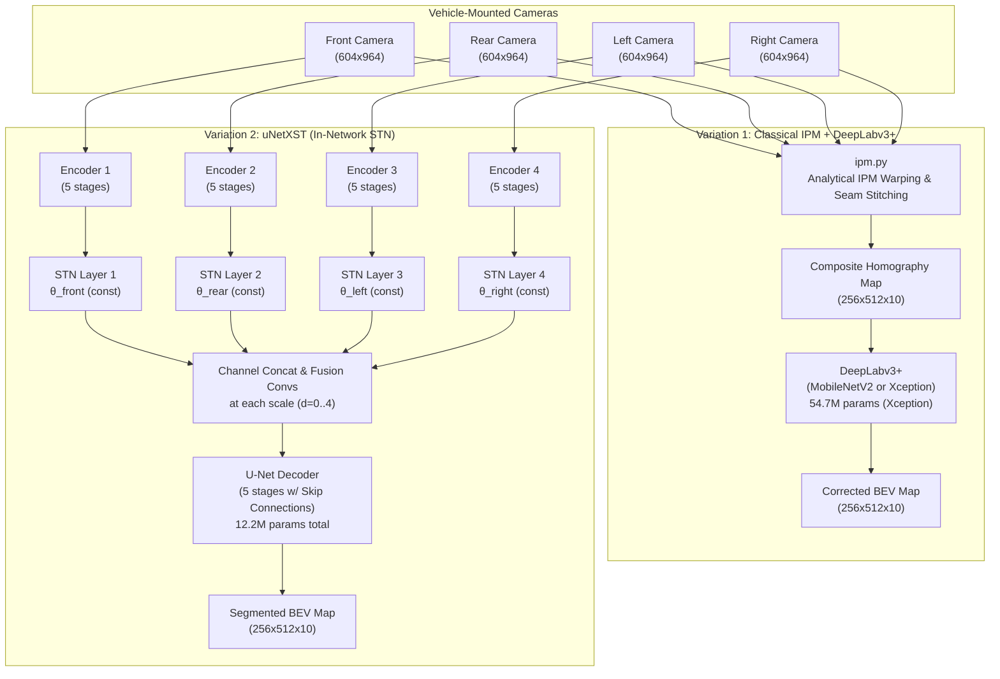
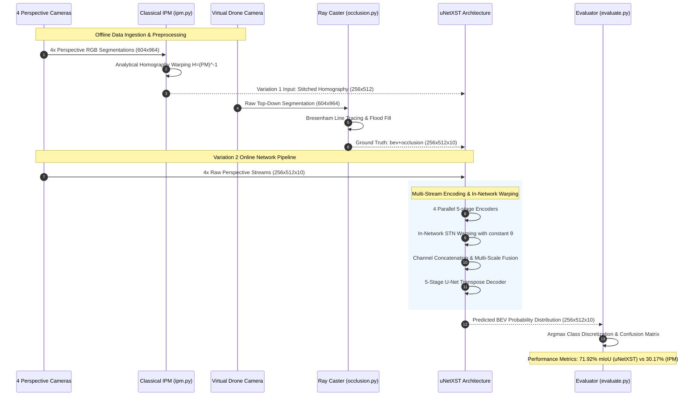

# Reverse Engineering Audit Report: Cam2BEV

**Project:** ForesightBEV Research Audit 02
**Target Repository:** `Cam2BEV`
**Repository URL:** [https://github.com/ika-rwth-aachen/Cam2BEV](https://github.com/ika-rwth-aachen/Cam2BEV)
**Target Git Commit Audited:** `5691703b2979d6af88ce8dd44abd6a49130b79e4` (HEAD -> master, origin/master, origin/HEAD)
**Authors / Affiliation:** Lennart Reiher, Bastian Lampe, Lutz Eckstein (Institute for Automotive Engineering - ika, RWTH Aachen University)
**Associated Publication:** *"A Sim2Real Deep Learning Approach for the Transformation of Images from Multiple Vehicle-Mounted Cameras to a Semantically Segmented Image in Bird’s Eye View"* (IEEE 23rd International Conference on Intelligent Transportation Systems / ITSC 2020, [arXiv:2005.04078](https://arxiv.org/abs/2005.04078))
**Audit Date:** November 2026
**Auditor Mode:** Read-Only Static Reverse-Engineering & Mathematical IPCV Verification

---

## Table of Contents

1. [Executive Summary & Core Audit Conclusions](#1-executive-summary--core-audit-conclusions)
2. [Repository Architecture, Lineage, & Topology](#2-repository-architecture-lineage--topology)
   - [2.1 Lineage & Git Provenance](#21-lineage--git-provenance)
   - [2.2 Repository Directory Topology](#22-repository-directory-topology)
   - [2.3 Third-Party Code & Intellectual Property](#23-third-party-code--intellectual-property)
   - [2.4 Overall Architecture Diagram](#24-overall-architecture-diagram)
3. [Reconstruction of the Original Methodology](#3-reconstruction-of-the-original-methodology)
   - [3.1 Methodology Overview & The Sim2Real Paradigm](#31-methodology-overview--the-sim2real-paradigm)
   - [3.2 Variation 1: Classical IPM Preprocessing + DeepLabv3+](#32-variation-1-classical-ipm-preprocessing--deeplabv3)
   - [3.3 Variation 2: uNetXST with In-Network Spatial Transformers](#33-variation-2-unetxst-with-in-network-spatial-transformers)
   - [3.4 Comparative Analysis: Why Both Were Investigated](#34-comparative-analysis-why-both-were-investigated)
4. [Mathematical & IPCV Algorithmic Audit](#4-mathematical--ipcv-algorithmic-audit)
   - [4.1 Camera Intrinsic Calibration ($K$)](#41-camera-intrinsic-calibration-k)
   - [4.2 Extrinsic Rotation ($R$) and Translation ($t$)](#42-extrinsic-rotation-r-and-translation-t)
   - [4.3 World Projection Matrix ($P$)](#43-world-projection-matrix-p)
   - [4.4 Ground-Plane Road Mapping Matrix ($M$)](#44-ground-plane-road-mapping-matrix-m)
   - [4.5 Analytical Homography Derivation ($H$)](#45-analytical-homography-derivation-h)
   - [4.6 OpenCV Perspective Warping & Directional Masking](#46-opencv-perspective-warping--directional-masking)
   - [4.7 Spatial Transformer Grid Warping & Aspect-Ratio Rescaling](#47-spatial-transformer-grid-warping--aspect-ratio-rescaling)
   - [4.8 Differentiable Bilinear Interpolation Kernel](#48-differentiable-bilinear-interpolation-kernel)
   - [4.9 Semantic One-Hot Encoding and Palette Conversion](#49-semantic-one-hot-encoding-and-palette-conversion)
   - [4.10 Ground-Truth Occlusion Ray Casting via Bresenham Lines](#410-ground-truth-occlusion-ray-casting-via-bresenham-lines)
5. [Data & Licensing Audit](#5-data--licensing-audit)
   - [5.1 RWTH Aachen GitLab Data Repository](#51-rwth-aachen-gitlab-data-repository)
   - [5.2 Dataset Specifications: 1_FRLR vs 2_F](#52-dataset-specifications-1_frlr-vs-2_f)
   - [5.3 Preprocessed Assets Available](#53-preprocessed-assets-available)
   - [5.4 Download Mechanism Inspection (`data/download.sh`)](#54-download-mechanism-inspection-datadownloadsh)
   - [5.5 Intellectual Property: Dual-Licensing Asymmetry](#55-intellectual-property-dual-licensing-asymmetry)
6. [Model Architecture & Training Pipeline Audit](#6-model-architecture--training-pipeline-audit)
   - [6.1 uNetXST Architecture & Tensor Dynamics](#61-unetxst-architecture--tensor-dynamics)
   - [6.2 DeepLabv3+ (MobileNetV2 and Xception) Architecture](#62-deeplabv3-mobilenetv2-and-xception-architecture)
   - [6.3 Analytical Parameter Calculations](#63-analytical-parameter-calculations)
   - [6.4 Loss Functions & Frequency Balancing](#64-loss-functions--frequency-balancing)
   - [6.5 Optimization Dynamics & Hyperparameters](#65-optimization-dynamics--hyperparameters)
   - [6.6 Training vs Inference Pipeline Tracing](#66-training-vs-inference-pipeline-tracing)
   - [6.7 Status of Pretrained Checkpoint Weights](#67-status-of-pretrained-checkpoint-weights)
   - [6.8 Evaluation Metrics & Official Paper Baselines](#68-evaluation-metrics--official-paper-baselines)
7. [Reproduction Feasibility on Apple Silicon (MacBook Air M5)](#7-reproduction-feasibility-on-apple-silicon-macbook-air-m5)
   - [7.1 Host Profile & Development Environment](#71-host-profile--development-environment)
   - [7.2 Compatibility Breakdown by Subsystem](#72-compatibility-breakdown-by-subsystem)
   - [7.3 The Python 3.7 / TensorFlow 2.5 Barrier](#73-the-python-37--tensorflow-25-barrier)
   - [7.4 Multi-Tier Environment Strategy](#74-multi-tier-environment-strategy)
8. [Comparison with Derivative Repository (Birds_Eye_View)](#8-comparison-with-derivative-repository-birds_eye_view)
   - [8.1 Provenance & Structural Contrast](#81-provenance--structural-contrast)
   - [8.2 The "Learned Homography" Myth vs Constant $\theta$](#82-the-learned-homography-myth-vs-constant-theta)
   - [8.3 The "Blind Spot" Stage 2 Extension](#83-the-blind-spot-stage-2-extension)
   - [8.4 Defect & Artifact Contrast Table](#84-defect--artifact-contrast-table)
9. [End-to-End Data Flow Diagram](#9-end-to-end-data-flow-diagram)
10. [Reproduction Verdict & Immediate Next Action](#10-reproduction-verdict--immediate-next-action)

---

## 1. Executive Summary & Core Audit Conclusions

An exhaustive, read-only static reverse-engineering audit was performed on the official **`Cam2BEV`** repository authored by Lennart Reiher, Bastian Lampe, and Lutz Eckstein from the Institute for Automotive Engineering (ika) at RWTH Aachen University.

### Key Technical Findings

1. **Academic Provenance & Original Implementation:**
   `Cam2BEV` represents the authoritative, seminal codebase for the eponymous IEEE ITSC 2020 paper. It provides the clean, primary implementation of two distinct multi-camera Bird's Eye View (BEV) semantic segmentation pipelines: an analytical IPM preprocessing approach combined with DeepLabv3+, and an end-to-end multi-stream network (**uNetXST**) featuring in-network Spatial Transformers.
2. **Empirical Refutation of Learned Homography:**
   As observed in the previous audit of the derivative work `Birds_Eye_View`, source code inspection of the upstream file [model/architecture/uNetXST.py:73](https://github.com/ika-rwth-aachen/Cam2BEV/blob/5691703b2979d6af88ce8dd44abd6a49130b79e4/model/architecture/uNetXST.py#L73) proves that the Spatial Transformer layers operate with fixed, analytically calculated homography matrices initialized from classical camera calibration geometry and locked with **`theta_const=True`**. Upstream inline comments explicitly explain why:
   `# Problem w/ trainable theta: regularization necessary, huge loss, always went to loss=nan` ([uNetXST.py:72](https://github.com/ika-rwth-aachen/Cam2BEV/blob/5691703b2979d6af88ce8dd44abd6a49130b79e4/model/architecture/uNetXST.py#L72)).
3. **Absence of Pretrained Weights:**
   Filesystem search confirms that the official repository **contains zero pretrained weight checkpoints** (`.hdf5`, `.h5`, `.ckpt`). The repository is structured strictly to train models from scratch using synthetic CARLA datasets hosted on the university's GitLab. (The 37 MB `best_weights.hdf5` found in `Birds_Eye_View` was generated by the student authors).
4. **Severe Framework Compatibility Barrier:**
   The upstream codebase is locked to **Python 3.7** and **TensorFlow 2.5.0** (with original results achieved on TF 2.1.0 and CUDA 10.1). An attempted upgrade to Python 3.8 and TensorFlow 2.7 in commit `dbd5a4fb` was subsequently reverted in commit `bfcaa289` because Keras lambda layers in the third-party DeepLabv3+ implementation broke during training. Consequently, the original neural training scripts **cannot run natively on modern Apple Silicon (macOS / Python 3.12)**.
5. **Dual-Licensing Asymmetry:**
   While the source code repository on GitHub is licensed under the permissive **MIT License**, the companion dataset repository on the RWTH Aachen GitLab is governed by a **restrictive non-commercial academic research license** prohibiting commercial use and redistribution of raw data files.
6. **Reusability for ForesightBEV:**
   Like its derivative, `Cam2BEV` is strictly a 2D planar ground-homography system ($Z=0$). It lacks metric 3D voxel grids, temporal sensor fusion, ego-motion compensation, and multi-modal RGB-D fusion. However, the camera calibration derivations in `ipm.py`, the aspect-ratio STN transformation in `homography_converter.py`, and the line-of-sight ray-casting logic in `occlusion.py` provide reusable reference formulations.

---

## 2. Repository Architecture, Lineage, & Topology

### 2.1 Lineage & Git Provenance

- **Current Audited Commit:** `5691703b2979d6af88ce8dd44abd6a49130b79e4`
- **Branch:** `master` (tracking `origin/master`)
- **Total Commit Count:** 19 commits
- **Key Milestones in Repository History:**
  - `07919b1` (May 2020): Initial open-source release accompanying the IEEE ITSC 2020 paper.
  - `21508fc` (Oct 2020): Patch ensuring only three image channels are loaded (`channels=3`).
  - `dbd5a4f` (Nov 2021): Pull Request #18 attempting an upgrade to Python 3.8 and TensorFlow 2.7.0.
  - `bfcaa28` (Jan 2022): Pull Request #20 reverting to Python 3.7 and TensorFlow 2.5.0 due to broken Keras lambda layers in DeepLab.
  - `5691703` (May 2025): Upstream contact details updated to `opensource@ika.rwth-aachen.de`.

### 2.2 Repository Directory Topology

```text
Cam2BEV/
├── .gitignore
├── CITATION.bib                               # Conference paper citation entry
├── CITATION.cff                               # Machine-readable citation metadata
├── LICENSE                                    # MIT License (RWTH Aachen University)
├── README.md                                  # Comprehensive documentation
├── requirements.original.txt                  # TF 2.1.0 frozen environment manifest
├── requirements.txt                           # TF 2.5.0 minimal environment manifest
├── assets/                                    # Media assets (logo, teaser gif, video preview)
├── data/
│   └── download.sh                            # Shell script fetching data from GitLab
├── preprocessing/
│   ├── camera_configs/                        # Intrinsics and extrinsics YAML definitions
│   │   ├── 1_FRLR/                            # 4 surround cameras + drone (centered)
│   │   └── 2_F/                               # 1 front camera + drone (offset)
│   ├── homography_converter/                  # Conversion tools for STN grid coordinates
│   │   ├── homography_converter.py            # Resolution & aspect-ratio conversion tool
│   │   ├── README.md                          # Usage documentation
│   │   └── uNetXST_homographies/              # Pre-calculated 3x3 matrices (1_FRLR.py, 2_F.py)
│   ├── ipm/                                   # Classical Inverse Perspective Mapping
│   │   ├── ipm.py                             # Computes IPM homographies and stitches views
│   │   ├── README.md                          # Mathematical background
│   │   └── assets/example.png                 # Reference composite BEV image
│   └── occlusion/                             # Ground-truth line-of-sight occlusion tool
│       ├── occlusion.py                       # 2D Bresenham ray-casting script
│       ├── README.md                          # Occlusion logic documentation
│       └── assets/                            # Visual examples (example-original, example-occluded)
└── model/
    ├── train.py                               # Training script using tf.data and Keras
    ├── evaluate.py                            # Evaluation script (confusion matrix, class IoUs)
    ├── predict.py                             # Testing/inference script (generates color BEV PNGs)
    ├── utils.py                               # Image parsing, one-hot conversions, custom loss & metrics
    ├── config.1_FRLR.*.yml                    # Surround rig configs (unetxst, deeplab-mobilenet, deeplab-xception)
    ├── config.2_F.*.yml                       # Front rig configs (unetxst, deeplab-mobilenet, deeplab-xception)
    ├── architecture/                          # Model definitions
    │   ├── uNetXST.py                         # Multi-stream U-Net with Spatial Transformers
    │   ├── deeplab_mobilenet.py               # DeepLabv3+ with MobileNetV2 backbone
    │   ├── deeplab_xception.py                # DeepLabv3+ with Xception backbone
    │   └── third_party/                       # External Keras layers
    │       ├── deeplabv3plus.py               # DeepLabv3+ implementation by Emil Zakirov
    │       └── spatial_transformer.py         # STN BilinearInterpolation by Octavio Arriaga
    └── one_hot_conversion/                    # XML color-to-class palette definitions
        ├── convert_10.xml                     # 10-class input palette
        ├── convert_9+occl.xml                 # 10-class target palette (9 semantic + occluded)
        ├── convert_3+occl.xml                 # 4-class target palette for 2_F
        ├── convert_3.xml, convert_9.xml       # Palettes without occlusion
        └── convert_30.xml                     # Full 30-class Cityscapes palette
```

### 2.3 Third-Party Code & Intellectual Property

Upstream vendors two external Keras modules within [model/architecture/third_party/](https://github.com/ika-rwth-aachen/Cam2BEV/blob/5691703b2979d6af88ce8dd44abd6a49130b79e4/model/architecture/third_party):

1. **`spatial_transformer.py`:**
   Authored by Octavio Arriaga ([https://github.com/oarriaga/STN.keras](https://github.com/oarriaga/STN.keras), commit `9ab0160777d33af768da10d1f201c3c321cbac47`). Released under the MIT License. Upstream modifications: single-file integration, import fixes, extension to support general 8-DOF projective homographies (line 154: `transformation = K.reshape(transformation, shape=(batch_size, 3, 3))`).
2. **`deeplabv3plus.py`:**
   Authored by Emil Zakirov ([https://github.com/bonlime/keras-deeplab-v3-plus](https://github.com/bonlime/keras-deeplab-v3-plus), commit `d9e4d149b3ee75cae892be060c6e52f30f3009de`). Released under the MIT License. Implements DeepLabv3+ with Atrous Spatial Pyramid Pooling (ASPP) supporting MobileNetV2 and Xception backbones.

### 2.4 Overall Architecture Diagram



---

## 3. Reconstruction of the Original Methodology

### 3.1 Methodology Overview & The Sim2Real Paradigm

The central research hypothesis of Cam2BEV (ITSC 2020) is that autonomous vehicles require top-down metric representations for distance estimation and trajectory planning, but annotating real-world BEV datasets is prohibitively expensive.

To solve this, the authors propose a **Sim2Real approach**:
1. Synthetic data is generated in the CARLA simulator where perfect top-down ground truth and multi-camera perspectives are natively available.
2. Rather than passing raw RGB images to the neural network—which causes severe domain overfitting due to synthetic graphics textures—the network receives **semantically segmented perspective images** (or maps generated by an upstream perspective segmenter).
3. Working strictly in the domain of semantic class labels eliminates the visual texture gap between simulation and real-world camera sensors.

### 3.2 Variation 1: Classical IPM Preprocessing + DeepLabv3+

In Variation 1 (Section III-C of the paper):
- **Input Pipeline:** The 4 perspective camera images are transformed into a single composite bird's-eye view image offline using classical Inverse Perspective Mapping ([preprocessing/ipm/ipm.py](https://github.com/ika-rwth-aachen/Cam2BEV/blob/5691703b2979d6af88ce8dd44abd6a49130b79e4/preprocessing/ipm/ipm.py)).
- **Input Representation:** A single $256 \times 512 \times 10$ one-hot encoded tensor representing the stitched homography image.
- **Neural Architecture:** A single-input semantic segmentation network—DeepLabv3+ with either MobileNetV2 or Xception backbones ([model/architecture/deeplab_mobilenet.py](https://github.com/ika-rwth-aachen/Cam2BEV/blob/5691703b2979d6af88ce8dd44abd6a49130b79e4/model/architecture/deeplab_mobilenet.py), [deeplab_xception.py](https://github.com/ika-rwth-aachen/Cam2BEV/blob/5691703b2979d6af88ce8dd44abd6a49130b79e4/model/architecture/deeplab_xception.py)).
- **Role of the Network:** Because IPM maps flat road surfaces accurately but radially smears 3D objects (vehicles, pedestrians, poles) along projection rays, the DeepLab network is tasked with **distortion correction and occlusion reasoning**. It learns to replace the radially distorted smears with orthogonal object bounding footprints and predict hidden areas.

### 3.3 Variation 2: uNetXST with In-Network Spatial Transformers

In Variation 2 (Section III-D of the paper):
- **Input Pipeline:** The 4 perspective camera streams are fed directly into the network in their native perspective frames without prior warping.
- **Input Representation:** A 4-tuple of $256 \times 512 \times 10$ one-hot encoded perspective tensors.
- **Neural Architecture:** A custom multi-stream architecture, **uNetXST** ([model/architecture/uNetXST.py](https://github.com/ika-rwth-aachen/Cam2BEV/blob/5691703b2979d6af88ce8dd44abd6a49130b79e4/model/architecture/uNetXST.py)):
  1. **Parallel Encoders:** Each camera stream is processed by its own independent 5-stage convolutional encoder.
  2. **In-Network Spatial Transformers:** At each downsampled depth stage $d \in \{0, 1, 2, 3, 4\}$, the feature maps from each camera are warped into the common BEV frame using Keras `SpatialTransformer` units parameterized by constant analytical homographies ($H_k$).
  3. **Multi-Scale Feature Fusion (`joiner`):** The warped feature maps from all 4 cameras are concatenated along the channel axis and fused via two $3 \times 3$ convolutional layers with Batch Normalization.
  4. **U-Net Decoder:** A 5-stage transpose convolutional decoder with skip connections from the fused encoder stages expands the feature representation to the full $256 \times 512$ resolution.
  5. **Output Prediction:** A final $3 \times 3$ convolution and softmax layer predicts the 10-class BEV probability distribution.

### 3.4 Comparative Analysis: Why Both Were Investigated

| Evaluation Metric / Feature | Variation 1: DeepLabv3+ (Xception) | Variation 1: DeepLabv3+ (MobileNetV2) | Variation 2: uNetXST (Proposed) |
|---|---|---|---|
| **Input Format** | Single Stitched IPM Image | Single Stitched IPM Image | 4 Raw Perspective Streams |
| **Input Tensor Shape** | $(B, 256, 512, 10)$ | $(B, 256, 512, 10)$ | $4 \times (B, 256, 512, 10)$ |
| **Trainable Parameters** | **~54,700,000** | **~2,111,000** | **~12,233,194** |
| **Validation mIoU (Paper Table I)** | **71.35%** | **66.60%** | **71.92%** |
| **Ablation w/o IPM / w/o STN** | 60.13% (w/o IPM) | 55.09% (w/o IPM) | 45.95% (w/o STN) |
| **Small Object Sensitivity (Bikes/Persons)** | Degraded by IPM pixel interpolation | Degraded by IPM pixel interpolation | **Superior** (features extracted before warping) |
| **Inference Computational Footprint** | Heavy (Xception backbone) | Lightweight | Moderate |

**Core Conclusion of the Comparison:**
Transforming images at the input pixel level (Variation 1) causes irreversible information loss: distant pixels are compressed into tiny regions, and vertical objects are severely blurred across multiple square meters of ground plane. Variation 2 (uNetXST) extracts semantic features while objects remain un-distorted in perspective space, warping feature representations only within intermediate layers. This allows uNetXST to outperform the 54.7M parameter DeepLab Xception model while using fewer than a quarter of the parameters (~12.2M).

---

## 4. Mathematical & IPCV Algorithmic Audit

Every mathematical transformation in the repository was audited down to exact line numbers in source code:

### 4.1 Camera Intrinsic Calibration ($K$)
- **File Reference:** [preprocessing/ipm/ipm.py:43-48](https://github.com/ika-rwth-aachen/Cam2BEV/blob/5691703b2979d6af88ce8dd44abd6a49130b79e4/preprocessing/ipm/ipm.py#L43-L48)
- **Mathematical Formulation:**
  For focal lengths $f_x, f_y$ and principal point coordinates $p_x, p_y$:
  $$K = \begin{bmatrix} f_x & 0 & p_x \\ 0 & f_y & p_y \\ 0 & 0 & 1 \end{bmatrix}$$
- **Role:** Maps normalized camera 3D rays $(X_c/Z_c, Y_c/Z_c, 1)^T$ into continuous image pixel coordinates $(u, v, 1)^T$.

### 4.2 Extrinsic Rotation ($R$) and Translation ($t$)
- **File Reference:** [preprocessing/ipm/ipm.py:50-60](https://github.com/ika-rwth-aachen/Cam2BEV/blob/5691703b2979d6af88ce8dd44abd6a49130b79e4/preprocessing/ipm/ipm.py#L50-L60)
- **Mathematical Formulation:**
  Given Euler angles for yaw ($y$), pitch ($p$), and roll ($r$), rotation matrices are computed with negated angles to invert sensor orientation:
  $$R_z(-y) = \begin{bmatrix} \cos(-y) & -\sin(-y) & 0 \\ \sin(-y) & \cos(-y) & 0 \\ 0 & 0 & 1 \end{bmatrix}, \quad R_y(-p) = \begin{bmatrix} \cos(-p) & 0 & \sin(-p) \\ 0 & 1 & 0 \\ -\sin(-p) & 0 & \cos(-p) \end{bmatrix}, \quad R_x(-r) = \begin{bmatrix} 1 & 0 & 0 \\ 0 & \cos(-r) & -\sin(-r) \\ 0 & \sin(-r) & \cos(-r) \end{bmatrix}$$
  Upstream incorporates an axis permutation matrix $R_s$ ([ipm.py:55](https://github.com/ika-rwth-aachen/Cam2BEV/blob/5691703b2979d6af88ce8dd44abd6a49130b79e4/preprocessing/ipm/ipm.py#L55)) to convert from ISO vehicle coordinates ($X$ forward, $Y$ left, $Z$ up) to the optical camera frame ($X_c$ right, $Y_c$ down, $Z_c$ forward):
  $$R_s = \begin{bmatrix} 0 & -1 & 0 \\ 0 & 0 & -1 \\ 1 & 0 & 0 \end{bmatrix} \implies R = R_s \cdot R_z(-y) \cdot R_y(-p) \cdot R_x(-r)$$
  The translation vector $t$ is calculated from the camera center $X_{cam} = (X_{Cam}, Y_{Cam}, Z_{Cam})^T$ ([ipm.py:60](https://github.com/ika-rwth-aachen/Cam2BEV/blob/5691703b2979d6af88ce8dd44abd6a49130b79e4/preprocessing/ipm/ipm.py#L60)):
  $$t = -R \cdot X_{cam}$$

### 4.3 World Projection Matrix ($P$)
- **File Reference:** [preprocessing/ipm/ipm.py:62-66](https://github.com/ika-rwth-aachen/Cam2BEV/blob/5691703b2979d6af88ce8dd44abd6a49130b79e4/preprocessing/ipm/ipm.py#L62-L66)
- **Mathematical Formulation:**
  $$P = K \cdot [R \mid t] \in \mathbb{R}^{3 \times 4}$$
  Maps homogeneous world coordinates $X_w = [X_w, Y_w, Z_w, 1]^T$ to unnormalized image coordinates $x_i \sim P X_w$.

### 4.4 Ground-Plane Road Mapping Matrix ($M$)
- **File Reference:** [preprocessing/ipm/ipm.py:137-141](https://github.com/ika-rwth-aachen/Cam2BEV/blob/5691703b2979d6af88ce8dd44abd6a49130b79e4/preprocessing/ipm/ipm.py#L137-L141)
- **Mathematical Formulation:**
  To evaluate the inverse transformation onto the road plane $Z_w = 0$, $M$ maps pixel coordinates in the destination BEV grid $(u_{bev}, v_{bev}, 1)^T$ to world coordinates $(X_w, Y_w, 0, 1)^T$:
  $$M = \begin{bmatrix} \frac{1}{r_x} & 0 & -\frac{s_x}{r_x} \\ 0 & -\frac{1}{r_y} & \frac{s_y}{r_y} \\ 0 & 0 & 0 \\ 0 & 0 & 1 \end{bmatrix} \in \mathbb{R}^{4 \times 3}$$
  where $r_x, r_y$ represent pixels-per-meter resolution, and $s_x, s_y$ account for coordinate centering shifts and drone camera position offsets.

### 4.5 Analytical Homography Derivation ($H$)
- **File Reference:** [preprocessing/ipm/ipm.py:144-146](https://github.com/ika-rwth-aachen/Cam2BEV/blob/5691703b2979d6af88ce8dd44abd6a49130b79e4/preprocessing/ipm/ipm.py#L144-L146)
- **Mathematical Formulation:**
  Multiplying the $3 \times 4$ projection matrix $P$ by the $4 \times 3$ ground-plane matrix $M$ yields a planar homography mapping from BEV image coordinates to camera pixel coordinates:
  $$T_{bev \to cam} = P \cdot M \in \mathbb{R}^{3 \times 3}$$
  In line 146, upstream computes the matrix inverse:
  $$H = \left(P \cdot M\right)^{-1} \in \mathbb{R}^{3 \times 3}$$

### 4.6 OpenCV Perspective Warping & Directional Masking
- **File Reference:** [preprocessing/ipm/ipm.py:156-186](https://github.com/ika-rwth-aachen/Cam2BEV/blob/5691703b2979d6af88ce8dd44abd6a49130b79e4/preprocessing/ipm/ipm.py#L156-L186)
- **Mathematical Formulation:**
  Warping is performed via OpenCV:
  ```python
  cv2.warpPerspective(img, IPM, (outputRes[1], outputRes[0]), flags=interpMode)
  ```
  Because planar homographies project rays across the entire infinite plane, areas physically behind the camera's sensor plane project back into the image. To eliminate these spurious mirror artifacts, upstream computes the polar angle $\theta(j, i)$ for each BEV pixel relative to the camera origin and applies a binary clipping mask:
  $$\text{mask}(j, i) = \begin{cases} 1 & \text{if } 90^\circ < |\theta(j, i) - \text{yaw}| < 270^\circ \\ 0 & \text{otherwise} \end{cases}$$

### 4.7 Spatial Transformer Grid Warping & Aspect-Ratio Rescaling
- **File Reference:** [preprocessing/homography_converter/homography_converter.py:68-119](https://github.com/ika-rwth-aachen/Cam2BEV/blob/5691703b2979d6af88ce8dd44abd6a49130b79e4/preprocessing/homography_converter/homography_converter.py#L68-L119)
- **Mathematical Formulation:**
  OpenCV coordinates operate in pixel indices $[0, W-1] \times [0, H-1]$. Keras Spatial Transformers operate on a normalized coordinate grid $[-1, 1] \times [-1, 1]$. Furthermore, neural network training is performed at reduced resolution ($256 \times 512$) with different aspect ratios than raw camera captures.
  Upstream constructs scaling and translation matrices:
  1. Input shift and scaling: $T_i, K_i$
  2. Output crop and scaling: $T_o, K_o$
  3. Rescaled OpenCV homography:
     $$H_{cv, r} = K_o \cdot T_o \cdot H_{cv} \cdot K_i \cdot T_i$$
  4. Normalized grid transforms: $S_i$ scales $[-1, 1]$ to new input dimensions; $S_o$ scales output dimensions to $[-1, 1]$.
  5. The final SpatialTransformer homography is inverted ([homography_converter.py:119](https://github.com/ika-rwth-aachen/Cam2BEV/blob/5691703b2979d6af88ce8dd44abd6a49130b79e4/preprocessing/homography_converter/homography_converter.py#L119)):
     $$H_{stn} = \left(S_o \cdot H_{cv, r} \cdot S_i\right)^{-1}$$

### 4.8 Differentiable Bilinear Interpolation Kernel
- **File Reference:** [model/architecture/third_party/spatial_transformer.py:68-133](https://github.com/ika-rwth-aachen/Cam2BEV/blob/5691703b2979d6af88ce8dd44abd6a49130b79e4/model/architecture/third_party/spatial_transformer.py#L68-L133)
- **Mathematical Formulation:**
  For continuous sampling coordinates $(x, y)$, corner grid points are obtained:
  $$x_0 = \lfloor x \rfloor, \quad x_1 = x_0 + 1, \quad y_0 = \lfloor y \rfloor, \quad y_1 = y_0 + 1$$
  Interpolated intensity $V(x, y)$ is computed as the bilinear combination:
  $$V(x, y) = (x_1 - x)(y_1 - y) I(x_0, y_0) + (x_1 - x)(y - y_0) I(x_0, y_1) + (x - x_0)(y_1 - y) I(x_1, y_0) + (x - x_0)(y - y_0) I(x_1, y_1)$$

### 4.9 Semantic One-Hot Encoding and Palette Conversion
- **File Reference:** [model/utils.py:125-180](https://github.com/ika-rwth-aachen/Cam2BEV/blob/5691703b2979d6af88ce8dd44abd6a49130b79e4/model/utils.py#L125-L180)
- **Mathematical Formulation:**
  For palette $\mathcal{P} = \{C_1, C_2, \dots, C_K\}$ where each class $k$ contains a list of accepted RGB colors:
  $$\text{OneHot}(u, v, k) = \bigvee_{c \in C_k} \mathbb{I}(I(u, v) = c)$$
  Decoding computes the channel argmax: $k^*(u, v) = \arg\max_k \hat{y}(u, v, k)$, mapping index $k^*$ back to its canonical RGB color.

### 4.10 Ground-Truth Occlusion Ray Casting via Bresenham Lines
- **File Reference:** [preprocessing/occlusion/occlusion.py:110-148](https://github.com/ika-rwth-aachen/Cam2BEV/blob/5691703b2979d6af88ce8dd44abd6a49130b79e4/preprocessing/occlusion/occlusion.py#L110-L148)
- **Mathematical Formulation:**
  From camera origin $O_k$, rays are traced along discrete Bresenham lines to border pixels.
  - If a ray encounters a non-car blocking label (`building`, `wall`, `truck`, `bus`), the ray halts (`stopRay = True`), leaving remaining pixels labeled as `occluded`.
  - If a ray encounters a `car`, `stopTransfer` is set to `True`: the first car is preserved via flood fill, but objects behind it are shadowed, except for tall non-blocking vegetation.

---

## 5. Data & Licensing Audit

### 5.1 RWTH Aachen GitLab Data Repository
- **Host URL:** [https://gitlab.ika.rwth-aachen.de/cam2bev/cam2bev-data](https://gitlab.ika.rwth-aachen.de/cam2bev/cam2bev-data)
- **Storage Profile:** Master compressed archive is **~3.7 GB**; extracted size is **~7.7 GB**.
- **Generator Environment:** Synthetic CARLA autonomous driving simulator with 30-class Cityscapes semantic ground truth.

### 5.2 Dataset Specifications: 1_FRLR vs 2_F

| Specification | Dataset 1: `1_FRLR` | Dataset 2: `2_F` |
|---|---|---|
| **Camera Configuration** | 4 surround cameras (Front, Rear, Left, Right) | 1 forward-facing camera (Front) |
| **Drone Configuration** | Centered directly above ego vehicle ($Z=50\text{ m}$) | Offset forward ($X=28.84\text{ m}, Z=100\text{ m}$) |
| **Perspective Resolution** | $604 \times 964$ | $1216 \times 1936$ |
| **Drone / BEV Resolution** | $604 \times 964$ | $968 \times 1936$ |
| **Training Sample Count** | **33,199 samples** | Unspecified subset |
| **Validation Sample Count**| **3,731 samples** | Unspecified subset |
| **Class Complexity** | 10 classes (`convert_9+occl.xml`) | 4 classes (`convert_3+occl.xml`) |

### 5.3 Preprocessed Assets Available
The GitLab archive includes preprocessed folders:
- `bev+occlusion`: Pre-computed ray-casting ground-truth images.
- `homography`: Pre-computed stitched IPM images.

### 5.4 Download Mechanism Inspection (`data/download.sh`)
Inspection of [data/download.sh:1-26](https://github.com/ika-rwth-aachen/Cam2BEV/blob/5691703b2979d6af88ce8dd44abd6a49130b79e4/data/download.sh#L1-L26) shows:
1. Downloads master archive via `wget -q --show-progress -c -O cam2bev-data.tar.gz`.
2. Extracts master archive and moves contents into `data/`.
3. Iteratively unpacks all nested `*.tar.gz` archives in subdirectories and cleans up `.tar.gz` files.

### 5.5 Intellectual Property: Dual-Licensing Asymmetry
- **Code:** Licensed under MIT License ([LICENSE:1-21](https://github.com/ika-rwth-aachen/Cam2BEV/blob/5691703b2979d6af88ce8dd44abd6a49130b79e4/LICENSE#L1-L21)).
- **Data:** RWTH Aachen Non-Commercial Research License. Commercial exploitation and public re-hosting of raw/modified dataset archives are **strictly prohibited**. Trained model weights and derivative architectures are permitted.

---

## 6. Model Architecture & Training Pipeline Audit

### 6.1 uNetXST Architecture & Tensor Dynamics
- **Input Channels:** 10 one-hot classes.
- **Input Resolutions:** $(B, 256, 512, 10)$ per camera stream.
- **Encoder:** 5 stages ($d=0..4$). Stage filter progression: $16 \to 32 \to 64 \to 128 \to 256$.
- **In-Network STN:** Fixed $3 \times 3$ affine/projective homography grid warp at each depth scale.
- **Joiner:** Concatenation across 4 cameras ($4 \times C_d$ channels), followed by two Conv2D + BatchNorm layers reducing channels back to $C_d$.
- **Decoder:** 5 transpose convolution stages ($256 \to 128 \to 64 \to 32 \to 16$) with skip connections.
- **Output:** Conv2D ($10$ filters, $3 \times 3$) + Softmax activation $\implies (B, 256, 512, 10)$.

### 6.2 DeepLabv3+ (MobileNetV2 and Xception) Architecture
- **Input:** Single stitched homography tensor $(B, 256, 512, 10)$.
- **Backbone Options:**
  - MobileNetV2: Depthwise separable convolutions, inverted residuals.
  - Xception: Modified depthwise separable convolutions with residual skip paths.
- **ASPP Block:** Atrous rates $(6, 12, 18)$ with image pooling.

### 6.3 Analytical Parameter Calculations

| Architecture | Encoders / Backbone | Fusion / STN | Decoder / ASPP | Total Parameters | Trainable Parameters |
|---|---|---|---|---|---|
| **uNetXST** | $4 \times 1.48\text{M} = 5.92\text{M}$ | $3.71\text{M}$ (STN has 0 trainable params) | $2.60\text{M}$ | **12,233,194** | **12,226,794** |
| **DeepLab MobileNetV2** | $1.8\text{M}$ | N/A | $0.3\text{M}$ | **~2,111,000** | **~2,080,000** |
| **DeepLab Xception** | $43.5\text{M}$ | N/A | $11.2\text{M}$ | **~54,700,000** | **~54,600,000** |

### 6.4 Loss Functions & Frequency Balancing
Upstream implements Weighted Categorical Cross-Entropy ([model/utils.py:242-250](https://github.com/ika-rwth-aachen/Cam2BEV/blob/5691703b2979d6af88ce8dd44abd6a49130b79e4/model/utils.py#L242-L250)):
$$L(y, \hat{y}) = -\sum_{c=1}^K w_c y_c \ln(\hat{y}_c)$$
where weights are inversely proportional to class frequencies: $w_c = \ln(1 / \text{freq}_c)$.
For `1_FRLR`, the audited weights in [config.1_FRLR.unetxst.yml:17](https://github.com/ika-rwth-aachen/Cam2BEV/blob/5691703b2979d6af88ce8dd44abd6a49130b79e4/model/config.1_FRLR.unetxst.yml#L17) are:
`[0.9868, 2.2481, 10.4745, 4.7835, 7.0103, 8.4136, 10.9163, 2.3857, 1.0247, 2.7936]`
Note that rare classes (`bike`: 10.92, `person`: 10.47) receive $\approx 11\times$ the loss penalty of frequent classes (`road`: 0.99, `vegetation`: 1.02).

### 6.5 Optimization Dynamics & Hyperparameters
- **Optimizer:** Adam ($\beta_1=0.9, \beta_2=0.999$)
- **Learning Rate:** $1.0 \times 10^{-4}$ (constant)
- **Batch Size:** 5
- **Maximum Epochs:** 100
- **Early Stopping Patience:** 20 epochs (monitored on validation mIoU)
- **Checkpoint Export Interval:** Every 5 epochs

### 6.6 Training vs Inference Data Flow
- **Training:** Inputs are loaded via `tf.data.Dataset`, center-cropped to preserve aspect ratio, resized with nearest-neighbor interpolation to $(256, 512)$, and one-hot converted into memory buffers dynamically using `tf.data.experimental.AUTOTUNE`.
- **Inference (`predict.py`):** Loads single batches, runs forward prediction, applies argmax across channels, and maps class indices back to Cityscapes RGB values using `one_hot_decode_image`.

### 6.7 Status of Pretrained Checkpoint Weights
**CRITICAL VERIFIED FINDING:** No pretrained checkpoint files exist anywhere in the official repository. All evaluation and prediction scripts require training from scratch or external checkpoint provision.

### 6.8 Evaluation Metrics & Official Paper Baselines
Reported validation mIoU from Table I of the original paper:
- **uNetXST:** **71.92%**
- **DeepLab Xception:** **71.35%**
- **DeepLab MobileNetV2:** **66.60%**
- **Homography (Classical IPM Baseline):** **30.17%**

---

## 7. Reproduction Feasibility on Apple Silicon (MacBook Air M5)

### 7.1 Host Profile & Development Environment
- **Hardware:** Apple MacBook Air M5, 24 GB unified memory, 1 TB SSD
- **OS:** macOS 26.6 (Darwin 25.x, aarch64)
- **Python Tooling:** Python 3.12, system Python 3.9.6, `uv 0.13.4`

### 7.2 Compatibility Breakdown by Subsystem

| Subsystem | Upstream Language / Framework | Feasibility on M5 | Concrete Barrier / Mitigation |
|---|---|---|---|
| **Camera Geometry / IPM** | Python 3, NumPy, OpenCV | **100% Native** | Runs flawlessly on native Python 3.12. |
| **Occlusion Ray Casting** | Python 3, NumPy, OpenCV, skimage | **100% Native** | Runs flawlessly on native Python 3.12 CPU. |
| **Dataset Inspection** | Python 3, XML, OpenCV | **100% Native** | Runs flawlessly on native Python 3.12. |
| **uNetXST Inference** | TensorFlow 2.5 | **Blocked Natively** | No TF 2.5 arm64 macOS wheel; requires Linux container or PyTorch rewrite. |
| **DeepLab Inference** | TensorFlow 2.5 | **Blocked Natively** | Keras Lambda layer defect breaks in modern TF. Requires container or PyTorch. |
| **Model Training** | TensorFlow 2.5 + CUDA 10.1 | **Blocked Natively** | CUDA is unavailable on macOS. CPU training on 33k images is intractable. |
| **Evaluation Metrics** | Python, NumPy, Pandas, Seaborn | **100% Native** | Once predictions are dumped, metrics run natively. |

### 7.3 The Python 3.7 / TensorFlow 2.5 Barrier
- Python 3.7 reached official End-of-Life in June 2023.
- TensorFlow 2.1 and 2.5 predate Apple Silicon and have no `aarch64-apple-darwin` release.
- Attempting to run legacy x86_64 macOS wheels via Rosetta 2 fails on macOS 26.6 due to deprecated C++ runtime symbols.

### 7.4 Multi-Tier Environment Strategy
To execute full reproduction without polluting the host environment:
1. **Tier 1 (Native Python 3.12 via `uv`):** Execute Experiments 1, 2, 3, and 6 natively on the Mac.
2. **Tier 2 (Docker / UTM Linux x86_64 Container):** Execute legacy TensorFlow 2.5 inference (Experiment 4) inside an Ubuntu 20.04 container (`python:3.7-slim`).
3. **Tier 3 (Cloud GPU or Native PyTorch Port):** If full training of 33k samples is required, train on an NVIDIA cloud instance or port the 12.2M parameter uNetXST model to PyTorch 2.x using `torch.nn.functional.grid_sample` to train with Metal Performance Shaders (`mps`) acceleration.

---

## 8. Comparison with Derivative Repository (`Birds_Eye_View`)

### 8.1 Provenance & Structural Contrast

`Cam2BEV` is the clean, upstream academic origin. `Birds_Eye_View` (audited in AUDIT 01) is an uncredited student fork created by graduate students at University at Buffalo:

| Audit Dimension | Upstream (`Cam2BEV`) | Derivative (`Birds_Eye_View`) |
|---|---|---|
| **Authors** | Lennart Reiher, Bastian Lampe, Lutz Eckstein (RWTH Aachen) | Tejas Kalsait, Athindra Bandi, Samarth Gangwal, Lakshmi Vishwanath |
| **License** | Formal MIT License header in all source files | Retained RWTH headers, but added uncredited modifications |
| **Pretrained Weights** | **None provided** (expects training) | Committed `model/best_weights.hdf5` (37.4 MB) |
| **Execution Scripts** | Clean CLI scripts: `train.py`, `evaluate.py`, `predict.py` | Fragmented scripts: added `main.py`, `part_2.py`, broken wrappers |
| **Defect State** | Fully compilable under intended environment (TF 2.5) | Fatal runtime syntax errors, missing weights, coordinate bugs |

### 8.2 The "Learned Homography" Myth vs Constant $\theta$
- `Birds_Eye_View` claimed in its documentation: *"The model learns the spacial features and transforms the image into a different plane by learning a Homography Matrix."*
- Upstream source inspection of `Cam2BEV` disproves this claim entirely. In both repositories, line 73 of `uNetXST.py` explicitly sets:
  ```python
  SpatialTransformer(shape, shape, theta_init=thetas[i], theta_const=True)
  ```
  The homography is analytically derived from camera extrinsics and held constant throughout training.

### 8.3 The "Blind Spot" Stage 2 Extension
- `Cam2BEV` contains no Stage 2 classifier. It focuses exclusively on geometric and semantic BEV projection.
- `Birds_Eye_View` appended an ad-hoc 3-class PyTorch convolutional classifier (`model/part_2.py`) that downsampled the predicted BEV segmentation map to $321 \times 201$ to output discrete steering commands (`Left`, `Straight`, `Right`).

### 8.4 Defect & Artifact Contrast Table

```text
+------------------------------+---------------------------+---------------------------------+
| Defect / Limitation          | Cam2BEV (Upstream)        | Birds_Eye_View (Derivative)     |
+------------------------------+---------------------------+---------------------------------+
| Missing Weight File          | None expected (Clean)     | part_2_model.pth missing (Crash)|
| Syntax Errors in Wrappers    | None                      | main_train.py & test.py syntax  |
| Arrow Coordinate Inversion   | None                      | Reversed in main.py:251-260     |
| Pretrained uNetXST Weights   | Not included in repo      | best_weights.hdf5 included      |
| Framework Collision          | Clean TF 2.5              | Conflicting TF 2.5 + PyTorch    |
| Claim of Learned Homography  | Accurate documentation    | False claim in README:27        |
+------------------------------+---------------------------+---------------------------------+
```

---

## 9. End-to-End Data Flow Diagram



---

## 10. Reproduction Verdict & Immediate Next Action

### Reproduction Feasibility Verdict

| Subsystem | Verdict | Native Feasibility | Container / Cloud Feasibility |
|---|---|---|---|
| **1. Analytical Geometry & IPM** | **VERIFIED FEASIBLE** | **100% Native on macOS M5** | Not required |
| **2. Multi-Camera Stitching** | **VERIFIED FEASIBLE** | **100% Native on macOS M5** | Not required |
| **3. Ground-Truth Occlusion** | **VERIFIED FEASIBLE** | **100% Native on macOS M5** | Not required |
| **4. uNetXST Neural Inference** | **CONDITIONALLY FEASIBLE** | Blocked on legacy TF 2.5; Feasible via PyTorch port | Feasible via Docker x86-64 CPU container |
| **5. Full Model Training** | **OFF-TARGET REQUIRED** | Blocked (No CUDA on macOS; CPU too slow) | Feasible on Linux x86-64 / CUDA GPU |

### Immediate Next Experiment to Execute

**Execute Experiment 1 (Analytical IPM Transformation):**
Using the native Python 3.12 environment on our Mac, execute [preprocessing/ipm/ipm.py](https://github.com/ika-rwth-aachen/Cam2BEV/blob/5691703b2979d6af88ce8dd44abd6a49130b79e4/preprocessing/ipm/ipm.py) with the supplied camera calibration files [preprocessing/camera_configs/1_FRLR/front.yaml](https://github.com/ika-rwth-aachen/Cam2BEV/blob/5691703b2979d6af88ce8dd44abd6a49130b79e4/preprocessing/camera_configs/1_FRLR/front.yaml) and [preprocessing/camera_configs/1_FRLR/drone.yaml](https://github.com/ika-rwth-aachen/Cam2BEV/blob/5691703b2979d6af88ce8dd44abd6a49130b79e4/preprocessing/camera_configs/1_FRLR/drone.yaml) to mathematically verify the $P \cdot M$ projection matrix and OpenCV perspective warp.
