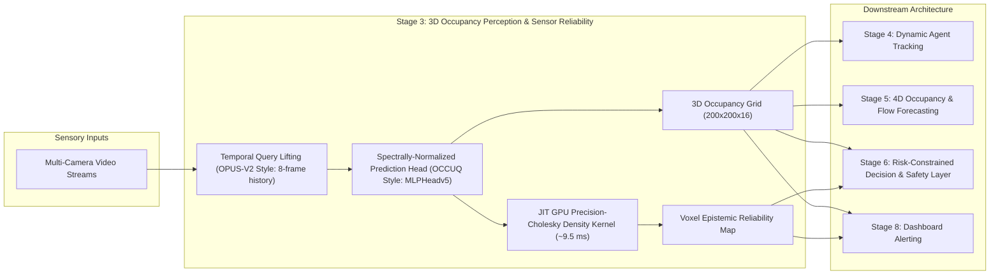

# REA 03 — Comparative Baseline Analysis: OCCUQ vs. SurroundOcc vs. OPUS-V2

**Audit Series:** ForesightBEV Stage 0 Reverse Engineering Audits  
**Document:** `research/repository_audits/occuq/COMPARISON_WITH_PREVIOUS_BASELINES.md`  
**Date:** 2026-11-04  
**Audited Repositories:**  
- **SurroundOcc:** `https://github.com/weiyithu/SurroundOcc` (`419bf5b`)  
- **OPUS / OPUS-V2:** `https://github.com/jbwang1997/OPUS` (`fdb1733`)  
- **OCCUQ:** `https://github.com/ika-rwth-aachen/OCCUQ` (`2aa5429`)  

---

## 1. Executive Summary & Comparative Matrix

Across our Stage 0 reverse-engineering audits, we have investigated three foundational camera-centric 3D perception architectures:
1. **SurroundOcc (REA 01):** The pioneer of dense 3D spatial cross-attention lifting and volumetric 3D deconvolution for multi-camera occupancy.
2. **OPUS-V2 (REA 02):** The state-of-the-art sparse-query and continuous point densification framework, establishing real-time inference ($25.8\text{ FPS}$ on Tiny) and high geometric fidelity ($38.6\text{ mIoU}$ on Large).
3. **OCCUQ (REA 03):** The first framework to integrate mathematically grounded, GPU-accelerated **Uncertainty Quantification (UQ)** into 3D occupancy perception, enabling out-of-distribution (OOD) detection and sensor degradation robustness.

| Feature / Metric | SurroundOcc (REA 01) | OPUS-V2-T (REA 02) | OPUS-V2-L (REA 02) | OCCUQ (REA 03) |
| :--- | :--- | :--- | :--- | :--- |
| **Paper & Venue** | ICCV 2023 (Tsinghua) | arXiv 2023 / 2024 | arXiv 2023 / 2024 | ICRA 2025 (ika RWTH Aachen) |
| **Architectural Paradigm** | Dense 3D Voxel Query Pyramid + 3D Deformable Cross-Attention | Sparse 3D Bounding Box Queries + Deformable Attention | Sparse 3D Bounding Box Queries + Deformable Attention | Dense 3D Voxel Query Pyramid + Spectrally Normalized MLP Head |
| **Query Representation** | Dense $25\times 25\times 2 \to 100\times 100\times 8$ | Sparse $Q=600$ queries ($P=128$) | Sparse $Q=4,800$ queries ($P=16$) | Dense $25\times 25\times 2 \to 100\times 100\times 8$ |
| **Output Grid Dimensions** | $200 \times 200 \times 16$ ($0.5\text{ m}$) | $200 \times 200 \times 16$ ($0.5\text{ m}$) | $200 \times 200 \times 16$ ($0.5\text{ m}$) | $200 \times 200 \times 16$ ($0.5\text{ m}$) |
| **Temporal Context** | Single-frame ($T=1$) | 8-frame past causal window ($T=8$) | 8-frame past causal window ($T=8$) | Single-frame ($T=1$) |
| **Throughput / Latency (RTX 3090)** | $\approx 4.5\text{ FPS}$ (~220 ms) | **$25.8\text{ FPS}$ (~38.8 ms)** | $8.6\text{ FPS}$ (~116.3 ms) | $\approx 5.2\text{ FPS}$ (~190 ms, $+9.5\text{ ms}$ for UQ) |
| **Occupancy Accuracy (mIoU)** | $\approx 28.5 - 30.2\%$ | $35.6 - 36.5\%$ | **$38.6\%$** | $\approx 29.8 - 30.5\%$ |
| **Uncertainty Quantification** | **None** (uncalibrated softmax) | **None** (deterministic queries) | **None** (deterministic queries) | **Disentangled Epistemic (GMM) + Aleatoric (Entropy / MSP)** |
| **OOD Detection (Missing Camera AUROC)** | Not evaluated (blind failure) | Not evaluated (blind failure) | Not evaluated (blind failure) | **$95.39\%$ (FPR95: $18.03\%$)** |
| **Macro OOD Detection (MultiCorrupt mAUROC)**| Not evaluated | Not evaluated | Not evaluated | **$80.15\%$ (Scale 3)** |
| **Calibration Metric** | Not evaluated | Not evaluated | Not evaluated | **ECE via `netcal` ($10\text{ bins}$)** |

---

## 2. In-Depth Comparative Dimensions

### 2.1 Architectural Heritage: SurroundOcc vs. OCCUQ
OCCUQ directly adopts the SurroundOcc pipeline as its base perceptual backbone. The core differences reside in:
1. **Prediction Head:** SurroundOcc projects decoder features directly to 17 class logits via a simple $1 \times 1 \times 1$ convolution. OCCUQ replaces this with `MLPHeadv5`, an 5-layer residual MLP featuring **Spectral Normalization** (`use_sn=True`).
2. **Feature Regularization:** By enforcing a bi-Lipschitz constraint via spectral normalization, OCCUQ prevents feature collapse, ensuring that anomalous camera inputs produce feature vectors that fall far from the training distribution.
3. **Inference Modality:** SurroundOcc outputs solely semantic logits $\hat{\mathbf{Y}} \in \mathbb{R}^{200 \times 200 \times 16}$. OCCUQ simultaneously outputs semantic logits and a voxel-level epistemic density field $\mathbf{U}_{\text{epistemic}} \in \mathbb{R}^{200 \times 200 \times 16}$.
4. **Computational Cost:** OCCUQ adds only **$9.48\text{ ms}$** of inference overhead on GPU, achieving high-speed uncertainty quantification without retraining the backbone.

### 2.2 Sparse Queries (OPUS) vs. Dense Uncertainty Quantification (OCCUQ)
OPUS and OCCUQ address two orthogonal, critical research frontiers in 3D occupancy:
- **OPUS focuses on Efficiency & Geometric Fidelity:** By replacing dense 3D query volumes with sparse, deformable 3D bounding boxes ($Q=600$), OPUS achieves real-time execution ($25.8\text{ FPS}$) and models fine spatial detail via continuous point densification. However, OPUS is **blind to its own uncertainty**: under sensor failure or adverse weather, its sparse queries continue to hallucinate bounding boxes with high softmax confidence.
- **OCCUQ focuses on Safety & Sensor Reliability:** By fitting an epistemic density model over feature representations, OCCUQ detects when camera hardware fails (e.g. front camera blackout) or weather severely degrades visibility.

---

## 3. Synergy & Strategic Blueprint for ForesightBEV

The findings from REA 01, REA 02, and REA 03 reveal a compelling synthesis for ForesightBEV:

### Proposed ForesightBEV Stage 3 Integration Strategy:
1. **Perception Engine:** Combine OPUS-style sparse temporal lifting (for high frame rate and causal multi-frame consistency) with an OCCUQ-style spectrally normalized projection head.
2. **Sensor Reliability Monitor:** Execute the GPU JIT log-likelihood kernel (`jit_log_prob`) in parallel with the occupancy forward pass. If epistemic density falls below an empirical safety threshold $\tau_{\text{OOD}}$ in a given spatial sector (e.g. forward azimuth $[-\pi/4, \pi/4]$), flag a **Sensor Reliability Warning**.
3. **Safety Fallback (Stage 6):** When Stage 3 flags high epistemic uncertainty due to camera occlusion or heavy fog:
   - Disallow aggressive high-speed trajectory planning.
   - Trigger a conservative control policy (e.g. safe deceleration, expanded clearance margins, or minimum risk maneuver).

---

## 4. Conclusion

While SurroundOcc provided the pioneering dense volumetric proof-of-concept and OPUS established sparse-query computational efficiency, OCCUQ provides the indispensable **reliability and safety foundation** required for an autonomous vehicle. The three repositories form a coherent technical lineage that directly informs ForesightBEV's Stage 3 perception and Stage 6 safety architecture.

