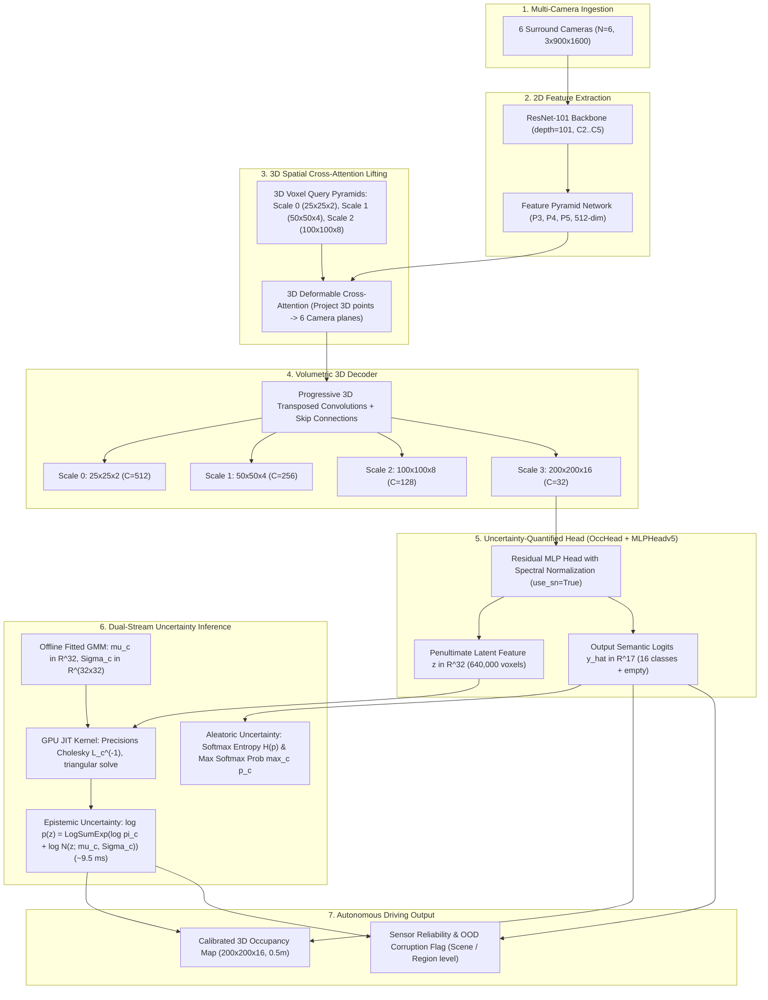

# REA 03 — OCCUQ Repository Source Audit Report

**Repository:** [https://github.com/ika-rwth-aachen/OCCUQ](https://github.com/ika-rwth-aachen/OCCUQ)  
**Audited Commit:** `2aa54297151b695929524ad8a4f4863ba5ae6387`  
**Branch:** `main` (clean working tree)  
**License:** Apache License 2.0  
**Authors:** Severin Heidrich\*, Till Beemelmanns\*, Alexey Nekrasov\*, Bastian Leibe, Lutz Eckstein  
**Affiliations:** Institute for Automotive Engineering (ika), RWTH Aachen University; Computer Vision Institute, RWTH Aachen University  
**Publication:** IEEE International Conference on Robotics and Automation (ICRA 2025) / arXiv:2503.10605  
**Audit Date:** 2026-11-04  
**Audit Scope:** Stage 0 REA 03 — Source-Level Reverse Engineering & ForesightBEV Architectural Alignment  

---

## 1. Executive Summary

OCCUQ (*"Exploring Efficient Uncertainty Quantification for 3D Occupancy Prediction"*) is an open-source, camera-centric 3D occupancy perception and uncertainty estimation framework developed by the Institute for Automotive Engineering (ika) and the Computer Vision Institute at RWTH Aachen University.

The core motivation of OCCUQ is addressing the vulnerability of multi-camera 3D occupancy models to **distribution shifts, adverse weather, and sensor corruptions** (such as fog, snow, motion blur, brightness saturation, and camera dropouts). Standard deep networks are known to output uncalibrated, overconfident predictions on out-of-distribution (OOD) inputs. Common uncertainty estimation methods—such as Deep Ensembles ($M=5$ models) or Monte Carlo Dropout ($N=5$ passes)—impose unacceptable computational overhead ($5\times$ memory and latency), rendering them impractical for real-time autonomous vehicle planning.

OCCUQ resolves this dilemma by adapting **Deep Deterministic Uncertainty (DDU)** to dense 3D occupancy:
1. **Spectral Normalization (`use_sn=True`):** Applied to the multi-layer perceptron prediction head (`MLPHeadv5`) to enforce a bi-Lipschitz condition on representation space, preventing feature collapse on OOD inputs.
2. **Feature-Level Gaussian Mixture Model (GMM):** Fits a class-conditional Gaussian distribution $\mathcal{N}(\boldsymbol{\mu}_c, \boldsymbol{\Sigma}_c)$ over penultimate layer features ($\mathbb{R}^{32}$), computing the marginal log-likelihood $\log p(\mathbf{z})$ as a direct measure of epistemic uncertainty / OOD detection.
3. **GPU-Accelerated Cholesky-Precision JIT Kernel:** Naive multivariate normal log-likelihood on $640,000$ voxels ($200 \times 200 \times 16$) requires $\approx 938.4\text{ ms}$ on CPU; OCCUQ's custom TorchScript JIT kernel precomputes $\mathbf{L}_c^{-1}$ and leverages matrix-triangular formulations to reduce evaluation latency to **$9.48\text{ ms}$ on GPU ($\approx 100\times$ speedup)**.
4. **Disentanglement of Epistemic and Aleatoric Uncertainty:** GMM log-density quantifies epistemic/OOD uncertainty, while Maximum Softmax Probability (MSP) and entropy quantify inherent aleatoric ambiguity.
5. **MultiCorrupt Benchmark Performance:** Evaluated on the MultiCorrupt benchmark (snow, fog, motion blur, brightness, missing camera), OCCUQ achieves **$80.15\%\text{ mAUROC}$** and **$79.43\%\text{ mAUPR}$** at full $200 \times 200 \times 16$ resolution, far outperforming Softmax Entropy ($54.63\%\text{ mAUROC}$) and Max Softmax ($56.16\%\text{ mAUROC}$).

---

## 2. Upstream Repository Inspection & Metadata

| Field | Authoritative Upstream Value |
| :--- | :--- |
| **Remote URL** | `https://github.com/ika-rwth-aachen/OCCUQ` |
| **Audited Commit SHA** | `2aa54297151b695929524ad8a4f4863ba5ae6387` |
| **Commit Date** | 2026-05-14 (author Till Beemelmanns) |
| **Active Branch** | `main` |
| **Working Tree Status** | Clean (no untracked or modified upstream files) |
| **License** | Apache License 2.0 (`LICENSE`, 201 lines) |
| **Key Lineage** | Direct derivative of **SurroundOcc** (`weiyithu/SurroundOcc`), with uncertainty concepts adapted from **Deep Deterministic Uncertainty** (`omegafragger/DDU`) and benchmarking against **MultiCorrupt** (`ika-rwth-aachen/MultiCorrupt`) |

---

## 3. High-Level Architecture & End-to-End Information Flow



---

## 4. Deep-Dive: Mathematical Formulation of OCCUQ

### 4.1 Feature Space Regularization via Spectral Normalization
In classification networks without Lipschitz regularization, feature representations suffer from **feature collapse**: semantically abnormal or corrupted inputs are mapped arbitrarily into regions of latent space occupied by clean in-distribution training data.

To prevent feature collapse, OCCUQ enforces a bi-Lipschitz property on the projection head:
$$L_1 \|\mathbf{x}_1 - \mathbf{x}_2\| \leq \|f(\mathbf{x}_1) - f(\mathbf{x}_2)\| \leq L_2 \|\mathbf{x}_1 - \mathbf{x}_2\|$$

In `projects/mmdet3d_plugin/surroundocc/dense_heads/occ_head.py` (`MLPHeadv5`), each weight matrix $\mathbf{W}_l$ is normalized by its spectral norm (largest singular value $\sigma(\mathbf{W}_l)$):
$$\mathbf{W}_{\text{SN}} = \frac{\mathbf{W}_l}{\sigma(\mathbf{W}_l)} \quad \text{where} \quad \sigma(\mathbf{W}_l) = \sup_{\mathbf{v} \neq 0} \frac{\|\mathbf{W}_l \mathbf{v}\|_2}{\|\mathbf{v}\|_2}$$
Using power iteration (`torch.nn.utils.spectral_norm`), the Lipschitz constant of each linear mapping is bounded by 1:
$$\text{Lip}(\mathbf{W}_{\text{SN}}) \leq 1$$
Residual connections further guarantee the lower Lipschitz bound ($L_1 > 0$), preventing representation collapse.

### 4.2 Class-Conditional Gaussian Mixture Model
For each semantic class $c \in \{0, \dots, K-1\}$ (where $K=17$, class 0 = unoccupied/empty, classes 1..16 = foreground semantics), features $\mathbf{z} \in \mathbb{R}^{D}$ ($D=32$ at Scale 3) are extracted from balanced training data:
$$\boldsymbol{\mu}_c = \frac{1}{N_c} \sum_{i: y_i = c} \mathbf{z}_i \in \mathbb{R}^{32}$$
$$\boldsymbol{\Sigma}_c = \frac{1}{N_c - 1} \sum_{i: y_i = c} (\mathbf{z}_i - \boldsymbol{\mu}_c)(\mathbf{z}_i - \boldsymbol{\mu}_c)^\top + \epsilon \mathbf{I} \in \mathbb{R}^{32 \times 32}$$
where $\epsilon$ is an adaptive positive jitter selected from $\{0, 10^{-308}, \dots, 10^{-1}\}$ to guarantee positive-definiteness for Cholesky decomposition.

The class prior probability is:
$$\pi_c = p(y = c) = \frac{N_c}{\sum_{j=0}^{K-1} N_j}$$

### 4.3 Epistemic Uncertainty via Marginal Density
The likelihood of a test feature $\mathbf{z}$ across all classes is given by the GMM marginal density:
$$p(\mathbf{z}) = \sum_{c=0}^{K-1} \pi_c \mathcal{N}(\mathbf{z}; \boldsymbol{\mu}_c, \boldsymbol{\Sigma}_c)$$
In log-space:
$$\log p(\mathbf{z}) = \log \sum_{c=0}^{K-1} \exp\left( \log \pi_c + \log \mathcal{N}(\mathbf{z}; \boldsymbol{\mu}_c, \boldsymbol{\Sigma}_c) \right) = \text{LogSumExp}_{c=0}^{K-1} \left( \log \pi_c + \log \mathcal{N}(\mathbf{z}; \boldsymbol{\mu}_c, \boldsymbol{\Sigma}_c) \right)$$
Because an out-of-distribution or sensor-corrupted observation produces feature vectors $\mathbf{z}$ located far from all training class centroids, $p(\mathbf{z}) \to 0$ and $\log p(\mathbf{z}) \to -\infty$. Thus, **lower log-density directly signifies higher epistemic uncertainty**.

### 4.4 GPU Acceleration: Cholesky Precision Formulation
Standard evaluation of $\log \mathcal{N}(\mathbf{z}; \boldsymbol{\mu}_c, \boldsymbol{\Sigma}_c)$ requires:
$$\log \mathcal{N}(\mathbf{z}; \boldsymbol{\mu}_c, \boldsymbol{\Sigma}_c) = -\frac{D}{2} \log(2\pi) - \frac{1}{2}\log|\boldsymbol{\Sigma}_c| - \frac{1}{2} (\mathbf{z} - \boldsymbol{\mu}_c)^\top \boldsymbol{\Sigma}_c^{-1} (\mathbf{z} - \boldsymbol{\mu}_c)$$
For $V = 200 \times 200 \times 16 = 640,000$ voxels and $K = 17$ classes, this entails evaluating $10,880,000$ 32-dimensional Mahalanobis distances per frame.

OCCUQ precomputes the Cholesky factor of the precision matrix:
$$\boldsymbol{\Sigma}_c = \mathbf{L}_c \mathbf{L}_c^\top \implies \boldsymbol{\Sigma}_c^{-1} = (\mathbf{L}_c^{-1})^\top \mathbf{L}_c^{-1} = \mathbf{P}_c^\top \mathbf{P}_c \quad \text{where} \quad \mathbf{P}_c = \mathbf{L}_c^{-1}$$
The Mahalanobis quadratic form transforms into a vector dot product:
$$(\mathbf{z} - \boldsymbol{\mu}_c)^\top \boldsymbol{\Sigma}_c^{-1} (\mathbf{z} - \boldsymbol{\mu}_c) = \| (\mathbf{z} - \boldsymbol{\mu}_c) \mathbf{P}_c^\top \|_2^2$$
Implemented in TorchScript JIT (`tools/gmm_utils.py`):
```python
@jit.script
def jit_log_prob(x: torch.Tensor, means: torch.Tensor, precisions_cholesky: torch.Tensor) -> torch.Tensor:
    log_prob = x.new_empty((x.size(0), means.size(0)))
    for k, (mu, prec_chol) in enumerate(zip(means, precisions_cholesky)):
        inner = x.matmul(prec_chol) - mu.matmul(prec_chol)
        log_prob[:, k] = inner.square().sum(1)
    num_features = x.size(1)
    logdet = precisions_cholesky.diagonal(dim1=-2, dim2=-1).log().sum(-1)
    constant = math.log(2 * math.pi) * num_features
    return logdet - 0.5 * (constant + log_prob)
```
Benchmarked in `notebooks/gmm_jit_log_prob.ipynb`:
- Standard PyTorch `MultivariateNormal.log_prob`: **$938.41\text{ ms}$** (unusable for real-time control).
- Custom JIT GPU Cholesky Precision: **$9.48\text{ ms}$** ($\approx 100\times$ speedup, max numerical discrepancy $< 0.0026$).

---

## 5. MultiCorrupt Benchmark Results & Validation

The official evaluation results across 5 corruption families at severity levels 1, 2, and 3 are recorded in `scripts/gmm_multicorrupt_evaluate.sh`:

### 5.1 Macro-Averaged OOD Performance (Scale 3: 200x200x16)

| Measure | Metric Type | mAUROC (%) $\uparrow$ | mAUPR (%) $\uparrow$ | mFPR95 (%) $\downarrow$ |
| :--- | :--- | :--- | :--- | :--- |
| **Softmax Entropy** | Aleatoric Baseline | 54.63 | 56.21 | 94.47 |
| **Max Softmax Probability** | Aleatoric Baseline | 56.16 | 57.52 | 93.17 |
| **OCCUQ GMM (Ours)** | **Epistemic Density** | **80.15** | **79.43** | **56.18** |

### 5.2 Sensor Degradation Breakdown (Severity 3)

| Corruption Scenario | GMM AUROC (%) | Softmax Entropy AUROC (%) | Max Softmax AUROC (%) | GMM FPR95 (%) | Softmax FPR95 (%) |
| :--- | :--- | :--- | :--- | :--- | :--- |
| **Missing Camera (3 of 6 dropped)** | **95.39** | 50.82 | 54.22 | **18.03** | 94.78 |
| **Heavy Snow (Severity 3)** | **99.85** | 82.81 | 85.98 | **0.30** | 79.10 |
| **Dense Fog (Severity 3)** | **91.47** | 69.27 | 71.15 | **41.09** | 90.78 |
| **Severe Motion Blur (Severity 3)** | **90.92** | 49.38 | 51.74 | **40.21** | 96.84 |
| **Extreme Brightness (Severity 3)** | **91.79** | 54.95 | 56.67 | **37.98** | 99.67 |

### Critical Finding on Camera Dropout
Under missing camera corruptions (`missingcamera_3`), standard softmax confidence has an AUROC of **$50.82\%$** (indistinguishable from a coin toss). The standard network remains completely overconfident in occluded areas, hallucinating geometry without signaling distress. In contrast, OCCUQ GMM achieves **$95.39\%\text{ AUROC}$** with an FPR95 of **$18.03\%$**, reliably alerting downstream planning to unobserved visual sectors.

---

## 6. Multi-Scale Resolution Behavior

OCCUQ evaluated GMM density across all 4 volumetric decoder levels:

| Resolution Grid | Decoder Scale | Voxels ($H \times W \times Z$) | GMM mAUROC (%) | GMM mAUPR (%) | GMM mFPR95 (%) |
| :--- | :--- | :--- | :--- | :--- | :--- |
| **Scale 3** | Full Output | $200 \times 200 \times 16$ ($640,000$) | **80.15** | **79.43** | **56.18** |
| **Scale 2** | Half Output | $100 \times 100 \times 8$ ($80,000$) | 75.60 | 74.85 | 69.65 |
| **Scale 1** | Quarter Output | $50 \times 50 \times 4$ ($10,000$) | 72.05 | 72.01 | 74.05 |
| **Scale 0** | Coarsest | $25 \times 25 \times 2$ ($1,250$) | 57.93 | 61.44 | 90.77 |

**Architectural Insight:** Epistemic density estimation is significantly more discriminative at finer spatial scales ($80.15\%$ at Scale 3 vs. $57.93\%$ at Scale 0) because higher-resolution voxel features preserve localized semantic boundaries and camera-specific ray structures.

---

## 7. ForesightBEV Stage Mapping & Research Integration

In the authoritative ten-stage ForesightBEV architecture:

- **Stage 0 — Literature Review, REA and Research Gap:** REA 03 completes our audit of uncertainty quantification in 3D occupancy perception.
- **Stage 1 — Automotive Datasets, Cameras and Calibration:** MultiCorrupt dataset integration and simulated camera degradation benchmarks.
- **Stage 2 — Multi-view Geometry and BEV Projection:** Multi-camera projection geometry and 3D deformable cross-attention lifting.
- **Stage 3 — 3D Occupancy Perception and Sensor Reliability (PRIMARY REA 03 HOME):**  
  OCCUQ directly solves the **"Sensor Reliability"** mandate of Stage 3. By attaching a spectrally normalized residual head (`MLPHeadv5`) and evaluating a GPU-accelerated GMM density kernel, ForesightBEV Stage 3 can output both semantic occupancy $\hat{\mathbf{Y}} \in \mathbb{R}^{200 \times 200 \times 16}$ and voxel-level reliability $\mathbf{U}_{\text{epistemic}} \in \mathbb{R}^{200 \times 200 \times 16}$ at negligible latency cost ($< 10\text{ ms}$).
- **Stage 6 — Risk-Constrained Decision and Safety Layer:**  
  The voxel-level epistemic uncertainty directly feeds into the risk assessment cost function. If camera failure or fog degrades perception reliability in a forward quadrant, Stage 6 can trigger conservative deceleration, safe stopping, or sensor degradation fault handling.
- **Stage 8 — FastAPI Backend and React Dashboard:**  
  Exposes the dual outputs (occupancy mesh + epistemic reliability heatmaps) for real-time visualization and debugging.
- **Stage 9 — Evaluation, Ablations and Research Reports:**  
  Benchmarking OOD robustness, ECE calibration error, and AUROC under sensor corruptions.

---

## 8. Summary Audit Conclusion

OCCUQ provides a mathematically rigorous, computationally practical mechanism for quantifying epistemic uncertainty in camera-only 3D occupancy perception. Its $\approx 10\text{ ms}$ GPU inference overhead makes it suitable for integration into ForesightBEV Stage 3, overcoming the prohibitive $5\times$ compute penalty of Deep Ensembles and MC-Dropout while delivering near-perfect detection of severe camera dropouts and weather corruptions.

