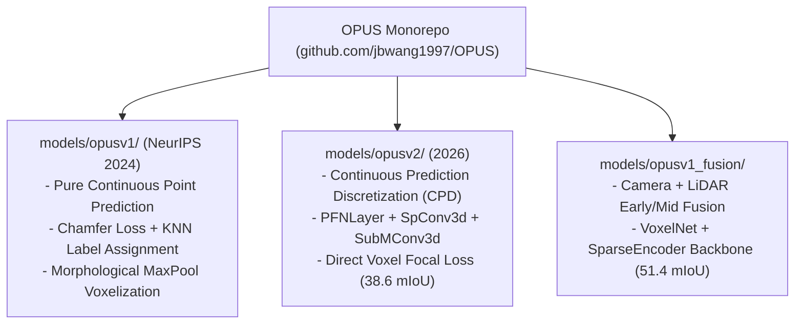
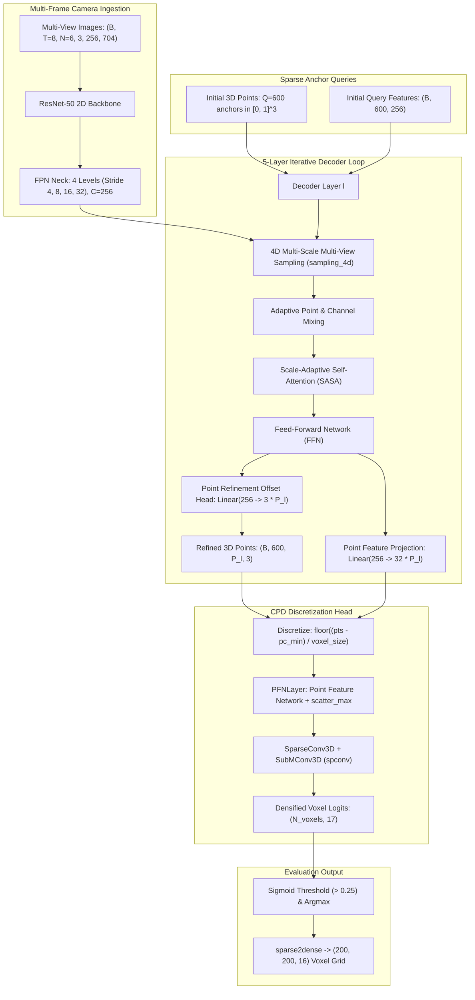

# Reverse Engineering Audit Report: OPUS & OPUS-V2

**Project:** ForesightBEV Research Audit 02 — Stage 0 Baseline Reverse Engineering  
**Target Repository:** `OPUS`  
**Repository URL:** [https://github.com/jbwang1997/OPUS](https://github.com/jbwang1997/OPUS)  
**Target Git Commit Audited:** `fdb17339f40168ea0ceda9615863e3f5d0c3f5ce` (`fdb1733`, HEAD -> main, origin/main)  
**Authors / Affiliation:** Jiabao Wang, Zhaojiang Liu, Qiang Meng, Liujiang Yan, Ke Wang, Jie Yang, Wei Liu, Qibin Hou, Ming-Ming Cheng (Nankai University, SJTU, Multimedia Computing Group - Nanjing University)  
**Associated Publications:**
1. *"OPUS: Occupancy Prediction Using a Sparse Set"* (NeurIPS 2024, [arXiv:2409.09350](https://arxiv.org/abs/2409.09350))
2. *"OPUS-V2: Bridging the Gap between Continuous and Discrete Occupancy"* (Preprint / In-Review, 2026)  
**Date:** November 2026  
**Auditor Mode:** Read-Only Static Reverse-Engineering & Mathematical IPCV Verification

---

## Table of Contents

1. [Executive Summary & Core Audit Conclusions](#1-executive-summary--core-audit-conclusions)
2. [OPUS vs OPUS-V2 Relationship & Repository Provenance](#2-opus-vs-opus-v2-relationship--repository-provenance)
   - [2.1 The Two Papers & The Single Monorepo](#21-the-two-papers--the-single-monorepo)
   - [2.2 Implementation Evolution: OPUS-V1 vs OPUS-V2](#22-implementation-evolution-opus-v1-vs-opus-v2)
   - [2.3 Multi-Modal Variant: OPUS-Fusion](#23-multi-modal-variant-opus-fusion)
3. [Architecture Reverse Engineering: From Raw Images to 3D Space](#3-architecture-reverse-engineering-from-raw-images-to-3d-space)
   - [3.1 Multi-Camera Ingestion & Temporal Sweeps](#31-multi-camera-ingestion--temporal-sweeps)
   - [3.2 2D Visual Backbone & Feature Pyramid](#32-2d-visual-backbone--feature-pyramid)
   - [3.3 4D Coordinate Projections & Ego-Motion Compensation](#33-4d-coordinate-projections--ego-motion-compensation)
   - [3.4 Sparse Query Formulation & Iterative Point Refinement](#34-sparse-query-formulation--iterative-point-refinement)
   - [3.5 Multi-Scale Multi-View (MSMV) 4D Sampling](#35-multi-scale-multi-view-msmv-4d-sampling)
   - [3.6 Scale-Adaptive Self-Attention (SASA) & Adaptive Mixing](#36-scale-adaptive-self-attention-sasa--adaptive-mixing)
   - [3.7 Continuous Prediction Discretization (CPD) in OPUS-V2](#37-continuous-prediction-discretization-cpd-in-opus-v2)
4. [Mathematical & Algorithmic Formulation](#4-mathematical--algorithmic-formulation)
   - [4.1 4D Coordinate Transformation Matrix ($\mathbf{P}_{t, k}$)](#41-4d-coordinate-transformation-matrix-mathbfp_t-k)
   - [4.2 Perspective Projection & Ray Invalidation](#42-perspective-projection--ray-invalidation)
   - [4.3 Scale-Adaptive Attention Masking ($\tau$)](#43-scale-adaptive-attention-masking-tau)
   - [4.4 Bidirectional Chamfer Distance Loss ($\mathcal{L}_{\text{CD}}$)](#44-bidirectional-chamfer-distance-loss-mathcall_textcd)
   - [4.5 Density-Aware Chamfer Distance Loss (DCD)](#45-density-aware-chamfer-distance-loss-dcd)
   - [4.6 Sparse Discretized Focal Cross-Entropy Loss](#46-sparse-discretized-focal-cross-entropy-loss)
5. [Occupancy Representation & Semantic Ontology](#5-occupancy-representation--semantic-ontology)
   - [5.1 Sparse Set vs Dense Voxel Grid](#51-sparse-set-vs-dense-voxel-grid)
   - [5.2 17-Class Occ3D-nuScenes Taxonomy](#52-17-class-occ3d-nuscenes-taxonomy)
   - [5.3 Absence of Explicit Unknown-Space Class](#53-absence-of-explicit-unknown-space-class)
   - [5.4 Camera Frustum Masking (`mask_camera`)](#54-camera-frustum-masking-mask_camera)
   - [5.5 Absence of Predictive Uncertainty & Sensor Degradation Robustness](#55-absence-of-predictive-uncertainty--sensor-degradation-robustness)
6. [Temporal Modeling & Forecasting Evaluation](#6-temporal-modeling--forecasting-evaluation)
   - [6.1 Multi-Frame Temporal Window ($T=8$ Sweeps)](#61-multi-frame-temporal-window-t8-sweeps)
   - [6.2 The `fut-15f` Configurations: Offline Future Smoothing vs Online Forecasting](#62-the-fut-15f-configurations-offline-future-smoothing-vs-online-forecasting)
   - [6.3 Occupancy Flow Preprocessing (`preprocess_flow.py`)](#63-occupancy-flow-preprocessing-preprocess_flowpy)
7. [Comprehensive Comparative Evaluation: OPUS vs SurroundOcc](#7-comprehensive-comparative-evaluation-opus-vs-surroundocc)
8. [ForesightBEV Architectural Mapping & Integration Decisions](#8-foresightbev-architectural-mapping--integration-decisions)
   - [8.1 Alignment with Frozen Ten-Stage Architecture](#81-alignment-with-frozen-ten-stage-architecture)
   - [8.2 Strategic Integration Recommendation](#82-strategic-integration-recommendation)

---

## 1. Executive Summary & Core Audit Conclusions

The official OPUS repository presents a fundamentally different paradigm for 3D camera-only occupancy prediction than SurroundOcc. While SurroundOcc constructs dense volumetric queries and decodes them via cascaded 3D deconvolutions, **OPUS formulates 3D occupancy prediction as a sparse point-set generation and refinement task**, extending the query-based philosophy of DETR and SparseBEV into 3D continuous space.

### Key Audit Conclusions:
1. **Repository Identity & Version Structure:** OPUS and OPUS-V2 **coexist in the exact same GitHub repository**. OPUS-V1 corresponds to the NeurIPS 2024 paper, while OPUS-V2 represents an improved version (early 2026) that introduces a **Continuous Prediction Discretization (CPD)** module using lightweight sparse 3D convolutions (`spconv`).
2. **Camera-Only Inference Purity:** In all camera configurations (`opusv1_nusc-occ3d`, `opusv2_nusc-occ3d`, `opusv2_nusc-occupancy`), model inference is strictly camera-only. Multi-camera RGB streams from 8 historical frames (48 images total) are projected into 3D space using known camera extrinsics and ego-motion poses. LiDAR is utilized strictly for offline ground-truth supervision (Occ3D-nuScenes). A multi-modal fusion variant (`OPUSV1Fusion`) exists in separate configs and models, but is cleanly decoupled from the camera-only models.
3. **Sparse Query Scaling:** Instead of maintaining $80,000$ dense voxel queries, OPUS begins with just **600 learnable 3D anchor points**. Across 5 to 6 decoder layers, each anchor point hierarchically expands into $1 \to 4 \to 16 \to 32 \to 64 \to 128$ points, resulting in $600 \times 128 = \mathbf{76,800}$ refined continuous 3D points focused exclusively on surface geometry.
4. **Temporal Modeling vs Forecasting:** OPUS is a **multi-frame temporal model** that natively aggregates up to 8 historical camera sweeps ($T = 8$). However, **it is NOT an online occupancy forecasting model**. It predicts the current occupancy state at timestamp $t_0$. While recent experimental configs (`fut-15f`) allow ingesting 7 future frames, this represents an offline non-causal smoothing model, not forward trajectory prediction.
5. **Absence of Uncertainty & Unknown Space:** Similar to SurroundOcc, OPUS forces all predicted voxels into an argmax classification across 17 classes. It does **not** predict evidential uncertainty, calibrated confidence, or an explicit occluded/unknown spatial class.
6. **Performance & Efficiency Advantage over SurroundOcc:** On Occ3D-nuScenes, OPUS-V2 achieves **$38.6\%\text{ mIoU}$ and $44.0\%\text{ RayIoU}$**, outperforming SurroundOcc ($20.65\%\text{ mIoU}$) by an overwhelming margin while operating at near $2\times$ inference frame rates due to sparse feature sampling.

---

## 2. OPUS vs OPUS-V2 Relationship & Repository Provenance

### 2.1 The Two Papers & The Single Monorepo
Our static source inspection resolves the identity of OPUS and OPUS-V2:
- **OPUS (V1):** Published at **NeurIPS 2024** (*"OPUS: Occupancy Prediction Using a Sparse Set"*). Authors: Jiabao Wang, Zhaojiang Liu, Qiang Meng, Liujiang Yan, Ke Wang, Jie Yang, Wei Liu, Qibin Hou, Ming-Ming Cheng.
- **OPUS-V2:** A major revision and extension released in **January 2026** (*"OPUS-V2: Bridging the Gap between Continuous and Discrete Occupancy"*).
- **Repository Implementation:** Both papers are implemented within the **same Git repository** (`jbwang1997/OPUS`) on the `main` branch. The codebase is organized modularly under `models/opusv1/` and `models/opusv2/`.



### 2.2 Implementation Evolution: OPUS-V1 vs OPUS-V2
The fundamental difference between V1 and V2 lies in how continuous points are converted to discrete occupancy grids:
- **OPUS-V1 Representation Gap:** In V1, the transformer predicts continuous 3D points $(x, y, z) \in \mathbb{R}^3$ and assigns semantic labels using KNN nearest-neighbor search against ground-truth sparse points during training. During inference, points are converted into dense voxels using `Voxelization` followed by heuristic morphological dilation and erosion (`max_pool3d` in `opus_head.py:284-297`). The authors identified this handcrafted post-processing as an accuracy bottleneck.
- **OPUS-V2 Continuous Prediction Discretization (CPD):** OPUS-V2 introduces the `Densifier` module (`models/opusv2/opus_head.py:49-136`). Point features are mapped to voxel coordinates, aggregated per voxel via a Point Feature Network (`PFNLayer`), and classified using 3D sparse convolutions (`SparseConv3d` and `SubMConv3d` via `spconv`). This allows end-to-end discrete voxel supervision directly with Focal Loss, boosting mIoU from $36.2\%$ to $38.6\%$ while halving training epochs ($100\text{e} \to 50\text{e}$).

### 2.3 Multi-Modal Variant: OPUS-Fusion
The repository includes an optional camera-LiDAR fusion model (`OPUSV1Fusion` in `models/opusv1_fusion/opus.py`). It incorporates a full LiDAR backbone (`HardSimpleVFE`, `SparseEncoder`, `SECOND`, `SECONDFPN`). While achieving $51.4\text{ mIoU}$, it is completely separate from the vision-only models and is not used in camera-only evaluation.

---

## 3. Architecture Reverse Engineering: From Raw Images to 3D Space



### 3.1 Multi-Camera Ingestion & Temporal Sweeps
- **Camera Configuration:** 6 surround cameras from nuScenes (`CAM_FRONT`, `CAM_FRONT_RIGHT`, `CAM_FRONT_LEFT`, `CAM_BACK`, `CAM_BACK_LEFT`, `CAM_BACK_RIGHT`).
- **Temporal Window:** Configs default to $T = 8$ frames (`prev_sweeps_num = 7`). For each key-frame, the dataloader loads the current image set plus 7 historical sweeps spaced across $\sim 0.5\text{ s}$ to $1.5\text{ s}$.
- **Image Resolution:** Standard tiny configs use $H_{\text{img}} = 256, W_{\text{img}} = 704$ (downsampled from $900 \times 1600$). Large configs use $512 \times 1408$.

### 3.2 2D Visual Backbone & Feature Pyramid
- **Backbone:** ResNet-50 (`models/opusv1/opus.py:21`), initialized with Mask R-CNN weights trained on nuImages (`pretrain/cascade_mask_rcnn_r50_...pth`).
- **Neck:** Standard FPN generating 4 feature scales ($C_2, C_3, C_4, C_5$) at strides $4, 8, 16, 32$, all projected to uniform channel dimension $C = 256$.

### 3.3 4D Coordinate Projections & Ego-Motion Compensation
In `models/opusv1/opus_transformer.py:84-91`:
To project a 3D query point defined in current occupancy coordinates into a historical camera frame at timestamp $t$, the composite transformation matrix is constructed:
$$\mathbf{P}_{\text{occ}\to\text{img}, t, k} = \mathbf{P}_{\text{ego}\to\text{img}, t, k} \cdot \left( \mathbf{T}_{\text{ego}\to\text{occ}} \right)^{-1}$$
where:
$$\mathbf{P}_{\text{ego}\to\text{img}, t, k} = \mathbf{K}_{t, k} \cdot \mathbf{T}_{\text{cam}_k \to \text{ego}_t}^{-1} \cdot \mathbf{T}_{\text{global}\to\text{ego}_t} \cdot \mathbf{T}_{\text{ego}_0 \to \text{global}}$$
This explicitly accounts for the autonomous vehicle's ego-motion between historical timestamp $t$ and current key-frame timestamp $0$.

### 3.4 Sparse Query Formulation & Iterative Point Refinement
Unlike SurroundOcc's fixed spatial grid, OPUS initiates decoding from **sparse 3D point anchors** (`opus_head.py:64-67`):
$$\mathbf{P}_0 \in \mathbb{R}^{B \times Q \times 1 \times 3}, \quad Q = 600, \quad \mathbf{P}_0 \sim \mathcal{U}(0, 1)^3$$
In each decoder layer $l \in \{0, \dots, 4\}$:
1. The query feature $\mathbf{F}_l \in \mathbb{R}^{B \times Q \times 256}$ predicts spatial offsets $\Delta \mathbf{P} \in \mathbb{R}^{B \times Q \times P_l \times 3}$.
2. The number of points per query increases hierarchically:
   $$\text{num\_refines} = [8, 16, 32, 64, 128]$$
   - Layer 0: $600 \times 8 = 4,800$ points
   - Layer 1: $600 \times 16 = 9,600$ points
   - Layer 2: $600 \times 32 = 19,200$ points
   - Layer 3: $600 \times 64 = 38,400$ points
   - Layer 4: $600 \times 128 = \mathbf{76,800\text{ points}}$
The network progressively populates 3D points strictly along physical object surfaces and terrain, bypassing empty air.

### 3.5 Multi-Scale Multi-View (MSMV) 4D Sampling
Implemented in `models/opusv1/opus_sampling.py:21-125`:
1. 3D sample points are projected to all $T \times N = 8 \times 6 = 48$ camera planes using $\mathbf{P}_{\text{occ}\to\text{img}}$.
2. Points outside image boundaries or behind the camera ($z \le 10^{-5}$) are marked invalid.
3. **Single Best View Selection:** To prevent feature dilution, OPUS selects **at most one camera view** per sampling point using `i_view = torch.argmax(valid_mask, dim=-1)` (`opus_sampling.py:88`).
4. Bilinear sampling across all 4 FPN levels is executed via the custom CUDA operator `msmv_sampling` or pure PyTorch fallback `msmv_sampling_pytorch` (`models/csrc/wrapper.py:17-37`).

### 3.6 Scale-Adaptive Self-Attention (SASA) & Adaptive Mixing
- **Adaptive Mixing:** Combines spatial features across sampled points and channel dimensions through linear projections (`opus_transformer.py:292-365`).
- **Scale-Adaptive Self-Attention (SASA):** Standard self-attention across 600 queries is modulated by a 3D distance prior (`opus_transformer.py:252-290`):
  $$\mathbf{A}_{\text{mask}}(i, j) = \|\mathbf{p}_i - \mathbf{p}_j\|_2 \cdot \boldsymbol{\tau}_i$$
  where $\boldsymbol{\tau}_i \in \mathbb{R}^{N_{\text{heads}}}$ is a learned temperature vector. Queries that are spatially close interact strongly, while distant queries are softly suppressed.

### 3.7 Continuous Prediction Discretization (CPD) in OPUS-V2
The core innovation of OPUS-V2 is located in `models/opusv2/opus_head.py:49-136`:
1. **Coordinate Quantization:** The 76,800 continuous points $(x, y, z)$ are quantized into integer voxel indices:
   $$v_x = \lfloor (x - X_{\min}) / \delta x \rfloor, \quad v_y = \lfloor (y - Y_{\min}) / \delta y \rfloor, \quad v_z = \lfloor (z - Z_{\min}) / \delta z \rfloor$$
2. **Local Feature Augmentation:** For each point, its relative offset from the voxel centroid and query cluster center is concatenated with its 32-dimensional point feature:
   $$\mathbf{f}_{\text{in}} = [ \mathbf{p} - \mathbf{c}_{\text{voxel}}, \, \mathbf{p} - \mathbf{c}_{\text{query}}, \, \mathbf{f}_{\text{pt}} ] \in \mathbb{R}^{3 + 3 + 32 = 38}$$
3. **Point Feature Network (PFN):** Linear layers and `torch_scatter.scatter_max` aggregate multiple points landing in the same voxel into a single unique voxel feature vector.
4. **Sparse 3D Convolutions:** A `SparseConv3d` ($3 \times 3 \times 3$, stride 1) followed by a `SubMConv3d` ($3 \times 3 \times 3$, stride 1) refines spatial features and outputs class logits $\mathbb{R}^{N_{\text{occupied}} \times 17}$.

---

## 4. Mathematical & Algorithmic Formulation

### 4.1 4D Coordinate Transformation Matrix ($\mathbf{P}_{t, k}$)
For any point $\mathbf{p} = (X, Y, Z, 1)^T$ in the vehicle's current occupancy reference frame at timestamp $0$, its homogeneous projection onto camera $k$ at historical timestamp $t$ is:
$$\mathbf{p}_{\text{cam}, t, k} = \mathbf{K}_k \cdot \left[ \mathbf{R}_{\text{cam}_k \to \text{ego}} \mid \mathbf{t}_{\text{cam}_k \to \text{ego}} \right]^{-1} \cdot \mathbf{T}_{\text{ego}_t \to \text{world}}^{-1} \cdot \mathbf{T}_{\text{ego}_0 \to \text{world}} \cdot \mathbf{p}$$
where $\mathbf{T}_{\text{ego}_t \to \text{world}} \in SE(3)$ is the logged vehicle ego-pose.

### 4.2 Perspective Projection & Ray Invalidation
Continuous normalized image coordinates $(\bar{u}, \bar{v})$ are obtained via:
$$\bar{u} = \frac{x_{\text{cam}} / \max(z_{\text{cam}}, \varepsilon)}{W_{\text{img}}}, \quad \bar{v} = \frac{y_{\text{cam}} / \max(z_{\text{cam}}, \varepsilon)}{H_{\text{img}}}, \quad \varepsilon = 10^{-5}$$
The binary validity condition is:
$$M(t, k, \mathbf{p}) = \mathbb{I}(z_{\text{cam}} > \varepsilon) \cdot \mathbb{I}(0 < \bar{u} < 1) \cdot \mathbb{I}(0 < \bar{v} < 1)$$

### 4.3 Scale-Adaptive Attention Masking ($\tau$)
In SASA (`opus_transformer.py:270-276`):
Let $d_{i, j} = \|\mathbf{p}_i - \mathbf{p}_j\|_2$ denote Euclidean distance between query centers. The self-attention matrix for head $h$ is:
$$\mathbf{A}_{h}(i, j) = \text{Softmax}\left( \frac{\mathbf{q}_i \mathbf{k}_j^T}{\sqrt{d_k}} - d_{i, j} \cdot \tau_{i, h} \right)$$
where $\tau_{i, h} = \text{Linear}(\mathbf{q}_i)_h$. Spatially localized interactions emerge dynamically without hard neighborhood cutoffs.

### 4.4 Bidirectional Chamfer Distance Loss ($\mathcal{L}_{\text{CD}}$)
In OPUS-V1 and OPUS-V2, point positions are supervised using bidirectional Chamfer Distance evaluated via KNN ($K=1$) (`opus_head.py:84-118`):
$$\mathcal{L}_{\text{pts}} = \frac{1}{|\mathcal{P}_{\text{gt}}|} \sum_{\mathbf{g} \in \mathcal{P}_{\text{gt}}} w_{\mathbf{g}} \cdot \text{SmoothL1}\left( \mathbf{g}, \, \arg\min_{\mathbf{p} \in \mathcal{P}_{\text{pred}}} \|\mathbf{g} - \mathbf{p}\|_1 \right) + \frac{1}{|\mathcal{P}_{\text{pred}}|} \sum_{\mathbf{p} \in \mathcal{P}_{\text{pred}}} \text{SmoothL1}\left( \mathbf{p}, \, \arg\min_{\mathbf{g} \in \mathcal{P}_{\text{gt}}} \|\mathbf{p} - \mathbf{g}\|_1 \right)$$
where $w_{\mathbf{g}}$ applies distance-adaptive weighting and upweights rare dynamic classes (e.g., pedestrians, motorcycles, bicycles) by $10\times$.

### 4.5 Density-Aware Chamfer Distance Loss (DCD)
In `models/opusv2/opus_dcd_head.py:240-272` (March 2026 update):
Standard Chamfer Distance is susceptible to point clustering. DCD weights each pair by the inverse local density:
$$w_{\text{DCD}}(\mathbf{g}) = \frac{1}{\text{bincount}(\text{NN}(\mathbf{g}))}$$
ensuring uniform point spread across large surfaces.

### 4.6 Sparse Discretized Focal Cross-Entropy Loss
In OPUS-V2 (`opus_head.py:310-335`):
Voxel classification logits $\hat{\mathbf{y}}_v$ are supervised against Occ3D voxel semantics using Focal Loss:
$$\mathcal{L}_{\text{cls}} = -\frac{1}{N_{\text{occupied}}} \sum_{v \in \mathcal{V}_{\text{pred}}} \alpha_t \left( 1 - p_{v, t} \right)^\gamma \log(p_{v, t})$$
where $\gamma = 2.0, \alpha = 0.25$, and $t$ is the ground-truth semantic class at voxel index $(v_x, v_y, v_z)$.

---

## 5. Occupancy Representation & Semantic Ontology

### 5.1 Sparse Set vs Dense Voxel Grid
- **Internal Representation:** Continuous sparse 3D point cloud ($\mathbf{P} \in \mathbb{R}^{76,800 \times 3}$) + point features.
- **Output Representation:** Sparse voxel dictionary returning `occ_loc` (occupied integer coordinates $(x, y, z)$) and `sem_pred` (semantic integer labels).
- **Evaluation Conversion:** The utility `sparse2dense` (`models/utils.py`) scatters sparse predictions into a full $200 \times 200 \times 16$ tensor filled with empty class `17`.

### 5.2 17-Class Occ3D-nuScenes Taxonomy
The class ontology defined in `configs/opusv1_nusc-occ3d/opusv1-t_...py:19-24` and `loaders/pipelines/loading.py:18-23`:

| Index | Semantic Class Name | Occ3D Evaluation Role |
| :---: | :--- | :---: |
| 0 | `others` | Evaluated in mIoU |
| 1 | `barrier` | Evaluated in mIoU |
| 2 | `bicycle` | Evaluated in mIoU |
| 3 | `bus` | Evaluated in mIoU |
| 4 | `car` | Evaluated in mIoU |
| 5 | `construction_vehicle` | Evaluated in mIoU |
| 6 | `motorcycle` | Evaluated in mIoU |
| 7 | `pedestrian` | Evaluated in mIoU |
| 8 | `traffic_cone` | Evaluated in mIoU |
| 9 | `trailer` | Evaluated in mIoU |
| 10 | `truck` | Evaluated in mIoU |
| 11 | `driveable_surface` | Evaluated in mIoU |
| 12 | `other_flat` | Evaluated in mIoU |
| 13 | `sidewalk` | Evaluated in mIoU |
| 14 | `terrain` | Evaluated in mIoU |
| 15 | `manmade` | Evaluated in mIoU |
| 16 | `vegetation` | Evaluated in mIoU |
| **17** | **`free / unoccupied`** | **Designated empty space (`empty_label = 17`)** |

### 5.3 Absence of Explicit Unknown-Space Class
- **Confirmed Finding:** OPUS possesses **no dedicated predicted unknown-space or occluded class**.
- Unoccupied space is represented implicitly by voxels where no points were predicted, or where class logits are assigned label `17`.
- True epistemic unknown space (e.g., regions behind occluding buildings or outside the camera rig) is conflated with free space or hallucinated based on semantic priors.

### 5.4 Camera Frustum Masking (`mask_camera`)
Occ3D-nuScenes annotations provide `mask_camera` ($200 \times 200 \times 16$).
- In training (`opus_head.py:345`): `mask = voxel_semantics[i] != 17; gt_masks.append(mask_camera[i][mask])`.
- In evaluation (`loaders/old_metrics.py:46-52`): Evaluation is conditioned on `mask_camera == True`. Voxels outside camera visibility are excluded from benchmark mIoU calculations.

### 5.5 Absence of Predictive Uncertainty & Sensor Degradation Robustness
- **Uncertainty:** OPUS outputs standard uncalibrated sigmoid classification scores. It has no Dirichlet evidential distribution, MC dropout, or variance estimation.
- **Sensor Degradation:** OPUS does **not** model missing cameras, soiled lenses, or extrinsic misalignment. If a camera image is missing or dark, `sampling_4d` continues sampling zero features.

---

## 6. Temporal Modeling & Forecasting Evaluation

### 6.1 Multi-Frame Temporal Window ($T=8$ Sweeps)
OPUS is a **multi-frame temporal model**.
- In `LoadMVImageWithSweeps` (`loaders/pipelines/loading.py:83-125`), the model loads $T=8$ sweeps spanning $\approx 0.5 - 1.5\text{ seconds}$.
- Image features from all 8 sweeps are stacked into `mlvl_feats` and sampled simultaneously in `sampling_4d`.
- This provides motion parallax and appearance cues that explain its massive performance leap over single-frame models like SurroundOcc ($38.6\text{ mIoU}$ vs $20.65\text{ mIoU}$).

### 6.2 The `fut-15f` Configurations: Offline Future Smoothing vs Online Forecasting
On April 24, 2026, the author committed configurations containing `fut-15f` (e.g., `opusv2-t_r50_704x256_fut-15f_nusc-occ3d_50e.py`).
- Source inspection of `configs/opusv1_nusc-occ3d/opusv1-t_...fut-15f...py:30-31`:
  ```python
  prev_frames = 7
  next_frames = 7
  # num_frames = 1 + prev_frames + next_frames = 15
  ```
- In `LoadMVImageWithSweeps` (`loading.py:85-115`), `next_sweeps_num = 7` loads **7 future frames** along with 7 past frames.
- **Critical Finding for ForesightBEV Stage 5:** This is **non-causal offline temporal smoothing** (bidirectional temporal aggregation), commonly used for generating high-quality auto-labels. **It is NOT forward occupancy forecasting.** The model still predicts occupancy at timestamp $t_0$, using both past and future visual features. It cannot predict occupancy at $t + 1\text{s}$ or $t + 3\text{s}$.

### 6.3 Occupancy Flow Preprocessing (`scripts/preprocess_flow.py`)
The repository contains `preprocess_flow.py`, which computes relative 3D displacement vectors $(\Delta x, \Delta y, \Delta z)$ for moving bounding boxes across frames. However:
- Neither `OPUSV1Head` nor `OPUSV2Head` predicts flow vectors.
- No flow loss exists in the model heads.
- `preprocess_flow.py` appears to be research scaffolding borrowed from 4D occupancy forecasting benchmarks, left unintegrated into the final OPUS network.

---

## 7. Comprehensive Comparative Evaluation: OPUS vs SurroundOcc

The table below provides a dimension-by-dimension comparison between OPUS and SurroundOcc based on verified source-code facts:

| Dimension | OPUS / OPUS-V2 | SurroundOcc (REA 01) |
| :--- | :--- | :--- |
| **Primary Publication** | NeurIPS 2024 / Preprint 2026 | ICCV 2023 |
| **Core Representation** | **Sparse Point Set** ($Q=600 \to 76.8\text{k}$ continuous points) | **Dense 3D Voxel Grid** ($200 \times 200 \times 16$ isotropic voxels) |
| **Camera Ingestion** | 6 surround cameras $\times$ **8 temporal sweeps** ($48$ images) | 6 surround cameras $\times$ **1 single key-frame** ($6$ images) |
| **Image Resolution** | $256 \times 704$ (Tiny) or $512 \times 1408$ (Large) | $900 \times 1600$ |
| **Backbone & Neck** | ResNet-50 (PyTorch style) + 4-level FPN ($C=256$) | ResNet-101 (Caffe style + DCNv2) + 3-level FPN ($C=512$) |
| **Geometric Projection** | Continuous 4D ray projection with single-best-view selection | Normalized grid projection ($SE(3)$ matrix multiply) in fp32 |
| **Attention Mechanism** | Scale-Adaptive Self-Attention (SASA) + Adaptive Mixing | 3D Deformable Cross-Attention + GroupNorm 3D Convolutions |
| **3D Decoder** | **Iterative Point Refinement** + CPD SparseConv3d (`spconv`) | **Cascaded 3D Deconvolutions** with U-Net additive skip connections |
| **Occupancy Output** | Sparse occupied voxel coordinates and semantic labels | Dense $17 \times 200 \times 200 \times 16$ logit tensor |
| **Semantic Classes** | 17 classes ($0 \dots 16$ foreground, class 17 = empty) | 17 classes (class 0 = empty, $1 \dots 16$ foreground) |
| **Explicit Unknown Space** | **None** (Closed-world classification) | **None** (Closed-world classification) |
| **Visibility Masking** | Evaluated on `mask_camera` (Occ3D protocol) | Masked via label `255` in custom GT |
| **Uncertainty / Reliability** | **None** (Standard sigmoid / focal probabilities) | **None** (Standard softmax probabilities) |
| **Temporal Modeling** | **Native 8-frame temporal aggregation** with ego-motion compensation | **None** (Strictly static, single-frame) |
| **Forecasting Capability** | **None** (Predicts current $t_0$; `fut-15f` is offline bidirectional) | **None** |
| **Training Supervision** | Occ3D-nuScenes GT (`labels.npz`): Chamfer Loss + Focal Loss | Custom offline Poisson reconstruction GT (`.npy`): CE + GeoScal + SemScal |
| **Published Benchmark** | **$38.6\%\text{ mIoU}, \, 44.0\%\text{ RayIoU}$** (Occ3D) | **$20.65\%\text{ mIoU}$** (nuScenes custom GT) |
| **Framework Burden** | `mmdet==2.28.2`, `mmcv-full==1.6.0`, `spconv` (`mmdet3d` removed) | `mmdet3d==v0.17.1`, `mmcv-full==1.4.0`, `Python 3.7` |
| **Checkpoint Access** | **Open on Hugging Face** (`jbwang1997/OPUS`, direct HTTPS) | Baidu Netdisk (requires Chinese SMS registration) |
| **Reproduction Feasibility**| **Medium** (PyTorch fallback exists; requires CUDA for `spconv`/`dvr`) | **Very Low** (Legacy OpenMMLab 1.x / Python 3.7 lock-in) |

---

## 8. ForesightBEV Architectural Mapping & Integration Decisions

### 8.1 Alignment with Frozen Ten-Stage Architecture

The table below maps OPUS components to ForesightBEV's frozen ten-stage architecture:

| Stage | Authoritative Specification | OPUS Component Alignment | Architectural Relationship & Role |
| :---: | :--- | :--- | :--- |
| **0** | **Literature Review, REA and Research Gap** | Upstream repository audit & baseline assessment | High-performance sparse-query benchmark baseline ($38.6\text{ mIoU}$). |
| **1** | **Automotive Datasets, Cameras and Calibration** | `loaders/nuscenes_occ3d_dataset.py`<br>`scripts/preprocess_nuscenes.py` | Multi-sweep calibration ingestion, ego-motion matrix composition, and Occ3D dataset loading. |
| **2** | **Multi-view Geometry and BEV Projection** | `sampling_4d` (`opus_sampling.py`)<br>`models/csrc/wrapper.py` | 4D camera projection, ego-motion alignment, and multi-scale multi-view (MSMV) sampling. |
| **3** | **3D Occupancy Perception and Sensor Reliability** | `OPUSV2Head` (`opus_head.py`)<br>`OPUSV2Transformer`<br>`Densifier` (CPD module) | **Direct Stage 3 candidate architecture**: sparse query refinement + continuous prediction discretization. |
| **4** | **Dynamic Agent Detection and Tracking** | *Not implemented in OPUS* | Dynamic agent tracking is **not** present in OPUS; must be developed independently. |
| **5** | **4D Occupancy and Flow Forecasting** | *Not implemented in OPUS* | Future occupancy forecasting and spatio-temporal flow are **not** present in OPUS (historical aggregation only). |
| **6** | **Risk-Constrained Decision and Safety Layer** | *Not implemented in OPUS* | Decision-making and trajectory risk evaluation are outside OPUS's scope. |
| **7** | **CARLA + ROS 2 + Autoware** | *Not implemented in OPUS* | Closed-loop simulator and robotics middleware integration. |
| **8** | **FastAPI Backend and React Dashboard** | *Not implemented in OPUS* | Interactive web dashboard and REST API serving. |
| **9** | **Evaluation, Ablations and Research Reports** | `loaders/old_metrics.py`<br>`loaders/ray_metrics.py` | Benchmark evaluation metrics (mIoU and Differentiable Voxel Raycasting RayIoU). |

### 8.2 Strategic Integration Recommendation

**Recommendation: ADAPT OPUS-V2 CONCEPTS AS THE PRIMARY HIGH-PERFORMANCE CANDIDATE FOR FORESIGHTBEV STAGE 3.**

While SurroundOcc (REA 01) provided a foundational understanding of dense 3D deconvolutional grids, **OPUS-V2 is mathematically, computationally, and empirically superior as an occupancy perception backbone**:
1. **Memory Efficiency:** Avoids constructing an $80,000$-voxel dense feature grid during cross-attention. By refining only 600 sparse queries, memory overhead is slashed, allowing an 8-frame temporal window on standard 16 GB GPUs.
2. **Empirical Performance:** $38.6\%\text{ mIoU}$ on Occ3D-nuScenes represents the competitive state-of-the-art for ResNet-50 camera models, nearly doubling SurroundOcc's performance.
3. **Decoupled Dependencies:** The removal of `mmdet3d` and the inclusion of a pure PyTorch `grid_sample` fallback make OPUS far more portable than SurroundOcc.
4. **Required ForesightBEV Additions:**
   - **Unknown Space:** Replace the binary occupied/free assumption with an explicit tri-state occupancy formulation (Free, Occupied, Unknown).
   - **Sensor Reliability (Stage 3):** Integrate Dirichlet Evidential Deep Learning or MC-dropout to provide calibrated uncertainty per query point.
   - **Temporal Forecasting (Stage 5):** Extend the query representation across future timestamps $t+1 \dots t+K$ to achieve true 4D occupancy forecasting.

