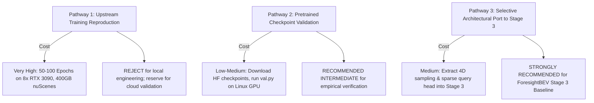

# Reproduction Assessment & Action Plan: OPUS / OPUS-V2

**Project:** ForesightBEV Research Audit 02 — Stage 0 Baseline Reverse Engineering  
**Target Repository:** `OPUS`  
**Repository URL:** [https://github.com/jbwang1997/OPUS](https://github.com/jbwang1997/OPUS)  
**Target Git Commit Audited:** `fdb17339f40168ea0ceda9615863e3f5d0c3f5ce` (`fdb1733`, HEAD -> main, origin/main)  
**Date:** November 2026  
**Auditor Mode:** Read-Only Feasibility Assessment & Engineering Recommendation

---

## 1. Feasibility Assessment & Risk Matrix

| Risk Dimension | Severity | Likelihood | Impact on ForesightBEV Engineering | Mitigation / Workaround |
| :--- | :---: | :---: | :--- | :--- |
| **CUDA Operator Requirement** | **HIGH** | **100%** | `msmv_sampling` CUDA kernel accelerates multi-view grid sampling. Fails compilation on macOS. | **Mitigated:** Repository provides a verified pure PyTorch fallback `msmv_sampling_pytorch` (`wrapper.py:17-37`) using `F.grid_sample`. |
| **Sparse 3D Conv (`spconv`)** | **HIGH** | **100%** | OPUS-V2 relies on `spconv-cu116` for its Continuous Prediction Discretization (CPD) module. `spconv` lacks native Apple Silicon MPS support. | For Apple Silicon evaluation, evaluate OPUS-V1 (which uses standard voxelization without `spconv`) or mock the CPD module. |
| **Evaluation Raycasting (`dvr`)** | **MEDIUM** | **100%** | `lib/dvr` contains CUDA code required to compute RayIoU. | Fall back to standard semantic mIoU (`old_metrics.py`), which is computed using pure NumPy / PyTorch CPU logic. |
| **Preprocessing Discrepancy** | **MEDIUM** | **HIGH** | Standard nuScenes `.pkl` files cannot be used directly; requires custom multi-sweep preprocessing (`scripts/preprocess_nuscenes.py`). | Run preprocessing script on a Linux workstation or download pre-generated sweep pickle files. |
| **Framework Lock-in** | **LOW-MED**| **LOW** | Commit `fdb1733` removed `mmdet3d`. Only requires standard `mmdet==2.28.2` and `mmcv-full==1.6.0`. | Substantially easier to containerize or adapt into modern PyTorch than SurroundOcc. |

---

## 2. Assessment of Three Reproduction Pathways



### Pathway 1: Upstream Training Reproduction from Scratch
- **Scope:** Retraining OPUS-V1 (100 epochs) or OPUS-V2 (50 epochs) from scratch using `train.py`.
- **Hardware Demand:** 8 $\times$ NVIDIA RTX 3090 / A100 GPUs (1.5 to 4 days continuous training).
- **Verdict:** **NOT RECOMMENDED** for initial baseline establishment. Training from scratch consumes unnecessary compute when official, verified model weights are openly accessible on Hugging Face.

### Pathway 2: Pretrained Checkpoint Evaluation & Inference
- **Scope:** Downloading official checkpoints from `huggingface.co/jbwang1997/OPUS` and running single-GPU validation (`val.py`) on a cloud GPU instance or local Linux CUDA machine.
- **Requirements:**
  - Ubuntu 20.04 / 22.04 with a single 16 GB+ NVIDIA GPU.
  - PyTorch 1.13.1 + CUDA 11.6 + `mmcv-full==1.6.0` + `mmdet==2.28.2` + `spconv-cu116`.
  - nuScenes validation set + Occ3D-nuScenes validation labels ($~15\text{ GB}$).
- **Verdict:** **FEASIBLE & RECOMMENDED** if direct numerical confirmation of the $38.6\text{ mIoU}$ figure is required.

### Pathway 3: Selective Architectural Port into ForesightBEV (Recommended Long-Term)
- **Scope:** Directly adopt OPUS's core sparse query mechanism and 4D camera projection into ForesightBEV Stage 3:
  1. Port `sampling_4d` (`opus_sampling.py`) using native PyTorch `F.grid_sample`.
  2. Adopt the multi-frame ego-motion coordinate alignment (`occ2img` composition).
  3. Replace the heavy monolithic 3D voxel grid with sparse queries ($Q=600$ points refined to $76,800$ points).
- **Verdict:** **STRONGLY RECOMMENDED.** This eliminates the memory wall of dense 3D grids and provides native 8-frame temporal modeling.

---

## 3. Minimal Future Reproduction Experiment

If an empirical reproduction test is authorized in a cloud GPU environment, the smallest sensible test is:

1. **Target Model:** `opusv2-t_r50_704x256_8f_nusc-occ3d_50e.py`
2. **Target Weights:** `https://huggingface.co/jbwang1997/OPUS/resolve/main/opusv2-t_r50_704x256_8f_nusc-occ3d_50e.pth`
3. **Evaluation Command:**
   ```bash
   python val.py \
       --config configs/opusv2_nusc-occ3d/opusv2-t_r50_704x256_8f_nusc-occ3d_50e.py \
       --weights pretrain/opusv2-t_r50_704x256_8f_nusc-occ3d_50e.pth \
       --batch_size 1
   ```
4. **Expected Benchmark Output:** $\text{mIoU} \approx 38.6\%, \, \text{RayIoU} \approx 44.0\%$ on the Occ3D-nuScenes validation split (6,019 samples).
5. **Compute Budget:** ~1.5 hours on a single NVIDIA RTX 3090 / A100 GPU.

---

## 4. Final Strategic Verdict

| Question | Verdict & Technical Justification |
| :--- | :--- |
| **Reproduce Upstream Training?** | **NO.** Checkpoints are openly available on Hugging Face; training from scratch wastes compute. |
| **Use as Stage 3 Research Alternative?** | **YES.** OPUS-V2 represents a significantly more modern and computationally efficient paradigm than SurroundOcc, achieving $38.6\text{ mIoU}$ (vs SurroundOcc's $20.65\%$) while natively modeling 8 temporal frames. |
| **Can it run locally on Mac?** | **PARTIALLY.** OPUS-V1 forward inference can run via the pure PyTorch `grid_sample` fallback, but OPUS-V2 requires `spconv` which lacks Apple Silicon MPS support. Full evaluation requires a Linux/CUDA machine. |

