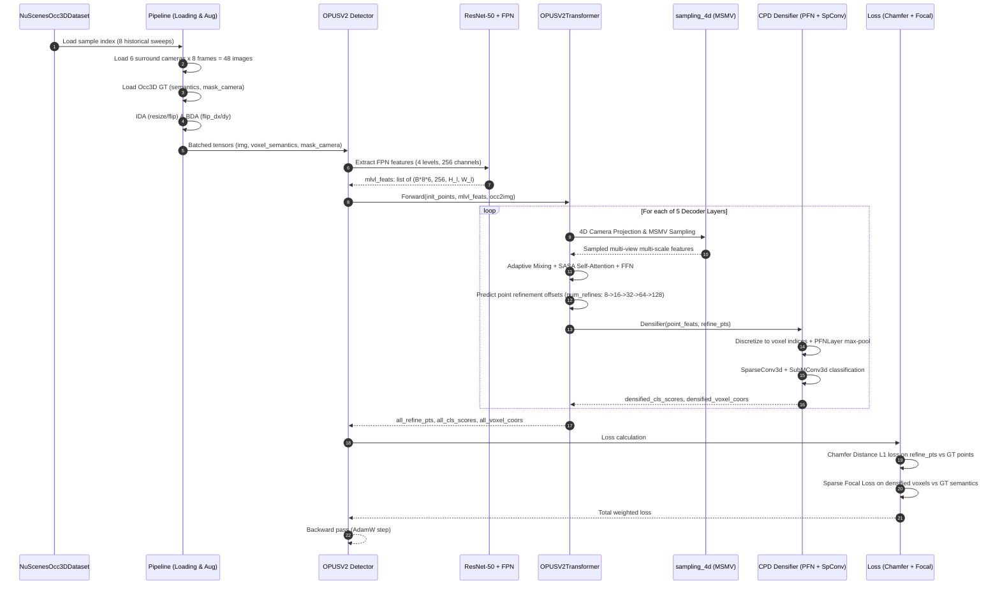
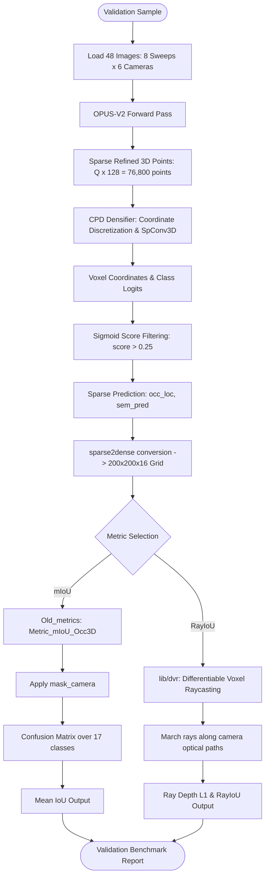

# Source Code Inventory & Functional Map: OPUS / OPUS-V2

**Project:** ForesightBEV Research Audit 02 — Stage 0 Baseline Reverse Engineering  
**Target Repository:** `OPUS`  
**Repository URL:** [https://github.com/jbwang1997/OPUS](https://github.com/jbwang1997/OPUS)  
**Target Git Commit Audited:** `fdb17339f40168ea0ceda9615863e3f5d0c3f5ce` (`fdb1733`, HEAD -> main, origin/main)  
**Date:** November 2026  
**Auditor Mode:** Read-Only Static Reverse-Engineering & Architecture Verification

---

## 1. Directory Tree & Module Hierarchy

```text
OPUS/
├── README.md                                  # Upstream documentation, benchmarks, HF weight links
├── LICENSE                                    # MIT License (Nanjing University, 2023)
├── train.py                                   # Master training script with DDP & EpochBasedRunner
├── val.py                                     # Master evaluation script (mIoU and RayIoU)
├── utils.py                                   # Logging, code backup, and miscellaneous utilities
├── dist_train.sh / dist_val.sh                # Distributed shell launchers
├── configs/
│   ├── opusv1_nusc-occ3d/                     # OPUS-V1 (NeurIPS 2024) Occ3D-nuScenes configs
│   │   ├── opusv1-t_r50_704x256_8f_nusc-occ3d_100e.py
│   │   ├── opusv1-l_r50_704x256_8f_nusc-occ3d_100e.py
│   │   └── opusv1-t_r50_704x256_fut-15f_nusc-occ3d_100e.py
│   ├── opusv2_nusc-occ3d/                     # OPUS-V2 Occ3D-nuScenes configs
│   │   ├── opusv2-t_r50_704x256_8f_nusc-occ3d_50e.py
│   │   ├── opusv2-l_r50_704x256_8f_nusc-occ3d_50e.py
│   │   ├── opusv2-t_r50_704x256_8f_dcdloss_nusc-occ3d_50e.py
│   │   └── opusv2-t_r50_704x256_fut-15f_nusc-occ3d_50e.py
│   ├── opusv2_nusc-occupancy/                 # OPUS-V2 OpenOccupancy benchmark configs
│   │   ├── opusv2-t_r50_704x256_8f_nusc-occupancy_50e.py
│   │   ├── opusv2-l_r50_704x256_8f_nusc-occupancy_50e.py
│   │   └── opusv2-t_r50_704x256_fut-15f_nusc-occupancy_50e.py
│   └── opusv1-fusion_nusc-occ3d/              # Camera+LiDAR fusion configs
│       ├── opusv1-fusion-l_r50_704x256_8f_nusc-occ3d_100e.py
│       └── opusv1-fusion-t_r50_704x256_fut-15f_nusc-occ3d_100e.py
├── loaders/
│   ├── __init__.py                            # Module exports
│   ├── builder.py                             # Custom dataloader builder with DistributedSampler
│   ├── custom.py                              # Base CustomDataset wrapping MMDetection datasets
│   ├── nuscenes_occ3d_dataset.py              # NuScenesOcc3DDataset loading Occ3D labels
│   ├── nuscenes_occupancy_dataset.py          # NuScenesOccupancyDataset loading OpenOccupancy labels
│   ├── ray_metrics.py                         # Differentiable Voxel Raycasting (DVR) RayIoU metric
│   ├── old_metrics.py                         # Standard Occ3D mIoU evaluation
│   ├── utils.py                               # Quaternion and coordinate conversion helpers
│   └── pipelines/
│       ├── __init__.py
│       ├── loading.py                         # LoadMVImageWithSweeps, LoadOcc3DFromFile, LoadOccupancyFromFile
│       ├── transforms.py                      # RandomTransformImage (IDA), RandomTransformOcc (BDA)
│       └── formatting.py                      # FinalFormatting, DefaultFormatBundle
├── models/
│   ├── __init__.py
│   ├── checkpoint.py                          # PyTorch activation checkpointing wrapper
│   ├── utils.py                               # GridMask, GpuPhotoMetricDistortion, sparse2dense
│   ├── bbox/                                  # Coordinate conversion utilities (encode_points, decode_points)
│   ├── csrc/                                  # Multi-Scale Multi-View (MSMV) sampling operator
│   │   ├── setup.py                           # C++/CUDA build script
│   │   ├── wrapper.py                         # PyTorch fallback vs compiled CUDA caller
│   │   └── msmv_sampling/                     # CUDA kernel sources
│   ├── img_modules/                           # ResNet, VoVNet, EVA-02 backbones
│   ├── lidar_modules/                         # SECOND, SparseEncoder, Voxelization (for fusion models)
│   ├── opusv1/                                # OPUS-V1 Point-Query Architecture
│   │   ├── opus.py                            # OPUSV1 detector
│   │   ├── opus_head.py                       # OPUSV1Head (Chamfer loss + KNN label assignment)
│   │   ├── opus_sampling.py                   # 4D camera projection & MSMV sampling
│   │   └── opus_transformer.py                # OPUSV1Transformer, Decoder, SASA Self-Attention
│   ├── opusv2/                                # OPUS-V2 Continuous Prediction Discretization (CPD)
│   │   ├── opus.py                            # OPUSV2 detector
│   │   ├── opus_head.py                       # OPUSV2Head + Densifier (PFN + SubMConv3D)
│   │   ├── opus_dcd_head.py                   # OPUSV2DCDHead (Density-aware Chamfer Loss variant)
│   │   ├── opus_sampling.py                   # 4D camera projection & MSMV sampling
│   │   └── opus_transformer.py                # OPUSV2Transformer with point feature projection
│   └── opusv1_fusion/                         # Camera+LiDAR multi-modal detector
│       ├── opus.py                            # OPUSV1Fusion detector
│       ├── opus_head.py                       # OPUSV1FusionHead
│       ├── opus_sampling.py                   # Multi-modal feature sampling
│       └── opus_transformer.py                # Cross-modal transformer
├── lib/
│   └── dvr/                                   # Differentiable Voxel Raycasting CUDA extension
│       ├── dvr.cpp                            # DVR PyBind11 C++ interface
│       └── dvr.cu                             # DVR CUDA raycasting kernel
└── scripts/
    ├── preprocess_nuscenes.py                 # Multi-sweep pickle file generator
    ├── preprocess_flow.py                     # Flow annotation preprocessor
    ├── gen_fusion_pretrain_model.py           # Pretrained fusion weight combiner
    ├── timing.py                              # Model FPS & latency benchmark script
    └── visualize.py                           # Open3D visualization script
```

---

## 2. File-by-File Inventory, Classes, Functions & Execution Flow

### 2.1 Top-Level Detectors (`models/opusv1/`, `models/opusv2/`)

| File Path | Class / Function | Purpose | Inputs & Outputs |
| :--- | :--- | :--- | :--- |
| `models/opusv1/opus.py` | `class OPUSV1(BaseDetector)` | Top-level detector for OPUS-V1. Manages backbone, FPN, GPU photometric distortion, and calls `pts_bbox_head`. | **In:** `img: (B, T*6, 3, H, W)`<br>**Out:** Training: loss dict; Testing: list of dicts with `sem_pred` & `occ_loc`. |
| `models/opusv2/opus.py` | `class OPUSV2(BaseDetector)` | Top-level detector for OPUS-V2. Identical interface to OPUSV1, dispatches to `OPUSV2Head`. | **In:** `img: (B, T*6, 3, H, W)`<br>**Out:** Discretized voxel predictions. |
| `models/opusv1_fusion/opus.py` | `class OPUSV1Fusion(BaseDetector)` | Multi-modal detector combining 6 camera streams with LiDAR voxelization (VoxelNet / SECOND). | **In:** Multi-view images + point clouds. |

### 2.2 Dense Heads & Discretization (`models/opusv1/`, `models/opusv2/`)

| File Path | Class / Function | Line Range | Purpose & Mathematical Mechanism |
| :--- | :--- | :--- | :--- |
| `models/opusv1/opus_head.py` | `class OPUSV1Head` | `L15-350` | Predicts continuous 3D points. Computes bidirectional Chamfer Loss using MMCV `knn`. Assigns semantic labels via nearest neighbor from GT points. During inference, uses `Voxelization` + morphological max-pool padding. |
| `models/opusv2/opus_head.py` | `class PFNLayer` | `L18-47` | Point Feature Network (Pillar Feature Net style). Projects point features, applies `BatchNorm1d` + `ReLU`, and computes cluster max-pooling via `torch_scatter.scatter_max`. |
| `models/opusv2/opus_head.py` | `class Densifier` | `L49-136` | **Continuous Prediction Discretization (CPD) module.** Maps continuous point coordinates to integer voxel indices, extracts local relative offsets, aggregates features through PFN layers, and refines logits using `SparseConv3d` and `SubMConv3d` (`spconv`). |
| `models/opusv2/opus_head.py` | `class OPUSV2Head` | `L139-415` | Master head for OPUS-V2. Supervised by Chamfer point loss (geometry) and sparse voxel Focal Loss directly on discretized voxels (semantics). |
| `models/opusv2/opus_dcd_head.py`| `class OPUSV2DCDHead` | `L140-420` | Variant incorporating Density-aware Chamfer Distance (DCD) weighting (`torch.bincount` scaling). |

### 2.3 Transformers, Attention & 4D Sampling

| File Path | Class / Function | Line Range | Purpose & Mechanism |
| :--- | :--- | :--- | :--- |
| `models/opusv1/opus_transformer.py` | `class OPUSV1Transformer` | `L20-53` | Manages 6-layer iterative decoder. Generates 3D bounding point refinements across stages. |
| `models/opusv1/opus_transformer.py` | `class OPUSTransformerDecoder` | `L56-135` | Computes $4 \times 4$ projection `occ2img = ego2img @ inv(ego2occ)`. Reorganizes multi-frame image features for 4D sampling. |
| `models/opusv1/opus_transformer.py` | `class OPUSTransformerDecoderLayer` | `L138-250` | Single decoder layer: Position encoding $\to$ 4D multi-camera sampling $\to$ Adaptive Mixing $\to$ Scale-Adaptive Self-Attention (SASA) $\to$ FFN $\to$ Point & class offset regression. |
| `models/opusv1/opus_transformer.py` | `class OPUSSelfAttention` | `L252-290` | Scale-Adaptive Self-Attention (SASA). Computes pairwise query 3D Euclidean distances, multiplies by learned temperature vector $\tau$, and constructs attention masks. |
| `models/opusv1/opus_transformer.py` | `class AdaptiveMixing` | `L292-365` | AdaMixer-style adaptive channel and spatial point feature mixing across sampled points. |
| `models/opusv1/opus_sampling.py` | `def sampling_4d` | `L21-125` | Projects 3D query points to all $T \times N$ views, checks image boundaries and positive depth, selects the single best valid camera view per point via `argmax(valid_mask)`, and executes `msmv_sampling`. |
| `models/csrc/wrapper.py` | `def msmv_sampling` | `L88-95` | Dispatches to compiled CUDA operator `_msmv_sampling_cuda` or pure PyTorch fallback `msmv_sampling_pytorch` using `F.grid_sample`. |

### 2.4 Dataloaders & Evaluation Pipelines

| File Path | Class / Function | Purpose |
| :--- | :--- | :--- |
| `loaders/nuscenes_occ3d_dataset.py` | `class NuScenesOcc3DDataset` | NuScenes dataset wrapper reading multi-sweep camera infos (`nuscenes_infos_train_sweep.pkl`) and loading Occ3D voxel labels (`labels.npz`). |
| `loaders/pipelines/loading.py` | `class LoadMVImageWithSweeps` | Loads $T$ multi-view frames (current + $T-1$ historical sweeps) and constructs ego pose history. |
| `loaders/pipelines/loading.py` | `class LoadOcc3DFromFile` | Loads `labels.npz` containing `semantics` ($200 \times 200 \times 16$), `mask_camera`, and `mask_lidar`. Remaps free space to label `17`. |
| `loaders/ray_metrics.py` | `def calc_rayiou` | RayIoU metric implementation using Differentiable Voxel Raycasting (`lib/dvr`) to evaluate depth-ray visibility consistency. |

---

## 3. End-to-End Execution Trace

### 3.1 Forward Training Pass Sequence (OPUS-V2)



### 3.2 Evaluation Sequence & Metric Flow



---

## 4. Key Tensor Shapes by Pipeline Stage (OPUS-V2 Tiny Default)

| Stage / Variable | Shape | Data Type | Notes |
| :--- | :--- | :--- | :--- |
| Raw Image Input `img` | `(B, 48, 3, 256, 704)` | `torch.float32` | 8 frames $\times$ 6 surround cameras |
| FPN Level 0 Feature | `(B*48, 256, 64, 176)` | `torch.float32` | Stride 4 |
| FPN Level 1 Feature | `(B*48, 256, 32, 88)` | `torch.float32` | Stride 8 |
| FPN Level 2 Feature | `(B*48, 256, 16, 44)` | `torch.float32` | Stride 16 |
| FPN Level 3 Feature | `(B*48, 256, 8, 22)` | `torch.float32` | Stride 32 |
| Initial Points `init_points` | `(B, 600, 1, 3)` | `torch.float32` | Uniform random $[0, 1]^3$ |
| Initial Query Feat `query_feat` | `(B, 600, 256)` | `torch.float32` | Zeros |
| Layer 0 Refined Points | `(B, 600, 8, 3)` | `torch.float32` | 4,800 points |
| Layer 1 Refined Points | `(B, 600, 16, 3)` | `torch.float32` | 9,600 points |
| Layer 2 Refined Points | `(B, 600, 32, 3)` | `torch.float32` | 19,200 points |
| Layer 3 Refined Points | `(B, 600, 64, 3)` | `torch.float32` | 38,400 points |
| Layer 4 (Final) Refined Points | `(B, 600, 128, 3)` | `torch.float32` | **76,800 points** |
| Layer 4 Point Features `pt_feats` | `(B, 600, 128, 32)` | `torch.float32` | Projected point features |
| Discretized Coordinates `voxel_coors` | `(N_unq, 4)` | `torch.int64` | `[batch_idx, x, y, z]` |
| Densified Class Scores | `(N_unq, 17)` | `torch.float32` | 17 semantic class logits |
| GT Voxel Semantics | `(B, 200, 200, 16)` | `torch.int64` | Occ3D voxel labels ($0 \dots 16$, free=$17$) |
| Camera Mask `mask_camera` | `(B, 200, 200, 16)` | `torch.bool` | Frustum visibility indicator |

