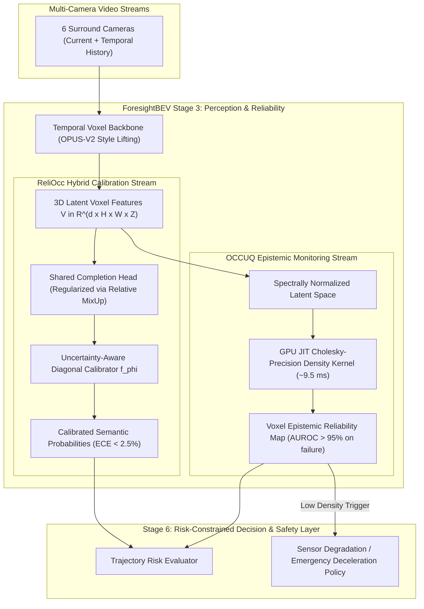

# REA 04 — Comparative Baseline Analysis: ReliOcc vs. OCCUQ vs. SurroundOcc vs. OPUS-V2

**Audit Series:** ForesightBEV Stage 0 Reverse Engineering Audits  
**Document:** `research/repository_audits/reliocc/COMPARISON_WITH_PREVIOUS_BASELINES.md`  
**Date:** 2026-11-04  
**Audited Papers & Repositories:**  
- **SurroundOcc (REA 01):** `weiyithu/SurroundOcc` (ICCV 2023)  
- **OPUS / OPUS-V2 (REA 02):** `jbwang1997/OPUS` (arXiv 2023/2024)  
- **OCCUQ (REA 03):** `ika-rwth-aachen/OCCUQ` (ICRA 2025)  
- **ReliOcc (REA 04):** IJCAI 2025 Proceedings / arXiv:2409.18026  

---

## 1. Comprehensive Four-Way Architectural Matrix

The following authoritative matrix synthesizes the findings across all four reverse engineering audits in ForesightBEV Stage 0:

| Dimension | ReliOcc (REA 04) | OCCUQ (REA 03) | SurroundOcc (REA 01) | OPUS-V2 (REA 02) |
| :--- | :--- | :--- | :--- | :--- |
| **Primary Publication** | IJCAI 2025 / arXiv:2409.18026 | ICRA 2025 / arXiv:2503.10605 | ICCV 2023 | arXiv 2023 / 2024 |
| **Base Occupancy Architecture** | VoxFormer / SGN | SurroundOcc | SurroundOcc | OPUS-V2 (Continuous Point Densifier) |
| **Input Modality** | Camera only | Camera only | Camera only | Camera only |
| **Camera Configuration** | **Monocular Forward View** (1 left camera, CAM 2) | **Surround Multi-View** (6 cameras, 360° coverage) | **Surround Multi-View** (6 cameras, 360° coverage) | **Surround Multi-View** (6 cameras, 360° coverage) |
| **Temporal Inputs** | $T=5$ frames (current + 4 past frames) | $T=1$ frame (single-frame camera input) | $T=1$ frame (single-frame camera input) | $T=8$ frames (current + 7 past frames) |
| **Dataset Benchmark** | SemanticKITTI | nuScenes / MultiCorrupt | nuScenes (SurroundOcc GT) | Occ3D-nuScenes / OpenOccupancy |
| **Voxel Grid Resolution** | $256 \times 256 \times 32$ ($0.2\text{ m}$, forward-only) | $200 \times 200 \times 16$ ($0.5\text{ m}$, surround) | $200 \times 200 \times 16$ ($0.5\text{ m}$, surround) | $200 \times 200 \times 16$ ($0.5\text{ m}$, surround) |
| **Uncertainty Method** | Hybrid (Absolute Gaussian logit + Relative Voxel Mix-Up) | Feature GMM with Spectral Normalization (DDU) | **None** (uncalibrated softmax) | **None** (deterministic queries) |
| **Aleatoric Estimation** | Gaussian logit sampling ($L_{\text{au}}$) + Softmax Entropy | Softmax Entropy $\mathcal{H}(p)$ + Max Softmax Probability | Maximum Softmax Probability | Maximum Softmax Probability |
| **Epistemic / OOD Estimation** | **Not explicitly modeled** (evaluated via OOD perturbations) | **Explicit GMM Marginal Density** $\log p(\mathbf{z})$ | None | None |
| **Relative Voxel Uncertainty** | **Yes** ($\lambda = \frac{\sigma_i}{\sigma_i + \sigma_j}$, paired Mix-Up) | None | None | None |
| **Calibration Method** | Uncertainty-aware Temperature ($T_\sigma = k_1 \sigma_i + k_2$, diagonal $\mathbf{W}$) | Evaluates ECE; planned UGTS | None | None |
| **Calibration Metrics** | $\text{ECE}_{\text{sem}}$ and $\text{ECE}_{\text{geo}}$ ($M=15$ bins) | ECE via `netcal` ($M=10$ bins) + NLL | None | None |
| **Misclassification Detection** | $\text{PRR}_{\text{sem}}$ and $\text{PRR}_{\text{geo}}$ (Rejection Curves) | Macro AUROC, AUPR, FPR95 | None | None |
| **Sensor Failure Robustness** | Evaluates **temporal frame dropping** in 5-frame buffer | Evaluates **spatial camera dropout** (1–3 of 6 cameras blacked out) | Blind failure / high overconfidence | Blind failure / high overconfidence |
| **Future Occupancy Forecasting** | None (predicts current timestamp $t$) | None (predicts current timestamp $t$) | None (predicts current timestamp $t$) | None (fut-15f is bidirectional auto-labeling) |
| **Inference Runtime Overhead** | **$0\text{ ms}$ (Online)**; $<1\text{ ms}$ (Offline) | **$+9.48\text{ ms}$** (TorchScript JIT GPU kernel) | Baseline (~220 ms) | $25.8\text{ FPS}$ (Tiny) / $8.6\text{ FPS}$ (Large) |
| **Public Implementation Status** | **Status D: No official code repository** | **Status A: Complete official code & Docker** | **Status A: Complete official code** | **Status A: Complete official code** |
| **Reproduction Feasibility** | **Clean-room reimplementation only** | **High** (Verified pretrained checkpoints) | **High** (Official checkpoints) | **High** (Official checkpoints) |

---

## 2. In-Depth Technical Contrasts

### 2.1 ReliOcc vs. OCCUQ: Orthogonal Uncertainty Philosophies
ReliOcc and OCCUQ tackle the reliability challenge in 3D occupancy from two fundamentally different statistical viewpoints:

```
+---------------------------------------------------------------------------------------------------+
|                                  THE UNCERTAINTY DUALITY                                          |
+---------------------------------------------------------------------------------------------------+
|   DIMENSION             OCCUQ (ICRA 2025)                     RELIOCC (IJCAI 2025)                |
+---------------------------------------------------------------------------------------------------+
| Target Uncertainty      EPISTEMIC (Model / OOD)               ALEATORIC & CALIBRATION             |
| Core Mathematical Tool  Feature-level GMM density p(z)        Gaussian logit reparameterization   |
| Regularization Method   Spectral Normalization (Lipschitz)    Voxel Feature Mix-Up (Relative unc) |
| Primary Failure Mode    Sensor degradation, blackout, fog     Overconfident category boundaries   |
| Detected                                                                                          |
| Runtime Mechanism       Active GPU kernel (~9.5 ms)           Discarded in online mode (0 ms);    |
|                         outputs voxel reliability map         Diagonal scaling in offline mode    |
+---------------------------------------------------------------------------------------------------+
```

- **OCCUQ is an Out-of-Distribution Detector:** By modeling the generative distribution of clean training features using a Gaussian Mixture Model regularized with spectral normalization, OCCUQ answers: *"Does this voxel feature look like anything seen during training, or is the sensor degraded / broken?"*
- **ReliOcc is an Aleatoric Calibrator and Boundary Regularizer:** By injecting heteroscedastic noise into logits and blending voxel features proportionally to their uncertainty ratio, ReliOcc answers: *"Given this in-distribution visual observation, how confident should downstream planning be in this specific semantic label?"*

### 2.2 Sensor Failure Definitions: Camera Dropout vs. Temporal Frame Dropping
A critical clarification must be maintained in autonomous driving perception:
- **OCCUQ’s Spatial Camera Dropout:** Simulates physical hardware failure where 1, 2, or 3 cameras in a 6-camera surround rig completely disconnect or become blinded. The model must detect missing visual information across an entire angular sector ($60^\circ - 180^\circ$).
- **ReliOcc’s Temporal Frame Dropping:** Evaluated on a monocular front camera where frames in the 5-frame history buffer ($t-1 \dots t-4$) are dropped. The spatial field of view remains unchanged; only temporal motion cues and parallax are degraded.
- **Audit Conclusion:** Robustness to temporal frame dropping in a monocular setup **does not imply robustness to spatial camera dropouts** in a multi-camera rig.

### 2.3 Online Inference Discrepancy
- In OCCUQ, the uncertainty module is an active inference component: the model evaluates the TorchScript JIT kernel (`jit_log_prob`) in parallel with semantic decoding, producing an explicit voxel-level epistemic density map $\mathbf{U}_{\text{epistemic}} \in \mathbb{R}^{200 \times 200 \times 16}$.
- In ReliOcc online mode, **the uncertainty branch is completely discarded at test time**. It acts purely as a loss regularizer during training. Downstream systems receive no explicit uncertainty output unless the offline calibrator is attached.

---

## 3. Synergy Blueprint for ForesightBEV Stage 3 and Stage 6

Rather than viewing OCCUQ and ReliOcc as competing approaches, their distinct strengths allow a unified, dual-stream perception architecture for ForesightBEV Stage 3:



### Strategic Recommendations:
1. **Train Stage 3 with Relative Uncertainty Loss ($\mathcal{L}_{\text{ru}}$):** Use ReliOcc's paired mix-up loss during Stage 3 training to regularize semantic boundaries without adding test-time inference overhead.
2. **Apply Offline Diagonal Calibration ($f_\phi$):** Fit the dynamic temperature calibrator on a held-out validation set to guarantee calibrated prediction confidences for downstream planning.
3. **Execute OCCUQ JIT Density Monitoring at Runtime:** Run OCCUQ's $9.5\text{ ms}$ GPU kernel in parallel with semantic decoding to provide Stage 6 with a real-time sensor failure flag.

