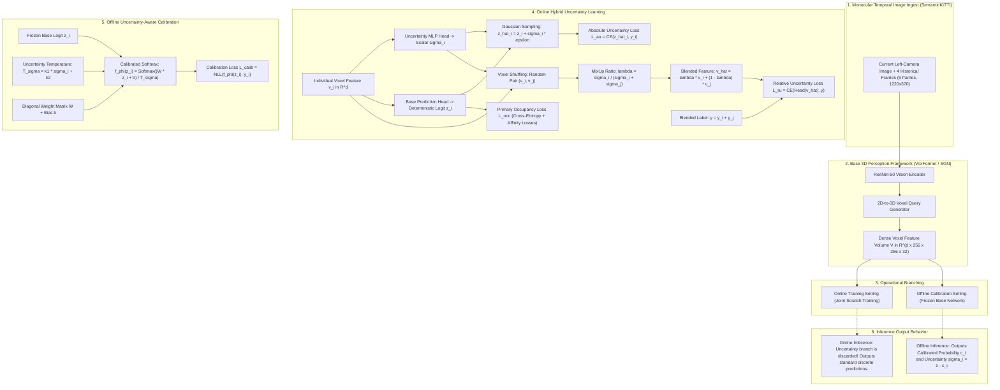

# REA 04 — ReliOcc Research and Implementation Audit Report

**Paper Title (Final Publication):** Reliable and Calibrated Semantic Occupancy Prediction by Hybrid Uncertainty Learning  
**Conference Venue:** Proceedings of the 34th International Joint Conference on Artificial Intelligence (IJCAI 2025), pp. 1973–1981  
**Official Publication DOI:** [10.24963/ijcai.2025/220](https://doi.org/10.24963/ijcai.2025/220)  
**Preprint:** [arXiv:2409.18026v1](https://arxiv.org/abs/2409.18026) (*"ReliOcc: Towards Reliable Semantic Occupancy Prediction via Uncertainty Learning"*)  
**Authors:** Song Wang, Zhongdao Wang, Jiawei Yu, Wentong Li, Bailan Feng, Junbo Chen, Jianke Zhu  
**Affiliations:** Zhejiang University; Huawei Noah's Ark Lab; Nanjing University of Aeronautics and Astronautics  
**Audit Date:** 2026-11-04  
**Audit Scope:** Stage 0 REA 04 — Reverse Engineering, Source Verification, and ForesightBEV Architectural Alignment  

---

## 1. Executive Summary

ReliOcc investigates the critical **reliability and confidence calibration gap** in camera-centric 3D semantic occupancy prediction. While multi-camera and monocular occupancy networks (such as VoxFormer, TPVFormer, and SGN) have steadily approached LiDAR-based models in raw geometric and semantic accuracy (IoU / mIoU), their prediction confidence remains uncalibrated, exhibiting high Expected Calibration Error (ECE) and poor misclassification rejection. In safety-critical autonomous driving, an overconfident misprediction of free space where an obstacle resides can lead to catastrophic trajectory planning failures.

To address this challenge, ReliOcc introduces a two-tier framework:
1. **Hybrid Uncertainty Learning (Online Mode):** 
   - **Absolute Uncertainty ($L_{au}$):** Predicts a scalar uncertainty $\sigma_i$ per voxel feature $v_i$, reparameterizing the categorical logits as samples from a Gaussian distribution $\hat{z}_i \sim \mathcal{N}(z_i, \sigma_i^2 \mathbf{I})$ to penalize data ambiguity.
   - **Relative Uncertainty ($L_{ru}$):** Overcomes optimization plateaus where individual $\sigma_i$ collapse to near-zero values. Voxel features are randomly shuffled and paired $(v_i, v_j)$, then blended using an uncertainty-weighted mix-up coefficient $\lambda = \frac{\sigma_i}{\sigma_i + \sigma_j}$. The mixed feature is decoded through a shared completion head supervised by blended labels $y = y_i + y_j$, enforcing relative uncertainty ordering independent of absolute scale.
2. **Uncertainty-Aware Calibration (Offline Mode):**
   - Applies post-hoc calibration to a frozen occupancy network. Dynamic temperature $T_\sigma = k_1 \sigma_i + k_2$ scales logits through a diagonal matrix $\mathbf{W}$ and bias $\mathbf{b}$, optimizing log-likelihood without degrading underlying predictive accuracy.

### Critical Implementation Status Finding
**Implementation Status: Status D — No Verifiable Official Implementation Found.**  
A thorough investigation across the official IJCAI 2025 proceedings, the arXiv preprint, the authors' academic profiles, and public code registries confirms that **the authors have not released an official source-code repository for ReliOcc**. While the paper cites and evaluates 10 open-source baselines (VoxFormer, SGN, Calib3D, SemanticKITTI-API, MonoScene, etc.), ReliOcc itself has not been published as open source. Consequently, this audit provides a rigorous, paper-and-supplement reverse-engineering audit, explicitly marking which architectural parameters are defined by the mathematical specification and which low-level implementation details remain unavailable.

---

## 2. Official Code Discovery Audit

Following our mandatory verification protocol, we executed multi-source searches across official academic databases, GitHub, and publication channels:

| Verification Channel | Query / Target | Result / Evidence | Classification |
| :--- | :--- | :--- | :--- |
| **IJCAI 2025 Official Proceedings** | `https://ijcai.org/proceedings/2025/220` | Full paper text, JSON, and PDF inspected. No repository link or code availability statement is provided. | No code link |
| **arXiv Preprint (2409.18026v1)** | Full HTML & LaTeX source inspection | Text cites 15 third-party GitHub URLs in Appendix D.2/D.3 (Calib3D, VoxFormer, SGN, MonoScene, relis, 3D_Corruptions_AD). **Zero repository links exist for ReliOcc.** | No code link |
| **Author Academic Profiles** | Song Wang, Jianke Zhu (Zhejiang University) | Personal and lab GitHub accounts (`MasterHow`, `RONINGOD`) host related projects (*OccFiner*, *GroundingOcc*), but contain no public repository for *ReliOcc*. | No repository found |
| **Community Benchmarks** | Awesome-3D-Occupancy-Prediction registries | Lists paper under IJCAI 2025 / arXiv without code links. | Unreleased |

### Formal Classification: **Status D (No verifiable official implementation found)**
In accordance with audit rules:
- No unverified or third-party reimplementation has been cloned or treated as authoritative.
- The audit is grounded strictly in the peer-reviewed IJCAI 2025 publication, the detailed arXiv technical report, and the mathematical specifications provided therein.

---

## 3. High-Level Architecture & End-to-End Information Flow

---

## 4. Mathematical and Architectural Reverse Engineering

### 4.1 Base Occupancy Architecture Adaptation
ReliOcc is designed as a model-agnostic plug-in evaluated on top of two representative vision-centric frameworks on the SemanticKITTI benchmark:
1. **VoxFormer (CVPR 2023):** 
   - Two-stage architecture. Stage-I generates class-agnostic query proposals via depth estimation; Stage-II uses cross-attention between 3D voxel queries and image features for class-specific segmentation.
   - Backbone: ResNet-50.
   - Primary loss: $\mathcal{L}_{\text{occ}} = \mathcal{L}_{\text{WCE}} + \mathcal{L}_{\text{scal\_geo}} + \mathcal{L}_{\text{scal\_sem}}$ (inherited from MonoScene).
2. **SGN (TIP 2024 / Sparse Guidance Network):**
   - End-to-end "dense-sparse-dense" design utilizing dynamic voxel aggregation and multi-scale guidance.
   - Backbone: ResNet-50.
   - Primary loss: $\mathcal{L}_{\text{occ}}$ incorporating geometric and semantic completion supervision.

### 4.2 Absolute Uncertainty Learning
- **Representation:** For every voxel $i$ in the 3D volume, the feature extractor yields $v_i \in \mathbb{R}^d$.
- **Heads:**
  - Standard linear head: maps $v_i$ to class logits $z_i \in \mathbb{R}^{S+1}$ (where $S=19$ for SemanticKITTI, index 0 = unoccupied).
  - Uncertainty MLP head: maps $v_i$ to a predicted scalar uncertainty $\sigma_i \in \mathbb{R}^+$.
- **Gaussian Logit Sampling (HAU Formulation):**
  Instead of evaluating cross-entropy on deterministic logits $z_i$, the logits are treated as random variables parameterized by heteroscedastic noise:
  $$\hat{z}_i \sim \mathcal{N}(z_i, \sigma_i^2 \mathbf{I})$$
  Using the reparameterization trick:
  $$\hat{z}_i = z_i + \sigma_i \cdot \epsilon, \quad \epsilon \sim \mathcal{N}(\mathbf{0}, \mathbf{I})$$
- **Loss Formulation:**
  $$\mathcal{L}_{\text{au}} = -\sum_{i=1}^V \log \left( \frac{\exp(\hat{z}_{i, y_i})}{\sum_{s=0}^S \exp(\hat{z}_{i, s})} \right)$$
- **Optimization Dynamics & The "Plateau" Defect:**
  When a voxel is unambiguous, minimizing $\mathcal{L}_{\text{au}}$ drives $\sigma_i \to 0$. As $\sigma_i$ becomes infinitesimal, the perturbation $\sigma_i \epsilon$ vanishes, gradients $\frac{\partial \mathcal{L}_{\text{au}}}{\partial \sigma_i} \to 0$, and optimization of the uncertainty branch stalls. Consequently, the network fails to learn fine-grained uncertainty distinctions among high-confidence voxels.

### 4.3 Relative Uncertainty Learning: The Central Innovation
To circumvent the absolute uncertainty optimization plateau, ReliOcc adapts the relative uncertainty learning principle from facial expression analysis (Zhang et al., NeurIPS 2021) to 3D volumetric fields:

1. **Voxel Shuffling & Pairing:** At each training iteration, the dense voxel set $\mathcal{V}$ is randomly permuted, generating arbitrary voxel pairs $(v_i, v_j)$.
2. **Uncertainty-Weighted Feature Mix-Up:**
   $$\hat{v} = \lambda v_i + (1 - \lambda) v_j \quad \text{where} \quad \lambda = \frac{\sigma_i}{\sigma_i + \sigma_j} \in [0, 1]$$
3. **Blended Label Construction:**
   $$y = y_i + y_j$$
   where $y_i, y_j \in \{0, 1\}^{S+1}$ are one-hot encoded ground-truth vectors.  
   > **Critical Mathematical Nuance (Footnote 2 of Paper):**  
   > Unlike conventional MixUp (Zhang et al., ICLR 2018), where labels are weighted by $\lambda$ ($y_{\text{mix}} = \lambda y_i + (1-\lambda) y_j$), ReliOcc **omits $\lambda$-weighting of labels** for training stability, supervising the shared completion head with an unweighted multi-label target.
4. **Shared Completion Head Processing:**
   $$\hat{z}_{\text{mix}} = \mathbf{W}_{\text{head}} \hat{v} + \mathbf{b}_{\text{head}}$$
5. **Relative Uncertainty Loss ($\mathcal{L}_{\text{ru}}$):**
   $$\mathcal{L}_{\text{ru}} = \mathcal{L}_{\text{CE}}(\hat{z}_{\text{mix}}, y_i + y_j)$$
6. **Gradient Mechanics & Scale-Invariant Regularization:**
   - If the network predicts high certainty for $v_i$ ($\sigma_i \ll \sigma_j$), the weighting coefficient $\lambda \to 0$. The mixed feature $\hat{v}$ is dominated by the uncertain feature $v_j$, yet the completion head is forced to predict both $y_i$ and $y_j$.
   - To minimize $\mathcal{L}_{\text{ru}}$, the network must adjust the ratio $\frac{\sigma_i}{\sigma_i + \sigma_j}$ rather than the absolute magnitudes. This enables active uncertainty differentiation even when both $\sigma_i$ and $\sigma_j$ are orders of magnitude below 1.

### 4.4 Uncertainty-Aware Post-Hoc Calibration
In offline mode, the trained occupancy model $V_\theta$ is completely frozen. ReliOcc trains an uncertainty-aware temperature scaling function $f_\phi$:

1. **Dynamic Temperature:**
   $$T_\sigma = k_1 \cdot \sigma_i + k_2$$
   where $k_1, k_2 \in \mathbb{R}$ are learnable scalar scaling parameters.
2. **Diagonal Linear Mapping with Bias:**
   $$f_\phi(z_i) = \mathcal{S}\left( \frac{\mathbf{W} \cdot z_i + \mathbf{b}}{T_\sigma} \right)$$
   where:
   - $\mathbf{W} \in \mathbb{R}^{(S+1) \times (S+1)}$ is constrained to be a **diagonal matrix** initialized to $\mathbf{I}$ (only $S+1$ diagonal weights are optimized, preserving cross-category logit separation).
   - $\mathbf{b} \in \mathbb{R}^{S+1}$ is a learnable class-bias vector.
3. **Calibration Objective ($\mathcal{L}_{\text{calib}}$):**
   Supervised using negative log-likelihood (NLL) over the validation split:
   $$\mathcal{L}_{\text{calib}} = -\sum_{i} \log f_\phi(z_i)^{(y_i)}$$

---

## 5. Online vs. Offline Operational Paradigms

A critical insight uncovered during our reverse engineering is the **disconnection between online training and online inference**:

| Operational Dimension | Online Uncertainty Learning Mode | Offline Model Calibration Mode |
| :--- | :--- | :--- |
| **Primary Goal** | Regularize voxel feature representations during training. | Calibrate output probabilities without changing model weights. |
| **Occupancy Network $V_\theta$** | Trained from scratch concurrently with uncertainty branch. | **Completely frozen.** |
| **Active Losses** | $\mathcal{L}_{\text{total}} = \mathcal{L}_{\text{occ}} + 4.0 \mathcal{L}_{\text{au}} + 6.0 \mathcal{L}_{\text{ru}}$ | $\mathcal{L}_{\text{calib\_total}} = 1.5 \mathcal{L}_{\text{au}} + 1.0 \mathcal{L}_{\text{ru}} + 4.0 \mathcal{L}_{\text{calib}}$ |
| **Inference-Time Behavior** | **The predicted uncertainty $\sigma_i$ is DISCARDED.** Standard inference is executed without using the uncertainty branch. | Inference evaluates $f_\phi(z_i)$, producing calibrated probability vectors. |
| **Exposed Output at Inference** | Discrete semantic labels $\hat{y}_i = \arg\max z_i$ and softmax scores. | Calibrated confidence $c_i = \max_s f_\phi(z_i)^{(s)}$; uncertainty derived as $\sigma_i = 1 - c_i$. |
| **Runtime Overhead** | **$0\text{ ms}$ overhead** (uncertainty branch pruned at test time). | Negligible ($< 1\text{ ms}$ elementwise scaling). |

> **Audit Finding on Online Uncertainty:**  
> The authors state: *"During inference, the model operates consistently with the original design as the predicted uncertainties are not utilized."*  
> Therefore, in online mode, ReliOcc's hybrid uncertainty is **purely a regularizing loss function** during backpropagation. It improves the geometric and semantic boundary representations of the base network, but does not provide an explicit voxel uncertainty channel during online inference. Only in offline mode does the model expose calibrated confidence and uncertainty.

---

## 6. Dataset and Input Modality Audit

### 6.1 SemanticKITTI Configuration
- **Dataset:** SemanticKITTI (based on KITTI Odometry Benchmark).
- **Sequences:** Sequences 00–10 (excluding 08) for training; sequence 08 for validation; sequences 11–21 for benchmark testing.
- **Voxel Grid Dimensions:** $256 \times 256 \times 32$ grid representing a spatial volume of $[-25.6\text{ m}, 25.6\text{ m}]$ in $X$, $[0.0\text{ m}, 51.2\text{ m}]$ in $Y$, and $[-2.0\text{ m}, 4.4\text{ m}]$ in $Z$.
- **Voxel Resolution:** $0.2\text{ m}$ isotropic resolution.
- **Classes:** 19 semantic classes + 1 unoccupied class ($S=19$).

### 6.2 Camera Modality: Monocular Temporal Ingestion
A key structural finding of this audit is that **ReliOcc does not ingest surround-view cameras**:
- **Camera Input:** The visual input consists exclusively of the **current image from the left camera (CAM 2) plus 4 previous temporal frames** ($T=5$ total frames).
- **Resolution:** Cropped to $1220 \times 370$.
- **Field of View:** Frontal field of view only ($\approx 90^\circ$ horizontal azimuth). It has zero perception of side or rear sectors.
- **Sensor Failure Definition:** In ReliOcc's robustness experiments, "sensor failure" refers to **temporal frame dropping** in the 5-frame historical buffer (e.g. weak = 1 frame dropped, strong = 2 or 3 frames dropped). It is **not** equivalent to multi-camera dropout (such as losing an entire camera in a 6-camera surround array, as tested in OCCUQ).

---

## 7. Robustness, Evaluation Metrics, and Results

### 7.1 Quantitative Reliability Comparison (SemanticKITTI Validation Set)

#### Online Uncertainty Learning (Table 2 of Paper)
| Method | Base Framework | mIoU (%) $\uparrow$ | $\text{PRR}_{\text{sem}}$ (%) $\uparrow$ | $\text{ECE}_{\text{sem}}$ (%) $\downarrow$ | IoU (%) $\uparrow$ | $\text{PRR}_{\text{geo}}$ (%) $\uparrow$ | $\text{ECE}_{\text{geo}}$ (%) $\downarrow$ |
| :--- | :--- | :--- | :--- | :--- | :--- | :--- | :--- |
| **Vanilla VoxFormer** | VoxFormer | 13.17 | 42.97 | 5.90 | 43.96 | 36.56 | 5.02 |
| VoxFormer + HAU | VoxFormer | 13.43 | 45.38 | 5.26 | 43.57 | 40.72 | 4.47 |
| VoxFormer + DUL | VoxFormer | 13.29 | 43.57 | 6.09 | 44.10 | 38.66 | 5.17 |
| VoxFormer + MCD | VoxFormer | 13.28 | 42.21 | 5.83 | 43.90 | 37.43 | 4.99 |
| **VoxFormer + ReliOcc** | **VoxFormer** | **13.43** | **47.75** | **2.84** | 43.28 | **44.58** | **2.57** |
| **Vanilla SGN** | SGN | 15.52 | 44.72 | 5.69 | 45.45 | 39.78 | 4.85 |
| SGN + HAU | SGN | 15.50 | 46.51 | 5.08 | 45.07 | 44.24 | 4.34 |
| SGN + DUL | SGN | 15.81 | 44.00 | 5.78 | 45.75 | 39.56 | 4.95 |
| SGN + MCD | SGN | 15.62 | 44.70 | 6.02 | 45.50 | 40.34 | 5.11 |
| **SGN + ReliOcc** | **SGN** | **15.65** | **50.72** | **3.75** | **45.78** | **49.61** | **3.07** |

#### Offline Model Calibration (Table 3 of Paper)
| Method | Base Framework | mIoU (%) $\uparrow$ | $\text{PRR}_{\text{sem}}$ (%) $\uparrow$ | $\text{ECE}_{\text{sem}}$ (%) $\downarrow$ | IoU (%) $\uparrow$ | $\text{PRR}_{\text{geo}}$ (%) $\uparrow$ | $\text{ECE}_{\text{geo}}$ (%) $\downarrow$ |
| :--- | :--- | :--- | :--- | :--- | :--- | :--- | :--- |
| **VoxFormer + TempS** | VoxFormer | 13.17 | 43.63 | 2.61 | 43.96 | 33.59 | 2.28 |
| **VoxFormer + DiriS** | VoxFormer | 13.17 | 48.12 | 2.38 | 43.96 | 42.78 | 2.42 |
| **VoxFormer + DeptS** | VoxFormer | 13.17 | 41.29 | 2.27 | 43.96 | 30.31 | **1.63** |
| **VoxFormer + ReliOcc** | **VoxFormer** | 13.17 | **48.17** | **2.05** | 43.96 | **44.34** | 2.57 |
| **SGN + TempS** | SGN | 15.52 | 46.90 | 2.68 | 45.45 | 37.25 | 2.35 |
| **SGN + DeptS** | SGN | 15.52 | 45.45 | 2.14 | 45.45 | 34.99 | **1.42** |
| **SGN + ReliOcc** | **SGN** | 15.52 | **47.40** | **2.09** | 45.45 | **43.80** | 2.43 |

### 7.2 Key Diagnostic Takeaways
1. **Calibration without Accuracy Loss:** In offline mode, ReliOcc cuts semantic ECE from $5.90\%$ to $2.05\%$ on VoxFormer while keeping mIoU identical ($13.17\%$).
2. **Superiority over Standard Scaling:** Standard Temperature Scaling (TempS) improves ECE but degrades misclassification detection ($\text{PRR}_{\text{geo}}$ drops from $36.56\%$ to $33.59\%$). ReliOcc maintains high ECE calibration while simultaneously increasing $\text{PRR}_{\text{geo}}$ to $44.34\%$.
3. **Ablation Evidence (Tables 4 & 5):** 
   - Absolute uncertainty alone yields modest gains ($\text{ECE}_{\text{sem}}: 5.90 \to 5.41\%$).
   - Relative uncertainty alone achieves $\text{ECE}_{\text{sem}}: 4.02\%$.
   - Combining both (Hybrid) achieves the best $\text{ECE}_{\text{sem}}: 2.84\%$ and highest $\text{PRR}_{\text{sem}}: 47.75\%$.

---

## 8. Training and Hardware Feasibility

### 8.1 Author-Reported Hardware & Environment
- **Compute Cluster:** $8 \times \text{NVIDIA Tesla V100 GPUs}$ (32GB VRAM each).
- **Optimizer:** AdamW (`lr=2e-4` for online, `lr=1e-3` for offline calibration).
- **Batch Size:** 1 sample per GPU (effective batch size 8).
- **Epochs:**
  - Online VoxFormer + ReliOcc: 20 epochs.
  - Online SGN + ReliOcc: 40 epochs.
  - Offline Calibration: 20 epochs.
- **Loss Coefficients:**
  - Online: $(\alpha_{\text{au}}, \beta_{\text{ru}}) = (4.0, 6.0)$.
  - Offline: $(\alpha_{\text{au}}, \beta_{\text{ru}}, \gamma_{\text{calib}}) = (1.5, 1.0, 4.0)$.

### 8.2 Execution Feasibility on Local Hardware
- **Apple Silicon Mac (M5, 24 GB Unified Memory):**
  - Full end-to-end training of VoxFormer / SGN on SemanticKITTI is **infeasible** due to heavy 3D transformer cross-attention, lack of native MPS deformable attention kernels, and high VRAM requirements across batch processing.
  - Standalone evaluation of the uncertainty-aware calibration function $f_\phi(z_i)$ and relative mix-up loss is lightweight and fully runnable on CPU / MPS.
- **Linux Workstation (1x RTX 3090 / 4090, 24 GB VRAM):**
  - Online training with batch size 1 is feasible with gradient accumulation, though 20–40 epochs on SemanticKITTI will require $\approx 48 - 72\text{ hours}$.
  - Offline calibration fine-tuning (frozen backbone, training only the calibrator for 20 epochs) is fast and easily runnable on a single 24 GB GPU within $\approx 2 - 3\text{ hours}$.

---

## 9. Implications for ForesightBEV

### 9.1 Stage 3 (3D Occupancy Perception and Sensor Reliability)
- **Hybrid Regularization in Training:** ReliOcc's relative uncertainty loss ($\mathcal{L}_{\text{ru}}$) provides an elegant, scale-invariant regularizer that can be incorporated into Stage 3 training to sharpen semantic boundaries without adding inference latency.
- **Offline Calibration Layer:** For deploying Stage 3 in safety-critical stacks, the diagonal temperature calibrator ($f_\phi$) can be attached post-training to align predicted softmax probabilities with true empirical accuracy.

### 9.2 Synthesis: OCCUQ vs. ReliOcc
ReliOcc and OCCUQ are **complementary, not competing**:
- **OCCUQ targets Epistemic Uncertainty & Out-of-Distribution Shift:** Its GMM feature density detects when sensor corruptions (camera failure, fog, lens occlusion) cause input representations to deviate from training distributions.
- **ReliOcc targets Aleatoric Calibration & Boundary Ambiguity:** Its relative uncertainty mix-up regularizes class boundary representations, and its offline calibrator ensures that in-distribution confidence scores match empirical accuracy.
- **Dual-Stream Stage 3 Architecture for ForesightBEV:**
  1. *Perception Backbone:* Camera-only 3D occupancy predicting logits $z_i$.
  2. *Epistemic Monitor (OCCUQ style):* $9.5\text{ ms}$ GPU JIT kernel evaluating feature log-density $\log p(v_i)$ to flag sensor degradation.
  3. *Calibrated Softmax (ReliOcc style):* Uncertainty-aware temperature scaling $f_\phi(z_i)$ outputting well-calibrated voxel probabilities.

---

## 10. Audit Conclusion

ReliOcc presents a mathematically sound framework for improving semantic occupancy reliability and calibration through paired voxel mix-up and diagonal temperature scaling. Because no official source code has been released by the authors (Status D), direct code reproduction is impossible, but its core mathematical formulation ($L_{\text{au}}$, $L_{\text{ru}}$, $f_\phi$) is fully documented and translatable into ForesightBEV Stage 3.

