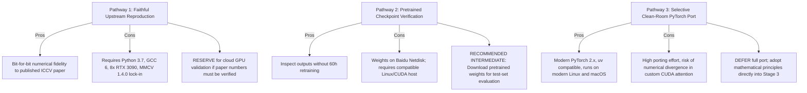

# Audit Review & Addendum: SurroundOcc (ICCV 2023)

**Project:** ForesightBEV Research Audit 01 — Stage 0 Baseline Reverse Engineering  
**Document Type:** Formal Technical Review & Audit Closure Addendum  
**Target Repository:** `SurroundOcc` (`https://github.com/weiyithu/SurroundOcc`)  
**Verified Commit SHA:** `419bf5b47ee07ef0610950cce5ba99168c506753` (`HEAD -> main`, origin/main)  
**Date:** November 2026  
**Auditor Mode:** Independent Source Verification & Cross-Examination  

---

## 1. Verified Upstream Repository Status

- **Remote URL:** `https://github.com/weiyithu/SurroundOcc.git`
- **Audited Commit SHA:** `419bf5b47ee07ef0610950cce5ba99168c506753`
- **Commit Metadata:** Fri Jun 20 20:47:59 2025 +0800, Author: Yi Wei (`weiyithu@163.com`), Subject: `Update link`.
- **Branch:** `main` (clean working directory, no local modifications).
- **Licence:** Apache License, Version 2.0 (verified via root `LICENSE` file, 201 lines).
- **Workspace Exclusions:** The upstream repository is located at `research/repositories/SurroundOcc/` and is strictly ignored by `.gitignore` (`research/repositories/*`), ensuring the ForesightBEV Git repository remains clean.

---

## 2. Review of Critical Technical Claims & Source-Code Verification

### 2.1 Output Channel Semantics (16 Classes + Empty)
- **Source Verification:**
  - In `projects/configs/surroundocc/surroundocc.py:19-21`:
    ```python
    class_names = [
        'barrier', 'bicycle', 'bus', 'car', 'construction_vehicle', 'motorcycle',
        'pedestrian', 'traffic_cone', 'trailer', 'truck', 'driveable_surface',
        'other_flat', 'sidewalk', 'terrain', 'manmade', 'vegetation'
    ]
    ```
    There are exactly **16 named foreground classes**.
  - In `projects/configs/surroundocc/surroundocc.py:68` and `projects/mmdet3d_plugin/surroundocc/dense_heads/occ_head.py:34, 51`:
    `num_classes = 17`.
  - In `projects/mmdet3d_plugin/surroundocc/loss/loss_utils.py:25`:
    `empty_probs = pred[:, 0, :, :, :]` — channel index `0` is treated as **empty space / background**.
  - In `projects/mmdet3d_plugin/datasets/evaluation_metrics.py:61-64` and `nuscenes_occupancy_dataset.py:198-215`:
    Index `0` is assigned as `'IoU'` (geometry occupancy IoU: `gt != 0 & pred != 0`). Classes `1` through `16` correspond to the 16 semantic classes.
  - **Confirmed Finding:** The 17 output channels represent channel 0 (empty/free space) plus channels 1–16 (the 16 foreground semantic driving classes).

### 2.2 Lack of Explicit Unknown Class in Model Output
- **Source Verification:**
  - `OccHead` (`occ_head.py:139`) outputs `out_channels = self.num_classes = 17` via a $1 \times 1 \times 1$ 3D convolution.
  - `SurroundOcc.forward_test` (`surroundocc.py:170`) runs:
    ```python
    _, pred_occ = torch.max(torch.softmax(pred_occ, dim=1), dim=1)
    ```
  - **Confirmed Finding:** The model output does **not** contain an explicit unknown or occluded class. Every voxel in the entire $100\text{ m} \times 100\text{ m} \times 8\text{ m}$ cuboid is forced via closed-world `argmax` to take an integer label in $\{0, \dots, 16\}$.

### 2.3 Handling of Camera Visibility, Invalid Voxels, and Ignore Labels
- **Camera Visibility in Network:**
  - In `OccEncoder.point_sampling` (`encoder.py:112-122`):
    ```python
    volume_mask = (reference_points_cam[..., 2:3] > eps)
    volume_mask = (volume_mask & (reference_points_cam[..., 1:2] > 0.0)
                & (reference_points_cam[..., 1:2] < 1.0)
                & (reference_points_cam[..., 0:1] < 1.0)
                & (reference_points_cam[..., 0:1] > 0.0))
    ```
    This mask determines whether a 3D reference point projects within the optical frustum and image boundaries of camera $k$.
  - In `SpatialCrossAttention.forward` (`spatial_cross_attention.py:138-173`):
    `volume_mask` (named `bev_mask`) selects visible queries per camera to save computation. Queries outside all camera views receive zeros in `slots`, are normalized by `count = torch.clamp(count, min=1.0)`, and pass through `output_proj` + residual input.
- **Ignore Label `255` in Supervision & Evaluation:**
  - In `pipelines/loading.py:32`: `occ[..., 3][occ[..., 3] == 0] = 255`. In the dataset loader, unannotated/invalid voxels originally stored as 0 are remapped to label `255`.
  - In `occ_head.py:279-281`:
    ```python
    criterion = nn.CrossEntropyLoss(ignore_index=255, reduction="mean")
    ```
  - In `loss_utils.py:31, 53`: `mask = (ssc_target != 255)` — both geometric and semantic scaling losses strictly filter out label `255`.
  - In `evaluation_metrics.py:59`: `mask = (gt_i != 255)` — voxels with ground-truth label `255` are excluded from True Positive, False Positive, and False Negative counts.

### 2.4 Single Timestamp vs Temporal Inference
- **Source Verification:**
  - In `projects/configs/surroundocc/surroundocc.py:112-120`: The training pipeline only includes `LoadMultiViewImageFromFiles`, `PhotoMetricDistortionMultiViewImage`, `LoadOccupancy`, `NormalizeMultiviewImage`, `PadMultiViewImage`, `DefaultFormatBundle3D`, and `CustomCollect3D`.
  - In `projects/configs/surroundocc/surroundocc.py:138-141`: Uses `ann_file='data/nuscenes_infos_train.pkl'` without temporal sweeps or queue length arguments.
  - In `surroundocc.py:94-97`:
    ```python
    if len_queue is not None:
        img_feats_reshaped.append(img_feat.view(int(B/len_queue), len_queue, int(BN / B), C, H, W))
    else:
        img_feats_reshaped.append(img_feat.view(B, int(BN / B), C, H, W))
    ```
    While `len_queue` parameter handling remains as dead/legacy code from BEVFormer, SurroundOcc never passes `len_queue` (`extract_feat` defaults to `len_queue=None`).
  - **Confirmed Finding:** SurroundOcc model inference operates strictly on a **single timestamp** (6 concurrent surround images). It has no temporal cross-attention, no recurrent feature buffers, and no velocity estimation.

### 2.5 Multi-Frame LiDAR Ground Truth vs Temporal Model Inference
- **Distinction Clarified:**
  - **Offline Ground-Truth Generation** (`tools/generate_occupancy_nuscenes/generate_occupancy_nuscenes.py:163-261`): Accumulates up to 10,000 LiDAR frames across an entire nuScenes scene sequence (typically 20 seconds, ~40 key-frames and non-key sweeps). It compensates for ego-motion using sensor-to-world transforms and canonicalizes dynamic object points using annotated 3D bounding boxes.
  - **Online Model Inference** (`surroundocc.py:141-177`): Consumes 6 images from *only the current key-frame*. The trained neural network is completely isolated from historical frames and LiDAR data.

### 2.6 Volumetric Grid Dimensions and Axis Ordering
- **Source Verification:**
  - In `encoder.py:54-74` (`get_reference_points`):
    ```python
    zs = torch.linspace(0.5, Z - 0.5, Z, dtype=dtype, device=device).view(Z, 1, 1).expand(Z, H, W) / Z
    xs = torch.linspace(0.5, W - 0.5, W, dtype=dtype, device=device).view(1, 1, W).expand(Z, H, W) / W
    ys = torch.linspace(0.5, H - 0.5, H, dtype=dtype, device=device).view(1, H, 1).expand(Z, H, W) / H
    ref_3d = torch.stack((xs, ys, zs), -1)
    ref_3d = ref_3d.permute(3, 0, 1, 2).flatten(1).permute(1, 0)
    ```
  - In `occ_head.py:221`:
    ```python
    volume_embed_reshape_i = volume_embed[i].reshape(bs, volume_z, volume_h, volume_w, -1).permute(0, 4, 3, 2, 1)
    ```
    The reshaping transforms token dimension `num_query = volume_z * volume_h * volume_w` into `(B, Z, H, W, C)` and permutes it to `(B, C, W, H, Z)`.
  - In `surroundocc.py:231-237` and `evaluation_metrics.py:9-14`:
    Axis 0 corresponds to $X$ (width, range $[-50, 50]$), Axis 1 corresponds to $Y$ (height/length, range $[-50, 50]$), and Axis 2 corresponds to $Z$ (vertical height, range $[-5, 3]$).

### 2.7 Voxel Resolution Verification
- **Source Verification:**
  - `point_cloud_range = [-50, -50, -5.0, 50, 50, 3.0]` (`surroundocc.py:11`) $\implies \Delta X = 100\text{ m}, \Delta Y = 100\text{ m}, \Delta Z = 8\text{ m}$.
  - `occ_size = [200, 200, 16]` (`surroundocc.py:12`).
  - Voxel size calculation:
    $$\delta x = \frac{50 - (-50)}{200} = 0.5\text{ m}, \quad \delta y = \frac{50 - (-50)}{200} = 0.5\text{ m}, \quad \delta z = \frac{3 - (-5)}{16} = 0.5\text{ m}$$
  - Also explicitly declared in `tools/generate_occupancy_nuscenes/config.yaml:5`: `voxel_size: 0.5`.
  - **Confirmed Finding:** The target grid is strictly isotropic at $0.5\text{ m} \times 0.5\text{ m} \times 0.5\text{ m}$.

### 2.8 Exact Tensor Dimensions Through All Stages
- **Backbone Input:** `(B, 6, 3, 900, 1600)`
- **ResNet101 Stages:**
  - Stage 2: `(B*6, 512, 116, 200)`
  - Stage 3: `(B*6, 1024, 58, 100)`
  - Stage 4: `(B*6, 2048, 29, 50)`
- **FPN Outputs (`mlvl_feats`):**
  - Level 0: `(B, 6, 512, 116, 200)`
  - Level 1: `(B, 6, 512, 58, 100)`
  - Level 2: `(B, 6, 512, 29, 50)`
- **Transfer Convolutions:**
  - Level 0: $512 \to 128 \implies (B, 6, 128, 116, 200)$
  - Level 1: $512 \to 256 \implies (B, 6, 256, 58, 100)$
  - Level 2: $512 \to 512 \implies (B, 6, 512, 29, 50)$
- **Volume Queries:**
  - Level 0: $(100 \times 100 \times 8 = 80,000, \, 128)$
  - Level 1: $(50 \times 50 \times 4 = 10,000, \, 256)$
  - Level 2: $(25 \times 25 \times 2 = 1,250, \, 512)$
- **3D Deconvolution Decoder Deblocks:**
  - `deblock[0]` (Conv3D $3\times3\times3$, stride 1): `(B, 256, 25, 25, 2)`
  - `deblock[1]` (Deconv3D, stride 2): `(B, 256, 50, 50, 4)`
  - *Add Skip Level 1*: `(B, 256, 50, 50, 4)`
  - `deblock[2]` (Conv3D $3\times3\times3$, stride 1): `(B, 128, 50, 50, 4)`
  - `deblock[3]` (Deconv3D, stride 2): `(B, 128, 100, 100, 8)`
  - *Add Skip Level 0*: `(B, 128, 100, 100, 8)`
  - `deblock[4]` (Conv3D $3\times3\times3$, stride 1): `(B, 64, 100, 100, 8)`
  - `deblock[5]` (Deconv3D, stride 2): `(B, 64, 200, 200, 16)`
  - `deblock[6]` (Conv3D $3\times3\times3$, stride 1): `(B, 32, 200, 200, 16)`
- **Prediction Heads (`occ_preds`):**
  - Index 0: `(B, 17, 25, 25, 2)`
  - Index 1: `(B, 17, 50, 50, 4)`
  - Index 2: `(B, 17, 100, 100, 8)`
  - Index 3: `(B, 17, 200, 200, 16)`

### 2.9 Origin of "Object Zoo" Terminology
- **Source Verification:**
  - In `tools/generate_occupancy_nuscenes/generate_occupancy_nuscenes.py:274`:
    ```python
    object_token_zoo = []
    ```
  - In `generate_occupancy_nuscenes.py:287`:
    ```python
    for query_object_token in object_token_zoo:
    ```
  - In `generate_occupancy_nuscenes.py:357`:
    ```python
    for k, object_token_in_zoo in enumerate(object_token_zoo):
    ```
  - **Confirmed Finding:** "Object Zoo" is **not** an audit invention. It is the **exact upstream variable and concept naming** used in the official ground-truth generation script.

### 2.10 Semantic Nearest-Neighbour Operator Verification
- **Source Verification:**
  - In `generate_occupancy_nuscenes.py:7`: `import chamfer`.
  - In `generate_occupancy_nuscenes.py:435-439`:
    ```python
    x = torch.from_numpy(dense_voxels).cuda().unsqueeze(0).float()
    y = torch.from_numpy(sparse_voxels_semantic[:,:3]).cuda().unsqueeze(0).float()
    d1, d2, idx1, idx2 = chamfer.forward(x, y)
    indices = idx1[0].cpu().numpy()
    ```
  - In `extensions/chamfer_dist/chamfer_cuda.cpp:21-23` and `chamfer.cu:50-110`:
    The C++ module binds `chamfer_cuda_forward(xyz1, xyz2)` which computes minimum squared Euclidean distance from each point in `xyz1` to all points in `xyz2` and returns indices `idx1`.
  - **Confirmed Finding:** The semantic label transfer explicitly reuses the **forward pass of the custom Chamfer distance CUDA extension** (`chamfer.forward`) as a GPU nearest-neighbour search kernel. It does not use `scipy.spatial.cKDTree` or `faiss` during this step.

---

## 3. Authoritative ForesightBEV Architecture & Component Mapping

The ForesightBEV ten-stage frozen architecture is strictly defined as:

- **Stage 0:** Literature Review, REA and Research Gap
- **Stage 1:** Automotive Datasets, Cameras and Calibration
- **Stage 2:** Multi-view Geometry and BEV Projection
- **Stage 3:** 3D Occupancy Perception and Sensor Reliability
- **Stage 4:** Dynamic Agent Detection and Tracking
- **Stage 5:** 4D Occupancy and Flow Forecasting
- **Stage 6:** Risk-Constrained Decision and Safety Layer
- **Stage 7:** CARLA + ROS 2 + Autoware
- **Stage 8:** FastAPI Backend and React Dashboard
- **Stage 9:** Evaluation, Ablations and Research Reports

The table below enforces the authoritative mapping of SurroundOcc components to this frozen ten-stage architecture:

| ForesightBEV Stage | Authoritative Specification | SurroundOcc Component Alignment | Architectural Relationship & Role |
| :---: | :--- | :--- | :--- |
| **Stage 0** | **Literature Review, REA and Research Gap** | Upstream repository audit & baseline assessment | Canonical 3D semantic occupancy reference and baseline comparison. |
| **Stage 1** | **Automotive Datasets, Cameras and Calibration** | `tools/generate_occupancy_nuscenes/`<br>`CustomNuScenesOccDataset` | Offline multi-frame LiDAR ground-truth generation pipeline and camera calibration ingestion supporting Stage 3 training. |
| **Stage 2** | **Multi-view Geometry and BEV Projection** | `OccEncoder.point_sampling` (`encoder.py:78-132`)<br>`SpatialCrossAttention` (`spatial_cross_attention.py:33-178`)<br>ResNet-101 + FPN (`surroundocc.py:42-61`) | Analytical camera projection geometry, multi-view feature lifting, and spatial cross-attention across surround views. |
| **Stage 3** | **3D Occupancy Perception and Sensor Reliability** | `OccHead` (`occ_head.py:30-301`)<br>3D Deconvolution Decoder & Skip Connections<br>Multi-Scale 3D Volume Queries | Multi-scale 3D volume queries ($[25, 50, 100, 200]$), 3D volumetric decoder, and multi-scale semantic occupancy prediction heads. |
| **Stage 4** | **Dynamic Agent Detection and Tracking** | *Not implemented in SurroundOcc* | Dynamic agent tracking is **not** implemented as a subsystem in SurroundOcc; must be developed independently. |
| **Stage 5** | **4D Occupancy and Flow Forecasting** | *Not implemented in SurroundOcc* | Future occupancy forecasting and spatio-temporal flow are **not** present in SurroundOcc (single-timestamp only). |
| **Stage 6** | **Risk-Constrained Decision and Safety Layer** | *Not implemented in SurroundOcc* | Trajectory risk estimation, collision evaluation, and safety filtering are outside SurroundOcc's scope. |
| **Stage 7** | **CARLA + ROS 2 + Autoware** | *Not implemented in SurroundOcc* | Closed-loop simulator and robotics middleware integration. |
| **Stage 8** | **FastAPI Backend and React Dashboard** | *Not implemented in SurroundOcc* | Interactive web dashboard and REST API serving. |
| **Stage 9** | **Evaluation, Ablations and Research Reports** | `evaluation_metrics.py`<br>`CustomNuScenesOccDataset.evaluate` | Benchmark evaluation metrics (IoU, mIoU, Chamfer distance reconstruction). |

> [!IMPORTANT]
> **Methodological & Technical Distinctions Preserved:**
> 1. **17-Class Closed-World Prediction:** The model predicts 17 categorical output channels: channel index 0 represents empty/free space, and channels 1–16 represent the 16 foreground semantic driving classes. It has **no dedicated predicted unknown-space class**.
> 2. **Masking vs Classification:** Invalid or unannotated voxels are handled via visibility masks (`volume_mask`) and dataset ignore masks (`label 255`), which exclude voxels from loss calculation and evaluation metrics rather than predicting an explicit unobserved state.
> 3. **LiDAR Supervision vs Camera Inference:** Offline multi-frame LiDAR point accumulation, ego-motion compensation, Poisson meshing, and semantic label transfer prepare ground-truth supervision in Stage 1/3; model inference is strictly camera-only at a single timestamp.
> 4. **Uncertainty Status:** Evidential Deep Learning (EDL) remains an active **research candidate** for Stage 3 sensor reliability and confidence estimation, not a finalized algorithm. SurroundOcc's standard softmax logits serve as the deterministic baseline to benchmark uncertainty methods against.

---

## 4. Assessment of Reproduction Recommendations

We re-evaluate the three reproduction pathways with strict fidelity and engineering effort criteria:



### Detailed Assessment of Pathways:
1. **Faithful Upstream Reproduction (Original Environment):**
   - **Cost/Effort:** Requires setting up a legacy Ubuntu 20.04 environment with CUDA 11.1, GCC 6/7, Python 3.7, and MMCV-full 1.4.0, plus 8 $\times$ 24GB GPUs for 60 hours ($480\text{ GPU hours}$).
   - **Recommendation:** Do not attempt in local developer workspaces. Reserve exclusively for containerized cloud execution if published paper metrics ($78.87\%$ IoU, $20.65\%$ mIoU) require verbatim empirical verification.
2. **Checkpoint-Based Inference (Compatible Linux/CUDA Server):**
   - **Cost/Effort:** Moderate. Requires downloading `r101_dcn_fcos3d_pretrain.pth` (available via GitHub HTTPS) and the semantic checkpoint from Baidu Netdisk (`dmcq`), executing `tools/dist_test.sh` on a single 24GB NVIDIA GPU.
   - **Recommendation:** Recommended if empirical baseline outputs are needed for visual comparison before training new models.
3. **Selective PyTorch 2.x Port for ForesightBEV:**
   - **Cost/Effort:** Significant engineering overhead if ported as a standalone monolithic project.
   - **Recommendation:** Do **not** spend engineering cycles building a separate "PyTorch 2.0 SurroundOcc clone." Instead, selectively import its mathematical equations and spatial projection formulation directly into ForesightBEV Stage 3.

---

## 5. Final ForesightBEV Architectural Decisions

### 5.1 Stage 3 Baseline Suitability
- **Decision:** **CONFIRMED AS STAGE 3 BASELINE REFERENCE.**
- **Rationale:** SurroundOcc is an established, peer-reviewed standard for 3D multi-camera occupancy on nuScenes. Benchmarking ForesightBEV against SurroundOcc establishes immediate academic and industrial credibility.

### 5.2 Reusable Camera Geometry & Spatial Attention Concepts
- **Decision:** **REUSE & ADAPT.**
- **Rationale:** The mathematical mapping from normalized 3D coordinates to unnormalized LiDAR metric space, followed by projection through $4 \times 4$ intrinsic-extrinsic matrices (`encoder.py:78-132`), is mathematically rigorous and computationally clean. The camera-indexing rebatching strategy (`spatial_cross_attention.py:138-155`) is highly effective at eliminating empty-frustum computation.

### 5.3 Volumetric Decoder Components Worth Adapting
- **Decision:** **ADAPT.**
- **Rationale:** The hierarchical multi-scale query representation ($[25, 50, 100, 200]$) combined with progressive 3D deconvolution and additive skip connections successfully resolves the GPU memory bottleneck of 3D grids. However, dense 3D convolutions become memory-prohibitive at resolutions $> 200 \times 200 \times 16$. ForesightBEV will adapt the multi-scale hierarchy while investigating sparse 3D convolutional backbones.

### 5.4 Unknown-Space Representation Requirements
- **Decision:** **REJECT UPSTREAM CLOSED-WORLD FORMULATION; REDESIGN FOR FORESIGHTBEV.**
- **Rationale:** SurroundOcc's failure to represent unobserved or occluded space violates autonomous driving safety principles. ForesightBEV Stage 3 requires a tri-state spatial representation: **Occupied, Free, and Unknown/Occluded**.

### 5.5 Temporal Modeling Requirements
- **Decision:** **REJECT UPSTREAM STATIC FORMULATION; DEVELOP FOR STAGE 5.**
- **Rationale:** SurroundOcc is entirely single-frame and cannot estimate obstacle velocity, trajectory heading, or occupancy flow. ForesightBEV Stage 5 must implement temporal recurrence across multi-frame sequences.

### 5.6 Uncertainty Integration Requirements
- **Decision:** **DEVELOP INDEPENDENTLY FOR STAGE 3.**
- **Rationale:** SurroundOcc provides uncalibrated softmax logits. Stage 3 requires reliable confidence estimation to detect sensor degradation, lens occlusion, and out-of-distribution environments.

### 5.7 Trajectory Risk Modeling
- **Decision:** **DEVELOP INDEPENDENTLY FOR STAGE 6.**
- **Rationale:** SurroundOcc stops at raw voxel occupancy. ForesightBEV Stage 6 must translate occupancy probabilities and uncertainties into path collision probabilities and risk fields.

---

## 6. Unresolved Technical Questions & Open Risks

1. **Missing Ground-Truth in Dynamic Object Interiors:** Does Poisson surface reconstruction create hollow shells for moving vehicles, and if so, how does nearest-neighbour semantic transfer treat interior voxels?
2. **Camera Misalignment Resilience:** How rapidly does SurroundOcc's mIoU degrade under subtle extrinsic pitch or roll perturbation ($0.5^\circ - 2.0^\circ$)?
3. **Sparse Attention Kernel Portability:** Can MMCV's `ms_deform_attn_forward` CUDA kernel be replaced with standard PyTorch 2.0 SDPA or FlashAttention without losing 3D reference point offset learning capability?
4. **Alternative Ground-Truth Sources:** Given the Baidu Netdisk barrier for pre-generated occupancy labels, should ForesightBEV rely on OpenOccupancy or Occ3D-nuScenes mirrors for standardized baseline comparison?

