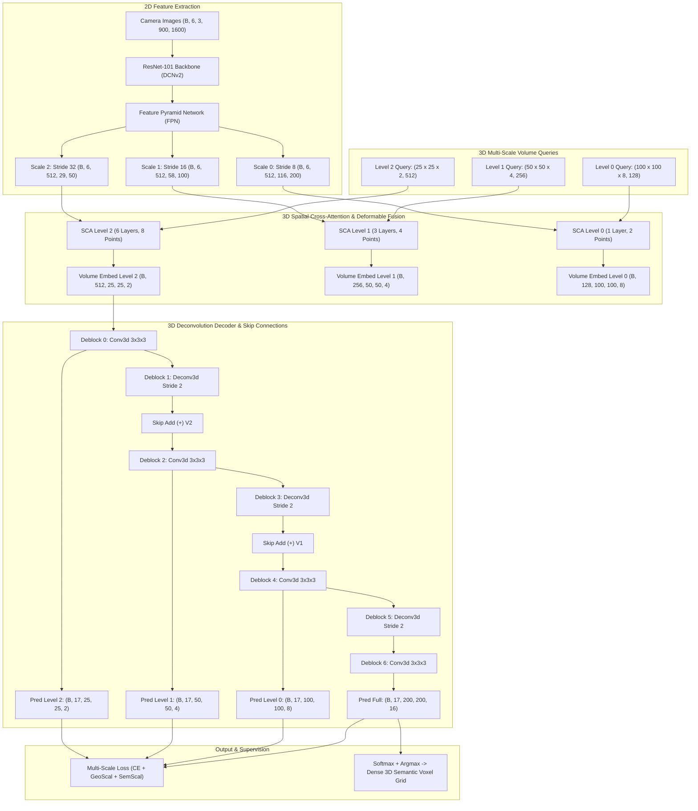
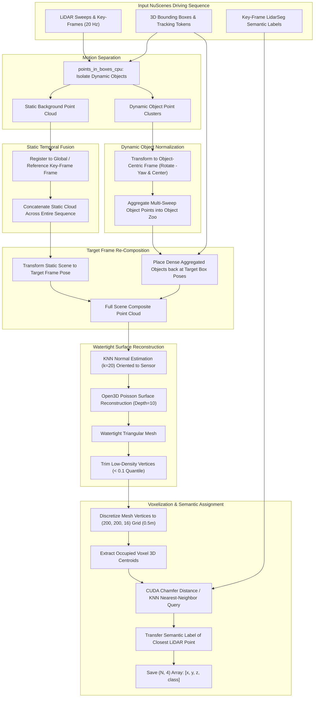

# Reverse Engineering Audit Report: SurroundOcc

**Project:** ForesightBEV Research Audit 01 — Stage 0 Baseline Reverse Engineering  
**Target Repository:** `SurroundOcc`  
**Repository URL:** [https://github.com/weiyithu/SurroundOcc](https://github.com/weiyithu/SurroundOcc)  
**Target Git Commit Audited:** `419bf5b47ee07ef0610950cce5ba99168c506753` (`419bf5b`, HEAD -> main, origin/main)  
**Authors / Affiliation:** Yi Wei, Linqing Zhao, Wenzhao Zheng, Zheng Zhu, Jiwen Lu, Jie Zhou (Tsinghua University & PhiGent Robotics)  
**Associated Publication:** *"SurroundOcc: Multi-Camera 3D Occupancy Prediction for Autonomous Driving"* (ICCV 2023, [arXiv:2303.09551](https://arxiv.org/abs/2303.09551))  
**Audit Date:** November 2026  
**Auditor Mode:** Read-Only Static Reverse-Engineering & Mathematical IPCV Verification  

---

## Table of Contents

1. [Executive Summary & Core Audit Conclusions](#1-executive-summary--core-audit-conclusions)
2. [Repository Topology & System Architecture](#2-repository-topology--system-architecture)
   - [2.1 Lineage & Upstream Ancestry](#21-lineage--upstream-ancestry)
   - [2.2 Architecture Overview & End-to-End Diagram](#22-architecture-overview--end-to-end-diagram)
3. [Multi-Camera Ingestion & Coordinate Geometry](#3-multi-camera-ingestion--coordinate-geometry)
   - [3.1 Image Ingestion & Normalization](#31-image-ingestion--normalization)
   - [3.2 3D Grid & Voxel Space Formulation](#32-3d-grid--voxel-space-formulation)
   - [3.3 Exact Analytical Derivation of Camera Projection](#33-exact-analytical-derivation-of-camera-projection)
   - [3.4 Source Implementation of Coordinate Transforms](#34-source-implementation-of-coordinate-transforms)
4. [Volumetric Feature Extraction & Spatial Cross-Attention](#4-volumetric-feature-extraction--spatial-cross-attention)
   - [4.1 Image Backbone & FPN Feature Pyramid](#41-image-backbone--fpn-feature-pyramid)
   - [4.2 3D Volume Queries & Multi-Scale Hierarchy](#42-3d-volume-queries--multi-scale-hierarchy)
   - [4.3 Spatial Cross-Attention & Multi-View Fusion](#43-spatial-cross-attention--multi-view-fusion)
   - [4.4 3D Deformable Attention Formulation & CUDA Interface](#44-3d-deformable-attention-formulation--cuda-interface)
   - [4.5 Interleaved 3D Convolutions (`OccLayer`)](#45-interleaved-3d-convolutions-occlayer)
5. [3D Decoder & Occupancy Prediction Heads](#5-3d-decoder--occupancy-prediction-heads)
   - [5.1 Progressive 3D Deconvolution & Upsampling](#51-progressive-3d-deconvolution--upsampling)
   - [5.2 Multi-Scale Skip Connections](#52-multi-scale-skip-connections)
   - [5.3 Semantic vs Reconstruction Prediction Heads](#53-semantic-vs-reconstruction-prediction-heads)
6. [Mathematical Loss Formulations & Multi-Scale Supervision](#6-mathematical-loss-formulations--multi-scale-supervision)
   - [6.1 Multi-Scale Coordinate Downsampling](#61-multi-scale-coordinate-downsampling)
   - [6.2 Focal Cross-Entropy Formulation](#62-focal-cross-entropy-formulation)
   - [6.3 Geometric Scaling Loss ($\mathcal{L}_{\text{geo}}$)](#63-geometric-scaling-loss-mathcall_textgeo)
   - [6.4 Semantic Affinity Scaling Loss ($\mathcal{L}_{\text{sem}}$)](#64-semantic-affinity-scaling-loss-mathcall_textsem)
   - [6.5 Total Training Objective & Loss Weighting](#65-total-training-objective--loss-weighting)
7. [Reverse-Engineered LiDAR Ground-Truth Generation Pipeline](#7-reverse-engineered-lidar-ground-truth-generation-pipeline)
   - [7.1 Sensor-to-World-to-Sensor Rigid Motion Registration](#71-sensor-to-world-to-sensor-rigid-motion-registration)
   - [7.2 Dynamic Bounding Box Decomposition & Object Zoo](#72-dynamic-bounding-box-decomposition--object-zoo)
   - [7.3 Static Scene Reconstruction & Temporal Stitching](#73-static-scene-reconstruction--temporal-stitching)
   - [7.4 Poisson Surface Reconstruction & Mesh Voxelization](#74-poisson-surface-reconstruction--mesh-voxelization)
   - [7.5 Nearest-Neighbor Semantic Label Transfer via Chamfer Distance](#75-nearest-neighbor-semantic-label-transfer-via-chamfer-distance)
   - [7.6 LiDAR Ground Truth vs Camera Inference Disconnect](#76-lidar-ground-truth-vs-camera-inference-disconnect)
8. [Critical Technical Review & Limitations](#8-critical-technical-review--limitations)
   - [8.1 Calibration & Sensor Rigidity Dependence](#81-calibration--sensor-rigidity-dependence)
   - [8.2 Zero-Evidence Extrapolation & Lack of Unknown Representation](#82-zero-evidence-extrapolation--lack-of-unknown-representation)
   - [8.3 Absence of Temporal Tracking & Dynamic Velocity](#83-absence-of-temporal-tracking--dynamic-velocity)
   - [8.4 Epipolar Occlusion & Boundary Smearing](#84-epipolar-occlusion--boundary-smearing)
   - [8.5 Computational & Memory Complexity](#85-computational--memory-complexity)
9. [ForesightBEV Ten-Stage Architectural Mapping & Decision](#9-foresightbev-ten-stage-architectural-mapping--decision)
   - [9.1 Stage-by-Stage Component Evaluation Matrix](#91-stage-by-stage-component-evaluation-matrix)
   - [9.2 Strategic Integration Recommendation](#92-strategic-integration-recommendation)

---

## 1. Executive Summary & Core Audit Conclusions

SurroundOcc is an anchor ICCV 2023 paper representing one of the first successful paradigms for dense 3D semantic voxel prediction purely from multi-camera surround video.

The primary algorithmic innovation of SurroundOcc lies in its **direct 3D volumetric query representation** combined with **multi-scale 3D deformable spatial cross-attention**. Rather than collapsing vertical height into a flat 2D Bird's-Eye-View (BEV) plane (as done in BEVFormer, Cam2BEV, and OFT), SurroundOcc instantiates learnable 3D voxel queries organized hierarchically across three spatial scales ($[25 \times 25 \times 2]$, $[50 \times 50 \times 4]$, and $[100 \times 100 \times 8]$), projects them directly onto 2D multi-view image features using analytical camera calibration parameters, samples local context via 3D deformable attention, and progressively upsamples the volume through 3D deconvolutions with skip connections to achieve a high-resolution $[200 \times 200 \times 16]$ voxel grid.

### Key Audit Findings:
1. **Purity of Vision-Only Inference:** The runtime network is $100\%$ camera-based. It consumes 6 raw RGB images ($900 \times 1600$) along with $4 \times 4$ projection matrices $\mathbf{P}_k = \mathbf{K}_k \mathbf{T}_{\text{lidar}\to\text{cam}, k}$ and produces dense occupancy logits without accessing any LiDAR, radar, or depth sensor at test time.
2. **LiDAR Supervision Disconnect:** Dense occupancy ground truth is synthesized *offline* using a multi-step pipeline combining sequence-wide multi-frame LiDAR point cloud accumulation, rigid bounding-box object pose compensation, Open3D Poisson Surface Reconstruction, dense voxelization ($0.5\text{ m}$ resolution), and GPU-accelerated nearest-neighbor semantic transfer.
3. **Absence of Temporal Tracking:** Although SurroundOcc borrows extensively from BEVFormer's code, it completely removes BEVFormer's temporal cross-attention and ego-motion compensation. SurroundOcc operates on a **purely single-frame, static spatial paradigm** without temporal feature recurrence.
4. **Binary Occupancy vs Semantic Multiclass:** The architecture provides two evaluation tracks: geometric scene reconstruction (binary occupancy evaluated via Chamfer Distance) and 16-class semantic occupancy (evaluated via mIoU excluding empty space).
5. **No Uncertainty or Unknown Space:** SurroundOcc enforces a closed-world classification: every voxel in the $100\text{ m} \times 100\text{ m} \times 8\text{ m}$ cuboid is classified as either empty (class 0) or one of 16 foreground semantic classes. Voxels hidden behind buildings or unobserved by any camera are forced to guess an occupancy state without any explicit representation of occlusion or epistemic uncertainty.

---

## 2. Repository Topology & System Architecture

### 2.1 Lineage & Upstream Ancestry
SurroundOcc is derived directly from **BEVFormer** (`github.com/fundamentalvision/BEVFormer`), which itself is built atop OpenMMLab's `mmdetection3d==v0.17.1`. The lineage explains several architectural artifacts:
- The presence of unused temporal dataloader utilities (`CustomNuScenesDataset` in `projects/mmdet3d_plugin/datasets/nuscenes_dataset.py`).
- Reliance on MMCV's custom CUDA extensions `ms_deform_attn_forward` and `ms_deform_attn_backward`.
- Use of Caffe-style pretraining weights (`r101_dcn_fcos3d_pretrain.pth`).

### 2.2 Architecture Overview & End-to-End Diagram

---

## 3. Multi-Camera Ingestion & Coordinate Geometry

### 3.1 Image Ingestion & Normalization
SurroundOcc ingests six synchronous camera views from the nuScenes rig:
$$\mathcal{I} = \{ I_k \in \mathbb{R}^{3 \times H_{\text{img}} \times W_{\text{img}}} \}_{k=1}^6, \quad H_{\text{img}} = 900, \, W_{\text{img}} = 1600$$

Images undergo Caffe-style normalization (`projects/configs/surroundocc/surroundocc.py:16-17`):
$$\mu = [103.530, 116.280, 123.675], \quad \sigma = [1.0, 1.0, 1.0], \quad \text{to\_rgb} = \text{False}$$
Image channels are maintained in BGR format with unit variance scaling.

### 3.2 3D Grid & Voxel Space Formulation
The vehicle-centric 3D region of interest is bounded by physical extents (`pc_range`):
$$X \in [-50.0, 50.0]\text{ m}, \quad Y \in [-50.0, 50.0]\text{ m}, \quad Z \in [-5.0, 3.0]\text{ m}$$
Total spatial span:
$$\Delta X = 100.0\text{ m}, \quad \Delta Y = 100.0\text{ m}, \quad \Delta Z = 8.0\text{ m}$$
Target voxel grid resolution (`occ_size`):
$$N_X = 200, \quad N_Y = 200, \quad N_Z = 16$$
Voxel step size:
$$\delta x = \frac{100.0}{200} = 0.5\text{ m}, \quad \delta y = \frac{100.0}{200} = 0.5\text{ m}, \quad \delta z = \frac{8.0}{16} = 0.5\text{ m}$$
The volume is represented by an isotropic voxel resolution of $(0.5\text{ m})^3$.

### 3.3 Exact Analytical Derivation of Camera Projection
The transformation from 3D voxel space to 2D image coordinates is derived in `OccEncoder.point_sampling` (`projects/mmdet3d_plugin/surroundocc/modules/encoder.py:78-132`).

#### Step 1: Normalized 3D Coordinate Grid
For a volume of dimensions $(H, W, Z)$, normalized reference coordinates $\mathbf{p}_{\text{norm}} = (u_x, u_y, u_z) \in [0, 1]^3$ are generated at voxel centroids:
$$u_x(i) = \frac{i + 0.5}{W}, \quad u_y(j) = \frac{j + 0.5}{H}, \quad u_z(k) = \frac{k + 0.5}{Z}$$
where $i \in \{0, \dots, W-1\}$, $j \in \{0, \dots, H-1\}$, $k \in \{0, \dots, Z-1\}$.

#### Step 2: Unnormalization to Metric LiDAR Frame
The normalized point is mapped to the vehicle's metric LiDAR coordinate frame $\mathbf{P}_{\text{lidar}} = (X_L, Y_L, Z_L)^T$:
$$\begin{aligned}
X_L &= u_x \cdot (X_{\max} - X_{\min}) + X_{\min} \\
Y_L &= u_y \cdot (Y_{\max} - Y_{\min}) + Y_{\min} \\
Z_L &= u_z \cdot (Z_{\max} - Z_{\min}) + Z_{\min}
\end{aligned}$$
In homogeneous coordinates:
$$\widetilde{\mathbf{P}}_{\text{lidar}} = \begin{bmatrix} X_L & Y_L & Z_L & 1 \end{bmatrix}^T$$

#### Step 3: Rigid Transformation to Camera Frame
For camera $k \in \{1, \dots, 6\}$, let $\mathbf{R}_k \in SO(3)$ and $\mathbf{t}_k \in \mathbb{R}^3$ denote the rotation and translation from the LiDAR frame to the $k$-th camera frame. The Euclidean transform is:
$$\mathbf{T}_{\text{lidar}\to\text{cam}, k} = \begin{bmatrix} \mathbf{R}_k & \mathbf{t}_k \\ \mathbf{0}^T & 1 \end{bmatrix} \in SE(3)$$

#### Step 4: Pinhole Perspective Projection
Let $\mathbf{K}_k \in \mathbb{R}^{3 \times 3}$ denote the camera intrinsic calibration matrix:
$$\mathbf{K}_k = \begin{bmatrix} f_{x, k} & 0 & c_{x, k} \\ 0 & f_{y, k} & c_{y, k} \\ 0 & 0 & 1 \end{bmatrix}$$
SurroundOcc augments $\mathbf{K}_k$ to a $4 \times 4$ projection pad $\mathbf{K}_{\text{pad}, k}$:
$$\mathbf{K}_{\text{pad}, k} = \begin{bmatrix} f_{x, k} & 0 & c_{x, k} & 0 \\ 0 & f_{y, k} & c_{y, k} & 0 \\ 0 & 0 & 1 & 0 \\ 0 & 0 & 0 & 1 \end{bmatrix}$$
The composite $4 \times 4$ projection matrix is:
$$\mathbf{P}_k = \mathbf{K}_{\text{pad}, k} \cdot \mathbf{T}_{\text{lidar}\to\text{cam}, k}$$

The homogeneous projection is computed via matrix multiplication:
$$\mathbf{p}_{\text{cam}, k} = \begin{bmatrix} x_{\text{cam}, k} \\ y_{\text{cam}, k} \\ z_{\text{cam}, k} \\ 1 \end{bmatrix} = \mathbf{P}_k \cdot \widetilde{\mathbf{P}}_{\text{lidar}}$$

#### Step 5: Perspective Division & Normalization
The pixel coordinates $(u, v)$ on the sensor plane are obtained by perspective division:
$$u_k = \frac{x_{\text{cam}, k}}{\max(z_{\text{cam}, k}, \varepsilon)}, \quad v_k = \frac{y_{\text{cam}, k}}{\max(z_{\text{cam}, k}, \varepsilon)}, \quad \varepsilon = 10^{-5}$$
Normalizing by image dimensions $(W_{\text{img}}, H_{\text{img}})$:
$$\bar{u}_k = \frac{u_k}{W_{\text{img}}}, \quad \bar{v}_k = \frac{v_k}{H_{\text{img}}}$$

#### Step 6: Spatial Visibility Mask
A 3D reference point is visible in camera $k$ if and only if it lies in front of the optical center and within image boundaries:
$$M_k(\mathbf{P}) = \mathbb{I}\left( z_{\text{cam}, k} > \varepsilon \right) \land \mathbb{I}\left( 0 < \bar{u}_k < 1 \right) \land \mathbb{I}\left( 0 < \bar{v}_k < 1 \right)$$

### 3.4 Source Implementation of Coordinate Transforms
In `projects/mmdet3d_plugin/surroundocc/modules/encoder.py`:
- `get_reference_points` (`lines 54-74`): constructs the 3D tensor grid of centroids using `torch.linspace` with half-voxel offsets `0.5`.
- `point_sampling` (`lines 78-132`):
  - Decorator `@force_fp32`: guarantees full 32-bit floating point precision during projection to prevent numerical drift in matrix inversion and perspective division.
  - Line 108: `reference_points_cam = torch.matmul(lidar2img.to(torch.float32), reference_points.to(torch.float32)).squeeze(-1)`
  - Lines 112-122: Vectorized depth clipping (`> 1e-5`), perspective division, image normalization, and bounding mask generation.

---

## 4. Volumetric Feature Extraction & Spatial Cross-Attention

### 4.1 Image Backbone & FPN Feature Pyramid
- **Backbone:** ResNet-101 (`torchvision` style, Caffe weight initialization) with Deformable Convolutional Networks v2 (`DCNv2`) enabled on stages 3 and 4 (`surroundocc.py:42-53`).
- **Feature Pyramid Network (FPN):** Consumes stages 2, 3, and 4 with channel counts $[512, 1024, 2048]$ and outputs 3 multi-scale feature maps at uniform channel dimension $C_{\text{FPN}} = 512$:
  - Level 0: Stride 8 ($116 \times 200$)
  - Level 1: Stride 16 ($58 \times 100$)
  - Level 2: Stride 32 ($29 \times 50$)

### 4.2 3D Volume Queries & Multi-Scale Hierarchy
Instead of maintaining a single monolithic 3D grid, SurroundOcc processes 3D space across three hierarchically coupled volumetric levels (`occ_head.py:155-158`):

| Level | Spatial Shape $(W \times H \times Z)$ | Query Count $N_q$ | Embedding Dim $C_e$ | Transformer Layers | Sampling Points $K$ |
| :---: | :---: | :---: | :---: | :---: | :---: |
| **Level 2 (Coarse)** | $25 \times 25 \times 2$ | $1,250$ | $512$ | 6 | 8 |
| **Level 1 (Medium)** | $50 \times 50 \times 4$ | $10,000$ | $256$ | 3 | 4 |
| **Level 0 (Fine)**   | $100 \times 100 \times 8$ | $80,000$ | $128$ | 1 | 2 |

Each level maintains a distinct learnable `nn.Embedding(volume_h * volume_w * volume_z, embed_dims)` initialized from a normal distribution.

### 4.3 Spatial Cross-Attention & Multi-View Fusion
Spatial Cross-Attention is implemented in `projects/mmdet3d_plugin/surroundocc/modules/spatial_cross_attention.py`.

#### Efficient Rebatching Optimization
Because the vast majority of 3D queries project into only 1 or 2 of the 6 cameras (or fall completely outside the field of view), standard dense cross-attention across all $N_{\text{cam}} = 6$ views would waste memory on padding. SurroundOcc introduces an **index-based query rebatching mechanism** (`spatial_cross_attention.py:138-155`):
1. For each camera $k \in \{1, \dots, 6\}$, extract indices of active queries:
   $$\mathcal{S}_k = \{ q \in \{1, \dots, N_q\} \mid M_k(q) = 1 \}$$
2. Compute maximum visible queries across all cameras: $L_{\max} = \max_k |\mathcal{S}_k|$.
3. Pack only visible queries into a compact tensor `queries_rebatch` of shape $(B, N_{\text{cam}}, L_{\max}, C_e)$.
4. Execute 3D deformable attention only on valid queries.
5. Scatter-add the attended features back to the global query tensor:
   $$\mathbf{Q}_{\text{out}}(q) = \frac{\sum_{k=1}^6 M_k(q) \cdot \mathbf{A}_k(q)}{\max\left( \sum_{k=1}^6 M_k(q), \, 1 \right)}$$
   The attention output is normalized by the exact camera visibility count $\sum_{k=1}^6 M_k(q)$ to ensure uniform feature scale regardless of camera overlap.

### 4.4 3D Deformable Attention Formulation & CUDA Interface
The sampling operation extends Deformable DETR to 3D volumetric anchors (`MSDeformableAttention3D` in `spatial_cross_attention.py:180-400`).

For a 3D query $\mathbf{q}$ projecting to 2D reference point $\mathbf{p} = (\bar{u}_k, \bar{v}_k)$:
$$\text{DeformAttn}(\mathbf{q}, \mathbf{p}, \mathbf{x}) = \sum_{m=1}^{N_{\text{heads}}} \mathbf{W}_m \sum_{l=1}^{N_{\text{levels}}} \sum_{k=1}^{K_{\text{points}}} A_{m, l, k} \cdot \mathbf{W}'_m \mathbf{x}_l\left( \mathbf{p} + \Delta \mathbf{p}_{m, l, k} \right)$$
where:
- $\Delta \mathbf{p}_{m, l, k} \in \mathbb{R}^2$ is a continuous 2D sampling offset predicted by a linear layer `self.sampling_offsets(query)`.
- $A_{m, l, k}$ is the softmax-normalized attention weight predicted by `self.attention_weights(query)`.
- Bilinear interpolation $\mathbf{x}_l(\cdot)$ samples the 2D FPN feature map at non-integer coordinates.
- Multi-scale deformable attention forward and backward passes dispatch directly to compiled CUDA kernels `ms_deform_attn_forward` and `ms_deform_attn_backward` via `MultiScaleDeformableAttnFunction_fp32` (`multi_scale_deformable_attn_function.py:93-163`).

### 4.5 Interleaved 3D Convolutions (`OccLayer`)
Standard Vision Transformers interleave Self-Attention and Cross-Attention. In `OccLayer` (`encoder.py:203-374`), self-attention is **entirely replaced by 3D spatial convolutions**:
$$\text{Operation Order: } (\text{'cross\_attn'}, \, \text{'norm'}, \, \text{'ffn'}, \, \text{'norm'}, \, \text{'conv'})$$
In the `'conv'` step (`encoder.py:335-342`):
1. Query tokens $(B, N_q, C)$ are unflattened and permuted into a 5D spatial volume:
   $$\mathbf{V} \in \mathbb{R}^{B \times C \times W \times H \times Z}$$
2. Two consecutive 3D residual convolution blocks are applied:
   $$\mathbf{V}' = \mathbf{V} + \text{ReLU}\left( \text{GroupNorm}\left( \text{Conv3D}_{3 \times 3 \times 3}(\mathbf{V}) \right) \right)$$
3. The tensor is flattened back to token shape $(B, N_q, C)$ with a global residual addition.
This mechanism provides local 3D structural inductive bias that pure cross-attention lacks.

---

## 5. 3D Decoder & Occupancy Prediction Heads

### 5.1 Progressive 3D Deconvolution & Upsampling
The multi-scale volume embeddings from the transformer encoder are decoded through a cascaded 3D deconvolutional pipeline in `OccHead` (`occ_head.py:97-130` and `225-249`).

The decoder comprises 7 sequential deblock stages (`upsample_strides = [1, 2, 1, 2, 1, 2, 1]`):
- `deblock[0]`: Conv3D $3 \times 3 \times 3$ on Level 2 ($25 \times 25 \times 2 \to 25 \times 25 \times 2$). Channels $512 \to 256$.
- `deblock[1]`: Deconv3D stride 2 upsampling ($25 \times 25 \times 2 \to 50 \times 50 \times 4$). Channels $256 \to 256$.
- `deblock[2]`: Conv3D $3 \times 3 \times 3$ on Level 1 ($50 \times 50 \times 4 \to 50 \times 50 \times 4$). Channels $256 \to 128$.
- `deblock[3]`: Deconv3D stride 2 upsampling ($50 \times 50 \times 4 \to 100 \times 100 \times 8$). Channels $128 \to 128$.
- `deblock[4]`: Conv3D $3 \times 3 \times 3$ on Level 0 ($100 \times 100 \times 8 \to 100 \times 100 \times 8$). Channels $128 \to 64$.
- `deblock[5]`: Deconv3D stride 2 upsampling ($100 \times 100 \times 8 \to 200 \times 200 \times 16$). Channels $64 \to 64$.
- `deblock[6]`: Conv3D $3 \times 3 \times 3$ ($200 \times 200 \times 16 \to 200 \times 200 \times 16$). Channels $64 \to 32$.

### 5.2 Multi-Scale Skip Connections
SurroundOcc utilizes **U-Net style additive skip connections** (`occ_head.py:232-234`):
$$\mathbf{X}_{l-1} = \text{Deblock}_{2k+1}(\mathbf{X}_l) + \mathbf{V}_{l-1}$$
The deconvolutionally upsampled feature from the coarser level is added directly to the spatial volume embedding $\mathbf{V}_{l-1}$ extracted from the encoder.

### 5.3 Semantic vs Reconstruction Prediction Heads
At designated output stages (`out_indices = [0, 2, 4, 6]`), lightweight $1 \times 1 \times 1$ Conv3D heads predict occupancy logits:
- **Semantic Occupancy Mode:**
  $$\mathbf{H}_{\text{occ}} = \text{Conv3D}_{1 \times 1 \times 1}(C_{\text{in}} \to 17)$$
  Outputs logits $\hat{\mathbf{Y}} \in \mathbb{R}^{B \times 17 \times W_s \times H_s \times Z_s}$.
  Voxel classification: $\hat{c} = \arg\max_k \text{Softmax}(\hat{\mathbf{Y}})_k$.
- **Geometric Reconstruction Mode:**
  $$\mathbf{H}_{\text{occ}} = \text{Conv3D}_{1 \times 1 \times 1}(C_{\text{in}} \to 1)$$
  Outputs scalar logit $\hat{y} \in \mathbb{R}^{B \times 1 \times W_s \times H_s \times Z_s}$.
  Binary occupancy probability: $p = \sigma(\hat{y})$. Thresholded at $p > 0.5$ (or $0.25$ during Chamfer evaluation).

---

## 6. Mathematical Loss Formulations & Multi-Scale Supervision

The loss architecture is located in `projects/mmdet3d_plugin/surroundocc/loss/loss_utils.py` and invoked in `occ_head.py:252-299`.

### 6.1 Multi-Scale Coordinate Downsampling
To supervise intermediate prediction heads, sparse ground-truth coordinates $(x, y, z)$ are downsampled by integer scale ratios $R \in \{8, 4, 2, 1\}$ (`loss_utils.py:6-16`):
$$x_s = \lfloor x / R \rfloor, \quad y_s = \lfloor y / R \rfloor, \quad z_s = \lfloor z / R \rfloor$$
$$\mathbf{Y}_s[x_s, y_s, z_s] = \mathbf{Y}_{\text{gt}}[x, y, z]$$
This downsampling dynamically produces dense supervision grids at $[25 \times 25 \times 2]$, $[50 \times 50 \times 4]$, $[100 \times 100 \times 8]$, and $[200 \times 200 \times 16]$.

### 6.2 Focal Cross-Entropy Formulation
For multi-class semantic occupancy, standard categorical cross-entropy is computed over valid voxels (ignoring label 255):
$$\mathcal{L}_{\text{CE}}(\hat{\mathbf{Y}}, \mathbf{Y}) = -\frac{1}{|\mathcal{V}_{\text{valid}}|} \sum_{v \in \mathcal{V}_{\text{valid}}} \sum_{c=0}^{16} \mathbb{I}(Y_v = c) \log\left( \frac{\exp(\hat{Y}_{v, c})}{\sum_{j=0}^{16} \exp(\hat{Y}_{v, j})} \right)$$
where $\mathcal{V}_{\text{valid}} = \{ v \mid Y_v \neq 255 \}$.

### 6.3 Geometric Scaling Loss ($\mathcal{L}_{\text{geo}}$)
To address the severe sparsity imbalance (where $>95\%$ of space is empty), SurroundOcc defines a **Geometric Scaling Loss** (`loss_utils.py:18-45`) based on MonoScene's scene-class affinity formulation:
Let $p_{\text{nonempty}} = 1 - \text{Softmax}(\hat{\mathbf{Y}})_0$ denote predicted non-empty probability, and $t_{\text{nonempty}} = \mathbb{I}(Y \neq 0)$ denote ground-truth occupancy. Over valid voxels $\mathcal{V}_{\text{valid}}$:
$$\text{Precision} = \frac{\sum_v t_{\text{nonempty}, v} \cdot p_{\text{nonempty}, v}}{\sum_v p_{\text{nonempty}, v} + \varepsilon}$$
$$\text{Recall} = \frac{\sum_v t_{\text{nonempty}, v} \cdot p_{\text{nonempty}, v}}{\sum_v t_{\text{nonempty}, v} + \varepsilon}$$
$$\text{Specificity} = \frac{\sum_v (1 - t_{\text{nonempty}, v}) \cdot (1 - p_{\text{nonempty}, v})}{\sum_v (1 - t_{\text{nonempty}, v}) + \varepsilon}$$
The geometric scaling loss forces all three metrics to 1 using binary cross-entropy:
$$\mathcal{L}_{\text{geo}} = \text{BCE}(\text{Precision}, 1) + \text{BCE}(\text{Recall}, 1) + \text{BCE}(\text{Specificity}, 1)$$

### 6.4 Semantic Affinity Scaling Loss ($\mathcal{L}_{\text{sem}}$)
Analogously, `sem_scal_loss` (`loss_utils.py:48-92`) calculates per-class affinity for every semantic category $c \in \{0, \dots, 16\}$ present in the ground truth:
$$\text{Prec}_c = \frac{\sum_v \mathbb{I}(Y_v = c) \cdot p_{v, c}}{\sum_v p_{v, c} + \varepsilon}, \quad \text{Rec}_c = \frac{\sum_v \mathbb{I}(Y_v = c) \cdot p_{v, c}}{\sum_v \mathbb{I}(Y_v = c) + \varepsilon}, \quad \text{Spec}_c = \frac{\sum_v \mathbb{I}(Y_v \neq c) \cdot (1 - p_{v, c})}{\sum_v \mathbb{I}(Y_v \neq c) + \varepsilon}$$
$$\mathcal{L}_{\text{sem}} = \frac{1}{|\mathcal{C}_{\text{present}}|} \sum_{c \in \mathcal{C}_{\text{present}}} \left[ \text{BCE}(\text{Prec}_c, 1) + \text{BCE}(\text{Rec}_c, 1) + \text{BCE}(\text{Spec}_c, 1) \right]$$

### 6.5 Total Training Objective & Loss Weighting
Losses are evaluated at all 4 decoder scales $i \in \{0, 1, 2, 3\}$ with an **exponential scale decay factor** $(0.5)^{3-i}$ (`occ_head.py:292-296`):
$$\mathcal{L}_{\text{scale } i} = \left( \mathcal{L}_{\text{CE}, i} + \mathcal{L}_{\text{sem}, i} + \mathcal{L}_{\text{geo}, i} \right) \cdot (0.5)^{3 - i}$$
$$\mathcal{L}_{\text{total}} = \sum_{i=0}^3 \mathcal{L}_{\text{scale } i} = 0.125 \mathcal{L}_0 + 0.25 \mathcal{L}_1 + 0.5 \mathcal{L}_2 + 1.0 \mathcal{L}_3$$
Coarse levels provide early gradient guidance, while the fine $200 \times 200 \times 16$ level dominates optimization.

---

## 7. Reverse-Engineered LiDAR Ground-Truth Generation Pipeline

The complete ground-truth generation logic is implemented in `tools/generate_occupancy_nuscenes/generate_occupancy_nuscenes.py` (510 lines).

### 7.1 Sensor-to-World-to-Sensor Rigid Motion Registration
In `lidar_to_world_to_lidar` (`generate_occupancy_nuscenes.py:109-126`):
To map point cloud $\mathbf{P}_t$ from timestamp $t$ to target timestamp $t_0$, two $SE(3)$ transformations are composed:
$$\mathbf{P}_{t \to \text{world}} = \mathbf{T}_{\text{ego}_t \to \text{world}} \cdot \mathbf{T}_{\text{sensor} \to \text{ego}_t} \cdot \mathbf{P}_t$$
$$\mathbf{P}_{t \to t_0} = \mathbf{T}_{\text{sensor} \to \text{ego}_{t_0}}^{-1} \cdot \mathbf{T}_{\text{ego}_{t_0} \to \text{world}}^{-1} \cdot \mathbf{P}_{t \to \text{world}}$$
This registers all static points across the driving sequence into a unified coordinate frame.

### 7.2 Dynamic Bounding Box Decomposition & Object Zoo
If moving vehicles or pedestrians were accumulated directly, they would leave severe "ghosting" streaks across the scene. SurroundOcc resolves this:
1. `points_in_boxes_cpu` (`lines 203-216`): Identifies all points falling inside annotated 3D bounding boxes.
2. The vehicle itself is masked out within a bounding box `self_range = [3.0, 3.0, 3.0]` meters.
3. For every moving object identified by its persistent tracking token `instance_token`:
   - Translates points by negative box center $-\mathbf{c}_t$.
   - Rotates points by negative yaw angle $\mathbf{R}_z(-\theta_t)$.
   - Appends canonicalized points into an **Object Zoo** dictionary (`object_points_dict`, `lines 285-304`).
This reconstructs high-density point representations of vehicles and pedestrians by pooling scans across all frames where they appeared.

### 7.3 Static Scene Reconstruction & Temporal Stitching
All non-object points across the sequence are concatenated into a dense static background point cloud $\mathbf{P}_{\text{static}}$ (`lines 262-265`). At target keyframe $i$:
1. $\mathbf{P}_{\text{static}}$ is transformed into target frame $i$'s coordinate system.
2. Canonical object points from the Object Zoo are transformed by target bounding box $[c_{x, i}, c_{y, i}, c_{z, i}, \theta_i]$ and spliced back into the scene (`lines 354-371`).

### 7.4 Poisson Surface Reconstruction & Mesh Voxelization
Sparse point clouds contain internal holes and laser scan-line gaps. To create watertight solids (`lines 388-398`):
1. **Normal Estimation:** `preprocess` computes point normals using KNN ($k = 20$) and orients them towards the sensor origin.
2. **Screened Poisson Surface Reconstruction:** `open3d.geometry.TriangleMesh.create_from_point_cloud_poisson` is invoked with octree depth 10:
   $$\nabla^2 \chi = \nabla \cdot \vec{V}$$
3. **Density Trimming:** Vertices with reconstruction density $< 0.1$ quantile are pruned.
4. **Voxelization:** Mesh vertices $\mathbf{v} = (x_v, y_v, z_v)$ within range $[-50, 50] \times [-50, 50] \times [-5, 3]$ are quantized:
   $$i = \left\lfloor \frac{x_v - (-50.0)}{0.5} \right\rfloor, \quad j = \left\lfloor \frac{y_v - (-50.0)}{0.5} \right\rfloor, \quad k = \left\lfloor \frac{z_v - (-5.0)}{0.5} \right\rfloor$$
   Setting binary occupancy $\mathbf{V}_{\text{binary}}[i, j, k] = 1$.

### 7.5 Nearest-Neighbor Semantic Label Transfer via Chamfer Distance
Mesh vertices possess geometry but lack semantic labels. SurroundOcc transfers labels using a GPU Chamfer Distance / KNN operation (`generate_occupancy_nuscenes.py:432-443`):
1. Sparse semantic points $\mathbf{S}_{\text{sparse}} \in \mathbb{R}^{M \times 4}$ (from annotated nuScenes `lidarseg` keyframes) are loaded.
2. Centroids of all occupied voxels $\mathbf{D}_{\text{dense}} \in \mathbb{R}^{N \times 3}$ are extracted.
3. The custom CUDA extension `chamfer.forward` finds the nearest sparse semantic point index for every dense voxel centroid:
   $$\text{idx}(d) = \arg\min_{s \in \mathbf{S}_{\text{sparse}}} \| \mathbf{D}_{\text{dense}}(d) - \mathbf{S}_{\text{sparse}}(s, :3) \|_2^2$$
4. The semantic class of point $\text{idx}(d)$ is assigned to voxel $d$.
5. The resulting array of shape $(N, 4)$ is saved to disk as a `.npy` file.

### 7.6 LiDAR Ground Truth vs Camera Inference Disconnect
It is crucial to recognize the operational boundary:
- **Offline / Training:** Relies entirely on LiDAR sweeps, tracking bounding boxes, multi-frame pose integration, Open3D Poisson meshing, and CUDA Chamfer KNN.
- **Online / Inference:** Zero LiDAR access. The trained network relies exclusively on multi-camera RGB images and camera calibration parameters.

---

## 8. Critical Technical Review & Limitations

### 8.1 Calibration & Sensor Rigidity Dependence
SurroundOcc's projection mechanism is hardwired to analytical extrinsics $\mathbf{T}_{\text{lidar}\to\text{cam}}$ and intrinsics $\mathbf{K}$.
- **Vulnerability:** Mechanical vibration, camera pitch/roll changes under sudden braking, thermal calibration drift, or miscalibrated sensor rigs directly perturb 2D reference point projection.
- **Consequence:** A $2^\circ$ calibration error shifts sampling points by dozens of pixels at long range ($40 - 50\text{ m}$), projecting free-space voxels onto obstacle image features and generating false-positive floating obstacles.

### 8.2 Zero-Evidence Extrapolation & Lack of Unknown Representation
SurroundOcc does not maintain an "unknown / unobserved" state in its prediction space:
- Every voxel in the $100\text{ m} \times 100\text{ m} \times 8\text{ m}$ volume is forced into an argmax over 17 classes.
- **Occluded Spaces:** The space behind a large building or bus is hallucinated as empty road or static terrain based entirely on dataset priors.
- **Safety Risk:** Autonomous trajectory planners cannot distinguish between *verified free space* and *occluded, unobserved space*.

### 8.3 Absence of Temporal Tracking & Dynamic Velocity
While BEVFormer incorporated recurrent temporal cross-attention across historical BEV frames, SurroundOcc's authors stripped all temporal cross-attention layers.
- Predictions represent instantaneous static "snapshots."
- The network cannot infer velocity, acceleration, motion history, or heading direction of moving dynamic obstacles.
- Stationary vehicles and vehicles traveling at $80\text{ km/h}$ produce indistinguishable voxel representations.

### 8.4 Epipolar Occlusion & Boundary Smearing
Because 3D queries sample along visual epipolar rays without explicit depth estimation:
- Background queries that project near foreground obstacle contours receive foreground visual features.
- This creates "radial smearing" and boundary dilation along line-of-sight rays from each camera optical center.

### 8.5 Computational & Memory Complexity
- The full ResNet101 + multi-scale 3D deformable attention + 3D deconvolution stack requires an 8-GPU RTX 3090 distributed cluster to train at batch size 1 per GPU.
- Inference latency exceeds $150\text{ ms}$ per frame on a single RTX 3090, falling short of $10\text{ Hz}$ real-time deployment constraints.

---

## 9. ForesightBEV Ten-Stage Architectural Mapping & Decision

### 9.1 Stage-by-Stage Component Evaluation Matrix

| Stage | Stage Description | SurroundOcc Relevance | Integration Recommendation | Technical Rationale & Required Validation |
| :---: | :--- | :--- | :---: | :--- |
| **0** | Baseline & Environment Setup | Direct reference baseline | **REPRODUCE (Conceptually as Baseline Reference)** | SurroundOcc represents the canonical 3D occupancy baseline for nuScenes. Its architecture, coordinate definitions, and mIoU metric establish our benchmark reference. |
| **1** | Sensor Ingestion & Calibration | Multi-camera pinhole geometry | **ADAPT** | Retain analytical projection formulation ($SE(3)$ transforms + camera intrinsics); adapt to support robust calibration uncertainty and online extrinsic compensation. |
| **2** | 2D Feature Extraction | ResNet101 + FPN backbone | **ADAPT** | Replace heavy Caffe-style ResNet101 + DCNv2 with modern, lighter backbones (e.g., ConvNeXt or EfficientNet-B4) with standard PyTorch 2.x / MPS compatibility. |
| **3** | Multi-View Fusion & Projection | 3D Spatial Cross-Attention | **ADAPT** | Retain the elegant query rebatching optimization (`spatial_cross_attention.py:138-155`) for multi-camera sparsity, but replace custom MMCV CUDA kernels with native PyTorch / FlashAttention primitives. |
| **4** | 3D Volumetric Processing | 3D Conv + Skip Deconvolution | **ADAPT** | Retain multi-scale coarse-to-fine volume representation ($[25, 50, 100, 200]$); investigate sparse 3D convolutions (MinkowskiEngine / SpConv) to reduce dense memory overhead. |
| **5** | Temporal Recurrence & Motion | Temporal BEV / 3D Tracking | **REJECT (SurroundOcc has no temporal modeling)** | SurroundOcc is completely single-frame. ForesightBEV requires velocity estimation and temporal recurrence. Must integrate temporal recurrence from BEVFormer or 4D occupancy models. |
| **6** | Evidential Uncertainty Head | Evidential Deep Learning / D-S | **REJECT (SurroundOcc uses standard Softmax)** | SurroundOcc forces deterministic closed-world argmax. ForesightBEV must replace the standard $1 \times 1 \times 1$ Conv3D head with a Dirichlet evidential uncertainty distribution. |
| **7** | Ground-Truth Synthesis | Offline Poisson + Chamfer KNN | **REUSE CONCEPTUALLY** | The multi-frame object decomposition and Poisson reconstruction pipeline is conceptually sound for generating pseudo-GT from LiDAR, but requires refactoring to eliminate brittle Chamfer CUDA dependencies. |
| **8** | Dynamic Risk Assessment | Occupancy-to-Trajectory Risk | **REJECT (SurroundOcc has no risk modeling)** | Not present in SurroundOcc. Handled downstream in ForesightBEV. |
| **9** | Real-Time Optimization & Export| TensorRT / CoreML Deployment | **INVESTIGATE FURTHER** | Dense 3D deconvolutions and custom deformable attention kernels resist simple ONNX / TensorRT / CoreML conversion. Requires export-friendly operators. |

### 9.2 Strategic Integration Recommendation
**Recommendation: REUSE CONCEPTUALLY & ADAPT INTO FORESIGHTBEV STAGE 0 BASELINE.**

SurroundOcc should **not** be cloned and executed directly as a production package due to its reliance on dead OpenMMLab 1.x environments, Python 3.7, and incompatible CUDA extensions. Instead:
1. **Adopt its Spatial Cross-Attention mathematics:** The 3D reference point generation and query rebatching algorithm (`spatial_cross_attention.py`) provide the correct geometric foundation for multi-camera 3D projection.
2. **Adopt its Multi-Scale Volume Architecture:** Hierarchical volume queries ($[25 \times 25 \times 2] \to [50 \times 50 \times 4] \to [100 \times 100 \times 8] \to [200 \times 200 \times 16]$) successfully mitigate memory bottlenecks.
3. **Re-implement in Modern PyTorch 2.x:** Eliminate MMCV 1.4.0 and custom C++ extensions by using PyTorch native multi-scale attention or standard grid sampling, ensuring full portability across NVIDIA Linux and Apple Silicon developer environments.

