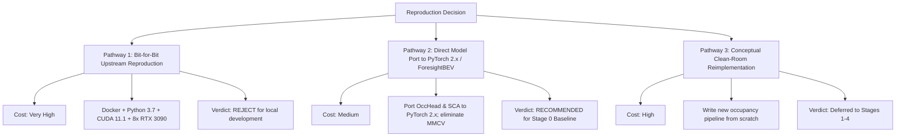

# Reproduction Assessment & Action Plan: SurroundOcc

**Project:** ForesightBEV Research Audit 01 — Stage 0 Baseline Reverse Engineering  
**Target Repository:** `SurroundOcc`  
**Repository URL:** [https://github.com/weiyithu/SurroundOcc](https://github.com/weiyithu/SurroundOcc)  
**Target Git Commit Audited:** `419bf5b47ee07ef0610950cce5ba99168c506753` (`419bf5b`, HEAD -> main, origin/main)  
**Date:** November 2026  
**Auditor Mode:** Read-Only Feasibility Assessment & Engineering Recommendation

---

## 1. Feasibility Assessment & Risk Matrix

Reproducing SurroundOcc in its exact upstream form represents a high maintenance burden with severe legacy software lock-in.

| Risk Category | Severity | Likelihood | Impact on ForesightBEV Engineering | Mitigation Strategy |
| :--- | :---: | :---: | :--- | :--- |
| **Toolchain Obsolescence** | **CRITICAL** | **100%** | Requires Python 3.7, PyTorch 1.10.1, MMCV-full 1.4.0, and GCC 6/7. Python 3.7 is deprecated across all modern package managers (`uv`, conda-forge). | Isolate upstream execution to a dedicated Docker container on cloud GPU nodes. Do not pollute the main ForesightBEV workspace. |
| **CUDA Compilation Lock** | **HIGH** | **100%** | Relies on compiled C++/CUDA kernels for `MultiScaleDeformableAttention` and `ChamferDistance`. Fails completely on non-NVIDIA (macOS / Apple Silicon) developer machines. | Refactor critical 3D projection and attention kernels to native PyTorch (`torch.nn.functional.grid_sample` or PyTorch 2.x SDPA). |
| **Dataset Hosting & Gating** | **MEDIUM** | **HIGH** | Pre-generated occupancy ground truth ($3.8\text{ GB}$) and official checkpoints are hosted on Baidu Netdisk (`pan.baidu.com`), requiring Chinese SMS registration. | Use direct HTTPS links to nuScenes official data and reproduce ground truth via `generate_occupancy_nuscenes.py` or download open mirror weights. |
| **Hardware Barrier** | **HIGH** | **HIGH** | Full 24-epoch training requires 8 $\times$ RTX 3090 (24 GB) GPUs for 60 hours ($480\text{ GPU hours}$). | Leverage pre-trained backbone features (`r101_dcn_fcos3d_pretrain.pth`) and perform evaluation or fine-tuning on a subset of validation scenes. |
| **Lack of Temporal Recurrence** | **MEDIUM** | **100%** | SurroundOcc provides zero velocity or dynamic tracking output, leaving a gap for ForesightBEV Stage 5. | Incorporate temporal recurrence inspired by BEVFormer or 4D occupancy baselines during our Stage 5 integration. |

---

## 2. Reproduction Pathways

We evaluate three potential pathways for integrating SurroundOcc into ForesightBEV:



### Pathway 1: Bit-for-Bit Upstream Reproduction (Legacy Container)
- **Goal:** Run original scripts (`tools/train.py`, `tools/test.py`) with zero code modifications.
- **Requirements:**
  - Dedicated Ubuntu 20.04 server with 8 $\times$ NVIDIA RTX 3090 / A100 GPUs.
  - CUDA Toolkit 11.1 / 11.3 + GCC 7.
  - Legacy Docker container (`nvcr.io/nvidia/pytorch:21.09-py3`).
  - Download full nuScenes ($400\text{ GB}$) and pre-generated occupancy labels ($3.8\text{ GB}$).
- **Evaluation:** Necessary only if our research requires verbatim validation of published paper numbers (e.g. reproducing exactly $78.87\%$ IoU and $20.65\%$ mIoU). Unsuitable for daily iterative development.

### Pathway 2: Direct Model Port to Modern PyTorch 2.x (Recommended)
- **Goal:** Extract `SurroundOcc`, `OccHead`, `PerceptionTransformer`, `OccEncoder`, and `SpatialCrossAttention` into an isolated, self-contained PyTorch module inside ForesightBEV.
- **Refactoring Tasks:**
  1. Replace MMCV's `ms_deform_attn_forward` with native PyTorch deformable attention or standard multi-head cross-attention.
  2. Replace C++ `ChamferDistance` with SciPy / PyTorch KD-Tree or `pytorch3d`.
  3. Replace `mmcv.runner.auto_fp16` and `force_fp32` with native `torch.cuda.amp.autocast`.
  4. Decouple dataset loading from MMDetection3D to a standard PyTorch `Dataset`.
- **Evaluation:** Provides a modern, portable baseline runnable on both cloud GPUs and Apple Silicon (via CPU/MPS fallback).

### Pathway 3: Conceptual Reimplementation within ForesightBEV Architecture
- **Goal:** Use SurroundOcc's audited mathematical equations (Section 3 and 4 of `REA_REPORT.md`) directly within the finalized ForesightBEV 10-stage architecture.
- **Evaluation:** This will be executed sequentially as ForesightBEV progresses through Stages 1 to 4.

---

## 3. Step-by-Step Porting Specification (Pathway 2)

To port SurroundOcc's core architecture without legacy dependencies:

### Step 3.1: Kernel Elimination & PyTorch Deformable Attention
In `projects/mmdet3d_plugin/surroundocc/modules/spatial_cross_attention.py:386-396`:
```python
# Replace custom MMCV CUDA call:
# output = MultiScaleDeformableAttnFunction.apply(...)
# With pure PyTorch equivalent:
output = multi_scale_deformable_attn_pytorch(
    value, spatial_shapes, sampling_locations, attention_weights
)
```
*Validation:* Verify output equivalence with tolerance $\text{atol} = 10^{-5}$ on unit test tensors.

### Step 3.2: Modernized Backbone & FP16 Support
- Replace `mmdet.ResNet` and `DCNv2` with `torchvision.models.resnet101` or modern `timm` ConvNeXt backbone.
- Replace OpenMMLab runner decorators:
  ```python
  # Old:
  @auto_fp16(apply_to=('img'))
  def extract_feat(...)
  
  # New:
  with torch.autocast(device_type=device, dtype=torch.float16):
      img_feats = self.extract_img_feat(img)
  ```

### Step 3.3: Decoupled Dataloader
Create a minimal standalone `NuScenesOccupancyDataset(torch.utils.data.Dataset)` consuming pre-extracted pickle metadata and returning:
- `img`: `torch.Tensor` of shape `(6, 3, 900, 1600)`
- `lidar2img`: `torch.Tensor` of shape `(6, 4, 4)`
- `gt_occ`: `torch.Tensor` of shape `(N, 4)`

---

## 4. Final Strategic Verdict

| Item | Recommendation |
| :--- | :--- |
| **Reproduce Upstream Training Unchanged?** | **NO.** Disproportionate engineering overhead due to deprecated OpenMMLab 1.x / Python 3.7 stack. |
| **Adapt Architecture into ForesightBEV?** | **YES.** Retain 3D volumetric query representation, spatial projection geometry, and coarse-to-fine 3D deconvolution heads. |
| **Use as Stage 0 Reference Baseline?** | **CONFIRMED.** SurroundOcc provides the baseline reference against which ForesightBEV's evidential uncertainty, temporal recurrence, and trajectory risk modeling will be measured. |

