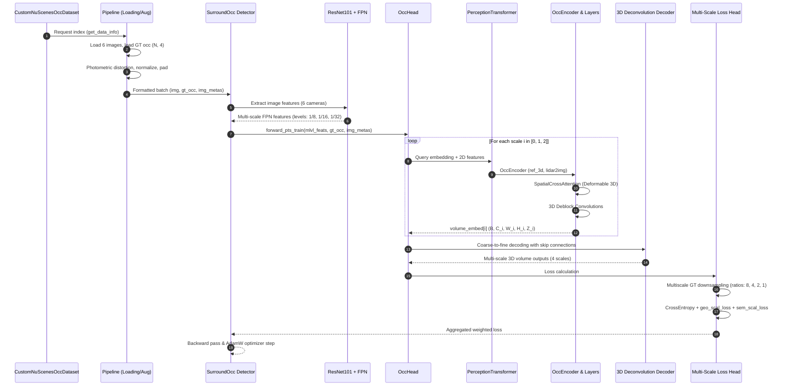
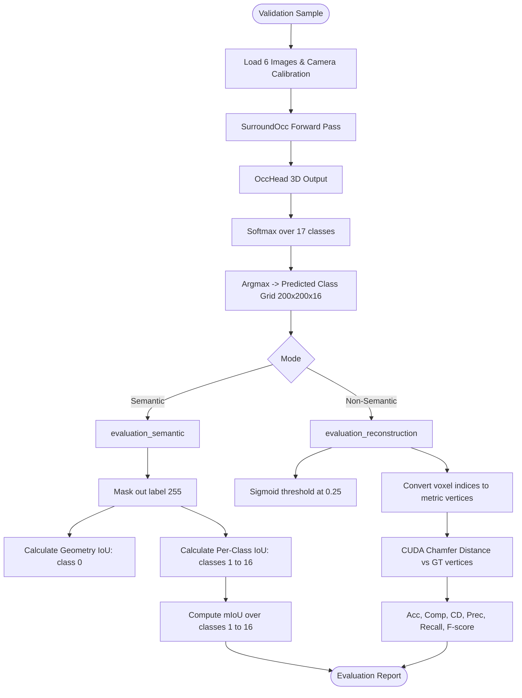

# Source Code Inventory & Functional Map: SurroundOcc

**Project:** ForesightBEV Research Audit 01 — Stage 0 Baseline Reverse Engineering  
**Target Repository:** `SurroundOcc`  
**Repository URL:** [https://github.com/weiyithu/SurroundOcc](https://github.com/weiyithu/SurroundOcc)  
**Target Git Commit Audited:** `419bf5b47ee07ef0610950cce5ba99168c506753` (`419bf5b`, HEAD -> main, origin/main)  
**Date:** November 2026  
**Auditor Mode:** Read-Only Static Reverse-Engineering & Architecture Verification

---

## 1. Directory Tree & Module Hierarchy

```text
SurroundOcc/
├── README.md                                   # Upstream documentation and project links
├── LICENSE                                     # Apache 2.0 license
├── docs/
│   ├── install.md                              # Environment installation instructions
│   ├── data.md                                 # nuScenes & occupancy ground truth setup
│   └── run.md                                  # Execution commands for train/eval/inference
├── extensions/
│   └── chamfer_dist/                           # Custom CUDA extension for Chamfer Distance
│       ├── setup.py                            # PyTorch C++/CUDA extension builder
│       ├── test.py                             # Validation script for Chamfer CUDA kernel
│       ├── chamfer_cuda.cpp                    # C++ interface bindings
│       └── chamfer.cu                          # GPU CUDA kernels for 3D point cloud distance
├── projects/
│   ├── configs/
│   │   ├── _base_/                             # MMDetection & MMDetection3D base configs
│   │   ├── datasets/
│   │   │   └── custom_nus-3d.py                # Base dataset definition (overridden by SurroundOcc)
│   │   └── surroundocc/
│   │       ├── surroundocc.py                  # Primary training config (ResNet101, multi-scale 3D head)
│   │       ├── surroundocc_inference.py        # Inference & PLY generation config
│   │       └── surroundocc_nosemantic.py       # Geometry-only scene reconstruction config
│   └── mmdet3d_plugin/
│       ├── __init__.py                         # Global plugin entrypoint
│       ├── core/                               # Bounding box assigners, coders, hooks
│       ├── datasets/
│       │   ├── __init__.py                     # Dataset registry export
│       │   ├── builder.py                      # Custom dataloader and dataset builders
│       │   ├── evaluation_metrics.py           # Reconstruction & semantic mIoU evaluation functions
│       │   ├── nuscenes_dataset.py             # Temporal BEVFormer base dataset (reference)
│       │   ├── nuscenes_occupancy_dataset.py   # CustomNuScenesOccDataset implementation
│       │   ├── pipelines/
│       │   │   ├── formating.py                # CustomDefaultFormatBundle3D
│       │   │   ├── loading.py                  # LoadOccupancy pipeline
│       │   │   └── transform_3d.py             # Multi-view padding, normalization, distortion
│       │   └── samplers/                       # Distributed samplers
│       ├── models/
│       │   └── utils/
│       │       ├── bricks.py                   # Runtime measurement wrappers
│       │       ├── grid_mask.py                # GridMask input image regularizer
│       │       └── position_embedding.py       # Learned & sinusoidal position embeddings
│       └── surroundocc/
│           ├── __init__.py                     # Package re-exports
│           ├── apis/
│           │   ├── mmdet_train.py              # Modified MMDetection training entrypoint
│           │   ├── test.py                     # Single/multi-GPU evaluation loop
│           │   └── train.py                    # SurroundOcc train entry API
│           ├── dense_heads/
│           │   ├── __init__.py                 # Export OccHead
│           │   └── occ_head.py                 # Multi-scale 3D volume decoder and loss head
│           ├── detectors/
│           │   ├── __init__.py                 # Export SurroundOcc
│           │   └── surroundocc.py              # Main 2D-to-3D detector wrapper
│           ├── hooks/
│           │   ├── __init__.py                 # Custom hooks
│           │   └── custom_hooks.py             # Validation and profiling hooks
│           ├── loss/
│           │   ├── __init__.py                 # Export loss utilities
│           │   └── loss_utils.py               # Multiscale supervision, geo_scal_loss, sem_scal_loss
│           └── modules/
│               ├── __init__.py                 # Module re-exports
│               ├── custom_base_transformer_layer.py # Base transformer layer supporting 'conv'
│               ├── encoder.py                  # OccEncoder & OccLayer (3D reference point generator)
│               ├── multi_scale_deformable_attn_function.py # CUDA function bindings for 3D DeformAttn
│               ├── spatial_cross_attention.py  # SpatialCrossAttention & MSDeformableAttention3D
│               └── transformer.py              # PerceptionTransformer volume coordinator
└── tools/
    ├── create_data.py                          # nuScenes info file preprocessing
    ├── dist_train.sh / dist_test.sh            # Distributed launcher scripts
    ├── dist_inference.sh / train.sh            # Inference and single-GPU training scripts
    ├── train.py / test.py                      # Main entrypoints for execution
    ├── visual.py                               # Mayavi visualization for .npy voxel grids
    └── generate_occupancy_nuscenes/
        ├── config.yaml                         # Voxel size, depth, and filter parameters
        ├── nuscenes.yaml                       # Semantic class mapping (16 driving classes + 1 empty)
        ├── nuscenes_val_list.txt               # Validation split scene tokens
        └── generate_occupancy_nuscenes.py      # Complete LiDAR Poisson reconstruction & voxelization pipeline
```

---

## 2. File-by-File Inventory, Classes, Functions & Execution Flow

### 2.1 Core Network Architecture (`projects/mmdet3d_plugin/surroundocc/`)

| File Path | Primary Class / Function | Purpose | Input Tensor / Types | Output Tensor / Types |
| :--- | :--- | :--- | :--- | :--- |
| `detectors/surroundocc.py` | `class SurroundOcc(MVXTwoStageDetector)` | Top-level detector managing image backbone, FPN, 3D volume head, training loss, and PLY generation. | `img: (B, N, 3, H, W)`<br>`img_metas: list[dict]` | Training: `loss_dict`<br>Inference: `pred_occ: (B, 17, 200, 200, 16)` |
| `dense_heads/occ_head.py` | `class OccHead(nn.Module)` | Multi-scale 3D volume feature generator, 3D deconvolution upsampler, skip connections, and multi-scale loss. | `mlvl_feats: list[(B, N, C_i, H_i, W_i)]`<br>`img_metas: list[dict]` | `volume_embed: list[Tensor]`<br>`occ_preds: list[(B, 17, W_s, H_s, Z_s)]` |
| `modules/transformer.py` | `class PerceptionTransformer(BaseModule)` | Top-level spatial transformer coordinator injecting camera and FPN level embeddings into 2D features. | `mlvl_feats`, `volume_queries: (V, C)` | `volume_embed: (V, B, C)` |
| `modules/encoder.py` | `class OccEncoder(TransformerLayerSequence)` | Computes normalized 3D meshgrid, applies camera projection matrix `lidar2img`, and executes transformer layers. | `volume_query: (V, B, C)`<br>`feat_flatten: (N, HW, B, C)` | `volume_embed: (B, V, C)` |
| `modules/encoder.py` | `class OccLayer(MyCustomBaseTransformerLayer)` | Single layer executing configurable sequence: `('cross_attn', 'norm', 'ffn', 'norm', 'conv')`. | `query: (B, V, C)` | `query: (B, V, C)` |
| `modules/spatial_cross_attention.py` | `class SpatialCrossAttention(BaseModule)` | Selects camera-visible 3D queries, dispatches deformable attention, and averages outputs across visible views. | `query: (B, V, C)`<br>`reference_points_cam: (N, B, V, 1, 2)` | `slots: (B, V, C)` |
| `modules/spatial_cross_attention.py` | `class MSDeformableAttention3D(BaseModule)` | Predicts 2D sampling offsets and attention weights for each 3D query across multi-scale feature maps. | `query`, `value`, `reference_points` | `output: (B, V, C)` |
| `modules/multi_scale_deformable_attn_function.py` | `MultiScaleDeformableAttnFunction_fp32` | Custom `torch.autograd.Function` wrapping MMCV CUDA kernels `ms_deform_attn_forward` and `backward`. | `value, shapes, starts, locations, weights` | `output: (B, V, C)` |
| `modules/custom_base_transformer_layer.py` | `class MyCustomBaseTransformerLayer(BaseModule)` | Extends standard transformer layers to support 3D convolutional blocks (`'conv'`) interleaved with attention. | `query, key, value` | `query: (B, V, C)` |
| `loss/loss_utils.py` | `def multiscale_supervision` | Strided coordinate downsampling of ground-truth sparse voxels for intermediate coarse supervision. | `gt_occ: (B, N_pts, 4)`, `ratio: int` | `gt: (B, W_s, H_s, Z_s)` |
| `loss/loss_utils.py` | `def geo_scal_loss` | Geometric scaling loss computing BCE on precision, recall, and specificity of non-empty occupancy. | `pred: (B, 17, W, H, Z)`<br>`ssc_target: (B, W, H, Z)` | Scalar scalar loss tensor |
| `loss/loss_utils.py` | `def sem_scal_loss` | Class affinity loss penalizing precision, recall, and specificity per semantic class. | `pred: (B, 17, W, H, Z)`<br>`ssc_target: (B, W, H, Z)` | Scalar loss tensor |

---

### 2.2 Datasets & Pipelines (`projects/mmdet3d_plugin/datasets/`)

| File Path | Primary Class / Function | Purpose |
| :--- | :--- | :--- |
| `nuscenes_occupancy_dataset.py` | `class CustomNuScenesOccDataset(NuScenesDataset)` | Dataset class loading `occ_path` (.npy), camera intrinsics, camera extrinsics (`lidar2img`), and evaluation hooks. |
| `nuscenes_occupancy_dataset.py` | `def evaluate` | Evaluates validation split using semantic mIoU (excluding class 0) or Chamfer distance reconstruction metrics. |
| `pipelines/loading.py` | `class LoadOccupancy` | Reads `.npy` ground truth. Remaps empty/unlabeled voxels (0 -> 255) in semantic mode. |
| `pipelines/transform_3d.py` | `class NormalizeMultiviewImage` | Applies mean/std normalization in Caffe style (`to_rgb=False`). |
| `pipelines/transform_3d.py` | `class PadMultiViewImage` | Divisible-by-32 image padding for multi-scale FPN feature alignment. |
| `pipelines/transform_3d.py` | `class PhotoMetricDistortionMultiViewImage` | Multi-camera color jittering, contrast, saturation, and hue perturbation. |
| `pipelines/transform_3d.py` | `class CustomCollect3D` | Bundles image tensors and metadata (`lidar2img`, `pc_range`, `occ_size`, `occ_path`). |
| `pipelines/formating.py` | `class CustomDefaultFormatBundle3D` | Wraps variable-length sparse occupancy labels into `DataContainer(stack=False)`. |
| `evaluation_metrics.py` | `def evaluation_semantic` | Computes True Positives, Predictions, and Ground Truth per class to produce Intersection-over-Union. |
| `evaluation_metrics.py` | `def eval_3d` | Chamfer Distance precision and recall using CUDA extension `chamfer.forward`. |

---

### 2.3 Ground-Truth Generation Pipeline (`tools/generate_occupancy_nuscenes/`)

| File Path | Function Name | Purpose | Implementation Details |
| :--- | :--- | :--- | :--- |
| `generate_occupancy_nuscenes.py` | `def lidar_to_world_to_lidar` | Rigid coordinate transform between non-key frames and reference key-frame coordinate space. | Composes rotation matrices and translation vectors via `pyquaternion.Quaternion`. |
| `generate_occupancy_nuscenes.py` | `def run_poisson` | Poisson Surface Reconstruction via Open3D to generate watertight surfaces from aggregated point clouds. | `o3d.geometry.TriangleMesh.create_from_point_cloud_poisson(pcd, depth=10)`. |
| `generate_occupancy_nuscenes.py` | `def preprocess` | Computes point normals oriented towards sensor origin using KNN search (`max_nn=20`). | Estimates normals on fused point clouds prior to Poisson reconstruction. |
| `generate_occupancy_nuscenes.py` | `def main` | Complete sequence extraction: splits static background from dynamic bounding boxes, reconstructs, voxelizes. | Extracts all 850 nuScenes driving sequences and saves sparse `(N, 4)` numpy arrays. |

---

### 2.4 Training, Inference & Analysis Entrypoints (`tools/`)

| File Path | Invocation Role | Key Parameters |
| :--- | :--- | :--- |
| `tools/train.py` | Master training entrypoint | Parses config, initializes distributed environment, builds dataset and model, registers runners. |
| `tools/test.py` | Master evaluation and benchmarking entrypoint | Runs forward pass over validation split, calls `evaluate()` or dumps raw predictions. |
| `tools/dist_train.sh` | Shell launcher for PyTorch distributed training | Arguments: `<config_path> <num_gpus> --work-dir <work_dir>`. |
| `tools/dist_test.sh` | Shell launcher for multi-GPU evaluation | Arguments: `<config_path> <checkpoint_path> <num_gpus>`. |
| `tools/dist_inference.sh` | Shell launcher for inference and visualization dump | Runs `surroundocc_inference.py` to write PLY and NPY files to `visual_dir/`. |
| `tools/visual.py` | Standalone voxel inspection script | Uses Mayavi / VTK to render 3D voxels colored by semantic class. |

---

## 3. End-to-End Execution Trace

### 3.1 Training Forward & Backward Pass



### 3.2 Evaluation & Metric Computation Trace



---

## 4. Key Tensor Shapes by Pipeline Stage

| Pipeline Stage | Module / Tensor Variable | Shape | Data Type | Notes |
| :--- | :--- | :--- | :--- | :--- |
| Image Input | `img` | `(B, 6, 3, 900, 1600)` | `torch.float32` | 6 surround cameras |
| Backbone Stage 2 | ResNet101 `out[0]` | `(B*6, 512, 116, 200)` | `torch.float32` | Stride 8 |
| Backbone Stage 3 | ResNet101 `out[1]` | `(B*6, 1024, 58, 100)` | `torch.float32` | Stride 16 |
| Backbone Stage 4 | ResNet101 `out[2]` | `(B*6, 2048, 29, 50)` | `torch.float32` | Stride 32 |
| FPN Outputs | `mlvl_feats[0..2]` | `[(B, 6, 512, 116, 200), (B, 6, 512, 58, 100), (B, 6, 512, 29, 50)]` | `torch.float32` | Uniform 512 channels |
| Scale 0 Queries | `volume_embedding[0]` | `(100*100*8, 128) = (80000, 128)` | `torch.float32` | Learnable embedding |
| Scale 1 Queries | `volume_embedding[1]` | `(50*50*4, 256) = (10000, 256)` | `torch.float32` | Learnable embedding |
| Scale 2 Queries | `volume_embedding[2]` | `(25*25*2, 512) = (1250, 512)` | `torch.float32` | Learnable embedding |
| 3D Ref Points (S0) | `ref_3d` | `(B, 1, 80000, 3)` | `torch.float32` | Normalized $[0, 1]^3$ |
| Projected Points | `reference_points_cam` | `(6, B, 80000, 1, 2)` | `torch.float32` | Normalized image coords $[0, 1]^2$ |
| Camera Mask | `volume_mask` | `(6, B, 80000, 1)` | `torch.bool` | Valid projection indicator |
| Scale 2 Output | `occ_preds[0]` | `(B, 17, 25, 25, 2)` | `torch.float32` | Coarsest prediction |
| Scale 1 Output | `occ_preds[1]` | `(B, 17, 50, 50, 4)` | `torch.float32` | Intermediate prediction |
| Scale 0 Output | `occ_preds[2]` | `(B, 17, 100, 100, 8)` | `torch.float32` | Fine prediction |
| Full Res Output | `occ_preds[3]` | `(B, 17, 200, 200, 16)` | `torch.float32` | Final full resolution |
| Ground Truth Occ | `gt_occ` | `(B, N_occupied, 4)` | `torch.float32` | Sparse $(x, y, z, \text{class})$ |

