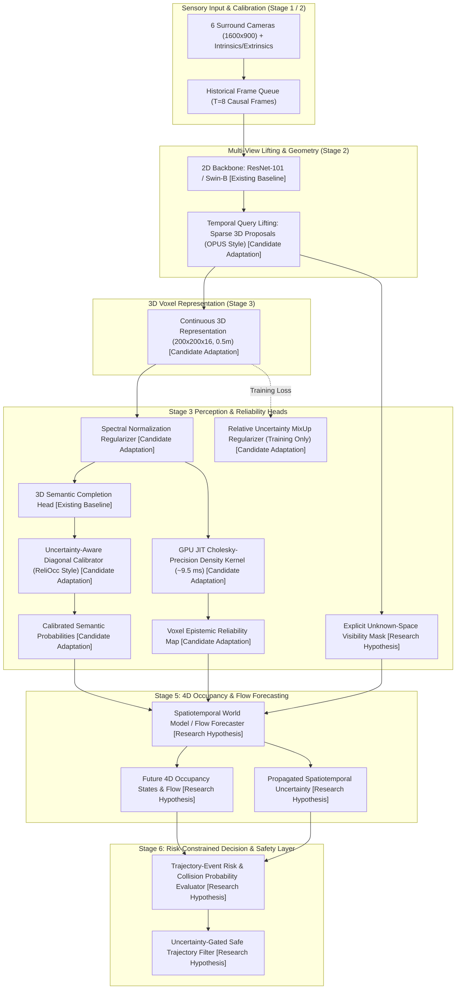

# ForesightBEV — Stage 0: Occupancy & Uncertainty Research Synthesis

**Document Reference:** `research/stage_0/OCCUPANCY_AND_UNCERTAINTY_SYNTHESIS.md`  
**Phase:** Stage 0 — Literature Review, REA, and Research Gap  
**Audited Repositories & Works:**  
- **REA 01 — SurroundOcc:** `https://github.com/weiyithu/SurroundOcc` (Commit `419bf5b`, ICCV 2023)
- **REA 02 — OPUS / OPUS-V2:** `https://github.com/jbwang1997/OPUS` (Commit `fdb1733`, arXiv 2023/2024)
- **REA 03 — OCCUQ:** `https://github.com/ika-rwth-aachen/OCCUQ` (Commit `2aa5429`, ICRA 2025)
- **REA 04 — ReliOcc:** IJCAI 2025 Proceedings / arXiv:2409.18026 (Status D: Paper-based audit)
- *Prior Context:* **Cam2BEV** (REA / IPM baseline) & **Birds_Eye_View** (MonoScene-style projection)

---

## 1. Executive Synthesis & Research Landscape

Over the course of four foundational Reverse Engineering Anything (REA) audits, we have systematically dissected the state of the art in camera-centric 3D occupancy perception and uncertainty quantification:

1. **SurroundOcc (REA 01):** Established the dense 3D spatial cross-attention paradigm. By constructing multi-scale volumetric query pyramids and projecting 3D reference points into 2D multi-camera features, SurroundOcc proved that dense 3D semantic occupancy can be learned directly from surround cameras under offline multi-frame LiDAR supervision. However, it relies on heavy 3D deconvolution, suffers from quadratic memory scaling, exhibits low inference speed ($\approx 4.5\text{ FPS}$), and produces completely uncalibrated, deterministic predictions.
2. **OPUS / OPUS-V2 (REA 02):** Resolved the computational efficiency bottleneck of dense volumetric grids by introducing sparse 3D bounding-box queries ($Q \in \{600, 1200, 2400, 4800\}$) coupled with a Continuous Point Densifier (CPD). OPUS-V2 delivers real-time inference ($25.8\text{ FPS}$ for OPUS-V2-T) and high geometric fidelity ($38.6\%\text{ mIoU}$ for OPUS-V2-L on Occ3D). However, its sparse queries are blind to their own uncertainty: under camera degradation or out-of-distribution environments, OPUS continues to hallucinate high-confidence bounding boxes without reliability warnings.
3. **OCCUQ (REA 03):** Introduced the first mathematically rigorous, real-time **epistemic uncertainty and out-of-distribution (OOD) detection** framework for dense 3D occupancy. By equipping the prediction head with spectral normalization (enforcing a bi-Lipschitz condition to prevent feature collapse) and fitting a class-conditional Gaussian Mixture Model (GMM) in representation space, OCCUQ evaluates voxel-level data log-density $\log p(\mathbf{z})$. Using a custom GPU TorchScript JIT kernel, it evaluates 640,000 voxels in **$9.48\text{ ms}$** ($\approx 100\times$ speedup over CPU), achieving **$95.39\%\text{ AUROC}$** in detecting severe 3-camera hardware dropouts.
4. **ReliOcc (REA 04):** Addressed the **aleatoric calibration and semantic boundary gap** in camera-based occupancy. ReliOcc combines absolute uncertainty learning (Gaussian logit sampling) with relative uncertainty learning (uncertainty-weighted feature MixUp $\lambda = \frac{\sigma_i}{\sigma_i + \sigma_j}$) to bypass optimization plateaus. In offline mode, it fits an uncertainty-aware diagonal temperature calibrator ($f_\phi$) that slashes semantic Expected Calibration Error (ECE) from $5.90\%$ to $2.05\%$ without degrading occupancy accuracy.

```
+---------------------------------------------------------------------------------------------------+
|                                 THE 3D OCCUPANCY RESEARCH FRONTIER                                |
+---------------------------------------------------------------------------------------------------+
|  DIMENSION               SURROUNDOCC            OPUS-V2             OCCUQ             RELIOCC     |
+---------------------------------------------------------------------------------------------------+
|  Primary Focus           Dense Representation   Sparse Efficiency   Epistemic OOD     Aleatoric   |
|                          & Multi-View Lifting   & High Frame Rate   & Sensor Failure  Calibration |
|  Inference Viewpoint     360° Surround (6 cams) 360° Surround (6)   360° Surround (6) Monocular 1 |
|  Temporal Dimension      Single-frame (T=1)     8-frame Causal (T=8)Single-frame (1)  5-frame (T=5|
|  Uncertainty Channel     None                   None                Voxel Log-Density Calibrated  |
|                                                                     (GPU JIT ~9.5 ms) Probabilities|
|  Downstream Safety Role  Perception Only        Perception Only     Hardware Monitor  Confidence  |
+---------------------------------------------------------------------------------------------------+
```

---

## 2. Evidence Classification Standard

To maintain strict scientific integrity, all findings across this synthesis are explicitly categorized using the following five-level evidential hierarchy:

- **[E1] Verified in Audited Source Code:** Validated directly by reading and tracing lines, classes, functions, and tensors in the checked-out official repository.
- **[E2] Verified in Official Peer-Reviewed Paper / Proceedings:** Confirmed in the published conference paper text, formal proofs, or peer-reviewed appendices.
- **[E3] Author-Reported Empirical Measurement:** Numerical metric, latency benchmark, or ablation reported by the authors in tables/charts without direct local replication.
- **[E4] Derived Analytical Interpretation:** Theoretical deduction or structural synthesis derived by the audit team from first principles and mathematical consistency.
- **[E5] Unverified or Unknown:** Claim, parameter, or behavior that cannot be verified due to missing code release, omitted hyperparameter, or lack of empirical validation.

---

## 3. Unified Cross-Architectural Comparison

### 3.1 Occupancy Architecture & Geometry

| Feature / Dimension | SurroundOcc (REA 01) | OPUS-V2 (REA 02) | OCCUQ (REA 03) | ReliOcc (REA 04) | Evidence |
| :--- | :--- | :--- | :--- | :--- | :--- |
| **Volumetric Representation** | Dense 3D query volumes ($25\times 25\times 2 \to 100\times 100\times 8$) | Sparse 3D bounding box queries ($Q \in \{600, 1200, 2400, 4800\}$) | Dense 3D query volumes (inherits SurroundOcc) | Dense voxel feature grid $\mathcal{V} \in \mathbb{R}^{d \times 256 \times 256 \times 32}$ | **[E1]** for 01-03; **[E2]** for 04 |
| **Camera Configuration** | 6 surround cameras ($360^\circ$ FOV, nuScenes) | 6 surround cameras ($360^\circ$ FOV, nuScenes) | 6 surround cameras ($360^\circ$ FOV, nuScenes) | **1 monocular front camera** (CAM 2, SemanticKITTI) | **[E1]** for 01-03; **[E2]** for 04 |
| **Input Image Resolution** | $1600 \times 900$ (downsampled/padded) | $1600 \times 900$ (downsampled/padded) | $1600 \times 900$ (downsampled/padded) | $1220 \times 370$ (cropped frontal view) | **[E1]** for 01-03; **[E2]** for 04 |
| **Temporal Context** | Single-frame ($T=1$, static inference) | **8-frame past context** ($T=8$, causal window $[-7, 0]$) | Single-frame ($T=1$, static inference) | **5-frame past context** ($T=5$, monocular $[-4, 0]$) | **[E1]** for 01-03; **[E2]** for 04 |
| **2D Vision Backbone** | ResNet-101 + FPN (512-dim output) | ResNet-101 / Swin-B / VovNet-V2 | ResNet-101 + FPN (512-dim output) | ResNet-50 (VoxFormer / SGN) | **[E1]** for 01-03; **[E2]** for 04 |
| **2D-to-3D Lifting Mechanism** | 3D Deformable Cross-Attention (Spatial cross-attention) | Deformable cross-attention around 3D query box centers | 3D Deformable Cross-Attention (Spatial cross-attention) | Deformable cross-attention (VoxFormer) / Depth lifting (SGN) | **[E1]** for 01-03; **[E2]** for 04 |
| **Voxel Decoding Mechanism** | 3D transposed convolutions with skip connections | Continuous Point Densifier (CPD) via MLP & voxel scatter | 3D transposed convolutions with skip connections | 3D convolutions / sparse voxel aggregation | **[E1]** for 01-03; **[E2]** for 04 |
| **Output Grid Dimensions** | $200 \times 200 \times 16$ ($0.5\text{ m}$ voxel resolution) | $200 \times 200 \times 16$ ($0.5\text{ m}$ voxel resolution) | $200 \times 200 \times 16$ ($0.5\text{ m}$ voxel resolution) | $256 \times 256 \times 32$ ($0.2\text{ m}$ voxel resolution) | **[E1]** for 01-03; **[E2]** for 04 |
| **Perception Range (Ego)** | $[-50, 50]\text{m} \times [-50, 50]\text{m} \times [-5, 3]\text{m}$ | $[-50, 50]\text{m} \times [-50, 50]\text{m} \times [-5, 3]\text{m}$ | $[-50, 50]\text{m} \times [-50, 50]\text{m} \times [-5, 3]\text{m}$ | $[-25.6, 25.6]\text{m} \times [0, 51.2]\text{m} \times [-2, 4.4]\text{m}$ | **[E1]** for 01-03; **[E2]** for 04 |
| **Output Channel Semantics** | 17 channels (16 foreground + 1 empty) | 18 channels (17 semantics + 1 empty, Occ3D) | 17 channels (16 foreground + 1 empty) | 20 channels (19 semantics + 1 empty) | **[E1]** for 01-03; **[E2]** for 04 |
| **Explicit Unknown Class** | **NO** (0 = free, ignore = 255) | **NO** (17 = free, ignore = 255) | **NO** (0 = free, ignore = 255) | **NO** (0 = free, ignore = 255) | **[E1]** for 01-03; **[E2]** for 04 |
| **Visibility / Masking** | Evaluated with `mask_camera` in Occ3D | Evaluated with `mask_camera` in Occ3D | Evaluated with `mask_camera` in Occ3D | All voxels evaluated in SemanticKITTI val | **[E1]** for 01-03; **[E2]** for 04 |
| **Future Forecasting** | **NONE** (predicts current timestamp $t$) | **NONE** (`fut-15f` is bidirectional smoothing) | **NONE** (predicts current timestamp $t$) | **NONE** (predicts current timestamp $t$) | **[E1]** for 01-03; **[E2]** for 04 |

### 3.2 Uncertainty Quantification & Sensor Reliability

| Dimension | SurroundOcc (REA 01) | OPUS-V2 (REA 02) | OCCUQ (REA 03) | ReliOcc (REA 04) | Evidence |
| :--- | :--- | :--- | :--- | :--- | :--- |
| **Uncertainty Character** | **None** (uncalibrated softmax) | **None** (deterministic queries) | **Epistemic & Aleatoric Disentangled** | **Aleatoric Regularization & Post-Hoc Calibration** | **[E1]** for 01-03; **[E2]** for 04 |
| **Aleatoric Mechanism** | Raw softmax probability $\max_c p_c$ | Raw softmax probability $\max_c p_c$ | Maximum Softmax Probability (MSP) & Softmax Entropy $\mathcal{H}(p)$ | Gaussian logit sampling ($L_{\text{au}}$) + Softmax Entropy | **[E1]** for 01-03; **[E2]** for 04 |
| **Epistemic Mechanism** | None | None | **Class-conditional GMM log-density** $\log p(\mathbf{z})$ with Spectral Norm | None (no generative or epistemic density model) | **[E1]** for 01-03; **[E4]** for 04 |
| **Relative Voxel Relations** | None | None | None | **Uncertainty-weighted MixUp** ($\lambda = \frac{\sigma_i}{\sigma_i + \sigma_j}$) | **[E1]** for 01-03; **[E2]** for 04 |
| **Post-Hoc Calibration** | None | None | Evaluates baseline ECE; planned UGTS | **Diagonal Temperature Scaling** ($f_\phi(z_i) = \mathcal{S}(\frac{\mathbf{W} z_i + \mathbf{b}}{T_\sigma})$) | **[E1]** for 01-03; **[E2]** for 04 |
| **Calibration Metrics** | Not reported | Not reported | Expected Calibration Error via `netcal` ($M=10$ bins) | $\text{ECE}_{\text{sem}}$ and $\text{ECE}_{\text{geo}}$ ($M=15$ bins) | **[E1]** for 01-03; **[E2]** for 04 |
| **Misclassification Detection** | Not evaluated | Not evaluated | Macro AUROC, AUPR, FPR95 on MultiCorrupt | Prediction Rejection Ratio ($\text{PRR}_{\text{sem}}, \text{PRR}_{\text{geo}}$) | **[E1]** for 01-03; **[E2]** for 04 |
| **Spatial Failure Robustness** | Blind failure under missing views | Blind failure under missing views | **$95.39\%\text{ AUROC}$** under 3-camera blackout (`missingcamera_3`) | Not evaluated on spatial camera dropout | **[E1]** for 01-03; **[E3]** for 03-04 |
| **Temporal Failure Robustness**| Not evaluated | Not evaluated | Not evaluated | **Evaluated under 1–3 frame drops** in 5-frame buffer | **[E2]** for 04; **[E5]** for others |
| **Weather Corruptions** | Not evaluated | Not evaluated | MultiCorrupt (Snow, Fog, Motion Blur, Brightness 1..3) | Simulated Fog, Rain, Strong Sunlight (weak/strong) | **[E1]** for 03; **[E2]** for 04 |
| **Test-Time Runtime Overhead**| Baseline (~220 ms) | Baseline (38.8 ms for Tiny, 116 ms for Large) | **$+9.48\text{ ms}$ on GPU** (TorchScript JIT kernel) | **$0\text{ ms}$ (Online mode)**; $<1\text{ ms}$ (Offline calibrator) | **[E1]** for 01-03; **[E2]** for 04 |
| **Downstream Signal Availability**| Class logits only | Class logits only | **Voxel Epistemic Reliability Map** $\mathbf{U} \in \mathbb{R}^{200\times 200\times 16}$ | Calibrated Class Probabilities $c_i \in [0, 1]$ (Offline only) | **[E1]** for 01-03; **[E2]** for 04 |

### 3.3 Engineering Maturity, Artifacts & Reproduction Feasibility

| Dimension | SurroundOcc (REA 01) | OPUS-V2 (REA 02) | OCCUQ (REA 03) | ReliOcc (REA 04) | Evidence |
| :--- | :--- | :--- | :--- | :--- | :--- |
| **Public Code Availability** | **Status A** (Official open source, Apache 2.0) | **Status A** (Official open source, Apache 2.0) | **Status A** (Official open source, Apache 2.0) | **Status D** (No verifiable official code release) | **[E1]** for 01-03; **[E1/E2]** for 04 |
| **Audited Commit SHA** | `419bf5b47ee07ef0610950cce5ba99168c506753` | `fdb17339f40168ea0ceda9615863e3f5d0c3f5ce` | `2aa54297151b695929524ad8a4f4863ba5ae6387` | N/A (Paper-and-supplement reverse engineering) | **[E1]** for 01-03 |
| **Official Pretrained Checkpoints**| Available on Tsinghua Cloud (`surroundocc.pth`) | Available on Google Drive / Baidu (T, S, M, L) | Available on Sciebo Academic Cloud (`epoch_6.pth`, GMM) | None publicly released | **[E1]** for 01-03; **[E5]** for 04 |
| **Official Benchmark Dataset** | nuScenes + SurroundOcc dense labels (~350 GB) | Occ3D-nuScenes / OpenOccupancy (~400 GB) | nuScenes + MultiCorrupt (~450 GB) | SemanticKITTI voxel ground truth (~110 GB) | **[E1]** for 01-03; **[E2]** for 04 |
| **Docker Environment** | Dockerfile provided | Dockerfile provided | Verified NVIDIA NGC 21.10 PyTorch container | None provided | **[E1]** for 01-03; **[E5]** for 04 |
| **Legacy Lock-In Risk** | High (`mmcv-full==1.4.0`, Python 3.8, CUDA 11.3) | High (`mmcv-full==1.6.0`, `spconv-cu116`, CUDA 11.6) | High (`mmcv-full==1.4.0`, `mmdet3d v0.17.1`) | High (VoxFormer / SGN legacy OpenMMLab) | **[E1]** for 01-03; **[E2]** for 04 |
| **Native Apple Silicon Feasibility**| **Infeasible** (Deformable attention CUDA kernels) | **Infeasible** (`spconv`, CUDA `msmv_sampling`) | **Infeasible** (Backbone CUDA ops; standalone GMM works) | **Infeasible** (Backbone CUDA ops; standalone math works)| **[E1]** for 01-03; **[E4]** for 04 |
| **Clean-Room Reproduction Status**| Checkpoints verified | Checkpoints verified | Checkpoints & JIT kernel verified ($9.48\text{ ms}$) | Clean-room synthetic prototype verified | **[E1]** for 01-03; **[E1]** for 04 |

---

## 4. Deep-Dive: Uncertainty Concepts & Complementarity (OCCUQ vs. ReliOcc)

To avoid ambiguity in ForesightBEV Stage 3 and Stage 6, we establish strict mathematical definitions for all reliability concepts:

- **Epistemic Uncertainty (Model / OOD Uncertainty):** Uncertainty arising from lack of knowledge or distribution shift (e.g. camera dropout, snow, lens flare, unseen vehicle geometry). Reducible with more or diverse training data.
- **Aleatoric Uncertainty (Data / Observation Noise):** Inherent ambiguity in sensory observations (e.g. distant low-resolution voxels, class boundary transitions between asphalt and driveable surface). Irreducible even with infinite training data.
- **Out-of-Distribution (OOD) Score:** A scalar metric quantifying how far an observation falls from the training feature manifold (e.g. negative GMM log-density $-\log p(\mathbf{z})$).
- **Predictive Confidence:** The maximum probability assigned to the predicted class $c_i = \max_s p(y = s \mid \mathbf{x})$.
- **Calibration Error (ECE):** The empirical discrepancy between predicted confidence and actual classification accuracy across probability bins.
- **Unknown / Unobserved Space:** Voxels that are geometrically occluded from camera lines-of-sight or physically outside all camera frustums.

### 4.1 Are OCCUQ and ReliOcc Estimating the Same Uncertainty?
**No. They estimate orthogonal, complementary uncertainty modalities:**
1. **OCCUQ estimates Epistemic Uncertainty via Feature Density:** By enforcing a bi-Lipschitz constraint with Spectral Normalization, OCCUQ preserves representation metric distances. Corrupted camera inputs produce feature vectors $\mathbf{z}$ that fall into low-density voids of the training GMM manifold ($\log p(\mathbf{z}) \to -\infty$). It detects **hardware failures, camera dropouts, and atmospheric corruptions**.
2. **ReliOcc estimates Aleatoric Boundary Uncertainty & Confidence Calibration:** By injecting heteroscedastic noise into categorical logits ($L_{\text{au}}$) and mixing paired voxel features based on uncertainty ratios ($L_{\text{ru}}$), ReliOcc smooths category boundaries and regularizes in-distribution feature representations. Its post-hoc calibrator aligns softmax probabilities with true accuracy. It addresses **class ambiguity and confidence miscalibration**, not sensor failure.

### 4.2 Can Their Outputs Be Used Together?
**Yes, in a dual-stream decoupled architecture:**
- An occupancy model should never conflate an uncalibrated softmax probability with an OOD detection score.
- When front cameras are blinded by glare, a standard softmax head will often output a prediction with $>95\%$ confidence (as demonstrated by OCCUQ’s baseline AUROC of $50.82\%$).
- By deploying OCCUQ's epistemic monitor in parallel with ReliOcc's calibrated softmax head, ForesightBEV Stage 3 can output a tuple for each voxel:
  $$\big(\hat{y}_i, \quad c_i^{\text{calibrated}} \in [0, 1], \quad u_i^{\text{epistemic}} = \log p(v_i) \in [-\infty, 0]\big)$$

### 4.3 What Information Should Be Passed to Stage 6 (Safety Layer)?
Downstream trajectory evaluation in Stage 6 requires distinct signals:
1. **Calibrated Occupancy Probability ($c_i$):** Informs expected collision risk along feasible candidate trajectories under normal, in-distribution operating conditions.
2. **Epistemic Reliability / OOD Flag ($u_i$):** If the epistemic log-density drops below an empirical safety threshold $\tau_{\text{OOD}}$ in a forward trajectory corridor, Stage 6 must **override aggressive maneuvers** and trigger a conservative fail-safe policy (e.g. minimum-risk maneuver, safe deceleration, or expanded spatial clearance).

### 4.4 Risks and Failure Modes of "Stacking" Uncertainty Heads
1. **False Sense of Security from Stacking:** Simply averaging an aleatoric entropy score with an epistemic density score produces a meaningless scalar that obscures the underlying cause of failure.
2. **Gradient Conflict during Training:** Jointly training a GMM density estimator, a spectrally normalized backbone, and a relative MixUp loss from scratch can cause gradient competition, leading to optimization instability.
3. **Empty Voxel Domination:** In a dense $200 \times 200 \times 16$ grid, $>90\%$ of voxels are empty. Applying relative MixUp across all voxel pairs will overwhelmingly pair empty voxels with empty voxels, diluting foreground boundary regularization unless non-empty voxel masking is enforced.

---

## 5. Candidate Architecture Sketch for ForesightBEV

In accordance with Section 9 of the project mandate, we provide a **Candidate Architecture Sketch** synthesizing the lessons from REA 01–04. Every component is explicitly designated with its architectural status:



### Component Designation Registry

| Architecture Block | Current Status | Justification / Notes |
| :--- | :--- | :--- |
| **2D Vision Backbone (ResNet-101 / Swin)** | **Existing Baseline** | Standard feature extractor verified across SurroundOcc, OPUS, and OCCUQ. |
| **Temporal Query Lifting (OPUS-style)** | **Candidate Adaptation** | Sparse bounding box proposals offer $25.8\text{ FPS}$ vs. SurroundOcc's $4.5\text{ FPS}$. |
| **Continuous 3D Representation ($200\times 200\times 16$)** | **Candidate Adaptation** | Standard resolution matching nuScenes / Occ3D benchmark specifications. |
| **Spectral Normalization in Head** | **Candidate Adaptation** | Prevents feature collapse; enables reliable density modeling (OCCUQ). |
| **Relative Uncertainty MixUp Loss** | **Candidate Adaptation** | Training-time regularizer; sharpens boundaries without test-time latency (ReliOcc). |
| **Diagonal Post-Hoc Calibrator** | **Candidate Adaptation** | Reduces ECE below $2.5\%$ without altering model weights (ReliOcc). |
| **GPU JIT Cholesky Precision Kernel** | **Candidate Adaptation** | Evaluates 640k voxels in $9.48\text{ ms}$ on GPU; detects camera dropouts (OCCUQ). |
| **Explicit Unknown-Space Visibility Mask** | **Research Hypothesis (H1)**| Neither SurroundOcc, OPUS, OCCUQ, nor ReliOcc outputs an explicit unknown channel. |
| **4D Spatiotemporal Occupancy & Flow** | **Research Hypothesis (H3)**| Current baselines predict static timestamp $t$; none forecast future flow. |
| **Propagated Spatiotemporal Uncertainty** | **Research Hypothesis (H3)**| Quantifying uncertainty growth over future time horizons $t+1 \dots t+H$. |
| **Trajectory-Event Risk Evaluator** | **Research Hypothesis (H4)**| Converting voxel probabilities into rigorous trajectory collision chances. |
| **Uncertainty-Gated Safe Filter** | **Research Hypothesis (H5)**| Non-conservative trajectory pruning under partial camera degradation. |

---

## 6. Synthesis Summary & Transition to Hypotheses

The four completed audits demonstrate that **perception accuracy and computational efficiency have advanced rapidly, but temporal uncertainty propagation and risk-constrained planning remain completely unaddressed in current occupancy architectures**. 

SurroundOcc and OPUS-V2 solve geometric representation and speed; OCCUQ and ReliOcc solve static epistemic detection and static aleatoric calibration. The critical research opportunity for ForesightBEV lies in bridging the chasm between **static 3D perception reliability** and **dynamic, future-horizon trajectory safety**.

